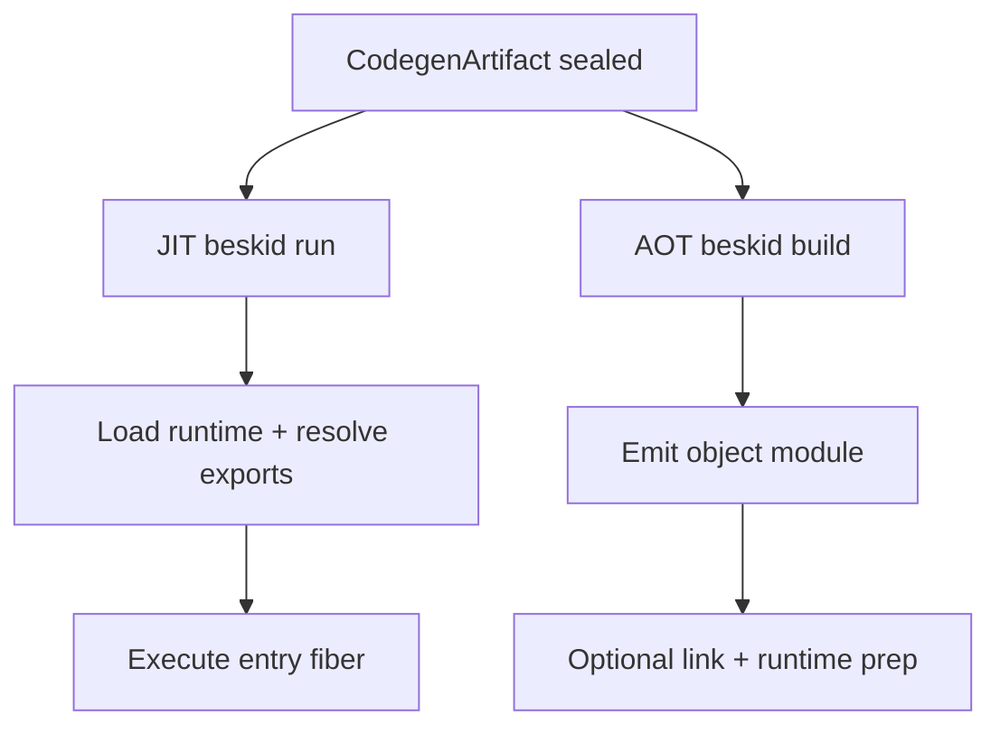
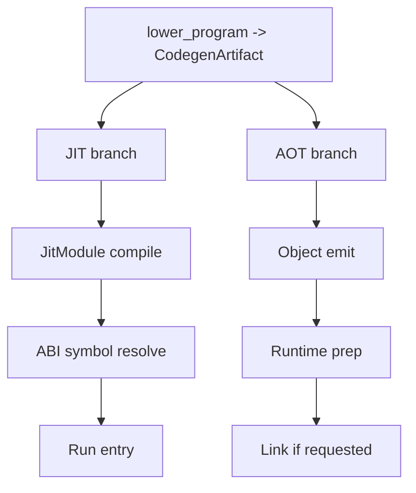

<!-- migrated from the legacy platform spec; canonical OpenSpec source -->
# Backends (JIT and AOT) Specification

## Purpose

Contracts for JIT execution and AOT object/link flows that consume a shared lowering artifact.
## Requirements
### Requirement: Feature hub authority: Decision [D-COMP-BUILD-0001]
The Beskid standard SHALL enforce the following migrated contract section. Accepted ADR decisions are binding; uppercase requirement keywords retain their BCP-14 meaning.

> This feature hub **owns** normative MUST/SHOULD contract text. Sibling articles **must not** redefine hub requirements and **should** link here for authority.

**Stable ID:** `BSP-REQ-76344D316A01`  
**Legacy source:** `site/spec-content/platform-spec/compiler/build-pipeline/backends-jit-aot/adr/0001-feature-hub-authority/content.md`  
**Source SHA-256:** `2bf2b525f2e0bb24376740e4e08fb04a7ce99c032105543ab0c8990aafacfbc1`

#### Scenario: Conformance exercises Decision
- **GIVEN** an implementation claims conformance with this capability
- **WHEN** behavior governed by this contract section is exercised
- **THEN** every MUST, SHALL, REQUIRED, prohibition, and accepted decision in the section is satisfied

### Requirement: Specification over implementation notes: Decision [D-COMP-BUILD-0002]
The Beskid standard SHALL enforce the following migrated contract section. Accepted ADR decisions are binding; uppercase requirement keywords retain their BCP-14 meaning.

> Normative platform-spec prose and ADRs under this feature **supersede** informal comments in implementation crates until explicitly migrated into spec text.

**Stable ID:** `BSP-REQ-C3D8F7D1A384`  
**Legacy source:** `site/spec-content/platform-spec/compiler/build-pipeline/backends-jit-aot/adr/0002-spec-over-implementation-notes/content.md`  
**Source SHA-256:** `81ae3c6b07b225f5b07805021d5f6172956ef30b0f4e790f537e4f71025e1ae0`

#### Scenario: Conformance exercises Decision
- **GIVEN** an implementation claims conformance with this capability
- **WHEN** behavior governed by this contract section is exercised
- **THEN** every MUST, SHALL, REQUIRED, prohibition, and accepted decision in the section is satisfied

### Requirement: Shared CodegenArtifact for JIT and AOT: Decision [D-COMP-BUILD-0003]
The Beskid standard SHALL enforce the following migrated contract section. Accepted ADR decisions are binding; uppercase requirement keywords retain their BCP-14 meaning.

> Both JIT (`beskid_engine::JitModule`) and AOT link flows **must** accept the same schema fields from `beskid_codegen` without forking lowering.

**Stable ID:** `BSP-REQ-CD8B19C86E87`  
**Legacy source:** `site/spec-content/platform-spec/compiler/build-pipeline/backends-jit-aot/adr/0003-shared-codegen-artifact-backends/content.md`  
**Source SHA-256:** `9cdf3332ecbeeb2cb4019aec13798d0e1a693addf80f4f3cd67530adc1aef7e3`

#### Scenario: Conformance exercises Decision
- **GIVEN** an implementation claims conformance with this capability
- **WHEN** behavior governed by this contract section is exercised
- **THEN** every MUST, SHALL, REQUIRED, prohibition, and accepted decision in the section is satisfied

### Requirement: Glue deterministic artifact closure
Rust Glue emission SHALL produce a versioned structured artifact containing backend, target/ABI/layout band, sorted binding identities, relative generated files and content digests, portable tool identities, declared link inputs and expected outputs; actual build results SHALL record output digests/status. Equivalent inputs SHALL emit identical files/manifests independent of discovery order, machine-local paths and timestamps. Materialization SHALL reject absolute paths, parent escape, duplicates, symlink escape and digest mismatch before effects, and promote complete output atomically. Ordinary Beskid code SHALL remain canonical CLIF/AOT; Glue SHALL emit adapters and build metadata rather than translate arbitrary Beskid method bodies into Rust. .NET SHALL remain unavailable until its separate profile/acceptance passes.

#### Scenario: Stable and confined artifacts
- **GIVEN** reordered equivalent bindings or escaping generated paths
- **WHEN** emission/materialization runs
- **THEN** equivalent output is byte-identical and escaping/duplicate/digest-invalid files are rejected (R4-GEN-01..03)

#### Scenario: Ordinary build independent
- **GIVEN** a CLIF Beskid project without Glue and no Rust/.NET tools
- **WHEN** it builds
- **THEN** no Glue external tooling is required

### Requirement: Bounded explicit Glue tool validation
Glue external builds SHALL resolve tools only from explicit path XOR prefix, never search-path/nearest-tool fallback. Each required tool SHALL be executable and interrogated with direct argv,10 s deadline and 1 MiB output cap; malformed/old version, unavailable target compilation/ABI proof, mismatched hash pin or absent tool SHALL fail before external build. Observed version, target evidence and executable sha256 SHALL always be recorded, and executable identity SHALL be rechecked immediately before spawn. C integer/float layout evidence and actual requested target compile/link capability SHALL be validated; host version/triple alone SHALL NOT prove target support.

#### Scenario: Tool failures bounded
- **GIVEN** missing/conflicting configuration, nonexecutable/drifted tool or a probe exceeding limits
- **WHEN** tool validation runs
- **THEN** typed failure prevents build without fallback and timed-out child is terminated/reaped (R4-TOOL-01..08)

#### Scenario: Target proof required
- **GIVEN** a host compiler exists but lacks requested target/link capability
- **WHEN** Glue validates the toolchain
- **THEN** it rejects before adapter build

#### Scenario: Tool changes after probe
- **GIVEN** tool bytes change after successful validation
- **WHEN** build is about to spawn
- **THEN** the recheck rejects changed identity before execution

### Requirement: Compiler owned external driver identity
Rust owner builds SHALL use the independently built compiler-owned native tool driver from the actual running executable's installed prefix. The compiler SHALL embed the driver's exact binary identity through the trusted build pipeline, bound to the complete current driver source inventory, Cargo package, target and successful executable artifact. Runtime sidecars, caller-selected wrapper paths and self-reported source digests SHALL NOT mint driver authority. Complete toolchain bundles SHALL include that exact executable. Each Rustc and native linker child invocation SHALL issue a bounded receipt of its actual canonical executable, unchanged SHA256, arguments and successful exit within the retained parent execution enclosure; configured executable hashes alone SHALL NOT count as observed invocations.

#### Scenario: Unqualified or replaced driver rejected
- **GIVEN** an unqualified compiler build, a missing bundled driver or replaced driver bytes
- **WHEN** an owning Rust image is built
- **THEN** the build rejects before invoking user Rust source without selecting an alternate wrapper

#### Scenario: Nested compilation retains cancellation authority
- **GIVEN** the owned driver has launched a native compiler descendant inside the producer enclosure
- **WHEN** the producer is cancelled or its absolute deadline expires
- **THEN** the compiler and its descendants are terminated and reaped through the shared execution service and no successful image admission is issued

### Requirement: Canonical closed Glue declaration facts
Rust Glue emission SHALL consume generation-bound registered Salsa binding/signature facts, preserving logical primitive, array-element, unit-return-only and owner-brand identities separately from physical C transport. String metadata SHALL use the canonical literal decoder and existing import/export authority. Duplicate attributes, duplicate or unknown metadata arguments, decoded NUL, unsupported raw-pointer/callback forms and unresolved nominal types SHALL fail before emission. Type closure SHALL be bounded across the complete signature (maximum depth64, aggregate1024 type nodes,256 parameters/generic binders), not only each recursive branch. Generic references SHALL retain issuing callable declaration and binder position; handle brands SHALL retain canonical qualified type declaration, applied arguments, library and nullability, rather than treating ordinary u64 or a spelling as ownership authority. The explicit `GlueHandle(Library, Nullable)` marker SHALL apply to a uniquely resolved nominal token declaration with exactly one u64 field; actual runtime owner validation SHALL remain mandatory and the marker SHALL never grant a caller-created token validity.

#### Scenario: Metadata cannot change ownership by ambiguity
- **GIVEN** duplicate or unknown Export/Extern/GlueHandle metadata, or decoded NUL
- **WHEN** the canonical binding query is requested
- **THEN** it rejects the declaration before artifacts or effects are produced

#### Scenario: Wide signatures obey the aggregate bound
- **GIVEN** individually shallow parameter types whose combined closure exceeds1024 nodes
- **WHEN** binding normalization runs
- **THEN** it rejects before allocating an unbounded normalized closure

#### Scenario: Generic and branded identity is preserved
- **GIVEN** a registered generic callable and an applied explicitly branded token type
- **WHEN** its binding fact is projected
- **THEN** binder owner/position and canonical qualified nominal/type-argument provenance are retained, and no ordinary u64 identity is accepted as a checked owner token

### Requirement: Canonical managed field classification for emitted descriptors

The compiler SHALL preserve managed-reference classification in generation-bound aggregate and applied generic field shapes independently of physical pointer ABI storage. Descriptor emission SHALL trace managed arrays and nominal references and SHALL exclude native pointer fields. Unknown specialized reference classification SHALL fail closed.

#### Scenario: Mixed native and managed fields
- **GIVEN** a registered aggregate containing a native pointer, managed array, nominal managed reference, and scalar word
- **WHEN** its canonical allocation descriptor is emitted
- **THEN** only the managed array and nominal reference slots appear in the pointer map
- **AND** native pointer storage retains its pointer ABI without being traced

### Requirement: Producer and loader issued Glue initialization

The native Glue producer SHALL emit a versioned initialization entry and SHALL verify its presence in the actual linked image. The loader SHALL pin the independently validated canonical shared provider before the artifact image and SHALL check both payload digests before and after loading. Initialization SHALL consume a borrowed synchronous host admission table issued from the private producer witness, compare the complete bounded compiled source and shape closure, and obtain a nonzero canonical library token. Generated images SHALL NOT authorize registration from their own JSON, rehashed metadata, raw token, or guessed source generation. Checked wrappers SHALL reject calls before successful initialization. Failed initialization SHALL publish no library token and SHALL release provisional roots and handles exactly once.

#### Scenario: Uninitialized image cannot publish managed output
- **GIVEN** a generated native image whose private producer witness has not been admitted by the loader
- **WHEN** a checked managed wrapper is called
- **THEN** it returns a declared failure with a zero output view and publishes no owner record

#### Scenario: Substituted closure fails host admission
- **GIVEN** a private producer witness for one complete source and shape closure
- **WHEN** initialization presents a substituted source digest or shape list, including self-consistent rehashed JSON
- **THEN** the host rejects initialization before calling generated code or publishing a library token

#### Scenario: Failed initialization may be retried without partial state
- **GIVEN** an initialization callback that returns failure after provisional setup
- **WHEN** the loader rolls back setup and subsequently attempts valid initialization
- **THEN** the previous attempt leaves no ready state or usable library token, releases provisional owned buffers, and valid initialization can establish the exact admitted closure; descriptor images already referenced by the process heap remain pinned until canonical heap destruction

### Requirement: Canonical library owner shape domain

The loader SHALL bind each canonical owner library exactly once to the complete admitted set of nonzero shape identities. The hidden bind transport SHALL accept at most 65,536 strictly increasing unsigned 64-bit identities and SHALL reject empty, duplicate, unsorted, stale, foreign, or repeated bindings before mutation. The domain SHALL reside in the source-defined library owner's traced payload and SHALL be published through canonical typed field assignment and its write barrier. Owned output admission SHALL prove domain membership before allocating or publishing a buffer. The process-wide 16 MiB owner budget SHALL include live library shape-domain bytes and outstanding owned buffer allocations, computed from the canonical rooted owner chain with checked addition; released domains and buffers SHALL contribute zero. Repeated bindings and budget exhaustion SHALL be rejected before temporary or managed allocation. This correlation domain SHALL NOT substitute for full compiled signature, source identity, descriptor, callback-address, and pinned-image validation.

#### Scenario: Unbound or unknown shape cannot allocate output
- **GIVEN** an unbound library or an admitted library whose domain does not contain the requested shape
- **WHEN** a managed output is requested
- **THEN** the provider rejects the request before allocation and returns a zero output view

#### Scenario: High unsigned shape identity remains exact
- **GIVEN** a validated library domain containing the maximum unsigned 64-bit identity
- **WHEN** an output request uses that exact identity
- **THEN** membership preserves all bits and succeeds without a signed reinterpretation

#### Scenario: Stale library cannot bind a fresh session
- **GIVEN** a library token issued before process shutdown
- **WHEN** a new process session attempts to bind that old token
- **THEN** the provider rejects it without changing the new session's owner domain

### Requirement: Checked library closure and allocation-free reclamation

The canonical provider SHALL close an admitted library only after validating its process, session, generation, and complete bounded owner chain. Closure SHALL revoke that library and release its owned buffers using the session's preadmitted traced empty payload and canonical typed write barrier, without allocating replacement managed payloads. Released records SHALL retain no managed buffer contents or native allocation size. Library closure SHALL NOT unload descriptor or callback images that may remain referenced by the process heap. Process shutdown SHALL validate the full chain before release and SHALL retain image owners through canonical heap destruction.

#### Scenario: Closed library cannot admit another owned output
- **GIVEN** a library owning live managed output buffers
- **WHEN** the private loader closes its exact library generation
- **THEN** the provider releases those buffers exactly once and rejects subsequent output or release attempts using that closed token

#### Scenario: Allocation failure does not prevent payload reclamation
- **GIVEN** a live admitted library and the session's rooted empty payload
- **WHEN** library closure occurs while no new managed allocation is available
- **THEN** closure uses the already admitted empty payload, clears retained payload contents through the canonical barrier, and requires no allocation

### Requirement: Consumer-branded opaque release follows privately admitted owner domains

The canonical shared provider SHALL expose a hidden checked consumer release transport `beskid_glue_v1_owner_release_consumer_opaque(u64 consumerLibrary, pointer completeBrand32, u64 token) -> i32`. It SHALL resolve the complete brand only through that consumer's live, once-bound loader-issued owner-domain closure and SHALL verify the actual owning library, generation, process, session, token kind, and complete owning brand before release. The caller SHALL NOT supply an owning library identity or destructor address. The provider SHALL retain no managed record pointer across an unlocked foreign callback; an internally copied scalar owner tuple SHALL be revalidated by the existing owning-library release operation. Revocation racing with release SHALL fail closed. Successful release SHALL tombstone the token before the actual admitted owning-image destructor executes exactly once. Foreign panic or failure SHALL return a checked status and SHALL NOT make the token reusable.

#### Scenario: Consumer releases a foreign-owned token through its exact brand
- **GIVEN** an actual compiled Rust owner image and a consumer image are admitted into one canonical process with an exact full-brand owner-domain binding
- **WHEN** the consumer releases a live token through that binding
- **THEN** the owning library's checked release runs its admitted destructor exactly once and all aliases of the token become stale (R4-OWN-12)

#### Scenario: Wrong brand and revoked owner deny consumer release before effects
- **GIVEN** a token with a different complete brand, a foreign session, or an owner revoked after consumer-domain lookup
- **WHEN** the hidden consumer release transport is invoked
- **THEN** it returns a checked failure without invoking a foreign destructor or accepting caller-supplied ownership metadata (R4-OWN-13)

### Requirement: Opaque Rust payload borrows retain a canonical owner lease
Generated Rust owner invocation SHALL obtain a nonzero process-issued borrow lease bound to the exact owning library, generation, full compiled brand, and live token before exposing a typed Rust reference. The provider SHALL publish that lease as an ordinary canonical traced OwnerRecord before returning the foreign payload address. Active leases SHALL make token release and library close return Busy without invoking the destructor. Borrow end SHALL validate the same full domain and consume the lease allocation-free using the preadmitted empty payload and canonical publication barrier. Generated invocation SHALL end the lease after success, typed error, or caught panic, and SHALL retain the provider and owning image through cleanup. Unpinned opaque resolve SHALL NOT remain an admitted invocation transport.
Owner records SHALL be bound to the runtime of the thread that opened it (the loader opening-thread restriction). A release from that thread during a live lease SHALL return Busy. A release from another operating-system thread SHALL NOT observe the lease or any other owner record and SHALL return Foreign. Neither result SHALL invoke the destructor or consume the token.

#### Scenario: R4-OWN-14 Reentrant release cannot invalidate an active borrow
- **GIVEN** an actual privately admitted Rust owner factory and typed invocation with a live borrow lease
- **WHEN** the invocation attempts token release or owning-library close
- **THEN** the provider returns Busy, no destructor runs, and the reference remains valid until borrow end

#### Scenario: R4-OWN-19 Foreign-thread release cannot observe an active borrow
- **GIVEN** an actual privately admitted Rust owner token with a live borrow lease on the thread that opened the runtime
- **WHEN** another operating-system thread releases the token, once or repeatedly
- **THEN** each release returns Foreign, no destructor runs, the borrowed call completes, and a later release on the opening thread succeeds exactly once

#### Scenario: R4-OWN-15 Borrow end rejects stale and foreign domains
- **GIVEN** an ended lease, a different library, or a different full brand
- **WHEN** borrow end is attempted
- **THEN** it fails closed without releasing another borrow or invoking a destructor

#### Scenario: R4-OWN-16 Borrow admission failure exposes no pointer
- **GIVEN** forced canonical record/root admission failure or an exhausted process identity
- **WHEN** borrow begin is attempted
- **THEN** both output pointer and lease are zero, no Rust reference is constructed, and token ownership remains unchanged

#### Scenario: R4-OWN-17 Panic completes the borrow before image teardown
- **GIVEN** an admitted typed Rust invocation that panics while holding a borrow
- **WHEN** its generated wrapper catches the panic
- **THEN** the wrapper ends the lease before returning a failure, keeps the provider/image pinned through end, and subsequent valid release invokes the destructor exactly once

### Requirement: Native Rust imports use a privately issued checked dispatch closure
Native Rust import adapters SHALL call only the exact checked status/out-parameter entry whose full binding identity and physical signature were issued by the current compiler and actual Rust-owner producer. The retained private loader SHALL validate the actual pinned image symbol owner, owning library, generation, and binding shape before issuing a once-bound import table. A public artifact packet, a source label, a rehashed file inventory, or an original raw scalar symbol SHALL NOT substitute for that closure. The adapter SHALL propagate nonzero status without publishing a result and SHALL release managed return transfers through the actual admitted owning library. The loader SHALL deny callable publication until every required import and opaque-owner domain has been admitted. Hidden function addresses SHALL remain native loader transport and SHALL NOT enter portable values or stdio frames.

#### Scenario: R4-ABI-18 Checked scalar failure cannot become success
- **GIVEN** a current source-issued scalar import and actual Rust checked entry
- **WHEN** the foreign entry reports a typed error or caught panic
- **THEN** the adapter preserves failure and publishes no scalar result

### Requirement: Fallible Rust imports return their status through checked export invocations
An import row SHALL be fallible when its Extern method declares `[RustOwner(Fallible:true)]`. An export row SHALL be fallible when its body reaches a fallible import through its direct-call closure. The packet SHALL record this fallibility on every row, and the row identity SHALL include it. The Rust owner build SHALL reject a callable whose fallibility differs from its issued import row.

The checked invocation of a fallible export SHALL admit a rooted failure cell, enter a runtime checked scope, and call a checked counterpart of the export body. The counterpart SHALL be the checked effect closure of the body. A Glue import in that closure SHALL be a leaf that calls the generated import adapter. A closure that the effect proof rejects SHALL fail the consumer build.

When a fallible import adapter receives a nonzero status inside the checked scope that the checked invocation of its thread entered, the adapter SHALL record the first status in the scope failure reason and SHALL return its zeroed output. The counterpart SHALL return before it uses that output. The checked invocation SHALL leave the scope, publish no result, and return the recorded status. A failure that the runtime records in the scope, such as an allocation failure, SHALL return status 3.

A nonzero status of a non-fallible import SHALL remain a terminal trap. A fallible import outside such a scope SHALL also trap. The direct export symbol of a fallible export SHALL run the ordinary body, so a fallible import failure through it SHALL trap.

#### Scenario: R4-ABI-19 Declared owner error reaches the checked export caller
- **GIVEN** a fallible export whose body returns the result of a fallible Rust factory, and an owner that returns its declared error 1 for an excessive length
- **WHEN** the checked export invocation is called with that length
- **THEN** it returns status 1, the output token remains zero, and no owner record is published

#### Scenario: R4-ABI-20 Non-fallible import failure stays terminal
- **GIVEN** a non-fallible import, or a fallible import called outside a Glue checked scope
- **WHEN** the owner entry returns a nonzero status
- **THEN** the adapter traps the process and does not return a zeroed output to Beskid code

#### Scenario: R4-ABI-21 Fallibility is part of the import identity
- **GIVEN** two otherwise identical packets that differ only in the `Fallible` value of one import
- **WHEN** the import rows are issued
- **THEN** their identities differ, and an owner built for one packet is not admitted for the other

#### Scenario: R4-ART-12 Missing or foreign import image denies publication
- **GIVEN** an import whose full binding identity has no unique privately produced owning image
- **WHEN** the loader prepares the consumer callable
- **THEN** it denies publication before any source or foreign callable effect

#### Scenario: R4-OWN-18 Managed imports release through their actual owner
- **GIVEN** a managed output transferred from an admitted Rust-owner image
- **WHEN** the adapter copies or rejects the output
- **THEN** it attempts exactly one checked release through that actual owning library and never substitutes a consumer-library token domain

### Requirement: Rust owner builds exclude ambient Cargo configuration
The Rust owner producer SHALL invoke Cargo only with its generated manifest and lock, `--offline --locked`, an explicit `--target` and `--target-dir`, and the Beskid-set `RUSTC`, wrapper and encoded flag values. Before spawning Cargo, it SHALL remove every inherited `CARGO_*`, `RUSTFLAGS`, `RUSTDOCFLAGS`, `RUSTC*` and `RUSTUP_TOOLCHAIN` variable from the child environment. It SHALL then set `CARGO_HOME` to an empty directory inside its staging area. The producer SHALL create its staging directory in the temporary directory that the caller's environment declares: `TMPDIR` on Unix, and `TMP`, then `TEMP`, on Windows when the value is an absolute path; otherwise the platform default. The producer SHALL reject the build when any ancestor of the staging directory, up to and including the root, contains `.cargo/config`, `.cargo/config.toml`, `rust-toolchain` or `rust-toolchain.toml`. Cargo merges ancestor configuration, and such files cannot be removed through `--config`. The probe and the build SHALL use the same working directory and environment.

#### Scenario: Inherited Cargo settings have no effect
- **GIVEN** inherited `RUSTC`, `RUSTFLAGS`, `CARGO_BUILD_RUSTFLAGS` and `CARGO_TARGET_DIR` values
- **WHEN** a Rust owner image is built
- **THEN** the receipts show only the explicitly selected rustc and linker, and the recorded Cargo arguments, encoded flags, target directory and tool identities equal those of a build without those variables

#### Scenario: Ancestor configuration fails closed
- **GIVEN** a `.cargo/config.toml` or `rust-toolchain.toml` in an ancestor of the staging directory
- **WHEN** a Rust owner image is built
- **THEN** the producer rejects the build and names the file before Cargo runs

### Requirement: Library output item selection
A library output (shared, static or object) SHALL contain every executable item of the units that the library owns, and the items of dependencies that those items reach, with one exception. An owned item SHALL NOT be in the output when the item or an item that it reaches calls a compiler SDK host callback (`__mod_semantic_*`, `__mod_query_*`) or a `Core.Args` service (`__args_*`), and the item is not an `[Export]` item. A host callback runs only inside a prepared native Mod invocation, and `Core.Args` reads the arguments that only an executable entry captures. A native Mod or an application that compiles the library from source keeps these items. An `[Export]` item that reaches a host callback or `Core.Args` SHALL fail the build. The build SHALL NOT report an internal compiler error for these items.

#### Scenario: Compiler SDK package builds as a library
- **GIVEN** the Corelib compiler SDK package, whose functions wrap host callbacks
- **WHEN** `beskid build` runs in the package directory
- **THEN** the build succeeds and the library output does not contain the callback wrappers

#### Scenario: Library that reads arguments
- **GIVEN** a library whose own function `pub string[] Arguments() { return Args.All(); }` has no `[Export]` attribute
- **WHEN** the library is built
- **THEN** the build succeeds and the library output does not contain `Arguments`

#### Scenario: Exported item that reads arguments
- **GIVEN** a library function with `[Export(Abi:"C", Symbol:"argument_count")]` that returns `Args.Count()`
- **WHEN** the library is built
- **THEN** the build fails with `Core.Args requires executable arguments`

### Requirement: JIT and AOT extern resolution
The JIT backend SHALL resolve required extern symbols as "Extern resolution fails closed" in `execution--abi-and-host--extern-dispatch-and-policy` states. The AOT backend SHALL fail with **E4050** (unresolved extern library) before it links when a required extern names a library that is not in the link libraries of the project or in the libraries of the runtime kit. An optional extern SHALL NOT cause E4050. Neither backend SHALL apply an allow list or a deny list from the environment. Neither backend SHALL fall back to the other mode when it fails.

#### Scenario: AOT library not linked
- **GIVEN** a required extern whose library is not in the project link libraries
- **WHEN** the AOT backend builds the artifact
- **THEN** the build fails with **E4050** that names the library and the symbol

#### Scenario: No silent fallback
- **GIVEN** a JIT extern resolution that fails
- **WHEN** the backend reports the failure
- **THEN** it reports a diagnostic and does not try an AOT build

### Requirement: Target CPU baseline
The compiler SHALL build every Cranelift target ISA from one baseline for each target. AOT object emission, the JIT and the compiler tests SHALL use the same baseline for a target. For `x86_64-unknown-linux-gnu` and `x86_64-pc-windows-msvc` the baseline SHALL be the x86-64-v2 microarchitecture level of the x86-64 psABI: SSE3, SSSE3, SSE4.1, SSE4.2, POPCNT, CMPXCHG16B and LAHF-SAHF. For `aarch64-apple-darwin` the baseline SHALL be Armv8.0-A with no optional extension. The compiler SHALL NOT enable a CPU feature above the baseline, also when the host CPU has the feature. A program built for an x86_64 target SHALL require a CPU with x86-64-v2.

#### Scenario: Cross build uses the baseline
- **GIVEN** a host with an x86-64-v4 CPU
- **WHEN** the user builds a program for `x86_64-unknown-linux-gnu`
- **THEN** the object uses no instruction above x86-64-v2

#### Scenario: JIT and AOT agree
- **GIVEN** one program
- **WHEN** the JIT and an AOT build for the host target compile it
- **THEN** both use the same target baseline

### Requirement: JIT host CPU check
Before the JIT generates code, it SHALL check that the host CPU has every feature of the host target baseline. If a feature is missing, the JIT SHALL stop with an error that names the baseline and each missing feature, and SHALL NOT run code.

#### Scenario: Old CPU
- **GIVEN** an x86_64 host without SSE4.2
- **WHEN** the user runs a program with the JIT
- **THEN** the run stops with an error that names x86-64-v2 and SSE4.2

### Requirement: No Cranelift runtime helpers
Generated machine code SHALL NOT call a Cranelift runtime helper (a symbol whose name starts with `__cranelift_`), because no runtime kit defines one. If the compilation of a function produces such a call, the AOT build SHALL stop with code **E4004** before the link step. The message SHALL name the function, the helper symbol and the target. The JIT SHALL stop with the same message before it runs code.

#### Scenario: Vector shuffle on x86_64
- **GIVEN** a program that uses the Corelib AES or ChaCha20 code
- **WHEN** the user builds it for `x86_64-unknown-linux-gnu`
- **THEN** the object has no undefined `__cranelift_` symbol, and the program links and runs

#### Scenario: Helper call is a compile error
- **GIVEN** a function whose compiled code calls `__cranelift_x86_pshufb`
- **WHEN** the AOT build compiles it
- **THEN** the build stops with E4004 that names the function and `__cranelift_x86_pshufb`, and the link step does not start

## Informative Source Provenance

The records below preserve migration history and are not normative except where text was extracted into a requirement above.

### Source Record: Backends (JIT and AOT)

**Authority:** informative provenance  
**Legacy path:** `/platform-spec/compiler/build-pipeline/backends-jit-aot/`  
**Source:** `site/spec-content/platform-spec/compiler/build-pipeline/backends-jit-aot/content.md`  
**SHA-256:** `ed109721fcd37a1fbf934b0f54627204af9785ba4b88cf77b6a94b3696c3d7bf`

<details>
<summary>Migrated source text</summary>

``````markdown
This feature hub defines how JIT and AOT diverge after lowering while sharing the same `CodegenArtifact`.

## Implementation anchors
- `compiler/crates/beskid_engine/src/` — JIT execution of `CodegenArtifact` via Cranelift
- `compiler/crates/beskid_aot/src/` — AOT compilation, object emission, and linking
- `compiler/crates/beskid_codegen/src/` — shared `CodegenArtifact` consumed by both backends

## Decisions
<!-- spec:generate:adr-index -->
No open decisions. Closed choices are normative ADRs under **`adr/`** (`D-COMP-BUILD-0001` … `D-COMP-BUILD-0003`); use the reader **ADRs** tab for expandable detail.
<!-- /spec:generate:adr-index -->
## Articles
<!-- spec:generate:article-index -->
- [Backends (JIT and AOT) - Contracts and edge cases](./articles/contracts-and-edge-cases/)
- [Backends (JIT and AOT) - Design model](./articles/design-model/)
- [Backends (JIT and AOT) - Examples](./articles/examples/)
- [Backends (JIT and AOT) - FAQ and troubleshooting](./articles/faq-and-troubleshooting/)
- [Backends (JIT and AOT) - Flow and algorithm](./articles/flow-and-algorithm/)
- [Backends (JIT and AOT) - Verification and traceability](./articles/verification-and-traceability/)
<!-- /spec:generate:article-index -->
``````

</details>

### Source Record: Feature hub authority

**Authority:** informative provenance  
**Legacy path:** `/platform-spec/compiler/build-pipeline/backends-jit-aot/adr/0001-feature-hub-authority/`  
**Source:** `site/spec-content/platform-spec/compiler/build-pipeline/backends-jit-aot/adr/0001-feature-hub-authority/content.md`  
**SHA-256:** `2bf2b525f2e0bb24376740e4e08fb04a7ce99c032105543ab0c8990aafacfbc1`

<details>
<summary>Migrated source text</summary>

``````markdown
## Context

Sibling articles under this feature previously restated requirements in inconsistent forms.

## Decision

This feature hub **owns** normative MUST/SHOULD contract text. Sibling articles **must not** redefine hub requirements and **should** link here for authority.

## Consequences

Contract changes start on the hub or in linked ADRs, then propagate to articles and implementation anchors.

## Verification anchors

- `site/website/src/content/docs/platform-spec/compiler/build-pipeline/backends-jit-aot/index.mdx`
- `article bundle under the same feature directory.`
``````

</details>

### Source Record: Specification over implementation notes

**Authority:** informative provenance  
**Legacy path:** `/platform-spec/compiler/build-pipeline/backends-jit-aot/adr/0002-spec-over-implementation-notes/`  
**Source:** `site/spec-content/platform-spec/compiler/build-pipeline/backends-jit-aot/adr/0002-spec-over-implementation-notes/content.md`  
**SHA-256:** `81ae3c6b07b225f5b07805021d5f6172956ef30b0f4e790f537e4f71025e1ae0`

<details>
<summary>Migrated source text</summary>

``````markdown
## Context

Implementation crates accumulated informal notes that diverged from published contracts.

## Decision

Normative platform-spec prose and ADRs under this feature **supersede** informal comments in implementation crates until explicitly migrated into spec text.

## Consequences

Engineers file spec/ADR updates when behavior changes; crate comments are non-authoritative for conformance arguments.

## Verification anchors

- `compiler/crates/beskid_analysis/`
``````

</details>

### Source Record: Shared CodegenArtifact for JIT and AOT

**Authority:** informative provenance  
**Legacy path:** `/platform-spec/compiler/build-pipeline/backends-jit-aot/adr/0003-shared-codegen-artifact-backends/`  
**Source:** `site/spec-content/platform-spec/compiler/build-pipeline/backends-jit-aot/adr/0003-shared-codegen-artifact-backends/content.md`  
**SHA-256:** `9cdf3332ecbeeb2cb4019aec13798d0e1a693addf80f4f3cd67530adc1aef7e3`

<details>
<summary>Migrated source text</summary>

``````markdown
## Context

Lowering produces one `CodegenArtifact`; backend selection happens after semantic gates complete.

## Decision

Both JIT (`beskid_engine::JitModule`) and AOT link flows **must** accept the same schema fields from `beskid_codegen` without forking lowering.

## Consequences

Backend-specific options attach at execution time; lowering stays single-path.

## Verification anchors

- `compiler/crates/beskid_engine/src/jit_module.rs`
- `compiler/crates/beskid_codegen`
- `compiler/crates/beskid_tests/src/runtime/jit.rs`.
``````

</details>

### Source Record: Backends (JIT and AOT) - Contracts and edge cases

**Authority:** informative provenance  
**Legacy path:** `/platform-spec/compiler/build-pipeline/backends-jit-aot/articles/contracts-and-edge-cases/`  
**Source:** `site/spec-content/platform-spec/compiler/build-pipeline/backends-jit-aot/articles/contracts-and-edge-cases/content.md`  
**SHA-256:** `3a6d2e6da691bac095bf7ffe46bf6ed35068a3c922fd81476f33083040773adc`

<details>
<summary>Migrated source text</summary>

``````markdown
- JIT and AOT must not diverge in front-end semantic results for the same source.
- Entrypoint contract for executables requires symbol `main` in current AOT linker strategy.
- AOT supports `Exe`, `SharedLib`, `StaticLib`, and `ObjectOnly` output kinds, with platform limits enforced by linker strategy checks.
- Static archive merge currently targets Unix-style toolchains (`ar`/`ranlib` or `libtool` on Apple hosts); Windows static archive merge is rejected as unsupported.
- JIT extern resolution has no feature flag and no allow or deny list; a required extern that does not resolve fails compilation.
- Backend failures should report compile/build diagnostics, not silently fallback to alternate modes.
``````

</details>

### Source Record: Backends (JIT and AOT) - Design model

**Authority:** informative provenance  
**Legacy path:** `/platform-spec/compiler/build-pipeline/backends-jit-aot/articles/design-model/`  
**Source:** `site/spec-content/platform-spec/compiler/build-pipeline/backends-jit-aot/articles/design-model/content.md`  
**SHA-256:** `d047bb3c81bcb6c93d43ec7b7cec15cdc9ea2e36200076a77818f046d09aca40`

<details>
<summary>Migrated source text</summary>

``````markdown
## Backend split



- **JIT path** (`beskid run`): compile artifact in-process and execute resolved entrypoint.
- **AOT path** (`beskid build`): emit object, optionally prepare runtime, optionally link native output.

Both paths **must** consume the same lowering artifact contract. JIT and AOT **must not** rebuild [`ProgramAssembly`](/platform-spec/compiler/build-pipeline/program-assembly/) or re-resolve `CompilePlan`; assembly is owned by `beskid_analysis` front-end services only.
``````

</details>

### Source Record: Backends (JIT and AOT) - Examples

**Authority:** informative provenance  
**Legacy path:** `/platform-spec/compiler/build-pipeline/backends-jit-aot/articles/examples/`  
**Source:** `site/spec-content/platform-spec/compiler/build-pipeline/backends-jit-aot/articles/examples/content.md`  
**SHA-256:** `f20b5ea3bf4f6a4b9a4328e5443461486d3ba8160a47631391d6d1085703e7d2`

<details>
<summary>Migrated source text</summary>

``````markdown
- **`beskid run` success:** JIT compiles and runs `main`, returning a formatted value string.
- **`beskid build --kind exe`:** AOT emits object, prepares runtime artifacts, then links executable.
- **`beskid build --kind object`:** AOT stops after object emission and skips link stage.
- **Bad entrypoint:** backend reports entrypoint resolution/signature diagnostic.
``````

</details>

### Source Record: Backends (JIT and AOT) - FAQ and troubleshooting

**Authority:** informative provenance  
**Legacy path:** `/platform-spec/compiler/build-pipeline/backends-jit-aot/articles/faq-and-troubleshooting/`  
**Source:** `site/spec-content/platform-spec/compiler/build-pipeline/backends-jit-aot/articles/faq-and-troubleshooting/content.md`  
**SHA-256:** `a5f549adc63d6971b07e30fcfc847b680d700589f943b66035045e21af3f9eac`

<details>
<summary>Migrated source text</summary>

``````markdown
## Why does `run` pass but `build --kind exe` fail?
Linking and runtime packaging are AOT-only steps; inspect linker/runtime preparation diagnostics.

## Why does object-only build skip runtime files?
`ObjectOnly` intentionally omits runtime preparation and native linking.

## Why does `build --kind static` fail on Windows targets?
Current static archive merge is implemented for Unix-style toolchains (`ar`/`ranlib`, and `libtool` on Apple hosts). Windows static archive merge currently returns an unsupported-linker-strategy error.

## Why does `build --kind exe --entrypoint foo` fail?
Current executable linker strategy requires entrypoint symbol `main`; alternate executable entrypoint names are rejected.

## Can JIT use a different lowering path?
Not in the current contract; both backends share the same lowering entrypoint.
``````

</details>

### Source Record: Backends (JIT and AOT) - Flow and algorithm

**Authority:** informative provenance  
**Legacy path:** `/platform-spec/compiler/build-pipeline/backends-jit-aot/articles/flow-and-algorithm/`  
**Source:** `site/spec-content/platform-spec/compiler/build-pipeline/backends-jit-aot/articles/flow-and-algorithm/content.md`  
**SHA-256:** `2a6e757568624578c5b135919d0dcc47cdfe6b8c80b92af00e7a8c907de45088`

<details>
<summary>Migrated source text</summary>

``````markdown


## JIT flow

1. Lower source with diagnostics.
2. Compile artifact in `JitModule`.
3. Resolve and validate entrypoint against manifest.
4. Execute and return formatted result.

## AOT flow

1. Lower source with diagnostics.
2. Build request from CLI flags.
3. Emit object module.
4. Prepare runtime and link when output kind requires it.
``````

</details>

### Source Record: Backends (JIT and AOT) - Verification and traceability

**Authority:** informative provenance  
**Legacy path:** `/platform-spec/compiler/build-pipeline/backends-jit-aot/articles/verification-and-traceability/`  
**Source:** `site/spec-content/platform-spec/compiler/build-pipeline/backends-jit-aot/articles/verification-and-traceability/content.md`  
**SHA-256:** `9543f5b06b0738d9a991cd3a59e9884655f2989fe01b9c8477e0656a226a71c9`

<details>
<summary>Migrated source text</summary>

``````markdown
Implementation anchors:

- `compiler/crates/beskid_engine/src/services.rs`
- `compiler/crates/beskid_engine/src/jit_module.rs`
- `compiler/crates/beskid_aot/src/api.rs`
- `compiler/crates/beskid_aot/src/linker.rs`
- `compiler/crates/beskid_cli/src/commands/build.rs`

Evidence should include JIT runtime tests in `compiler/crates/beskid_tests/src/runtime/` and AOT contract tests in `compiler/crates/beskid_tests/src/aot/`.

``````

</details>
