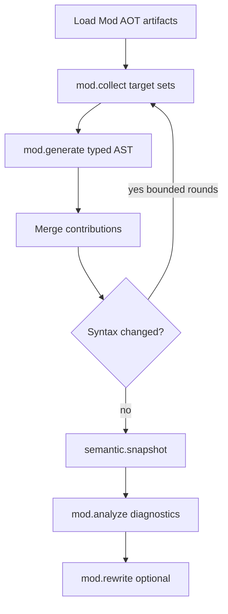

<!-- migrated from the legacy platform spec; canonical OpenSpec source -->
# Mod host bridge Specification

## Purpose

Reference compiler-owned execution, capability policy, and communication with compile-time Beskid modules.
## Requirements
### Requirement: Feature hub authority: Decision [D-COMP-MODS-0010]
The Beskid standard SHALL enforce the following migrated contract section. Accepted ADR decisions are binding; uppercase requirement keywords retain their BCP-14 meaning.

> This feature hub **owns** normative MUST/SHOULD contract text. Sibling articles **must not** redefine hub requirements and **should** link here for authority.

**Stable ID:** `BSP-REQ-847B3421C406`  
**Legacy source:** `site/spec-content/platform-spec/compiler/compiler-mods/mod-host-bridge/adr/0001-feature-hub-authority/content.md`  
**Source SHA-256:** `fe02ec04a412e99592a0515f5cf2fcc9196dd11a6337394b72b4a2908775d313`

#### Scenario: Conformance exercises Decision
- **GIVEN** an implementation claims conformance with this capability
- **WHEN** behavior governed by this contract section is exercised
- **THEN** every MUST, SHALL, REQUIRED, prohibition, and accepted decision in the section is satisfied

### Requirement: Specification over implementation notes: Decision [D-COMP-MODS-0011]
The Beskid standard SHALL enforce the following migrated contract section. Accepted ADR decisions are binding; uppercase requirement keywords retain their BCP-14 meaning.

> Normative platform-spec prose and ADRs under this feature **supersede** informal comments in implementation crates until explicitly migrated into spec text.

**Stable ID:** `BSP-REQ-18C731BA3BCD`  
**Legacy source:** `site/spec-content/platform-spec/compiler/compiler-mods/mod-host-bridge/adr/0002-spec-over-implementation-notes/content.md`  
**Source SHA-256:** `879eec7a560a004c3a9dd0a09453b7d6535d6ec64acba241353265fb110c0adc`

#### Scenario: Conformance exercises Decision
- **GIVEN** an implementation claims conformance with this capability
- **WHEN** behavior governed by this contract section is exercised
- **THEN** every MUST, SHALL, REQUIRED, prohibition, and accepted decision in the section is satisfied

### Requirement: Mod host AOT-only with descriptor registration: Decision [D-COMP-MODS-0012]
The Beskid standard SHALL enforce the following migrated contract section. Accepted ADR decisions are binding; uppercase requirement keywords retain their BCP-14 meaning.

> Contract discovery uses `(contractId, typeId, entrySymbol)` tuples; failures emit E1821–E1870 before `mod.collect`.

**Stable ID:** `BSP-REQ-58DE9BF21A00`  
**Legacy source:** `site/spec-content/platform-spec/compiler/compiler-mods/mod-host-bridge/adr/0003-mod-aot-only-registration/content.md`  
**Source SHA-256:** `29299dc25ad28c5686b6990d6c7075053bb61dea568818db8b36d390315f9ccd`

#### Scenario: Conformance exercises Decision
- **GIVEN** an implementation claims conformance with this capability
- **WHEN** behavior governed by this contract section is exercised
- **THEN** every MUST, SHALL, REQUIRED, prohibition, and accepted decision in the section is satisfied

### Requirement: Registered executable callable identities
Native Mod preparation SHALL derive each executable callable identity from its exact current registered declaration key, concrete signature and actual emitted function in the same typed codegen artifact. Declaration leaf names and caller-supplied linker symbols SHALL NOT establish callable authority. Equal leaf names in separate owners SHALL retain distinct callable identities. Stale, foreign, unavailable or unapplied generic declaration keys SHALL NOT resolve to an executable callable. A physical pointer signature alone SHALL NOT authorize casting a native host request into a Beskid SDK object; the native bridge SHALL construct and extract typed SDK values through canonical layout authority.

#### Scenario: Equal method names retain exact emitted identities (MOD-06-09)
- **GIVEN** distinct registered function and method declarations with the same leaf name
- **WHEN** the prepared module emits them and a native bridge selects either declaration
- **THEN** exact keys resolve to their distinct emitted symbols and concrete signatures, without leaf-name matching

#### Scenario: Stale callable selection rejected (MOD-06-10)
- **GIVEN** an emitted prepared module and a declaration key from another generation or source owner
- **WHEN** a native bridge requests the callable
- **THEN** no executable identity is returned and no invocation occurs

#### Scenario: Contract discovery retains registered declaration identity (MOD-06-11)
- **GIVEN** types declaring separate contracts whose methods have the same leaf name
- **WHEN** native adapter preparation discovers their conformances
- **THEN** each conformance resolves to its exact registered contract declaration key, including exact receiver identity for impl blocks
- **AND** discovery alone does not establish canonical SDK provenance or a validated implementation witness

#### Scenario: Equal pointer ABI does not authorize different request types (MOD-06-12)
- **GIVEN** a contract method expecting a string and a declared implementation accepting a byte array
- **WHEN** native adapter preparation validates the implementation witness
- **THEN** the differing source identities reject the implementation even though both use pointer ABI representation
- **AND** witnesses from another project or generation are unavailable before native invocation

#### Scenario: Native requests use typed SDK constructors (MOD-06-13)
- **GIVEN** a validated native invocation context and canonical SDK request declarations
- **WHEN** the bridge constructs compilation, workspace, catalog and contract request values
- **THEN** ordinary typed SDK constructors allocate the exact managed objects with compiler-emitted descriptors and field tracing
- **AND** each returned object is rooted before another allocation, without casting native request memory into SDK objects

### Requirement: Actual assembly generation authority for native Mods
Production Mod collection/generation/analysis and typed pipeline operations SHALL carry the current `ProgramAssembly.SyntaxGenerationId` or identical registered Salsa syntax generation. Absent generation SHALL explicitly mean unavailable authority; zero or a hardcoded epoch SHALL NOT authorize structural construction, query or pipeline edits. The native structural request, host arena, read-only query surface and resulting node provenance SHALL agree on owner/generation; changes to source assembly SHALL invalidate stale handles and facts.

#### Scenario: Current assembly identity reaches generator (MOD-06-07)
- **GIVEN** an assembled source generation and a native structural Mod
- **WHEN** production dispatch and typed pipeline merge run
- **THEN** request/arena/query/merge use that exact generation rather than hardcoded zero or one

#### Scenario: Stale or absent authority rejected (MOD-06-08)
- **GIVEN** a previous-generation handle or no assembled generation
- **WHEN** a structural constructor/query/edit is requested
- **THEN** it rejects before effects instead of fabricating an epoch or rebuilding a shadow semantic model

### Requirement: Every discovered Mod has a qualified executable artifact
The host SHALL reject a discovered Mod dependency lacking its validated executable descriptor before collection, generation, analysis or rewrite. The host SHALL construct default dispatch solely from validated executable artifact paths and SHALL NOT install a recording stub when an invoker is absent. Absence of Mod dependencies SHALL continue to skip Mod execution.

#### Scenario: Missing descriptor cannot silently disable a dependency (MOD-06-14)
- **GIVEN** a discovered Mod dependency with no executable descriptor
- **WHEN** native invoker preparation or collection is requested
- **THEN** preparation fails with the dependency identity and collection cannot succeed with empty registrations

### Requirement: Source-qualified Mod instance construction
A native adapter SHALL obtain each managed contract receiver through an exact registered source factory with a nominally matching result, or through a current field-free aggregate construction proven by canonical layout facts. The canonical `ModFactory<T>` contract SHALL expose `T Create(CollectRequest context)`; an applied implementation witness SHALL preserve the exact nominal T rather than its physical pointer representation. Factory receivers SHALL satisfy the same construction rules. Construction cycles, missing factories, ambiguous factories and incompatible factory results SHALL fail before contract invocation. The host SHALL root each constructed managed receiver before further allocation and SHALL NOT pass a null receiver or manufacture field defaults.

#### Scenario: Stateful receiver is fully initialized by its source factory (MOD-06-15)
- **GIVEN** a registered Mod receiver with fields and an exact source factory conforming to ModFactory of that receiver
- **WHEN** its native adapter is prepared and invoked
- **THEN** the factory receives the typed current collection context, returns the exact managed receiver and the adapter roots it before calling the validated contract method

#### Scenario: Physically equal foreign factory result is rejected (MOD-06-16)
- **GIVEN** a factory returning a different nominal receiver whose native representation is also a pointer
- **WHEN** native adapter preparation validates the factory
- **THEN** it rejects before native invocation without casting the factory result or inventing defaults

### Requirement: Current-source executable cache selection
The host SHALL inspect executable cache candidates against the current complete source, manifest, lock, SDK, target and runtime-provider closure. It SHALL select only one qualified current candidate, SHALL NOT select the lexicographically first or most recent candidate, and SHALL reject multiple qualified candidates as ambiguous. Stale candidates SHALL NOT establish execution authority. If no current candidate qualifies, the failure SHALL identify the need to rebuild rather than execute stale source.

#### Scenario: Stale cache cannot outrank current source (MOD-06-17)
- **GIVEN** a lexicographically earlier stale executable and one qualified executable matching the complete current closure
- **WHEN** the host prepares the Mod dependency
- **THEN** only the qualified current executable is selected

#### Scenario: Two qualified executables are ambiguous (MOD-06-18)
- **GIVEN** two distinct cache candidates qualifying for the same current Mod dependency
- **WHEN** the host selects its native executable
- **THEN** preparation fails before collection with an ambiguity diagnostic instead of choosing by path or timestamp

### Requirement: Issued compilation syntax entry root
The typed SDK Compilation request SHALL carry an entryRoot with the canonical nominal NodeRef source type. The host SHALL issue it from the actual borrowed registered assembly, preserving its source unit, current syntax generation, root node and active invocation issuer. File names, mutable counters and user-created pointer-shaped values SHALL NOT establish entry-root authority. Query traversal SHALL consume issued roots and validate every referenced owner, generation and invocation before projecting facts. Generic visitors SHALL execute Enter and Exit in Beskid source around recursive Children traversal; visitor receivers and function pointers SHALL NOT cross the host callback transport.

#### Scenario: Compilation supplies its actual registered root (MOD-06-19)
- **GIVEN** a native Mod invocation with a registered source assembly
- **WHEN** its typed compilation request is constructed
- **THEN** entryRoot identifies that assembly's actual root with the active issuer and generation, and Query accepts it without reconstructing syntax from a file path

#### Scenario: SDK field uses a qualified nominal leaf
- **GIVEN** a SDK declaration with a fully qualified nominal field type whose homonymous source module is not separately imported
- **WHEN** the production dependency closure is assembled
- **THEN** the complete nominal source module is materialized and its field retains the exact nominal type identity

#### Scenario: Foreign root and visitor pointer are rejected (MOD-06-20)
- **GIVEN** a NodeRef from another assembly or closed invocation, or a visitor receiver offered as a raw pointer
- **WHEN** a native query or traversal is requested
- **THEN** stale or foreign query authority is rejected and visitor execution remains in typed Beskid source

### Requirement: Bounded flat SDK syntax collections
Generated SDK mirrors of Rust syntax vectors SHALL use a canonical managed array record with one typed items field. The machine correspondence SHALL identify this representation explicitly and preserve every element's order, source metadata and numeric width. Native transport SHALL bound collection count and bytes independently of structural nesting depth; a flat collection SHALL NOT consume one structural depth level per element. Generation and invocation SHALL reject the retired recursive Cons/Empty representation rather than retaining a compatibility decoder.

#### Scenario: Flat collection exceeds the nesting limit (MOD-06-21)
- **GIVEN** an issued syntax projection containing 257 flat elements and an admitted structural depth bound of 128
- **WHEN** it crosses the generated typed SDK and native callback transport
- **THEN** all elements retain their exact order and values without constructing a recursive list or increasing the stack depth limit

#### Scenario: Collection exceeds its independent count budget (MOD-06-22)
- **GIVEN** a syntax collection exceeding the invocation's admitted element count or byte budget
- **WHEN** a worker constructs or returns that collection
- **THEN** invocation fails before publishing a contribution, and the structural depth limit is unchanged

### Requirement: Lossless generated declaration wrappers
Native typed syntax contributions SHALL transport complete SpannedContractDefinition, SpannedTypeDefinition and SpannedFunctionDefinition values, including their source span and node identity. The host SHALL map those wrappers through the canonical machine correspondence and issue fresh merged syntax generation authority. Bare declaration payloads SHALL NOT be accepted as a compatibility substitute or supplied with fabricated wrapper metadata.

#### Scenario: Generated declaration retains its wrapper (MOD-06-23)
- **GIVEN** a qualified generator returning a complete typed declaration wrapper
- **WHEN** the native host translates and merges the contribution
- **THEN** its source span and declaration contents are preserved and its resulting semantic authority belongs to the newly registered merged generation

### Requirement: Owned native invocation transport
The host SHALL transport compiler-issued compilation, workspace, package, and target context as owned typed values through the isolated ABI2 worker. Public pointer views and raw image paths SHALL NOT issue executable native authority. AttributeGenerator contributions SHALL retain their complete source SpannedAttributeDeclaration wrappers through typed decoding and fresh-generation merge.

#### Scenario: Owned request remains valid after context cloning
- **GIVEN** a qualified native contract and an owned compilation request
- **WHEN** the request is cloned and transported to the isolated worker
- **THEN** strings, package registrations, and target arrays SHALL retain their exact values without borrowed host pointer views
- **AND** callbacks SHALL borrow only the current invocation authority on its owning thread

#### Scenario: MOD-06-24 Attribute declaration metadata survives execution
- **GIVEN** an AttributeGenerator returning a source-issued SpannedAttributeDeclaration
- **WHEN** the host decodes and merges its contribution
- **THEN** the declaration node, source span, and node identifier SHALL remain intact
- **AND** the merged program SHALL receive a fresh registered generation

### Requirement: Staged native entry failure status
A generated CABI2 Mod entry SHALL return status 0 only with a nonzero encoded result. On failure it SHALL return the status of the failed stage: 1 when the header or the request decoding fails, 2 when the factory or the contract method fails, 3 when result encoding fails, and 4, 5 or 6 when result encoding exceeds the transport depth bound (128), the transport work bound (1048576 values) or the transport byte bound (16 MiB). The host SHALL reject every nonzero status and SHALL name the failed stage in the invocation error. The transport bounds SHALL NOT be raised for an individual Mod.

#### Scenario: MOD-06-34 Oversized result names the exceeded bound
- **GIVEN** a Generator whose typed result needs more encoded values than the transport work bound
- **WHEN** the host invokes it through the isolated worker
- **THEN** the entry returns status 5, no contribution is published, and the invocation error names the work bound

### Requirement: Owned typed rewriter replacement
An admitted native rewriter SHALL be able to return a newly constructed typed program item or direct declaration projection. The registered syntax provider SHALL validate its canonical Rust AST kind, bounded structure and current host-owned target before queuing replacement. Replacement SHALL retain the target's outer source provenance and leading documentation; supplied numeric node identities SHALL NOT issue generation authority. Applying the pipeline SHALL publish an owned program for fresh-generation registration.

#### Scenario: Rewriter constructs a new declaration
- **GIVEN** a current issued host declaration and an admitted typed rewriter
- **WHEN** the rewriter returns a newly constructed canonical declaration projection
- **THEN** the provider queues its typed replacement without requiring an existing replacement NodeRef or textual parsing

#### Scenario: Forged target or malformed projection
- **GIVEN** a foreign target, a mismatched projection kind or an over-budget replacement
- **WHEN** owned replacement is requested
- **THEN** the provider rejects it before mutating the pending program

### Requirement: Immutable prepared executable issuance
Prepared executable entries and their emitted artifact SHALL form an immutable compiler-issued packet with read-only inspection. A private initialization or native authority plan SHALL remain bound to the exact lowered bodies, data, imports, exports and descriptor plans. Consuming or cloning a general codegen artifact SHALL NOT permit altered contents to retain privileged initialization authority; privileged emission SHALL validate the complete private structural binding before emission.

#### Scenario: Caller cannot substitute a prepared body
- **GIVEN** an issued prepared entrypoint packet
- **WHEN** a caller inspects its entries and emitted artifact
- **THEN** its public API provides no mutable field or replacement constructor

#### Scenario: Cloned artifact has changed body or descriptor data
- **GIVEN** a cloned artifact retaining a private initialization plan
- **WHEN** its body, data, imports, exports or descriptor plans differ from the issued snapshot
- **THEN** privileged emission rejects the artifact before generating an executable initializer

### Requirement: Directional native transport closure
The native producer SHALL derive separate recursive codec closures from issued entry and callback signatures. Host-to-source decoding SHALL include entry requests, factory requests and callback results; source-to-host encoding SHALL include entry results and callback parameters. Exact source constructors SHALL be required for decoded nominal values. Output-only nominal values SHALL use their issued layouts and encoders without fabricated constructors or unrelated decoding requirements.

#### Scenario: Generated result has no input constructor
- **GIVEN** an issued generated contribution or result type used only as an entry result
- **WHEN** native transport is emitted
- **THEN** its recursive encoder is emitted without requiring or inventing a source constructor

#### Scenario: Callback result requires a constructor
- **GIVEN** a nominal type used as a callback result with no issued source constructor
- **WHEN** native transport is emitted
- **THEN** preparation fails before invocation

### Requirement: Compiler SDK dependency closure
The compiler SDK package SHALL declare its Foundation dependency explicitly through the canonical project graph. SDK source imports of Core collections, Optional, and Results SHALL resolve at their package-native `Core.*` paths from that verified dependency closure, without a source-authority bypass.

#### Scenario: MOD-06-27 SDK compilation resolves Foundation source imports
- **GIVEN** the installed compiler SDK package and its declared Foundation dependency
- **WHEN** the canonical resolver prepares the SDK for native Mod compilation
- **THEN** Core.Collections.Array, Core.Optional, and Core.Results resolve through the dependency graph and retain preparation-issued package provenance

### Requirement: Exclusive typed native Mod protocol
Native Mod execution SHALL use the qualified CABI2 producer and invocation-scoped owned transport. The compiler SHALL NOT expose raw V1 request mirrors, pointer-valued structural contribution handles, or the legacy structural callback registry as an alternate dispatch path. The host structural arena SHALL retain owned typed AST contributions and opaque checked numeric identities independently of the native ABI.

#### Scenario: MOD-06-28 Retired raw structural protocol cannot dispatch
- **GIVEN** a raw V1 request or relocatable Mod object without private executable producer authority
- **WHEN** a caller requests native contract execution
- **THEN** execution is rejected and no raw callback or AST pointer conversion is available

### Requirement: Mod companion packages compile in full
When a reached dependency package declares a Mod, that package SHALL be the companion package of the Mod. The assembly SHALL include every source unit of each companion package and SHALL follow their imports to a fixpoint, independent of what the user program imports. Route planning, the semantic view of the Mod and the compiled program SHALL use this one set of source units. The host project package and Mod packages SHALL NOT be companion packages. A package that the program does not reach SHALL contribute no source unit.

#### Scenario: Contracts-only import builds and round-trips (MOD-06-35)
- **GIVEN** a program that imports only `Core.Serialization.Contracts` and uses `[Serialize]`, and a reached package `corelib_serialization` that declares the Serialization Mod
- **WHEN** the program is built and run
- **THEN** the build succeeds because every source unit of `corelib_serialization` is compiled, and the serialized value round-trips

#### Scenario: Unreached package contributes no units (MOD-06-36)
- **GIVEN** a program that does not reach a package that declares a Mod
- **WHEN** the assembly is built
- **THEN** no source unit of that package is in the assembly and its Mod is not active

### Requirement: Native Mod cache key length
The directory that holds a published native Mod cache entry, `<workspaceRoot>/.beskid/obj/mods/<packageId>/<artifactKey>/<targetTriple>/`, SHALL be named by an `artifactKey` of exactly 32 lowercase hex digits: the first 128 bits of the SHA-256 of the serialized descriptor identity. A host SHALL recompute the key from the descriptor before it uses an entry and SHALL refuse an entry whose directory name differs from the recomputed key. A release bundle SHALL ship only these sealed entries of its Corelib Mods; the working state that a Mod build leaves beside them (`obj/` trees, cache and materialization locks) SHALL NOT be in the bundle.

#### Scenario: A built Mod entry is named by a 32-digit key
- **GIVEN** a native Mod built for `x86_64-pc-windows-msvc`
- **WHEN** the host publishes its cache entry
- **THEN** the entry directory below `.beskid/obj/mods/<packageId>/` is named by 32 lowercase hex digits followed by the target triple directory
- **AND** a later build that recomputes the same key reuses the entry

#### Scenario: A renamed entry is refused
- **GIVEN** a published cache entry whose directory name no longer matches the key recomputed from its descriptor
- **WHEN** the host qualifies the entry
- **THEN** the host refuses the entry and names it as failing integrity verification

#### Scenario: A release bundle carries no Mod build caches
- **GIVEN** the release bundle assembly prebuilds each Corelib Mod inside the bundle
- **WHEN** the bundle is archived
- **THEN** the archive holds each sealed Mod entry and no `obj/` tree, `.cache-lock` or `.materialize-lock`

## Informative Source Provenance

The records below preserve migration history and are not normative except where text was extracted into a requirement above.

### Source Record: Mod host bridge

**Authority:** informative provenance  
**Legacy path:** `/platform-spec/compiler/compiler-mods/mod-host-bridge/`  
**Source:** `site/spec-content/platform-spec/compiler/compiler-mods/mod-host-bridge/content.md`  
**SHA-256:** `535f7823dec0e8113efac01466a1bc5b864db50e9702f5180b92fcd49713c2c8`

<details>
<summary>Migrated source text</summary>

``````markdown
This feature hub defines Rust-side mod-host execution: `Mod` project registration, contract discovery, AOT artifact lifecycle, compilation-event orchestration, and capability policy.

## Language alignment
Implements language-meta compiler-mod contracts (`Collector`, `Generator`, `Analyzer`, `Rewriter`, `AttributeGenerator`) for manifest-driven `Mod` orchestration.

## Implementation anchors
- `compiler/crates/beskid_analysis/src/mod_host/` — mod discovery, registration validation, contract dispatch through `ContractInvoker`, typed merge, analyze / rewrite orchestration.
- `compiler/crates/beskid_analysis/src/mod_host/invoker.rs` — **`ContractInvoker`** trait with **`StubContractInvoker`** / **`ScriptedContractInvoker`** for host bring-up and tests.
- `compiler/crates/beskid_analysis/src/mod_host/validate.rs` — pre-`mod.collect` cross-artifact validation that short-circuits scheduling on **E1828**, **E1829**, **E1851**, **E1852**, **E1853**, **E1854**, **E1855**.
- `compiler/crates/beskid_codegen/src/services.rs` — lowering boundaries after typed mod contributions.
- `compiler/crates/beskid_engine/tests/mod_host.rs` — engine integration test driving the full pipeline through `Engine::compile_artifact`.

## Decisions
<!-- spec:generate:adr-index -->
No open decisions. Closed choices are normative ADRs under **`adr/`** (`D-COMP-MODS-0010` … `D-COMP-MODS-0012`); use the reader **ADRs** tab for expandable detail.
<!-- /spec:generate:adr-index -->
## Articles
<!-- spec:generate:article-index -->
- [Mod host bridge - AOT artifact contract](./articles/aot-artifact-contract/)
- [mod host bridge - Contracts and edge cases](./articles/contracts-and-edge-cases/)
- [mod host bridge - Design model](./articles/design-model/)
- [mod host bridge - Examples](./articles/examples/)
- [mod host bridge - FAQ and troubleshooting](./articles/faq-and-troubleshooting/)
- [mod host bridge - Flow and algorithm](./articles/flow-and-algorithm/)
- [mod host bridge - Verification and traceability](./articles/verification-and-traceability/)
<!-- /spec:generate:article-index -->
``````

</details>

### Source Record: Feature hub authority

**Authority:** informative provenance  
**Legacy path:** `/platform-spec/compiler/compiler-mods/mod-host-bridge/adr/0001-feature-hub-authority/`  
**Source:** `site/spec-content/platform-spec/compiler/compiler-mods/mod-host-bridge/adr/0001-feature-hub-authority/content.md`  
**SHA-256:** `fe02ec04a412e99592a0515f5cf2fcc9196dd11a6337394b72b4a2908775d313`

<details>
<summary>Migrated source text</summary>

``````markdown
## Context

Sibling articles under this feature previously restated requirements in inconsistent forms.

## Decision

This feature hub **owns** normative MUST/SHOULD contract text. Sibling articles **must not** redefine hub requirements and **should** link here for authority.

## Consequences

Contract changes start on the hub or in linked ADRs, then propagate to articles and implementation anchors.

## Verification anchors

- `site/website/src/content/docs/platform-spec/compiler/compiler-mods/mod-host-bridge/index.mdx`
- `article bundle under the same feature directory.`
``````

</details>

### Source Record: Specification over implementation notes

**Authority:** informative provenance  
**Legacy path:** `/platform-spec/compiler/compiler-mods/mod-host-bridge/adr/0002-spec-over-implementation-notes/`  
**Source:** `site/spec-content/platform-spec/compiler/compiler-mods/mod-host-bridge/adr/0002-spec-over-implementation-notes/content.md`  
**SHA-256:** `879eec7a560a004c3a9dd0a09453b7d6535d6ec64acba241353265fb110c0adc`

<details>
<summary>Migrated source text</summary>

``````markdown
## Context

Implementation crates accumulated informal notes that diverged from published contracts.

## Decision

Normative platform-spec prose and ADRs under this feature **supersede** informal comments in implementation crates until explicitly migrated into spec text.

## Consequences

Engineers file spec/ADR updates when behavior changes; crate comments are non-authoritative for conformance arguments.

## Verification anchors

- `compiler/crates/beskid_analysis/`
- `compiler/crates/beskid_codegen/`
- `compiler/crates/beskid_analysis/src/services/`
``````

</details>

### Source Record: Mod host AOT-only with descriptor registration

**Authority:** informative provenance  
**Legacy path:** `/platform-spec/compiler/compiler-mods/mod-host-bridge/adr/0003-mod-aot-only-registration/`  
**Source:** `site/spec-content/platform-spec/compiler/compiler-mods/mod-host-bridge/adr/0003-mod-aot-only-registration/content.md`  
**SHA-256:** `29299dc25ad28c5686b6990d6c7075053bb61dea568818db8b36d390315f9ccd`

<details>
<summary>Migrated source text</summary>

``````markdown
## Context

`Mod` packages **must** export public Beskid types implementing SDK contracts; host loads AOT artifacts and `mod.descriptor.json` registrations—not manifest attach metadata.

## Decision

Contract discovery uses `(contractId, typeId, entrySymbol)` tuples; failures emit E1821–E1870 before `mod.collect`.

## Consequences

JIT mod execution is not normative; rebuild uses `beskid mod rebuild`.

## Verification anchors

- `compiler/crates/beskid_analysis/`
- `mod artifact store paths in analysis services.`
``````

</details>

### Source Record: Mod host bridge - AOT artifact contract

**Authority:** informative provenance  
**Legacy path:** `/platform-spec/compiler/compiler-mods/mod-host-bridge/articles/aot-artifact-contract/`  
**Source:** `site/spec-content/platform-spec/compiler/compiler-mods/mod-host-bridge/articles/aot-artifact-contract/content.md`  
**SHA-256:** `f9f8d9272d5cfb75b1755f8a13f5a9c194f78e3b0ca121ce682a32699747b317`

<details>
<summary>Migrated source text</summary>

``````markdown
This article is the normative **AOT artifact contract** for `type: Mod` packages. It complements **[Mod host bridge / design model](./design-model/)** lifecycle steps and **[Compiler Mod SDK](/platform-spec/language-meta/metaprogramming/compiler-mod-sdk/)** contract discovery.

## Artifact directory layout

Hosts **must** store each built mod artifact under the workspace **object store** using a content-addressed layout:

```text
<workspaceRoot>/.beskid/obj/mods/<packageId>/<artifactKey>/<targetTriple>/
  mod.o              # or platform archive (mod.a / mod.so) — native object for AOT load
  mod.descriptor.json
```

| Path segment | Meaning |
| --- | --- |
| `<packageId>` | Stable package identity from lock/manifest (normalized, case-sensitive as resolved). |
| `<artifactKey>` | First 32 lowercase hex digits (128 bits) of the SHA-256 of the **cache key tuple** (see below). |
| `<targetTriple>` | LLVM-style triple string for the built artifact (e.g. `aarch64-apple-darwin`). |

Registry-fetched mods use the same layout under the workspace object store after materialization; global package caches **may** mirror the tuple but the host **must** treat the workspace path above as authoritative for an active compilation.

## Cache key tuple

Rebuild is required when any component of the tuple changes:

| Field | Source |
| --- | --- |
| `lock_hash` | Hash of relevant lockfile bytes for the mod package slice. |
| `mod_source_hash` | Hash of mod project sources + `Project.proj` / `project.mod` bytes. |
| `target_triple` | Active host target for AOT link/load. |
| `compiler_version` | Reference compiler version token (CLI `--version` / embedded build id). |

**`artifactKey`** = the first 32 hex digits of `SHA256(canonical_json({ lock_hash, mod_source_hash, target_triple, compiler_version }))`.

`beskid mod rebuild` **must** invalidate entries whose tuple diverges; `beskid mod clean` **must** remove `.beskid/obj/mods/` (or the documented subset for named projects).

## Export descriptor (`mod.descriptor.json`)

The sidecar **must** be UTF-8 JSON. Hosts **must** reject artifacts when the descriptor is missing, unreadable, or fails schema validation (**E1821–E1835**).

### Schema (v1)

| Field | Type | Required | Meaning |
| --- | --- | --- | --- |
| `schemaVersion` | integer | yes | Must be `1` for this contract revision. |
| `packageId` | string | yes | Matches resolved package id. |
| `packageVersion` | string | no | Registry-assigned version when known. |
| `modSourceHash` | string (hex) | yes | Must match cache tuple `mod_source_hash`. |
| `lockHash` | string (hex) | yes | Must match cache tuple `lock_hash`. |
| `targetTriple` | string | yes | Must match directory `<targetTriple>`. |
| `compilerVersion` | string | yes | Must match cache tuple `compiler_version`. |
| `objectFile` | string | yes | Relative path within the artifact directory (typically `mod.o`). |
| `registrations` | array | yes | Contract export table (may be empty only when the mod exports no contracts). |

Each **`registrations[]`** element:

| Field | Type | Required | Meaning |
| --- | --- | --- | --- |
| `contractId` | string | yes | Stable contract name (e.g. `Beskid.Compiler.Collect.Collector`). |
| `typeId` | string | yes | Public Beskid type implementing the contract in the mod assembly. |
| `entrySymbol` | string | yes | AOT export symbol used to invoke the contract entrypoint. |

Example:

```json
{
  "schemaVersion": 1,
  "packageId": "compiler_sdk_test_mod",
  "packageVersion": "0.0.0-local",
  "modSourceHash": "a1b2…",
  "lockHash": "c3d4…",
  "targetTriple": "aarch64-apple-darwin",
  "compilerVersion": "0.2.0-dev",
  "objectFile": "mod.o",
  "registrations": [
    {
      "contractId": "Beskid.Compiler.Collect.Collector",
      "typeId": "TestMod.DemoCollector",
      "entrySymbol": "beskid_mod_entry_TestMod_DemoCollector"
    }
  ]
}
```

Hosts **may** also read an embedded export table inside the native object, but **`mod.descriptor.json` is authoritative** for discovery when present.

## Load sequence (`mod.load`)

1. Resolve transitive `Mod` nodes from `CompilePlan`.
2. Locate artifact directory for `(packageId, artifactKey, targetTriple)`.
3. Verify `modSourceHash`, `lockHash`, `targetTriple`, and `compilerVersion` against the active tuple.
4. Load native object and parse `registrations`.
5. Bind `(contractId, typeId, entrySymbol)` tuples into the mod host schedule before `mod.collect`.

Any failure **must** emit a diagnostic from **E1821–E1835** and **must not** partially schedule contracts.

## Load-failure diagnostics (**E1821–E1835**)

| Code | When emitted |
| --- | --- |
| **E1821** | Artifact directory or `objectFile` missing. |
| **E1822** | `mod.descriptor.json` missing or not valid UTF-8 JSON. |
| **E1823** | `schemaVersion` unsupported or required field absent. |
| **E1824** | `modSourceHash` or `lockHash` does not match active cache tuple (stale artifact). |
| **E1825** | `targetTriple` does not match host compilation target. |
| **E1826** | `compilerVersion` does not match active compiler build. |
| **E1827** | Native object load/link failed (platform loader error). |
| **E1828** | `entrySymbol` not found in loaded object export table. |
| **E1829** | Duplicate `(contractId, typeId)` registration in one artifact. |
| **E1830** | `registrations` empty but mod package declared required contracts in manifest metadata. |
| **E1831** | Capability required at load time not granted in `project.mod.capabilities`. |
| **E1832** | `maxGeneratorRounds` exceeded during host compilation (runtime policy). |
| **E1833** | Sandbox / FFI bridge violation during mod bootstrap. |
| **E1834** | Artifact built for different `packageId` than resolved graph node. |
| **E1835** | Catch-all mod-host bootstrap failure when no more specific **E1821–E1834** code applies. |

Register each code in `diagnostic_kinds.rs` when implementation lands; extend this table if new load paths need distinct identities.

## Scheduling-conflict diagnostics (**E1851–E1870**)

After **`mod.load`** but **before** **`mod.collect`**, the host **must** validate cross-artifact and cross-registration consistency. Failures in this band short-circuit scheduling and are reported as **`ModHostDiagnostics`** in `compiler/crates/beskid_analysis/src/mod_host/diagnostics.rs`.

| Code | When emitted |
| --- | --- |
| **E1851** | Same `(contractId, typeId)` is provided by multiple mod artifacts. |
| **E1852** | Two distinct artifacts export the same `entrySymbol` for different `(contractId, typeId)` tuples. |
| **E1853** | Unknown `contractId` value in a registration (not a recognized SDK contract suffix: `Collector`, `Generator`, `AttributeGenerator`, `Analyzer`, `Rewriter`). |
| **E1854** | `Rewriter` registration without an attached `Analyzer` registration in the same artifact. |
| **E1855** | Catch-all scheduling-stage failure when no narrower **E1851–E1870** code applies. |
| **E1856–E1870** | Reserved for future scheduling-stage failures. |

These diagnostics carry artifact-level locations (descriptor sidecar path or manifest path) rather than Beskid source spans because the conflict is detected on the loaded registration table, not on user source. Implementations **must** report **all** issues found in a single load pass deterministically before aborting.

## Related contracts

- **[Contract discovery](./design-model/#contract-discovery)** — how registrations map to host scheduling.
- **[Diagnostic code registry](/platform-spec/compiler/semantic-pipeline/diagnostic-code-registry/design-model/)** — full **E1801–E1899** band.
- **[Workspace resolution](/platform-spec/compiler/resolution-and-projects/workspace-resolution-contract/design-model/)** — graph discovery before load.
``````

</details>

### Source Record: mod host bridge - Contracts and edge cases

**Authority:** informative provenance  
**Legacy path:** `/platform-spec/compiler/compiler-mods/mod-host-bridge/articles/contracts-and-edge-cases/`  
**Source:** `site/spec-content/platform-spec/compiler/compiler-mods/mod-host-bridge/articles/contracts-and-edge-cases/content.md`  
**SHA-256:** `06af5303804532f166e4ab5cf86e1c7a57c89eaa89a1b957f9a51cb32bc28b99`

<details>
<summary>Migrated source text</summary>

``````markdown
This article states **contracts and edge cases** for **mod host bridge**.

## Hard requirements
- **Deterministic ordering** — discovery and execution order must be reproducible from equal inputs (path-normalized roots, sorted files, stable tie-breaks).
- **Bounded work** — host enforces step limits, allocation caps, and recursion depth across nested mod contract invocations.
- **Versioned facades** — `Beskid.Compiler` surface is tied to compiler language version tokens exposed on the compilation instance.

## Edge cases
- **Partial programs** — facades must tolerate incomplete syntax where the language permits; diagnostics are preferred over host panics.
- **Conflicting edits** — multiple generator contributors touching the same declaration identity produce a deterministic merge failure surfaced as structured diagnostics.
``````

</details>

### Source Record: mod host bridge - Design model

**Authority:** informative provenance  
**Legacy path:** `/platform-spec/compiler/compiler-mods/mod-host-bridge/articles/design-model/`  
**Source:** `site/spec-content/platform-spec/compiler/compiler-mods/mod-host-bridge/articles/design-model/content.md`  
**SHA-256:** `2c0023c006b5ddc51c0fb244f5ff0b9b38645a210def472b7218328d07979339`

<details>
<summary>Migrated source text</summary>

``````markdown
This article documents the **design model** for the **Mod host bridge**.

## Language alignment

Executes **`Collector` → `Generator` → semantic gate → `Analyzer` → `Rewriter`** for `Mod` packages discovered from the dependency graph. Scope narrowing is owned by **`Collector`** contracts, not manifest attach fields.

## Persistent entities

- **Compilation instance** — active host compilation under transformation.
- **Mod artifact** — AOT-compiled output for a `Mod` package, cached under object/package store paths.
- **Syntax snapshot** — immutable tree with stable node identities for incremental keys.
- **Capability tokens** — host-granted permissions for diagnostics, typed emit, rewrite, and optional source/semantic reads.

## Boundaries

- Mod SDK facades never bypass the host bridge for effects.
- Compiler composition / IoC remains Rust-owned (**[Pipeline composition](/platform-spec/compiler/pipeline-composition/)**).
- Mod execution is **AOT-only**; no compile-time JIT path is normative.

## Mod artifact lifecycle

1. **Discovery** — Resolve all transitive `type: Mod` dependencies from host `CompilePlan`.
2. **Build** — On first detection or hash change, compile mod package AOT and store artifact.
3. **Registry fetch** — Package manager fetched mods: build once, cache artifact by lock hash + target triple.
4. **Workspace edit** — Local `Mod` projects rebuild on source/config hash change (eager incremental check).
5. **Load** — Host loads artifacts before `mod.collect` for the active compilation.

CLI commands **`beskid mod rebuild`** (clean + build mod artifacts) and **`beskid mod clean`** manage object-store mod outputs. **`beskid mod generate`** is **not** normative—typed generation and optional disk materialization are scheduled by the host during compilation (see **Target-driven materialization** below).

## Target-driven materialization

Generation and optional on-disk writes run when **observed Collector targets** change (new target, removed target, or content-hash delta)—not via a standalone CLI generate step.

| Step | Behavior |
| --- | --- |
| **`mod.collect`** | Mod returns a `CollectTargetSet` with stable target ids (file paths, symbol ids, attribute roots). |
| **Host fingerprint** | Computes **`capture_fingerprint`** per registration (see **[Incremental scheduling and determinism](/platform-spec/compiler/compiler-mods/incremental-scheduling-determinism/design-model/)**). |
| **On miss** | Run **`mod.generate`**, merge typed items into the host program, and when the mod declares **`generatedOutputs`** in its manifest, write files through the generic layout writer (`generate.layout.json` + root). |
| **On hit** | Skip generator execution and disk write for that registration. |

The generic output writer is **mod-agnostic**—it maps typed emit results to on-disk paths from manifest layout metadata; generation logic stays in Beskid mod contracts.

**`artifactPolicy`** on the mod manifest (`reuse`, `rebuild`, `clean_rebuild`) governs when fetched mod artifacts are invalidated before collect/generate; hosts **must** honor it during **`beskid mod rebuild`** and host build entrypoints.

## Contract discovery

Mod packages **must** export contract implementations as **public Beskid types** implementing SDK `contract` interfaces. The host **must not** rely on manifest attach lists or language-level meta items for registration.

At **`mod.load`**, for each resolved `Mod` package the host:

1. Opens the AOT artifact for the active target triple (**[AOT artifact contract](./aot-artifact-contract/)**).
2. Parses `mod.descriptor.json` (authoritative when present) and validates the embedded **`registrations`** array.
3. Schedules one host entry per **`(contractId, typeId, entrySymbol)`** tuple.

| Field | Role |
| --- | --- |
| `contractId` | Stable SDK contract identity (`Beskid.Compiler.Collect.Collector`, etc.). |
| `typeId` | Public type in the mod assembly implementing the contract. |
| `entrySymbol` | Native export used to invoke the contract at the mod boundary. |

Conflicting registrations or bootstrap failures **must** emit **E1821–E1835** / **E1851–E1870** and abort scheduling before `mod.collect`. Scope narrowing remains in **`Collector`** implementations, not manifest metadata.

## Capability matrix (normative vocabulary)

Manifest `project.mod.capabilities` lists entries from this closed set. Defaults when omitted: **`diagnostics`** only.

| Capability | Grants |
| --- | --- |
| `diagnostics` | Emit compiler-native diagnostics. |
| `read_project_sources` | Read UTF-8 from resolved module roots of the host compilation. |
| `emit_syntax` | Apply typed AST contributions from `Generator`. |
| `query_semantic_snapshot` | Read semantic snapshot after the diagnostics gate. |
| `rewrite_syntax` | Apply typed `Rewriter` replacements. |
| `extern_ffi` | Opt-in FFI bridge per **[FFI and extern](/platform-spec/language-meta/interop/ffi-and-extern/)**. |

## Pipeline observation

Host boundaries **must** emit `beskid_pipeline` phase ids: `mod.load`, `mod.collect`, `mod.generate`, `syntax.generation`, `semantic.snapshot`, `mod.analyze`, `mod.rewrite`, `lower.ready`. See **[Compiler Mods / phase ids](/platform-spec/compiler/compiler-mods/#mod-projects)**.

## Anchored code paths

- `compiler/crates/beskid_analysis/src/mod_host/` — collection, typed merge, contract dispatch, analyzer / rewrite orchestration.
- `compiler/crates/beskid_analysis/src/mod_host/generate_output.rs` — mod-agnostic generic layout writer for **`generatedOutputs`** disk materialization.
- `compiler/crates/beskid_analysis/src/mod_host/invoker.rs` — **`ContractInvoker`** trait + Stub / Scripted invokers used by host pipeline and tests.
- `compiler/crates/beskid_analysis/src/mod_host/validate.rs` — pre-`mod.collect` registration validation pass that emits **E1828**, **E1829**, **E1851**, **E1852**, **E1853**, **E1854**, **E1855**.
- `compiler/crates/beskid_analysis/src/mod_host/diagnostics.rs` — structured **`ModHostIssue`** / **`ModHostDiagnostics`** carriers.
- `compiler/crates/beskid_analysis/src/services/front_end.rs` — front-end session hook for `run_through_generate` / `run_analyze_rewrite`.
- `compiler/crates/beskid_pipeline/` — phase ids and observers.
- `compiler/crates/beskid_codegen/src/services.rs` — lowering after consistent merged program.
``````

</details>

### Source Record: mod host bridge - Examples

**Authority:** informative provenance  
**Legacy path:** `/platform-spec/compiler/compiler-mods/mod-host-bridge/articles/examples/`  
**Source:** `site/spec-content/platform-spec/compiler/compiler-mods/mod-host-bridge/articles/examples/content.md`  
**SHA-256:** `c25ebe2903fe3de31016c880b3e58cef2b338e376e6b8b2cd0bdc0bb1f34fcab`

<details>
<summary>Migrated source text</summary>

``````markdown
This article collects **examples** for **mod host bridge** (informative sketches aligned with contracts).

## Example A — Minimal query
A compile-time module reads a syntax attribute using the query API, then emits a diagnostic without mutating syntax.

## Example B — Emitter sketch
A contributor constructs a new method declaration through `Beskid.Compiler.Emit`, attaches trivia, and registers it with the incremental graph.

> Executable snippets will track the reference implementation as mod host execution lands in the compiler; until then, treat these as specification fixtures.
``````

</details>

### Source Record: mod host bridge - FAQ and troubleshooting

**Authority:** informative provenance  
**Legacy path:** `/platform-spec/compiler/compiler-mods/mod-host-bridge/articles/faq-and-troubleshooting/`  
**Source:** `site/spec-content/platform-spec/compiler/compiler-mods/mod-host-bridge/articles/faq-and-troubleshooting/content.md`  
**SHA-256:** `030a72d342e63bbfdfb572ed338ee8b5b1ce3e759f7e66e62d66f746b36c7099`

<details>
<summary>Migrated source text</summary>

``````markdown
This article collects **FAQ** entries for **mod host bridge**.

## Why separate language-meta and compiler pages?
Language-meta defines Beskid-side mod contracts; this compiler area defines how the Rust host executes them safely and incrementally.

## Can meta call arbitrary FFI?
No — unless explicitly granted by platform policy and declared in compilation capabilities. Default contracts deny ambient FFI.

Authoritative split: **[FFI and extern](/platform-spec/language-meta/interop/ffi-and-extern/)** (language `Extern` contracts), **[Interop.Contracts](/platform-spec/language-meta/interop/interop-contracts/)** (abstract primitives), **[C ABI profile](/platform-spec/language-meta/interop/c-abi-profile/)** / **[Rust ABI profile](/platform-spec/language-meta/interop/rust-abi-profile/)** (concrete profiles). Meta does not implicitly satisfy any of these without host-granted capabilities.

## Where do Roslyn/KSP parallels apply?
Only as rationale for incremental caches and typed models; Beskid contracts are authoritative here, not foreign tool behavior.
``````

</details>

### Source Record: mod host bridge - Flow and algorithm

**Authority:** informative provenance  
**Legacy path:** `/platform-spec/compiler/compiler-mods/mod-host-bridge/articles/flow-and-algorithm/`  
**Source:** `site/spec-content/platform-spec/compiler/compiler-mods/mod-host-bridge/articles/flow-and-algorithm/content.md`  
**SHA-256:** `6de11f6f40ab9dd4b32c0511d209a1f12836fd5a31c45703f871155293a0f217`

<details>
<summary>Migrated source text</summary>

``````markdown
## Mod host orchestration



## Primary flow

1. After **`parse`** (and **`macro.expand`**), **`mod.load`** registers contracts from resolved **`Mod`** projects in the dependency graph.
2. **`mod.collect`** records generator/analyzer/rewriter target sets per mod.
3. **`mod.generate`** emits typed AST contributions; the host merges them as typed nodes, with no text parse, and replays when syntax changed (bounded by **`maxGeneratorRounds`**).
4. Builtin **semantic rules** run on the merged program; emit **`semantic.snapshot`** before analyzers read frozen state.
5. **`mod.analyze`** publishes diagnostics; **`mod.rewrite`** applies typed replacements when enabled.
6. Emit **`lower.ready`** only when the merged tree is consistent for HIR lowering.

## Ordering constraints

- No mod body runs before a parseable **`Program`** snapshot exists for its compilation unit.
- Analyzers **must not** mutate syntax after **`semantic.snapshot`**; rewrites go through **`mod.rewrite`** only.
- Capability checks and step budgets are enforced in the Rust host before Beskid mod entrypoints run (see [Incremental scheduling and determinism](/platform-spec/compiler/compiler-mods/incremental-scheduling-determinism/)).
``````

</details>

### Source Record: mod host bridge - Verification and traceability

**Authority:** informative provenance  
**Legacy path:** `/platform-spec/compiler/compiler-mods/mod-host-bridge/articles/verification-and-traceability/`  
**Source:** `site/spec-content/platform-spec/compiler/compiler-mods/mod-host-bridge/articles/verification-and-traceability/content.md`  
**SHA-256:** `c7462e7f4da05d6f8be231254655cb5a4084b0148537f64bd70ebe751021a84e`

<details>
<summary>Migrated source text</summary>

``````markdown
This article documents **verification and traceability** for **mod host bridge**.

## Traceability matrix

| Anchor | Role |
| --- | --- |
| `compiler/crates/beskid_aot/src/mod_artifact.rs` | Mod AOT artifact build, cache key tuple, descriptor emission. |
| `compiler/crates/beskid_analysis/src/mod_host/` | Reference mod host orchestration: discovery, capabilities, validation, contract dispatch, typed merge, analyze / rewrite. |
| `compiler/crates/beskid_analysis/src/mod_host/diagnostics.rs` | Structured **`ModHostIssue`** / **`ModHostDiagnostics`** with **E1828**, **E1829**, **E1830**, **E1831**, **E1851**, **E1852**, **E1853**, **E1854**, **E1855**. |
| `compiler/crates/beskid_analysis/src/mod_host/validate.rs` | Pre-`mod.collect` cross-artifact validation pass. |
| `compiler/crates/beskid_analysis/src/mod_host/invoker.rs` | **`ContractInvoker`** trait + **`StubContractInvoker`** / **`ScriptedContractInvoker`** test surfaces. |
| `compiler/crates/beskid_analysis/src/services/front_end.rs` | Front-end integration for `run_through_generate` before semantic diagnostics and `run_analyze_rewrite` after semantic work. |
| `compiler/crates/beskid_codegen/src/services.rs` | Lowering / codegen integration for mod host phases before `lower.ready`. |
| `compiler/crates/beskid_pipeline/src/phases.rs` | Literal `mod.load`, `mod.collect`, `mod.generate`, `mod.analyze`, `mod.rewrite` phase ids. |

## Test anchors

| Anchor | Coverage |
| --- | --- |
| `compiler/crates/beskid_analysis/src/mod_host/api.rs` (unit tests) | Skip mod phases on no-mod plans, dispatch all four contract kinds through `StubContractInvoker`, abort on duplicate `(contractId, typeId)` registration with **E1829**. |
| `compiler/crates/beskid_analysis/src/mod_host/validate.rs` (unit tests) | Per-issue assertions for **E1828**, **E1829**, **E1851**, **E1852**, **E1853**, **E1854**, plus a clean-load pass. |
| `compiler/crates/beskid_tests/src/mods/contract_dispatch.rs` | End-to-end dispatch through every contract kind against the `sample_mod` fixture; canonical pipeline phase order. |
| `compiler/crates/beskid_tests/src/mods/conflicts.rs` | End-to-end **E1828**, **E1829**, **E1853**, **E1854** scheduling abort tests against the `sample_mod` fixture. |
| `compiler/crates/beskid_tests/fixtures/mods/sample_mod/` | Reference compiler-mod fixture exercising `Collector`, `Generator`, `AttributeGenerator`, `Analyzer`, `Rewriter`. |
| `compiler/crates/beskid_engine/tests/mod_host.rs` | Engine-level integration: drives the full pipeline and JIT-compiles the lowered host program. |
| `compiler/crates/beskid_tests/src/analysis/pipeline/mod_phases.rs` | Pipeline-phase ordering subsequence assertions and `FULL_BUILD_PHASE_ORDER` regression. |

## Verification expectations

- **Phase ids** — Unit or integration tests **must** assert the literal strings from **[Compiler Mods / Mod projects and pipeline phase ids](/platform-spec/compiler/compiler-mods/#mod-projects)** appear in `beskid_pipeline` observations (see **[Stage ordering / verification](/platform-spec/compiler/build-pipeline/stage-ordering/verification-and-traceability/)**).
- **Contract dispatch** — `ContractInvoker` is dispatched once per scheduled `(contractId, typeId, entrySymbol)` tuple per phase, with `Collector` / `Generator` outcomes returned from `run_through_generate` and `Analyzer` / `Rewriter` outcomes returned from `run_analyze_rewrite_with_invoker`.
- **Capabilities** — Table-driven tests in `compiler/crates/beskid_analysis/src/mod_host/capabilities.rs` verify each capability grants / denies the documented effect and emits codes from the **E1821–E1835** band on denial.
- **AOT artifacts** — Tests assert descriptor schema, cache key invalidation, and **E1821–E1835** on deliberate load failures (**[AOT artifact contract](./aot-artifact-contract/)**).
- **Scheduling conflicts** — Tests assert **E1828**, **E1829**, **E1851–E1855** short-circuit scheduling **before** `mod.collect` is observed (see **`compiler/crates/beskid_tests/src/mods/conflicts.rs`** and the scheduling-conflict band in **[AOT artifact contract](./aot-artifact-contract/#scheduling-conflict-diagnostics-e1851e1870)**).
- **Merge** — Tests assert atomic typed-emit commit at `syntax.generation`: partial emit never reaches `lower.ready` (pair with **[Typed emitter / verification](/platform-spec/compiler/compiler-mods/typed-emitter-and-transforms/verification-and-traceability/)** once populated).
- **Incremental traces** — Optional goldens validate invalidation when syntax edits move spans tied to mod contract registrations (**[Incremental scheduling / verification](/platform-spec/compiler/compiler-mods/incremental-scheduling-determinism/verification-and-traceability/)**).

## Review cadence
- Update this bundle whenever public `Beskid.Compiler.*` shapes or host policies change.
``````

</details>
