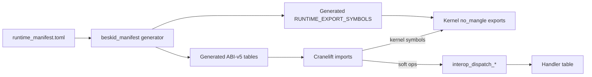

<!-- migrated from the legacy platform spec; canonical OpenSpec source -->
# Builtins and symbols Specification

## Purpose

ABI builtin function signatures, return kinds, and runtime export symbol compatibility.
## Requirements
### Requirement: ABI-v5 Bsol manifest is the sole runtime contract authority
`compiler/runtime_manifest.bsol` SHALL be the sole input for ABI-v5 runtime
symbols, signatures, layouts, traps, capabilities, target adapter bindings,
ordered OS-import allowlists, static/shared kit metadata, and deterministic
hashes. Generated Rust declarations, C headers, ABI JSON, ISLE import facts,
JIT/AOT allowlists, canonical runtime validation, and kit validation MUST agree
exactly with that manifest and MUST fail closed on missing, duplicate,
orphaned, target-mismatched, signature-mismatched, capability-mismatched, or
hash-mismatched data. Generated application code SHALL call direct versioned
`beskid_rt_v5_*` exports; it MUST NOT use a runtime dispatch registry,
envelope, tag, handler registration, bridge anchor, or Rust-host symbol table.

#### Scenario: Manifest and generated import agree
- **GIVEN** an ABI-v5 runtime export used by typed ISLE lowering
- **WHEN** generated ABI artifacts, CLIF imports, and a selected runtime kit are
  validated
- **THEN** symbol, signature, capability, target, layout dependencies, and hash
  all derive from the same Bsol declaration before link or load

#### Scenario: Legacy manifest or dispatch path is rejected
- **GIVEN** a build input or artifact referencing `runtime_manifest.toml`, an
  ABI-v3 dispatch entrypoint, a dispatch tag, or a Rust bridge anchor
- **WHEN** contract generation or runtime-kit validation runs
- **THEN** it fails before execution and does not generate or select a
  compatibility route

### Requirement: Array access remains outside the runtime call ABI
The ABI-v5 manifest SHALL own typed array layouts, rooted allocation/growth,
construction finish, and pointer write barriers. It MUST NOT declare
`array_get` or `array_set`, and generated registries, CLIF, runtime kits, and
linked applications MUST NOT contain those element-access symbols. Bounds,
typed address calculation, loads, and stores SHALL be emitted directly by the
generation-bound ISLE rule using manifest-derived layout facts.

#### Scenario: ABI audit finds no element access export
- **GIVEN** generated ABI-v5 artifacts and a linked application that indexes an
  array
- **WHEN** manifest, import, export, and binary allowlists are audited
- **THEN** no `array_get` or `array_set` symbol or dispatch route exists and the
  application's verified CLIF contains the direct checked access

### Requirement: Socket builtins use one opaque generation-tagged ABI handle
The runtime SHALL represent every TCP listener, TCP stream, and UDP socket in
its socket ABI as one opaque handle containing a table slot and generation. A
builtin MUST validate both values before accessing a native socket. The handle,
all builtin symbols, and their signatures MUST be manifest-generated and
registered through the existing builtin registry. Native descriptors and
platform constants MUST NOT cross the runtime/corelib ABI or appear in a public
Network API.

**Stable ID:** `BSP-REQ-3D4E0AE8B901`

#### Scenario: Reused slot rejects a stale handle
- **GIVEN** a closed socket whose table slot is reused with a new generation
- **WHEN** a late operation presents the previous opaque handle
- **THEN** the runtime rejects it as closed or stale without touching the new socket

### Requirement: Socket builtin registry has one generated implementation path
Every socket ABI operation SHALL be declared in the runtime manifest and MUST
have exactly one generated ABI signature, runtime export or dispatch entry, and
runtime implementation. Hand-written import signatures, direct Cranelift
socket calls, and target-specific public entrypoints are prohibited. The
manifest socket status enumeration SHALL list every public `NetworkError`
variant in declaration order starting at 1, followed by exactly one internal
pending status that MUST NOT cross the runtime/corelib boundary.

**Stable ID:** `BSP-REQ-B094EDC16A72`

#### Scenario: Manifest parity rejects an unregistered operation
- **GIVEN** a runtime socket operation that is not declared by the manifest
- **WHEN** ABI registry generation or conformance validation runs
- **THEN** validation fails before JIT or AOT execution

## Informative Source Provenance

The records below preserve migration history and are not normative except where text was extracted into a requirement above.

### Source Record: Builtins and symbols

**Authority:** informative provenance  
**Legacy path:** `/platform-spec/execution/abi-and-host/builtins-and-symbols/`  
**Source:** `site/spec-content/platform-spec/execution/abi-and-host/builtins-and-symbols/content.md`  
**SHA-256:** `fd624512565bfdf523efc7b1fbf47a7d7644de15f8948fabefcf0f78b0d3d1ac`

<details>
<summary>Migrated source text</summary>

``````markdown
<SpecSection title="What this feature specifies" id="what-this-feature-specifies">
This feature explains the stable ABI contract between generated code, runtime exports, and host execution. It is organized into newcomer-friendly articles that move from model, to flow, to contracts, then practical verification and debugging guidance.
</SpecSection>

<SpecSection title="Implementation anchors" id="implementation-anchors">
- `BuiltinFnSpec` tables in `beskid_abi::generated::abi_v5_contract` (`ABI_V5_SOFT_BUILTINS`, `ABI_V5_CORELIB_SERVICE_BINDINGS`, `ABI_V5_SOURCE_BUILTINS`), generated by `compiler/crates/beskid_abi/build.rs` from `compiler/runtime_manifest.bsol`
- `RUNTIME_EXPORT_SYMBOLS` in `compiler/crates/beskid_abi/src/symbols.rs`
- Builtin runtime implementations in `compiler/crates/beskid_runtime/src/builtins/mod.rs`
- Panic and syscall behavior in `compiler/crates/beskid_runtime/src/builtins/panic_io.rs`
</SpecSection>

## Decisions
<!-- spec:generate:adr-index -->
No open decisions. Closed choices are normative ADRs under **`adr/`** (`D-EXEC-ABI-0003` … `D-EXEC-ABI-0007`); use the reader **ADRs** tab for expandable detail.
<!-- /spec:generate:adr-index -->
## Articles
<!-- spec:generate:article-index -->
- [Contracts and edge cases](./articles/contracts-and-edge-cases/)
- [Design model](./articles/design-model/)
- [Examples](./articles/examples/)
- [FAQ and troubleshooting](./articles/faq-and-troubleshooting/)
- [Flow and algorithm](./articles/flow-and-algorithm/)
- [Verification and traceability](./articles/verification-and-traceability/)
<!-- /spec:generate:article-index -->
``````

</details>

### Source Record: Generated ABI-v5 tables are the sole runtime import source

**Authority:** informative provenance  
**Legacy path:** `/platform-spec/execution/abi-and-host/builtins-and-symbols/adr/0003-builtin-specs-sole-clif-source/`  
**Source:** `site/spec-content/platform-spec/execution/abi-and-host/builtins-and-symbols/adr/0003-builtin-specs-sole-clif-source/content.md`  
**SHA-256:** `90e95c33b7a7da7d5acefc4e8157134b6f1b8a07793a0a1e153833bd0ac77dc4`

<details>
<summary>Migrated source text</summary>

``````markdown
## Context

Hand-written Cranelift calls bypass the shared ABI catalog and desynchronize JIT, AOT, and runtime `extern "C-unwind"` implementations.

## Decision

| Rule | Detail |
| --- | --- |
| Catalog | The ABI-v5 tables that `beskid_abi/build.rs` generates from `compiler/runtime_manifest.bsol` are the **sole** source of runtime import signatures (**ABI-002**) |
| Call shape | `beskid_abi::runtime_source::canonical_corelib_service_abi_for_adapter(symbol)` gives the shape of every runtime import. It checks service bindings first, then manifest source builtins, then soft builtins |
| Codegen | `cranelift_host::declare_referenced_builtin_imports` declares only the runtime imports that the lowered CLIF references, in symbol order. Each import uses `cranelift_host::runtime_import_signature` |
| Validation | Object import declaration, `artifact_validation::is_runtime_builtin`, the AOT platform-import boundary, and checked-effect imports use the same shape. A declaration with a different shape is rejected |
| Diverging builtins | `AbiReturnKind::Never` for `panic` so unreachable blocks are correct |
| Parity | Symbol strings in specs **must** match `RUNTIME_EXPORT_SYMBOLS` entries (**ABI-001**) |

## Consequences

A new builtin requires a spec change, a `compiler/runtime_manifest.bsol` entry, and a `beskid_runtime::builtins` implementation in one change set. Do not add a hand-written signature table.

## Verification anchors

`compiler/crates/beskid_codegen/src/cranelift_host.rs`; `compiler/crates/beskid_abi/tests/runtime_import_catalog_v06.rs`.
``````

</details>

### Source Record: Runtime builtins use C-unwind exports

**Authority:** informative provenance  
**Legacy path:** `/platform-spec/execution/abi-and-host/builtins-and-symbols/adr/0004-runtime-c-unwind-exports/`  
**Source:** `site/spec-content/platform-spec/execution/abi-and-host/builtins-and-symbols/adr/0004-runtime-c-unwind-exports/content.md`  
**SHA-256:** `f7a925a882000dd710ec0bcf2fbba77be0509ff54f985db2128f9d900bde6c49`

<details>
<summary>Migrated source text</summary>

``````markdown
## Context

Generated code calls runtime entrypoints across JIT relink and AOT link. Rust panics across the boundary must use the platform unwind ABI expected by Cranelift `call` sites.

## Decision

| Rule | Detail |
| --- | --- |
| Export attribute | Implementations use `#[unsafe(no_mangle)] pub extern "C-unwind"` in `beskid_runtime::builtins` |
| Registry | `RUNTIME_EXPORT_SYMBOLS` lists every export the linker/JIT registers |
| Layout types | `BeskidStr` `{ ptr, len }` and `BeskidArray` `{ ptr, len, cap }` are normative payload headers |
| Families | Allocation, GC, fibers, channels, interop dispatch, IO, and `panic` share one catalog |

## Consequences

Host tooling resolves imports by symbol name and the generated ABI-v5 call shape, not Rust mangling.

## Verification anchors

`compiler/crates/beskid_runtime/src/builtins/mod.rs`; `compiler/crates/beskid_runtime/src/lib.rs` re-exports.
``````

</details>

### Source Record: Manifest-generated registries

**Authority:** informative provenance  
**Legacy path:** `/platform-spec/execution/abi-and-host/builtins-and-symbols/adr/0005-manifest-generated-registries/`  
**Source:** `site/spec-content/platform-spec/execution/abi-and-host/builtins-and-symbols/adr/0005-manifest-generated-registries/content.md`  
**SHA-256:** `d597b052a4fc52e4527240c51f98fa255cea81cca3c7c8b4c4d3f85910f172c6`

<details>
<summary>Migrated source text</summary>

``````markdown
## Context

ABI v2 required parallel edits to `beskid_abi`, analysis builtins, JIT registration, and runtime bridge whenever a runtime symbol changed. Drift between registries caused link failures and silent analysis gaps.

## Decision

| Rule | Detail |
| --- | --- |
| Source | `compiler/runtime_manifest.toml` is the **sole** input for registry generation |
| Outputs | The runtime import tables **must** be **generated**. In ABI v5, `beskid_abi/build.rs` generates `ABI_V5_SOFT_BUILTINS`, `ABI_V5_CORELIB_SERVICE_BINDINGS`, and `ABI_V5_SOURCE_BUILTINS` from `compiler/runtime_manifest.bsol` |
| Builtin catalog | `beskid_abi::all_builtin_specs()` returns the manifest soft builtins only |
| CLIF authority | [D-EXEC-ABI-0003](/platform-spec/execution/abi-and-host/builtins-and-symbols/adr/0003-builtin-specs-sole-clif-source/) remains valid. The generated ABI-v5 tables are the sole runtime import source |
| Parity | Generator **must** enforce symbol-string parity between specs and export lists |

## Consequences

Adding or reclassifying a runtime builtin **must** change the manifest and regenerate — not hand-edit Rust tables. Supersedes manual dual-registry maintenance for v3 onward.

## Verification anchors

`compiler/crates/beskid_manifest/`; `compiler/crates/beskid_abi/build.rs`; `compiler/crates/beskid_tests/src/abi/contracts.rs`.
``````

</details>

### Source Record: Contracts and edge cases

**Authority:** informative provenance  
**Legacy path:** `/platform-spec/execution/abi-and-host/builtins-and-symbols/articles/contracts-and-edge-cases/`  
**Source:** `site/spec-content/platform-spec/execution/abi-and-host/builtins-and-symbols/articles/contracts-and-edge-cases/content.md`  
**SHA-256:** `5d74103224387013ee53d82daf208598180c9203983bf302fffc1de836b8ad32`

<details>
<summary>Migrated source text</summary>

``````markdown
## Normative requirements

| ID | Requirement |
| --- | --- |
| **BLT-001** | Every soft builtin in `ABI_V5_SOFT_BUILTINS` and every direct runtime implementation of a canonical Corelib service binding **must** have exactly one `#[unsafe(no_mangle)]` export in the runtime with the same symbol string. |
| **BLT-002** | The exact runtime kit **must** export every soft builtin and every direct Corelib service adapter (adapter equal to implementation) in the generated ABI-v5 tables. `RUNTIME_EXPORT_SYMBOLS` in `generated/symbols.rs` is a frozen ABI-v4 name list. It only reserves those names from user FFI (`beskid_abi::is_runtime_owned_ffi_symbol`). |
| **BLT-003** | `panic` and `panic_str` **must** use `AbiReturnKind::Never`; callers **must not** expect return values. |
| **BLT-004** | Pointer parameters **must** refer to GC-tracked or ABI-documented structs (`BeskidStr`, headers); null unless the specific builtin documents otherwise. |
| **BLT-005** | Fiber join builtins **must** distinguish status-only (`fiber_join_status`) vs value (`fiber_join_value`) per symbol names in `symbols.rs`. |
| **BLT-006** | Channel receive **must** expose status vs value as separate symbols (`channel_receive_status`, `channel_receive_value`) to avoid ambiguous CLIF signatures. |

## Signature table (selected)

| Symbol | Params | Returns |
| --- | --- | --- |
| `alloc` | `ptr, ptr` (size, type desc) | `ptr` |
| `str_new` | `ptr, ptr` (data, len) | `ptr` |
| `syscall_write` | `i64, ptr` (fd, `BeskidStr`) | `i64` |
| `gc_write_barrier` | `ptr, ptr` | void |
| `fiber_spawn` | (see `runtime_manifest.bsol`) | `i64` fiber id |
| `interop_dispatch_ptr` | `ptr` | `ptr` |

Full table: `compiler/runtime_manifest.bsol`. The generated tables are in `beskid_abi::generated::abi_v5_contract`.

## Edge cases

| Case | Rule |
| --- | --- |
| `array_new` without `arrays_backing` | Header allocated; `ptr` field null; `array_len` still reports logical length |
| Null `BeskidStr` in `syscall_write` | Returns error sentinel (`-1`) per IO runtime |
| Test helpers `test_bytes_*` | Only for compiler tests; not a stable user API |
| Metrics exports | Gated by `metrics` feature; not in baseline `RUNTIME_EXPORT_SYMBOLS` unless enabled at build |

## Implementation anchors
- `compiler/runtime_manifest.bsol` — signature, null-safety, and error sentinel contracts
- `compiler/crates/beskid_abi/src/runtime_source/corelib_services/abi_shape.rs` — `canonical_corelib_service_abi_for_adapter` call shapes
- `compiler/crates/beskid_runtime/src/builtins/` — runtime impl parity with specs

## Related topics

- [Panic, IO, and syscalls](/platform-spec/execution/runtime/panic-io-and-syscalls/)
- [Channels and synchronization](/platform-spec/execution/runtime/channels-and-synchronization/)
``````

</details>

### Source Record: Design model

**Authority:** informative provenance  
**Legacy path:** `/platform-spec/execution/abi-and-host/builtins-and-symbols/articles/design-model/`  
**Source:** `site/spec-content/platform-spec/execution/abi-and-host/builtins-and-symbols/articles/design-model/content.md`  
**SHA-256:** `ca9a5f0d94a22748939f99da48967352bce05dbd23323d4dd7659312999c810d`

<details>
<summary>Migrated source text</summary>

``````markdown
## Purpose

Document the **manifest-driven registry** that connects Beskid lowered code to the host runtime: a language-owned manifest generates symbolic names for the linker, Cranelift signatures, analysis builtins, JIT registration, and bridge anchors — split into **kernel** direct exports and **dispatch** entrypoints in ABI v3.

## Primary actors

| Actor | Artifact |
| --- | --- |
| **`runtime_manifest.toml`** | Normative classification of kernel vs dispatch ops |
| **`beskid_manifest` generator** | Emits generated Rust tables at build time |
| **`beskid_abi::generated::abi_v5_contract`** | Generated `BuiltinFnSpec { symbol, params, returns }` entries (`ABI_V5_SOFT_BUILTINS`, `ABI_V5_CORELIB_SERVICE_BINDINGS`, `ABI_V5_SOURCE_BUILTINS`) |
| **`beskid_abi::generated::symbols`** | Frozen ABI-v4 `SYM_*` constants and `RUNTIME_EXPORT_SYMBOLS`. Not generated. Reserves names from user FFI only |
| **`beskid_codegen`** | `cranelift_host::declare_referenced_builtin_imports` declares only the referenced runtime imports with the generated call shapes |
| **`beskid_runtime::builtins`** | Kernel `#[unsafe(no_mangle)] pub extern "C-unwind"` exports; soft impls via dispatch |

## Builtin families

| Family | v3 path | Consumer |
| --- | --- | --- |
| **Allocation / GC (kernel)** | Direct `alloc`, `gc_*` | All backends |
| **Faults / preempt (kernel)** | Direct `panic`, `runtime_preempt_check` | Traps and scheduling |
| **Dispatch (kernel entry)** | `interop_dispatch_{unit,ptr,usize}` | Soft op envelopes |
| **Soft ops (dispatch)** | Manifest tags → handler table | Strings, channels, fibers, IO, … |
| **Registration (kernel)** | `beskid_register_callbacks`, `beskid_register_handlers` | Host and corelib init |
| **Composition / dynamic (kernel, Phase A)** | Direct composition and dynamic symbols | DI and dynamic lowering |

Return kinds include **`AbiReturnKind::Never`** for diverging `panic` calls so Cranelift marks unreachable correctly.

## Data layout contracts

- **`BeskidStr`**: `{ ptr, len }` UTF-8 bytes (immutable; length in bytes).
- **`BeskidArray`**: `{ ptr, len, cap }`; element storage optional behind runtime `arrays_backing` feature ([Runtime feature flags](/platform-spec/execution/runtime/runtime-feature-flags/)).

## Registry diagram



## Implementation anchors
- `compiler/runtime_manifest.toml` — normative manifest input
- `compiler/crates/beskid_manifest/` — generator crate
- `compiler/crates/beskid_abi/src/generated/` — `abi_v5_contract.rs` (generated ABI-v5 tables), `mod.rs`, and `symbols.rs` (frozen ABI-v4 names, `RUNTIME_EXPORT_SYMBOLS`, `SYM_*`)
- `compiler/crates/beskid_runtime/src/builtins/` — kernel exports and private soft implementations

## Related topics

- [ABI versioning](/platform-spec/execution/abi-and-host/abi-versioning-and-compatibility/) — when to bump version after symbol changes
- [Flow and algorithm](./flow-and-algorithm/)
``````

</details>

### Source Record: Examples

**Authority:** informative provenance  
**Legacy path:** `/platform-spec/execution/abi-and-host/builtins-and-symbols/articles/examples/`  
**Source:** `site/spec-content/platform-spec/execution/abi-and-host/builtins-and-symbols/articles/examples/content.md`  
**SHA-256:** `2a7f5bda13749d626bbd53ea6c405bb1d4e47691a200de7e6cc151a66c75d9e2`

<details>
<summary>Migrated source text</summary>

``````markdown
## Locating a builtin implementation

Given CLIF calling `fiber_yield`:

1. Find `SYM_FIBER_YIELD` → `"fiber_yield"` in `symbols.rs`.
2. Locate the `fiber_yield` entry in `compiler/runtime_manifest.bsol`. `canonical_corelib_service_abi_for_adapter("fiber_yield")` gives its call shape.
3. Open `compiler/crates/beskid_runtime/src/builtins/fiber.rs` for behavior (park current fiber, requeue).

## Corelib indirection

User code calls `Fiber.Yield()` in `corelib_concurrency`; lowering **must not** embed scheduler details. The package emits a call to `fiber_yield` only—see [Concurrency package](/platform-spec/core-library/concurrency/concurrency-package/).

## Allocation + GC root scenario

A global `string` cached from native code:

1. Lowering calls `alloc` with type descriptor pointer.
2. Host registers root via `gc_register_root` when exposing to foreign API.
3. On teardown, `gc_unregister_root` pairs with registration.

Missing unroot leaks until next collection; handles from `gc_root_handle` document temporary pinning.

## Panic from bounds check

Lowering may emit:

```
call panic(message_ptr, message_len) -> never
```

Runtime formats output and terminates the process—no stack unwind through Beskid frames ([error model legacy](../../../../execution/runtime/error-model.md)).

## Inspecting JIT registration

`cranelift_host::declare_referenced_builtin_imports` declares each runtime import that the lowered CLIF references. A drift between the runtime export name and the manifest symbol breaks link or finalize with `MissingFunction`.

## Related topics

- [Verification and traceability](./verification-and-traceability/)
- Legacy symbol list: [Runtime ABI (v0.1)](../../../../execution/runtime/runtime-abi-v0-1.md)
``````

</details>

### Source Record: FAQ and troubleshooting

**Authority:** informative provenance  
**Legacy path:** `/platform-spec/execution/abi-and-host/builtins-and-symbols/articles/faq-and-troubleshooting/`  
**Source:** `site/spec-content/platform-spec/execution/abi-and-host/builtins-and-symbols/articles/faq-and-troubleshooting/content.md`  
**SHA-256:** `9d8462515c0154da37e3a7e2cf394b0df1d298cbbaa8e8089816442933b50afb`

<details>
<summary>Migrated source text</summary>

``````markdown
## FAQ

### Why separate the generated ABI-v5 tables and `RUNTIME_EXPORT_SYMBOLS`?

Names alone are not sufficient for Cranelift. The generated `BuiltinFnSpec` entries carry parameter and return kinds. `RUNTIME_EXPORT_SYMBOLS` is a frozen ABI-v4 name list. It is not a signature catalog. It only reserves runtime-owned names from user FFI.

### Can I add a builtin only in runtime?

No (**BLT-001**). Codegen will not declare the import; JIT fails at finalize or AOT fails at link.

### What calling convention is used?

Generated code uses the Cranelift default for the host ISA; runtime exports use `extern "C-unwind"` so panics across the boundary remain defined for Rust host frames.

### Do fiber builtins use `Fiber<T>` in the ABI?

No. ABI uses raw ids and pointers; generic `Fiber<T>` is a corelib surface. See [Fiber scheduler](/platform-spec/execution/runtime/fiber-scheduler-and-stacks/).

## Troubleshooting

| Symptom | Likely fix |
| --- | --- |
| `MissingFunction` for `channel_receive` | Call site uses old symbol; use `channel_receive_status` / `channel_receive_value` |
| CLIF verify failure on builtin call | Arity mismatch. Update `runtime_manifest.bsol` and lowering together |
| GC heap corruption after new store | Missing `gc_write_barrier` in lowering for pointer write |
| `array_new` always null data pointer | Build runtime with `--features arrays_backing` if tests need backing storage |

## Related topics

- [Flow and algorithm](./flow-and-algorithm/)
- [Runtime feature flags](/platform-spec/execution/runtime/runtime-feature-flags/)
``````

</details>

### Source Record: Flow and algorithm

**Authority:** informative provenance  
**Legacy path:** `/platform-spec/execution/abi-and-host/builtins-and-symbols/articles/flow-and-algorithm/`  
**Source:** `site/spec-content/platform-spec/execution/abi-and-host/builtins-and-symbols/articles/flow-and-algorithm/content.md`  
**SHA-256:** `90d5926878746d3503cf351fdab40d26e9f37014607b038c06da566974633fe6`

<details>
<summary>Migrated source text</summary>

``````markdown
## Purpose

Trace how a builtin reference in CLIF becomes a live function pointer at run time. Registry diagram: [design model](./design-model/).

## Lowering to import declaration

1. HIR/lowering selects a runtime operation (allocate string, `fiber_yield`, etc.).
2. Codegen emits a `call` to the stable symbol string (for example `alloc`, not a mangled Rust name).
3. During `compile`, `cranelift_host::declare_referenced_builtin_imports` declares only the runtime imports that the lowered CLIF references, in symbol order.
4. For each import, `cranelift_host::runtime_import_signature` maps `AbiParamKind::Ptr` to the host pointer type and `I64` to `i64`. It sets the return type from `AbiReturnKind`. The shape comes from `canonical_corelib_service_abi_for_adapter(symbol)`.

## Runtime entry

1. Generated code calls using the platform default calling convention (SysV on Linux x86_64).
2. The runtime builtin enters `enter_runtime_scope` / GC rules as needed (`alloc`, barriers).
3. Fiber/channel builtins park or enqueue work via `beskid_runtime::scheduler` without exposing scheduler internals to CLIF.

## String builtin algorithm (`str_concat`)

1. Read `BeskidStr` headers for left and right operands.
2. Allocate a fresh buffer via `alloc` for combined byte length.
3. Copy UTF-8 payload; return new `{ ptr, len }` handle.
4. On allocation failure or null inputs, trap via `panic` (no implicit `Option` at ABI layer).

## GC barrier hook

1. Lowering emits `gc_write_barrier(parent, child)` after pointer stores when concurrent GC is active.
2. Runtime barrier ensures tri-color invariant (see [Memory and GC](/platform-spec/execution/runtime/memory-and-gc-runtime-contract/)).
3. Phase A may simplify barrier work when only one mutator runs; symbol remains reserved.

## Implementation anchors
- `compiler/crates/beskid_codegen/src/cranelift_host.rs` — `declare_referenced_builtin_imports` and `runtime_import_signature`
- `compiler/crates/beskid_abi/build.rs` — generates the ABI-v5 signature tables from `compiler/runtime_manifest.bsol`
- `compiler/crates/beskid_engine/src/jit_module.rs` — symbol map initialization

## Related topics

- [Contracts and edge cases](./contracts-and-edge-cases/)
- `compiler/runtime_manifest.bsol` — full runtime import manifest
``````

</details>

### Source Record: Verification and traceability

**Authority:** informative provenance  
**Legacy path:** `/platform-spec/execution/abi-and-host/builtins-and-symbols/articles/verification-and-traceability/`  
**Source:** `site/spec-content/platform-spec/execution/abi-and-host/builtins-and-symbols/articles/verification-and-traceability/content.md`  
**SHA-256:** `433e365f3b1249c11f509253b9f099bed4ced8f0aa315346c070e161f418a1b8`

<details>
<summary>Migrated source text</summary>

``````markdown
## Canonical files

| File | Contract |
| --- | --- |
| `compiler/runtime_manifest.bsol` | Runtime import manifest |
| `compiler/crates/beskid_abi/build.rs` | Generates `ABI_V5_SOFT_BUILTINS`, `ABI_V5_CORELIB_SERVICE_BINDINGS`, `ABI_V5_SOURCE_BUILTINS` |
| `compiler/crates/beskid_abi/src/runtime_source/corelib_services/abi_shape.rs` | `canonical_corelib_service_abi_for_adapter` |
| `compiler/crates/beskid_abi/src/abi_types.rs` | `AbiParamKind`, `AbiReturnKind` |
| `compiler/crates/beskid_abi/src/generated/symbols.rs` | Frozen ABI-v4 `RUNTIME_EXPORT_SYMBOLS` (user FFI reservation only) |
| `compiler/crates/beskid_runtime/src/builtins/mod.rs` | Module routing to alloc/gc/fiber/… |
| `compiler/crates/beskid_codegen/src/cranelift_host.rs` | `declare_referenced_builtin_imports`, `runtime_import_signature` |
| `compiler/crates/beskid_engine/src/jit_module.rs` | Function pointer table for JIT |

## Tests

| Location | Covers |
| --- | --- |
| `compiler/crates/beskid_tests/src/runtime/jit.rs` | Builtin calls through JIT |
| `compiler/crates/beskid_e2e_tests/src/tests/runtime_cases.rs` | Panic, IO, runtime smoke |
| `compiler/crates/beskid_runtime` benches | Microbenchmarks for alloc/GC hot paths |

## Requirement mapping

| ID | Check |
| --- | --- |
| **BLT-001** | Compare `ABI_V5_SOFT_BUILTINS` and direct Corelib service adapter symbols with `pub extern` exports in `builtins/` |
| **BLT-002** | Exact runtime kit validation finds every soft builtin and every direct Corelib service adapter. `compiler/crates/beskid_abi/tests/runtime_import_catalog_v06.rs` regenerates the tables from `runtime_manifest.bsol` and fails on drift. It checks that the builtin catalog is exactly the manifest soft builtins |
| **BLT-005–006** | Symbol rename tests in fiber/channel integration tests |

## Review checklist (PRs touching builtins)

1. Update `compiler/runtime_manifest.bsol`, the runtime implementation, and the spec together.
2. Decide if [ABI versioning](/platform-spec/execution/abi-and-host/abi-versioning-and-compatibility/) bump is required.
3. Run `cargo test -p beskid_tests runtime` and relevant `beskid_e2e_tests` targets.

## Implementation anchors
- `compiler/crates/beskid_abi/tests/runtime_import_catalog_v06.rs` — manifest drift and call-shape assertions
- `compiler/crates/beskid_tests/src/runtime/` — JIT and runtime test fixtures

## Related topics

- [Contracts and edge cases](./contracts-and-edge-cases/)
- [ABI versioning verification](/platform-spec/execution/abi-and-host/abi-versioning-and-compatibility/verification-and-traceability/)
``````

</details>
