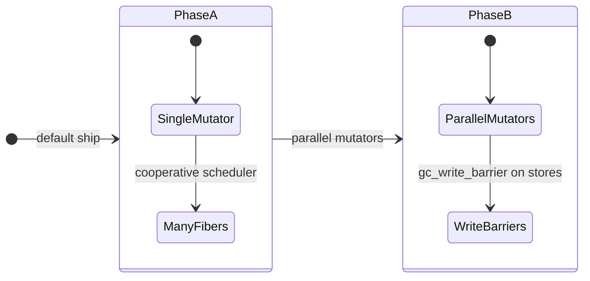
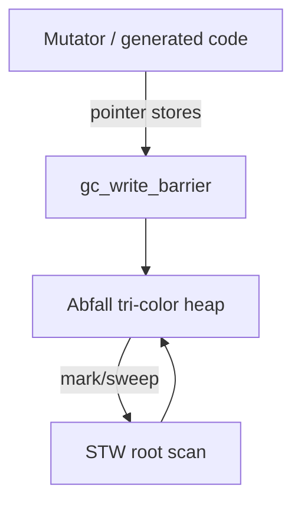

<!-- migrated from the legacy platform spec; canonical OpenSpec source -->
# Memory and GC runtime contract Specification

## Purpose

Allocation, object lifetime, and garbage-collection responsibilities shared across compiler and runtime.
## Requirements
### Requirement: Ship Phase A GC before parallel mutators: Decision [D-EXEC-RT-0005]
The Beskid standard SHALL enforce the following migrated contract section. Accepted ADR decisions are binding; uppercase requirement keywords retain their BCP-14 meaning.

> | Phase | Mutators | Ship order |
> | --- | --- | --- |
> | **A (v0.2)** | One Beskid mutator; many cooperative fibers | **Default ship** |
> | **B** | Parallel mutators | Not implemented in 0.6.0; the runtime has no Phase B switch. Parallel execution is planned in the changes `v061-attributes-and-isolate-prerequisites` through `v065-parallel-sequences` |
> 
> Phase B **must not** become the default without updating this feature hub and fiber
> scheduler contracts.

**Stable ID:** `BSP-REQ-46C4422DC096`  
**Legacy source:** `site/spec-content/platform-spec/execution/runtime/memory-and-gc-runtime-contract/adr/0005-phase-a-before-phase-b/content.md`  
**Source SHA-256:** `e1c463259520657e4c81b6420e3a90e87afaea20ee7f12314a79dec3275d8563`

#### Scenario: Conformance exercises Decision
- **GIVEN** an implementation claims conformance with this capability
- **WHEN** behavior governed by this contract section is exercised
- **THEN** every MUST, SHALL, REQUIRED, prohibition, and accepted decision in the section is satisfied

### Requirement: Span-batched tri-color mark-sweep collection and barrier exports: Decision [D-EXEC-RT-0006]
The Beskid standard SHALL enforce the following migrated contract section. Accepted ADR decisions are binding; uppercase requirement keywords retain their BCP-14 meaning.

> | Component | Role |
> | --- | --- |
> | **Collector** | Precise, non-moving tri-color mark-sweep collector in the canonical runtime (`Runtime/Mem/Gc`). Marking is span-batched: shading an object sets its bit in the span mark bitmap and enqueues the span once on a heap-wide FIFO; draining a span scans every marked-but-unscanned slot in one pass; large objects use the header mark word (`Marking.bd`). `gc_collect` sets the marking phase, marks roots, drains the mark work, sweeps per span and returns to idle |
> | **Scheduling** | In 0.6.0 one collection runs to completion inside the allocating call (non-incremental); it pauses only the fibers of that heap's single mutator thread |
> | **Atomicity** | Because collection is non-incremental, no mutator store runs while the heap is marking |
> | **Field stores** | Generated code SHALL NOT call `gc_write_barrier` for field stores |
> | **Array element stores** | Generated code calls `beskid_rt_v5_array_write_barrier` for managed array element stores |
> | **Barrier exports** | `gc_write_barrier` and `beskid_rt_v5_array_write_barrier` remain exported for runtime code and native Mod adapters; `gc_write_barrier` has no effect outside the marking phase |

**Stable ID:** `BSP-REQ-76C777704644`  
**Legacy source:** `site/spec-content/platform-spec/execution/runtime/memory-and-gc-runtime-contract/adr/0006-abfall-tri-color-heap/content.md`  
**Source SHA-256:** `d83d75b49f675ad50cb41d55685814a5a6b26bd1e5836b528545937ba764d731`

#### Scenario: Conformance exercises Decision
- **GIVEN** an implementation claims conformance with this capability
- **WHEN** behavior governed by this contract section is exercised
- **THEN** every MUST, SHALL, REQUIRED, prohibition, and accepted decision in the section is satisfied

### Requirement: Heap objects carry type descriptors for scanning: Decision [D-EXEC-RT-0007]
The Beskid standard SHALL enforce the following migrated contract section. Accepted ADR decisions are binding; uppercase requirement keywords retain their BCP-14 meaning.

> | Rule | Detail |
> | --- | --- |
> | Header | Heap objects begin with a **type descriptor pointer** for precise scan |
> | Allocation | `alloc(size, type_desc)` uses `abfall::Heap::allocate_beskid` |
> | Strings / arrays | `BeskidStr`, `BeskidArray` headers per [builtins layout](/platform-spec/execution/abi-and-host/builtins-and-symbols/) |
> | Roots | Stacks (stack maps), globals (registered roots), `gc_root_handle` externals |
> | Compiler | Lowers descriptors and stack maps; does not embed collector policy |

**Stable ID:** `BSP-REQ-8EDA62A2D0E0`  
**Legacy source:** `site/spec-content/platform-spec/execution/runtime/memory-and-gc-runtime-contract/adr/0007-heap-type-descriptors/content.md`  
**Source SHA-256:** `d048da0588f5491093ffb15b350cced510c8f6e9a617aa315d22936e6e97da9d`

#### Scenario: Conformance exercises Decision
- **GIVEN** an implementation claims conformance with this capability
- **WHEN** behavior governed by this contract section is exercised
- **THEN** every MUST, SHALL, REQUIRED, prohibition, and accepted decision in the section is satisfied

### Requirement: Growable managed heap of chained regions
The managed heap SHALL be a chain of one or more independently mapped regions obtained through `system_allocate`. Each region SHALL begin with a 64-byte region header (`next`, `size`, `bump`, `limit`, `free_bytes`, `largest_free`, `objects_start`, reserved) and SHALL hold a span directory followed by objects only in `[objects_start, bump)`, where `objects_start` accounts for the directory's size. The runtime SHALL add regions to the chain while a program is running instead of failing an allocation that the committed-size cap still permits. Objects SHALL NOT move when a region is added, when a span is carved or freed within a region, or when a collection runs. Marking, sweeping, free-list reuse, and every heap-membership test (`HeapContains`/`spanOf`-equivalent lookup, `IsAllocatedObject`, `ManagedObjectForReference`) SHALL treat every region in the chain and every span within it, and SHALL keep the existing per-block boundary rule inside each span. The `BeskidHeapState` layout in `runtime_manifest.bsol` and the `HEAP_*` constants in the canonical runtime sources SHALL be identical, and a compiler test SHALL fail when they differ.

**Stable ID:** `BSP-REQ-88A15BB6918A`

#### Scenario: Live data larger than the initial region survives growth and collection
- **GIVEN** a program that keeps 4 MiB of managed objects reachable from roots with an initial region of 1 MiB
- **WHEN** the program allocates that data, reads `gc_heap_region_count` and `gc_heap_committed`, drops the roots, and calls `__gc_collect`
- **THEN** every allocation succeeds, `gc_heap_region_count` is at least 3, `gc_heap_committed` exceeds 1 MiB, every object address that was returned before growth still validates as an allocated object, and after the collection `gc_bytes_allocated` reports only the objects that remain reachable

#### Scenario: Address-to-span lookup does not walk the region's objects
- **GIVEN** a region holding many spans across several size classes
- **WHEN** the runtime resolves an arbitrary live object address to its span
- **THEN** the resolution touches only the region's span directory (an O(1) arena-index computation), never a linear walk over prior objects or spans in the region

### Requirement: Span/page allocator carved from region pages
Each region SHALL be subdivided into fixed 8 KiB pages, and every allocation SHALL be served from a span: a run of one or more whole pages holding objects of exactly one size class, or, for a request whose rounded size exceeds the largest size class, a dedicated span sized to the request. The runtime SHALL carry a generated size-class table (bytes per class, pages per span, and a reciprocal-multiplication constant for slot-index computation) checked into the compiler and cross-checked by a test against the `.bd` constants that mirror it. Each span SHALL record, outside the bytes available to objects, its base, page count, size class, an allocation bitmap, a mark bitmap, and a free-slot list. A span's `noscan` classification SHALL be derived from its size class's type descriptor at first carve and SHALL exclude the span from marking's scan work. Allocation of a small object SHALL be O(1) amortized (pop a free slot or advance a bump index within the current span of that class) and SHALL touch the region's growth or free-page bookkeeping only when the current span for a class is exhausted.

**Stable ID:** `BSP-REQ-990344D0B4B6`

#### Scenario: Many small objects across every size class land on class-homogeneous spans
- **GIVEN** a program that allocates one rooted object of every size class the table defines, repeated until each class has filled at least one span
- **WHEN** the objects are read back by address
- **THEN** every object's span reports the exact size class its request rounded to, no span mixes two size classes, and no allocation in this sequence walked the region's free-page list more than once per span exhaustion

#### Scenario: A request larger than the largest size class gets a dedicated span
- **GIVEN** a single allocation request larger than the largest size class
- **WHEN** the allocation runs
- **THEN** it is served by a span sized to the request rounded up to whole pages, that span reports size class zero (large), and no unrelated allocation shares its pages

### Requirement: Heap growth pacing and committed-size cap
The runtime SHALL keep a `collection_threshold` equal to `max(2 * live_bytes after the last collection, 512 KiB)` and SHALL run a collection before growing only when `live_bytes` has reached that threshold; otherwise it SHALL grow without collecting. Pacing SHALL be evaluated when a span is refilled for a size class or when a large or dedicated-region request cannot be served, not on every allocation. A growth region SHALL be at least the requested allocation plus the region header and span directory, SHALL otherwise start at 1 MiB and double after every growth up to 64 MiB, and a request larger than the pending region size SHALL receive a dedicated region. The runtime SHALL NOT let `committed_bytes` exceed `cap_bytes`. The runtime SHALL export `beskid_rt_v5_heap_set_cap(bytes) -> u8`, which SHALL succeed only while the runtime is active and `bytes` is at least both the committed size and the initial region size, and SHALL export `gc_heap_cap`, `gc_heap_committed`, `gc_heap_region_count`, and `gc_heap_failure_reason` as read-only statistics.

The runtime SHALL NOT impose a fixed default cap on the managed heap: without configuration, `cap_bytes` SHALL be the maximum word value and the heap SHALL grow by regions until the system allocator refuses, which SHALL remain the diagnosable `out_of_memory` trap with the existing failure reason and diagnostic. The region chain SHALL have no fixed region count.

The runtime SHALL read `BESKID_HEAP_MAX` during `beskid_rt_v5_process_init`, after the heap, the primary thread and the scheduler exist, as a decimal byte count with an optional `k`, `m` or `g` suffix (powers of 1024, either case), and SHALL apply it through `beskid_rt_v5_heap_set_cap`. An absent or empty variable SHALL leave the heap uncapped. An unparsable value, or one the cap export rejects (below the committed size or below the initial region size), SHALL terminate initialization through the runtime trap path with exit status 101 and the variable name as the diagnostic message. Because the runtime reads the variable, every activation path (executable host, `beskid_library_attach_v5`, embedding engines) SHALL honour it identically; the executable host SHALL NOT parse it. `BESKID_HEAP_MAX_BYTES` is not read.

**Stable ID:** `BSP-REQ-539C3C627D46`

#### Scenario: Cap from the environment
- **GIVEN** a process started with `BESKID_HEAP_MAX=2m` whose program keeps 3 MiB of managed objects reachable
- **WHEN** the allocation that would exceed 2 MiB runs
- **THEN** the process terminates with exit status 101, the `out_of_memory (5)` diagnostic and `cap=2097152`

#### Scenario: Malformed cap
- **GIVEN** a process started with `BESKID_HEAP_MAX=abc`
- **WHEN** `beskid_rt_v5_process_init` runs
- **THEN** the process terminates with exit status 101 and `BESKID_HEAP_MAX` in the diagnostic

#### Scenario: No cap
- **GIVEN** a process started without `BESKID_HEAP_MAX` on a machine with the memory
- **WHEN** its program keeps 1,088 MiB of managed objects reachable
- **THEN** the allocations succeed, more than one region is committed and the heap verifies clean

#### Scenario: Garbage-heavy program collects instead of growing
- **GIVEN** a program whose reachable set never exceeds 64 KiB but that allocates 8 MiB of short-lived objects in a loop
- **WHEN** the loop completes
- **THEN** `gc_heap_committed` is still 1 MiB, `gc_heap_region_count` is 1, and `gc_collection_count` is greater than zero

### Requirement: Span-queued marking and per-span sweep
Marking SHALL start from the root set (root stack, handle stack, `RootFrame` chains, and suspended fiber frames) and SHALL be precise: only addresses the compiler or runtime records as pointer-bearing are treated as roots or traced. Shading an object on a small, scannable span SHALL set that object's bit in the span's mark bitmap and, if the span is not already queued, SHALL enqueue the span on a first-in-first-out work queue exactly once; a span already queued SHALL accumulate further marks without being enqueued again. Draining SHALL process a dequeued span by scanning every slot marked but not yet scanned in one left-to-right pass, tracing each such object's pointer fields and shading their targets, and SHALL process large or non-span-eligible objects through a separate stack-based work list. Marking SHALL terminate when both work structures are empty. Sweeping SHALL run once per collection after marking completes and SHALL process each region's spans independently: a span with no marked object SHALL return its pages to the region's free-page list; a span with at least one marked object SHALL exchange its allocation bitmap for its mark bitmap, rebuild its free-slot list from the newly free slots, and clear its mark bitmap for the next cycle. Sweeping SHALL NOT read or write the byte contents of live objects. Collection is stop-the-world for the heap's single mutator, so a store cannot race a marker. The generated code SHALL NOT emit a `gc_write_barrier` call for field stores; managed array element stores call `beskid_rt_v5_array_write_barrier`. The `gc_write_barrier` export SHALL remain for runtime code and native Mod adapters and SHALL have no effect outside the marking phase.

**Stable ID:** `BSP-REQ-A03B6EAE5FCB`

#### Scenario: Two objects on the same span are scanned together, not re-walked per object
- **GIVEN** two rooted objects that land on the same span and no other live object on that span
- **WHEN** a collection runs
- **THEN** the span is dequeued from the mark work queue exactly once and both objects are scanned during that single dequeue

#### Scenario: An emptied span is returned and reused by a different size class
- **GIVEN** a span fully populated with one size class whose objects are all dropped before a collection, in a region otherwise at capacity for new spans
- **WHEN** the collection runs and a subsequent allocation requests a different size class
- **THEN** the emptied span's pages satisfy that later allocation

#### Scenario: No write-barrier call is emitted for a managed field store
- **GIVEN** compiled code that assigns a value to a field the compiler knows is GC-managed
- **WHEN** the code is generated
- **THEN** the generated code contains no call to `gc_write_barrier`

### Requirement: Growable root and handle stacks
The runtime SHALL root every GC-managed local, construction temporary, and host-held handle in a segmented, growable stack rather than a fixed-capacity table. Registering a root SHALL append it to the current segment, allocating and linking a new segment through the platform allocator (never through the managed allocator) when the current segment is full; registration SHALL NOT fail or silently refuse to root a value because a fixed capacity was reached. Unregistering a root SHALL remove it from whichever segment holds it. Marking SHALL walk every segment of both stacks in addition to the existing `RootFrame` chain and suspended-fiber walk, unchanged. A managed value that crosses a fiber boundary (join, channel transfer, or an ABI-value slot) SHALL be rooted by the transferring code for as long as it is reachable only through that transfer, matching the existing `AbiValue` rooting discipline.

**Stable ID:** `BSP-REQ-0FC58CAAF5D8`

#### Scenario: Deep recursion roots thousands of concurrently live locals without a capacity ceiling
- **GIVEN** a recursive-descent parse (or an equivalent synthetic fixture) that keeps several thousand GC-managed locals and construction temporaries rooted concurrently on the call stack
- **WHEN** the parse runs to completion
- **THEN** every root registration succeeds, no root or handle registration is silently refused, and the process does not terminate by signal

#### Scenario: Root-stack growth failure is a diagnosable trap, not a crash
- **GIVEN** the platform allocator is made to fail the specific allocation that would grow the root stack
- **WHEN** a root registration needs a new segment
- **THEN** the runtime calls the typed exhaustion trap with a reason distinguishing root-stack growth failure from heap growth failure, and the process exits 101 rather than crashing

### Requirement: Diagnosable managed-heap exhaustion
When a valid allocation cannot be satisfied after the pacing policy has collected and the cap or the operating system refuses further growth, the runtime SHALL record the failure reason and requested size in the heap state and SHALL call the runtime trap with code 5 (`out_of_memory`) and a message that contains the reason code, requested bytes, live bytes, committed bytes, and cap bytes as decimal numbers. Failure reasons SHALL include, at minimum, cap reached, platform allocation failure, a request larger than the cap, and root- or handle-stack growth failure. The trap host SHALL print `beskid runtime trap v5: <trap name> (<code>): <message>` and exit with status 101. `beskid_rt_v5_managed_object_allocate` SHALL NOT return null for a valid request; null remains reserved for a malformed request or descriptor. Exhaustion inside a fiber SHALL be process-fatal through the same trap. The generated `trapz` guard after each allocation call SHALL remain as the fail-closed backstop for malformed requests.

**Stable ID:** `BSP-REQ-8C1FA4687232`

#### Scenario: Cap exhaustion exits through the out-of-memory trap instead of an illegal-instruction signal
- **GIVEN** a process started with `BESKID_HEAP_MAX=2m` whose program keeps 3 MiB of managed objects reachable
- **WHEN** the allocation that would exceed the cap runs
- **THEN** the process exits with status 101, was not terminated by a signal, and its standard error contains `beskid runtime trap v5`, `out_of_memory (5)`, and `cap=2097152`

## Informative Source Provenance

The records below preserve migration history and are not normative except where text was extracted into a requirement above.

### Source Record: Memory and GC runtime contract

**Authority:** informative provenance  
**Legacy path:** `/platform-spec/execution/runtime/memory-and-gc-runtime-contract/`  
**Source:** `site/spec-content/platform-spec/execution/runtime/memory-and-gc-runtime-contract/content.md`  
**SHA-256:** `de1d5708a259e1d94a8e0d19131a78f930be503392a7e97da98cb0aea789b2cd`

<details>
<summary>Migrated source text</summary>

``````markdown
<SpecSection title="What this feature specifies" id="what-this-feature-specifies">
`Memory and GC runtime contract` defines one operational contract that a newcomer can follow end-to-end: first the model, then execution flow, then strict guarantees, concrete examples, and verification guidance.
</SpecSection>

<SpecSection title="GC phases" id="gc-phases">



Phase A: many fibers, **one GC mutator** thread. Phase B: parallel mutators with insertion barriers; see [design model](./design-model/) for builtin tables.

</SpecSection>

<SpecSection title="Implementation anchors" id="implementation-anchors">
- Runtime memory exports in `compiler/crates/beskid_runtime/src/lib.rs`
- ABI contracts in `compiler/crates/beskid_abi/src/lib.rs`
- JIT linking and call setup in `compiler/crates/beskid_engine/src/jit_module.rs`
- Runtime integration tests in `compiler/crates/beskid_tests/src/runtime/jit.rs`
</SpecSection>

## Decisions
<!-- spec:generate:adr-index -->
No open decisions. Closed choices are normative ADRs under **`adr/`** (`D-EXEC-RT-0005` … `D-EXEC-RT-0007`); use the reader **ADRs** tab for expandable detail.
<!-- /spec:generate:adr-index -->
## Articles
<!-- spec:generate:article-index -->
- [Contracts and edge cases](./articles/contracts-and-edge-cases/)
- [Design model](./articles/design-model/)
- [Examples](./articles/examples/)
- [FAQ and troubleshooting](./articles/faq-and-troubleshooting/)
- [Flow and algorithm](./articles/flow-and-algorithm/)
- [Verification and traceability](./articles/verification-and-traceability/)
<!-- /spec:generate:article-index -->
``````

</details>

### Source Record: Ship Phase A GC before parallel mutators

**Authority:** informative provenance  
**Legacy path:** `/platform-spec/execution/runtime/memory-and-gc-runtime-contract/adr/0005-phase-a-before-phase-b/`  
**Source:** `site/spec-content/platform-spec/execution/runtime/memory-and-gc-runtime-contract/adr/0005-phase-a-before-phase-b/content.md`  
**SHA-256:** `e1c463259520657e4c81b6420e3a90e87afaea20ee7f12314a79dec3275d8563`

<details>
<summary>Migrated source text</summary>

``````markdown
## Context

Parallel GC mutators need write barriers, stack-map coverage, and scheduler coordination. Shipping partial parallel GC risks data races on the Abfall heap.

## Decision

| Phase | Mutators | Ship order |
| --- | --- | --- |
| **A (v0.2)** | One Beskid mutator; many cooperative fibers | **Default ship** |
| **B (v0.3, opt-in)** | Parallel mutators + real `gc_write_barrier` on pointer-payload channels + syscall-pool guard | Wired behind `BESKID_RUNTIME_PHASE_B` / `set_runtime_phase(RuntimePhase::PhaseB)`; stays opt-in until preemption emission and concurrent-mark stress land |
| **B (later)** | Phase B becomes the default | Requires AOT/JIT to insert `runtime_preempt_check` prologues and full concurrent-mark stress coverage |

Phase B **must not** become the default without updating this feature hub and fiber
scheduler contracts.

## Consequences

Phase A barriers stay correct because Phase B reuses the same Dijkstra insertion
barrier; the difference is that Phase B exercises it on multi-mutator workloads and
on pointer-payload channel ops. Fiber/feature docs cross-link Phase tables.

## Verification anchors

GC integration tests under `crates/beskid_runtime/tests/`:

- `tests/concurrency.rs` — channel/scheduler core
- `tests/gc.rs`, `tests/gc_concurrency.rs` — Phase A heap and root handles
- `tests/phase_b_concurrency.rs` — Phase B multi-mutator stress, pointer-payload
  channels with write barriers, syscall-pool guard, optional preemption hook

Platform-spec Phase diagrams in hub and [design model](../design-model/).
``````

</details>

### Source Record: Abfall tri-color heap with write barriers

**Authority:** informative provenance  
**Legacy path:** `/platform-spec/execution/runtime/memory-and-gc-runtime-contract/adr/0006-abfall-tri-color-heap/`  
**Source:** `site/spec-content/platform-spec/execution/runtime/memory-and-gc-runtime-contract/adr/0006-abfall-tri-color-heap/content.md`  
**SHA-256:** `d83d75b49f675ad50cb41d55685814a5a6b26bd1e5836b528545937ba764d731`

<details>
<summary>Migrated source text</summary>

``````markdown
## Context

The prior arena model needed a collector that supports concurrent marking and precise scanning with compiler-emitted descriptors.

## Decision

| Component | Role |
| --- | --- |
| **Abfall** | Tri-color mark/sweep heap integrated in `beskid_runtime::gc` |
| **Barriers** | `gc_write_barrier` on pointer stores during marking |
| **STW** | Limited stop-the-world for root scan and phase transitions |
| **Snapshots** | `GcSnapshot` / `enter_runtime_scope` for host tooling |

Git anchor: `6ecd493` (vendored Abfall + Beskid heap integration).

## Consequences

Lowering **must** emit barriers where Phase requires them. Hosts attach runtime scope before JIT/AOT execution.

## Verification anchors

`compiler/crates/beskid_runtime/src/gc/`; JIT runtime tests.
``````

</details>

### Source Record: Heap objects carry type descriptors for scanning

**Authority:** informative provenance  
**Legacy path:** `/platform-spec/execution/runtime/memory-and-gc-runtime-contract/adr/0007-heap-type-descriptors/`  
**Source:** `site/spec-content/platform-spec/execution/runtime/memory-and-gc-runtime-contract/adr/0007-heap-type-descriptors/content.md`  
**SHA-256:** `d048da0588f5491093ffb15b350cced510c8f6e9a617aa315d22936e6e97da9d`

<details>
<summary>Migrated source text</summary>

``````markdown
## Context

Conservative stack scanning alone is insufficient for precise Beskid object graphs across fibers and codegen optimizations.

## Decision

| Rule | Detail |
| --- | --- |
| Header | Heap objects begin with a **type descriptor pointer** for precise scan |
| Allocation | `alloc(size, type_desc)` uses `abfall::Heap::allocate_beskid` |
| Strings / arrays | `BeskidStr`, `BeskidArray` headers per [builtins layout](/platform-spec/execution/abi-and-host/builtins-and-symbols/) |
| Roots | Stacks (stack maps), globals (registered roots), `gc_root_handle` externals |
| Compiler | Lowers descriptors and stack maps; does not embed collector policy |

## Consequences

Descriptor schema changes are ABI-visible per **D-EXEC-ABI-0002**.

## Verification anchors

`beskid_codegen` stack maps; `beskid_runtime` alloc/GC tests.
``````

</details>

### Source Record: Contracts and edge cases

**Authority:** informative provenance  
**Legacy path:** `/platform-spec/execution/runtime/memory-and-gc-runtime-contract/articles/contracts-and-edge-cases/`  
**Source:** `site/spec-content/platform-spec/execution/runtime/memory-and-gc-runtime-contract/articles/contracts-and-edge-cases/content.md`  
**SHA-256:** `14bd7cdac6cb4667ff64be72f859581acb83e659858b39b66d3b04cc7ecffa14`

<details>
<summary>Migrated source text</summary>

``````markdown
## Normative requirements

| ID | Requirement |
| --- | --- |
| **GC-001** | All heap objects **must** carry type descriptors reachable from the object header for precise scanning. |
| **GC-002** | Pointer stores in generated code **must** lower to `gc_write_barrier` when concurrent marking is enabled. |
| **GC-003** | Phase A **must** execute at most one Beskid mutator performing allocations at a time. |
| **GC-004** | `gc_collect` / `gc_collect_if_needed` **must** be safe to call from host tooling when runtime scope is entered. |
| **GC-005** | External roots **must** pair `gc_register_root` with `gc_unregister_root` (or handle APIs) to avoid leaks. |
| **GC-006** | Stack maps **must** be emitted for functions that hold GC pointers across safepoints. |
| **GC-007** | Phase B mutators **must** attach to a shared heap through `attach_phase_b_mutator` (or an equivalent runtime scope) before allocating or reading GC-managed pointers. |
| **GC-008** | Syscall-pool worker threads **must not** allocate on the Beskid heap; the runtime **must** trap the violation when assertions are enabled. |
| **GC-009** | Pointer-payload channel transfers **must** apply the insertion write barrier on both send and receive paths, and **must** keep the in-flight pointer reachable via an external GC handle while it sits in the queue. |
| **GC-010** | Optional preemption (`runtime_preempt_check`) **must** be a no-op when preemption is disabled and **must** never block a syscall-pool worker thread. |

## GC export contracts

| Symbol | Returns | Semantics |
| --- | --- | --- |
| `gc_bytes_allocated` | `i64` | Total allocated bytes (diagnostic) |
| `gc_object_count` | `i64` | Live object estimate |
| `gc_phase` | `i64` | Phase enum 0/1/2 |
| `gc_write_barrier` | void | Barrier hook |
| `gc_root_handle` | `i64` | Temporary external pin |
| `channel_send_ptr` / `channel_receive_ptr` | `i64` status | Pointer-payload channel ops with barrier and external-handle handoff |
| `runtime_preempt_check` | void | Optional safe-point hook; yields when preemption is enabled |

## Edge cases

| Case | Behavior |
| --- | --- |
| Null pointer store | Lowering should avoid barrier; runtime barrier on null **should** no-op |
| Fiber migration mid-mark | Scheduler holds mutator lock; no second mutator attaches (Phase A only) |
| Multiple Phase B mutators on one heap | Each thread holds a `MutatorAttachGuard`; shared heap + per-thread GC context |
| Full heap during `str_concat` | Panic/trap — matches allocation failure policy |
| Conservative fallback | **Forbidden** — Beskid uses precise descriptors only |
| Syscall-pool worker accidentally allocates | `assert_mutator_allowed` panics; the worker is **not** a mutator |
| Pointer-payload channel sender from a non-fiber OS thread | Backpressure resolved by `try_send` + `thread::yield_now`, never `park_current` |

## Rejected alternatives (decision record)

Reference counting, conservative GC, and region-only allocation are **rejected** for v0.2; see legacy [Concurrent GC](../../../../execution/memory/gc.md) decision summary.

## Implementation anchors
- `compiler/crates/beskid_runtime/src/gc.rs` — write barriers, heap allocation, and mutator guard
- `compiler/crates/abfall/src/` — precise type descriptors and tri-color invariants
- `compiler/runtime_manifest.bsol` — `gc_write_barrier`, `gc_collect` builtin entries (generated into the ABI-v5 tables)

## Related topics

- [Memory model (language)](/platform-spec/language-meta/memory-model/)
- [Builtins and symbols](/platform-spec/execution/abi-and-host/builtins-and-symbols/)
``````

</details>

### Source Record: Design model

**Authority:** informative provenance  
**Legacy path:** `/platform-spec/execution/runtime/memory-and-gc-runtime-contract/articles/design-model/`  
**Source:** `site/spec-content/platform-spec/execution/runtime/memory-and-gc-runtime-contract/articles/design-model/content.md`  
**SHA-256:** `8687a1fc3b935e8ce194042fbba1798237f48a411da3fcefd5f7d883e5884ecc`

<details>
<summary>Migrated source text</summary>

``````markdown
## Purpose

Normative model for **how Beskid heap objects live**, how the **Abfall** tri-color collector interacts with generated code, and how **Phase A** scheduling constrains mutators before parallel GC (Phase B).

## Primary actors

| Actor | Responsibility |
| --- | --- |
| **Compiler lowering** | Emits `alloc`, write barriers, stack maps, type descriptors |
| **`beskid_runtime::gc`** | `enter_runtime_scope`, heap attachment, `GcSnapshot` for hosts |
| **Abfall heap** | Concurrent mark/sweep with STW segments |
| **Fiber scheduler** | Ensures only one mutator runs Beskid allocations in Phase A |

## Object model

- Heap objects begin with a **type descriptor pointer** used for precise scanning.
- **`alloc(size, type_desc)`** creates descriptor-backed payloads via `abfall::Heap::allocate_beskid`.
- **Strings** use `BeskidStr`; **arrays** use `BeskidArray` headers (backing optional per feature flag).
- **Roots**: stacks (stack maps), globals (registered roots), external handles (`gc_root_handle`).

## GC architecture



**Tri-color** marking runs concurrently with the mutator where Phase allows; **write barriers** prevent black→white edges during marking. **STW** episodes are limited to root scanning and phase transitions.

## Phase A vs Phase B

| Phase | Mutators | Notes |
| --- | --- | --- |
| **A (current)** | One Beskid mutator at a time | Fibers swap on scheduler threads; syscall pool workers **must not** allocate as mutators |
| **B (target)** | Parallel mutators with barriers | Requires full stack-map coverage and scheduler coordination |

See [Fiber scheduler and stacks](/platform-spec/execution/runtime/fiber-scheduler-and-stacks/) for parking and safepoints.

## Implementation anchors
- `compiler/crates/beskid_runtime/src/gc.rs` — GC arena, write barriers, and collection cycle
- `compiler/crates/beskid_runtime/src/runtime/` — `GcSnapshot`, mutator attachment, and arena access
- `compiler/crates/abfall/src/` — tri-color marking and heap implementation

## Related topics

- [Flow and algorithm](./flow-and-algorithm/)
- Legacy: [Concurrent GC](../../../../execution/memory/gc.md)
``````

</details>

### Source Record: Examples

**Authority:** informative provenance  
**Legacy path:** `/platform-spec/execution/runtime/memory-and-gc-runtime-contract/articles/examples/`  
**Source:** `site/spec-content/platform-spec/execution/runtime/memory-and-gc-runtime-contract/articles/examples/content.md`  
**SHA-256:** `3cf007e123a339bb81ddc1528ca4d89448c8c23b71c33ae420955e86a62a889a`

<details>
<summary>Migrated source text</summary>

``````markdown
## Prose: steady-state server loop

A long-running service allocates short-lived request objects each iteration. Between iterations it calls `gc_collect_if_needed` from a host driver. Pacing prevents unbounded heap growth while keeping STW pauses short enough for cooperative fibers to meet latency goals.

## Prose: fiber-heavy workload (Phase A)

Ten thousand `Fiber<T>` workers share one mutator. When a fiber blocks on `channel_receive`, the scheduler parks it and runs another fiber on the same mutator thread. GC can mark concurrently in the Abfall background thread, but no second fiber performs `alloc` on a different OS thread without violating **GC-003**.

## Host snapshot (Rust)

```rust
let snap = beskid_runtime::runtime::snapshot_gc();
// Display bytes, object count, phase for diagnostics
```

Prefer this over reading `gc_phase` directly from generated tests in Rust harness code.

## External root for FFI buffer

1. Native code receives a Beskid `string` pointer.
2. Host calls `gc_register_root` before storing the pointer in a global struct.
3. After foreign use ends, `gc_unregister_root` releases the pin.

Skipping step 3 retains objects until explicit collection—often misreported as "memory leak" in bindings.

## Write barrier on field update

Lowering for `record.child = value` when `value` is a reference type:

1. Store pointer field.
2. `gc_write_barrier(parent_obj, child_ref)`.

Omitting step 2 under concurrent marking can collect live objects.

## Related topics

- [Verification and traceability](./verification-and-traceability/)
- [Runtime overview (legacy)](../../../../execution/runtime/runtime-overview.md)
``````

</details>

### Source Record: FAQ and troubleshooting

**Authority:** informative provenance  
**Legacy path:** `/platform-spec/execution/runtime/memory-and-gc-runtime-contract/articles/faq-and-troubleshooting/`  
**Source:** `site/spec-content/platform-spec/execution/runtime/memory-and-gc-runtime-contract/articles/faq-and-troubleshooting/content.md`  
**SHA-256:** `d659b113d6fe9ba86df2f0e55b21ff32f4e68e603a382b4a7b93067ccee4ac6f`

<details>
<summary>Migrated source text</summary>

``````markdown
## FAQ

### Is `gc_write_barrier` a no-op today?

Barriers **must** remain in the ABI. Phase A may simplify runtime work when marking is off, but lowering still emits calls so Phase B does not require compiler flag days.

### Can I call `gc_collect` from Beskid user code?

Only through intentional runtime/corelib surfaces; arbitrary user calls bypass pacing policy and may STW unexpectedly. Host tooling and tests are the primary callers.

### How does this relate to the language memory model?

Language rules define ownership and references; this feature defines **runtime enforcement** (allocation, tracing, barriers). See [/platform-spec/language-meta/memory-model/](/platform-spec/language-meta/memory-model/).

### When does Phase B land?

When stack maps, scheduler coordination, and conformance suites prove safe parallel mutators. Until then **GC-003** remains in force.

## Troubleshooting

| Symptom | Check |
| --- | --- |
| Random segfaults after field assign | Barrier missing in lowering for reference store |
| Heap never shrinks | Pacing not triggered; call `gc_collect` in test to validate sweep |
| Leak across FFI | Unmatched `gc_register_root` / `gc_unregister_root` |
| Fibers see stale objects | Violated single-mutator rule—audit scheduler attachment |

## Related topics

- [Fiber scheduler FAQ](/platform-spec/execution/runtime/fiber-scheduler-and-stacks/faq-and-troubleshooting/) (if present) or hub
- [Flow and algorithm](./flow-and-algorithm/)
``````

</details>

### Source Record: Flow and algorithm

**Authority:** informative provenance  
**Legacy path:** `/platform-spec/execution/runtime/memory-and-gc-runtime-contract/articles/flow-and-algorithm/`  
**Source:** `site/spec-content/platform-spec/execution/runtime/memory-and-gc-runtime-contract/articles/flow-and-algorithm/content.md`  
**SHA-256:** `1bae1fe7486f22bc6545ad8572b38ecc1d04dcb4448837210e3878bcef6d06c9`

<details>
<summary>Migrated source text</summary>

``````markdown
## Purpose

Algorithms for allocation, collection, and barrier execution. Architecture diagram: [design model](./design-model/).

## Allocation path

1. Lowering emits `alloc(size, type_descriptor_ptr)` at object creation sites.
2. Runtime enters current heap scope (`enter_runtime_scope` / TLS hooks).
3. `alloc` delegates to Abfall `allocate_beskid` with descriptor metadata for scanning.
4. On failure, runtime traps (panic) — no silent null returns for required objects.

## Write barrier path

1. After each pointer store in generated code, lowering emits `gc_write_barrier(parent, child)`.
2. Barrier grays or marks `child` so concurrent marking retains reachability.
3. Phase A may elide heavy barrier work when collector is idle, but the call site remains for ABI stability.

## Collection pacing

1. Mutator allocation increases `gc_bytes_allocated`.
2. `gc_collect_if_needed` compares growth against pacing policy (heap vs CPU tradeoff).
3. When triggered, phases transition: idle → mark (STW root scan, concurrent mark) → mark termination STW → sweep.
4. `gc_phase` export reports `0=Idle`, `1=Marking`, `2=Sweeping` for tests and tooling.

## Safepoints

1. Implicit safepoints at calls and loop backedges (compiler-inserted).
2. Stack maps at safepoints let STW scan precise roots.
3. Fiber stack switching **must** register alternate stacks for enumeration ([fiber scheduler](/platform-spec/execution/runtime/fiber-scheduler-and-stacks/)).

## Host inspection

Rust hosts call `beskid_runtime::runtime::GcSnapshot` instead of parsing raw `gc_*` exports when displaying heap stats or forcing `collect`.

## Implementation anchors
- `compiler/crates/beskid_runtime/src/runtime/` — `alloc` entry and `GcSnapshot` inspection
- `compiler/runtime_manifest.bsol` — `gc_write_barrier` signature (generated into the ABI-v5 tables)
- `compiler/crates/abfall/src/` — tri-color write barrier and STW transition

## Related topics

- [Contracts and edge cases](./contracts-and-edge-cases/)
- [Write barriers (legacy)](../../../../execution/memory/write-barriers.md)
``````

</details>

### Source Record: Verification and traceability

**Authority:** informative provenance  
**Legacy path:** `/platform-spec/execution/runtime/memory-and-gc-runtime-contract/articles/verification-and-traceability/`  
**Source:** `site/spec-content/platform-spec/execution/runtime/memory-and-gc-runtime-contract/articles/verification-and-traceability/content.md`  
**SHA-256:** `b97683ef52fa5f988c64800a4e058de391b0279f2ae6db5e524762d282eebabc`

<details>
<summary>Migrated source text</summary>

``````markdown
## Implementation anchors

| Path | Role |
| --- | --- |
| `compiler/crates/beskid_runtime/src/gc.rs` | Scope, heap TLS, collection drivers |
| `compiler/crates/beskid_runtime/src/builtins/gc.rs` | Exported `gc_*` builtins |
| `compiler/crates/beskid_runtime/src/builtins/alloc.rs` | `alloc` entry |
| `compiler/crates/abfall/` | Tri-color heap implementation |
| `compiler/crates/beskid_codegen` | Stack maps, barrier insertion, descriptors |
| `compiler/crates/beskid_tests/src/runtime/jit.rs` | JIT + GC integration |

## Tests and benches

| Target | Coverage |
| --- | --- |
| `beskid_tests` runtime JIT | Alloc + collect under execution |
| `beskid_runtime` `runtime_micro` bench | Hot path regression guard |
| Future conformance | Stack map completeness per function (Phase B gate) |

## Requirement traceability

| ID | Evidence |
| --- | --- |
| **GC-001** | Descriptor emission tests in codegen artifacts |
| **GC-002** | CLIF inspection / lowering unit tests for barrier calls |
| **GC-003** | Fiber scheduler tests + code review of `enter_runtime_scope` |
| **GC-004** | Host `GcSnapshot` / `force_collect` tests |

## Related topics

- [Contracts and edge cases](./contracts-and-edge-cases/)
- [Codegen and IR](/platform-spec/compiler/codegen-and-ir/)
``````

</details>
