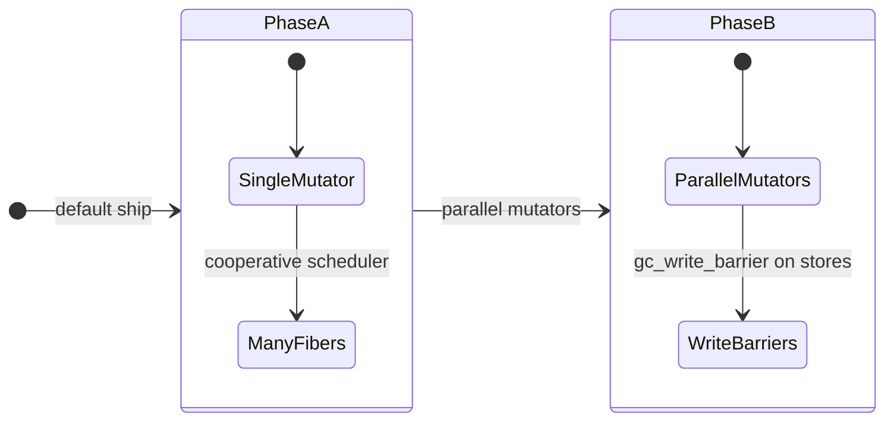
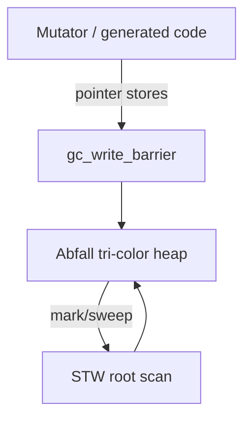

<!-- migrated from the legacy platform spec; canonical OpenSpec source -->
# Memory and GC runtime contract Specification

## Purpose

Allocation, object lifetime, and garbage-collection responsibilities shared across compiler and runtime.
## Requirements
### Requirement: Ship Phase A GC before parallel mutators: Decision [D-EXEC-RT-0005]
The Beskid standard SHALL enforce the following migrated contract section. Accepted ADR decisions are binding; uppercase requirement keywords retain their BCP-14 meaning.

> | Phase | Mutators | Ship order |
> | --- | --- | --- |
> | **A (v0.2)** | One Beskid mutator; many cooperative fibers | **Default ship** |
> | **B** | Parallel mutators | Not implemented in 0.6.0; the runtime has no Phase B switch. Parallel execution is planned in the changes `v061-attributes-and-isolate-prerequisites` through `v065-parallel-sequences` |
> 
> Phase B **must not** become the default without updating this feature hub and fiber
> scheduler contracts.

**Stable ID:** `BSP-REQ-46C4422DC096`  
**Legacy source:** `site/spec-content/platform-spec/execution/runtime/memory-and-gc-runtime-contract/adr/0005-phase-a-before-phase-b/content.md`  
**Source SHA-256:** `e1c463259520657e4c81b6420e3a90e87afaea20ee7f12314a79dec3275d8563`

#### Scenario: Conformance exercises Decision
- **GIVEN** an implementation claims conformance with this capability
- **WHEN** behavior governed by this contract section is exercised
- **THEN** every MUST, SHALL, REQUIRED, prohibition, and accepted decision in the section is satisfied

### Requirement: Span-batched tri-color mark-sweep collection and barrier exports: Decision [D-EXEC-RT-0006]
The Beskid standard SHALL enforce the following migrated contract section. Accepted ADR decisions are binding; uppercase requirement keywords retain their BCP-14 meaning.

> | Component | Role |
> | --- | --- |
> | **Collector** | Precise, non-moving tri-color mark-sweep collector in the canonical runtime (`Runtime/Mem/Gc`). Marking is span-batched: shading an object sets its bit in the span mark bitmap and enqueues the span once on a heap-wide FIFO; draining a span scans every marked-but-unscanned slot in one pass; a large object is shaded in its header mark word and its span is queued on the same FIFO (`Marking.bd`) |
> | **Scheduling** | From 0.6.2 a collection cycle is incremental: it runs in bounded steps on the heap's own mutator thread, between that heap's fiber executions, with no marker thread. The phases are idle, marking (mark start, mark steps, mark termination), sweeping (sweep steps) and idle again. `gc_collect` completes a whole cycle inside the call |
> | **Atomicity** | Mutator stores run between mark steps. The hybrid write barrier, allocation in black and the root snapshot at mark start keep every object that is reachable at mark start, and every object allocated during the cycle, alive to the end of the cycle |
> | **Field stores** | From 0.6.2 generated code SHALL guard each store that overwrites a GC-managed field of an existing object with the barrier: an inline test of `beskid_rt_v5_gc_barrier_active`, and a call to `beskid_rt_v5_gc_write_barrier(slot, value)` before the store only when the test is non-zero |
> | **Array element stores** | From 0.6.2 generated code guards each store that overwrites a GC-managed array element in the same way. Stores that initialize a new object (aggregate literals, array literals, closure environments, spawn argument environments) have no barrier |
> | **Barrier exports** | `beskid_rt_v5_gc_write_barrier` is the barrier of generated code and of runtime stores into existing objects. `gc_write_barrier` and `beskid_rt_v5_array_write_barrier` keep their 0.6.0 signatures and semantics (shade the new value while the calling thread's heap is marking) for native Mod adapters; generated code does not call them. No barrier export has an effect outside the marking phase of the calling thread's heap |

**Stable ID:** `BSP-REQ-76C777704644`  
**Legacy source:** `site/spec-content/platform-spec/execution/runtime/memory-and-gc-runtime-contract/adr/0006-abfall-tri-color-heap/content.md`  
**Source SHA-256:** `d83d75b49f675ad50cb41d55685814a5a6b26bd1e5836b528545937ba764d731`

#### Scenario: Conformance exercises Decision
- **GIVEN** an implementation claims conformance with this capability
- **WHEN** behavior governed by this contract section is exercised
- **THEN** every MUST, SHALL, REQUIRED, prohibition, and accepted decision in the section is satisfied

#### Scenario: A collection cycle interleaves with the mutator
- **GIVEN** a program that keeps 16 MiB of linked managed objects reachable and then allocates 32 MiB of short-lived objects
- **WHEN** a cycle starts at the mark trigger
- **THEN** `gc_phase` reads 1 at more than one allocation of the program before it reads 2, no mark step traces more than the step bound of "Mark pacing and bounded steps", and every reachable object is intact after the cycle

### Requirement: Heap objects carry type descriptors for scanning: Decision [D-EXEC-RT-0007]
The Beskid standard SHALL enforce the following migrated contract section. Accepted ADR decisions are binding; uppercase requirement keywords retain their BCP-14 meaning.

> | Rule | Detail |
> | --- | --- |
> | Header | Heap objects begin with a **type descriptor pointer** for precise scan |
> | Allocation | `alloc(size, type_desc)` uses `abfall::Heap::allocate_beskid` |
> | Strings / arrays | `BeskidStr`, `BeskidArray` headers per [builtins layout](/platform-spec/execution/abi-and-host/builtins-and-symbols/) |
> | Roots | Stacks (stack maps), globals (registered roots), `gc_root_handle` externals |
> | Compiler | Lowers descriptors and stack maps; does not embed collector policy |

**Stable ID:** `BSP-REQ-8EDA62A2D0E0`  
**Legacy source:** `site/spec-content/platform-spec/execution/runtime/memory-and-gc-runtime-contract/adr/0007-heap-type-descriptors/content.md`  
**Source SHA-256:** `d048da0588f5491093ffb15b350cced510c8f6e9a617aa315d22936e6e97da9d`

#### Scenario: Conformance exercises Decision
- **GIVEN** an implementation claims conformance with this capability
- **WHEN** behavior governed by this contract section is exercised
- **THEN** every MUST, SHALL, REQUIRED, prohibition, and accepted decision in the section is satisfied

### Requirement: Growable managed heap of chained regions
The managed heap SHALL be a chain of one or more independently mapped regions obtained through `system_allocate`. Each region SHALL begin with a 64-byte region header (`next`, `size`, `bump`, `limit`, `free_bytes`, `largest_free`, `objects_start`, reserved) and SHALL hold a span directory followed by objects only in `[objects_start, bump)`, where `objects_start` accounts for the directory's size. The runtime SHALL add regions to the chain while a program is running instead of failing an allocation that the committed-size cap still permits. Objects SHALL NOT move when a region is added, when a span is carved or freed within a region, or when a collection runs. Marking, sweeping, free-list reuse, and every heap-membership test (`HeapContains`/`spanOf`-equivalent lookup, `IsAllocatedObject`, `ManagedObjectForReference`) SHALL treat every region in the chain and every span within it, and SHALL keep the existing per-block boundary rule inside each span. The `BeskidHeapState` layout in `runtime_manifest.bsol` and the `HEAP_*` constants in the canonical runtime sources SHALL be identical, and a compiler test SHALL fail when they differ.

**Stable ID:** `BSP-REQ-88A15BB6918A`

#### Scenario: Live data larger than the initial region survives growth and collection
- **GIVEN** a program that keeps 4 MiB of managed objects reachable from roots with an initial region of 1 MiB
- **WHEN** the program allocates that data, reads `gc_heap_region_count` and `gc_heap_committed`, drops the roots, and calls `__gc_collect`
- **THEN** every allocation succeeds, `gc_heap_region_count` is at least 3, `gc_heap_committed` exceeds 1 MiB, every object address that was returned before growth still validates as an allocated object, and after the collection `gc_bytes_allocated` reports only the objects that remain reachable

#### Scenario: Address-to-span lookup does not walk the region's objects
- **GIVEN** a region holding many spans across several size classes
- **WHEN** the runtime resolves an arbitrary live object address to its span
- **THEN** the resolution touches only the region's span directory (an O(1) arena-index computation), never a linear walk over prior objects or spans in the region

### Requirement: Span/page allocator carved from region pages
Each region SHALL be subdivided into fixed 8 KiB pages, and every allocation SHALL be served from a span: a run of one or more whole pages holding objects of exactly one size class, or, for a request whose rounded size exceeds the largest size class, a dedicated span sized to the request. The runtime SHALL carry a generated size-class table (bytes per class, pages per span, and a reciprocal-multiplication constant for slot-index computation) checked into the compiler and cross-checked by a test against the `.bd` constants that mirror it. Each span SHALL record, outside the bytes available to objects, its base, page count, size class, an allocation bitmap, a mark bitmap, and a free-slot list. A span's `noscan` classification SHALL be derived from its size class's type descriptor at first carve and SHALL exclude the span from marking's scan work. Allocation of a small object SHALL be O(1) amortized (pop a free slot or advance a bump index within the current span of that class) and SHALL touch the region's growth or free-page bookkeeping only when the current span for a class is exhausted.

**Stable ID:** `BSP-REQ-990344D0B4B6`

#### Scenario: Many small objects across every size class land on class-homogeneous spans
- **GIVEN** a program that allocates one rooted object of every size class the table defines, repeated until each class has filled at least one span
- **WHEN** the objects are read back by address
- **THEN** every object's span reports the exact size class its request rounded to, no span mixes two size classes, and no allocation in this sequence walked the region's free-page list more than once per span exhaustion

#### Scenario: A request larger than the largest size class gets a dedicated span
- **GIVEN** a single allocation request larger than the largest size class
- **WHEN** the allocation runs
- **THEN** it is served by a span sized to the request rounded up to whole pages, that span reports size class zero (large), and no unrelated allocation shares its pages

### Requirement: Heap growth pacing and committed-size cap
The runtime SHALL keep a `collection_threshold` equal to `max(2 * live_bytes after the last completed cycle, 512 KiB)` and a `mark_trigger` equal to `collection_threshold - collection_threshold / 4`. At a pacing point, which is a span refill for a size class or a large or dedicated-region request that cannot be served, an idle heap whose `live_bytes` has reached `mark_trigger` SHALL start an incremental collection cycle; a heap whose `live_bytes` has reached `collection_threshold` SHALL complete its collection cycle (start one if it is idle, then finish marking and sweeping inside the allocating call) before it grows; a heap that is sweeping SHALL finish sweeping before it grows; otherwise the heap SHALL grow without completing a cycle, also while it is marking. Starting a cycle is not a collection in the sense of this requirement; completing one is. Pacing SHALL be evaluated at pacing points, not on every allocation. A growth region SHALL be at least the requested allocation plus the region header and span directory, SHALL otherwise start at 1 MiB and double after every growth up to 64 MiB, and a request larger than the pending region size SHALL receive a dedicated region. The runtime SHALL NOT let `committed_bytes` exceed `cap_bytes`. When growth fails because the cap is reached, the runtime SHALL complete the in-progress cycle, retry the allocation, and if it still fails SHALL run one more complete cycle and retry once more before it reports exhaustion, so that objects that were unreachable at the failing allocation are reclaimed as in 0.6.0. The runtime SHALL export `beskid_rt_v5_heap_set_cap(bytes) -> u8`, which SHALL succeed only while the runtime is active and `bytes` is at least both the committed size and the initial region size, and SHALL export `gc_heap_cap`, `gc_heap_committed`, `gc_heap_region_count`, and `gc_heap_failure_reason` as read-only statistics.

The runtime SHALL NOT impose a fixed default cap on the managed heap: without configuration, `cap_bytes` SHALL be the maximum word value and the heap SHALL grow by regions until the system allocator refuses, which SHALL remain the diagnosable `out_of_memory` trap with the existing failure reason and diagnostic. The region chain SHALL have no fixed region count.

The runtime SHALL read `BESKID_HEAP_MAX` during `beskid_rt_v5_process_init`, after the heap, the primary thread and the scheduler exist, as a decimal byte count with an optional `k`, `m` or `g` suffix (powers of 1024, either case), and SHALL apply it through `beskid_rt_v5_heap_set_cap`. An absent or empty variable SHALL leave the heap uncapped. An unparsable value, or one the cap export rejects (below the committed size or below the initial region size), SHALL terminate initialization through the runtime trap path with exit status 101 and the variable name as the diagnostic message. Because the runtime reads the variable, every activation path (executable host, `beskid_library_attach_v5`, embedding engines) SHALL honour it identically; the executable host SHALL NOT parse it. `BESKID_HEAP_MAX_BYTES` is not read.

**Stable ID:** `BSP-REQ-539C3C627D46`

#### Scenario: Cap from the environment
- **GIVEN** a process started with `BESKID_HEAP_MAX=2m` whose program keeps 3 MiB of managed objects reachable
- **WHEN** the allocation that would exceed 2 MiB runs
- **THEN** the process terminates with exit status 101, the `out_of_memory (5)` diagnostic and `cap=2097152`

#### Scenario: Malformed cap
- **GIVEN** a process started with `BESKID_HEAP_MAX=abc`
- **WHEN** `beskid_rt_v5_process_init` runs
- **THEN** the process terminates with exit status 101 and `BESKID_HEAP_MAX` in the diagnostic

#### Scenario: No cap
- **GIVEN** a process started without `BESKID_HEAP_MAX` on a machine with the memory
- **WHEN** its program keeps 1,088 MiB of managed objects reachable
- **THEN** the allocations succeed, more than one region is committed and the heap verifies clean

#### Scenario: Garbage-heavy program collects instead of growing
- **GIVEN** a program whose reachable set never exceeds 64 KiB but that allocates 8 MiB of short-lived objects in a loop
- **WHEN** the loop completes
- **THEN** `gc_heap_committed` is still 1 MiB, `gc_heap_region_count` is 1, and `gc_collection_count` is greater than zero

#### Scenario: A cycle starts at the mark trigger without blocking growth
- **GIVEN** an idle heap with `collection_threshold` 512 KiB whose live bytes reach 384 KiB at a span refill
- **WHEN** the refill runs
- **THEN** `gc_phase` reads 1 after the refill, `gc_collection_count` is unchanged, and an allocation that needs a new region before the threshold is reached grows the heap while `gc_phase` still reads 1

#### Scenario: Reaching the threshold while marking completes the cycle before growth
- **GIVEN** a heap that is marking, whose live bytes have reached `collection_threshold`, and whose next allocation cannot be served from committed pages
- **WHEN** that allocation runs
- **THEN** `gc_collection_count` increases by one before `gc_heap_region_count` changes

#### Scenario: Cap pressure reclaims garbage dropped during a cycle
- **GIVEN** a process started with `BESKID_HEAP_MAX=8m` whose program keeps 1 MiB reachable, calls `gc_cycle_start`, then drops a 4 MiB graph that was reachable at mark start and allocates 4 MiB of new reachable objects
- **WHEN** an allocation reaches the cap
- **THEN** the runtime completes the in-progress cycle and one more cycle, `gc_collection_count` increased by two, every allocation succeeds, and the process does not trap

### Requirement: Growable root and handle stacks
The runtime SHALL root every GC-managed local, construction temporary, and host-held handle in a segmented, growable stack rather than a fixed-capacity table. Registering a root SHALL append it to the current segment, allocating and linking a new segment through the platform allocator (never through the managed allocator) when the current segment is full; registration SHALL NOT fail or silently refuse to root a value because a fixed capacity was reached. Unregistering a root SHALL remove it from whichever segment holds it. Marking SHALL walk every segment of both stacks in addition to the existing `RootFrame` chain and suspended-fiber walk, unchanged. A managed value that crosses a fiber boundary (join, channel transfer, or an ABI-value slot) SHALL be rooted by the transferring code for as long as it is reachable only through that transfer, matching the existing `AbiValue` rooting discipline.

**Stable ID:** `BSP-REQ-0FC58CAAF5D8`

#### Scenario: Deep recursion roots thousands of concurrently live locals without a capacity ceiling
- **GIVEN** a recursive-descent parse (or an equivalent synthetic fixture) that keeps several thousand GC-managed locals and construction temporaries rooted concurrently on the call stack
- **WHEN** the parse runs to completion
- **THEN** every root registration succeeds, no root or handle registration is silently refused, and the process does not terminate by signal

#### Scenario: Root-stack growth failure is a diagnosable trap, not a crash
- **GIVEN** the platform allocator is made to fail the specific allocation that would grow the root stack
- **WHEN** a root registration needs a new segment
- **THEN** the runtime calls the typed exhaustion trap with a reason distinguishing root-stack growth failure from heap growth failure, and the process exits 101 rather than crashing

### Requirement: Diagnosable managed-heap exhaustion
When a valid allocation cannot be satisfied after the pacing policy has collected and the cap or the operating system refuses further growth, the runtime SHALL record the failure reason and requested size in the heap state and SHALL call the runtime trap with code 5 (`out_of_memory`) and a message that contains the reason code, requested bytes, live bytes, committed bytes, and cap bytes as decimal numbers. Failure reasons SHALL include, at minimum, cap reached, platform allocation failure, a request larger than the cap, and root- or handle-stack growth failure. The trap host SHALL print `beskid runtime trap v5: <trap name> (<code>): <message>` and exit with status 101. `beskid_rt_v5_managed_object_allocate` SHALL NOT return null for a valid request; null remains reserved for a malformed request or descriptor. Exhaustion inside a fiber SHALL be process-fatal through the same trap. The generated `trapz` guard after each allocation call SHALL remain as the fail-closed backstop for malformed requests.

**Stable ID:** `BSP-REQ-8C1FA4687232`

#### Scenario: Cap exhaustion exits through the out-of-memory trap instead of an illegal-instruction signal
- **GIVEN** a process started with `BESKID_HEAP_MAX=2m` whose program keeps 3 MiB of managed objects reachable
- **WHEN** the allocation that would exceed the cap runs
- **THEN** the process exits with status 101, was not terminated by a signal, and its standard error contains `beskid runtime trap v5`, `out_of_memory (5)`, and `cap=2097152`

### Requirement: Canonical provider GC handle and root registration exports
The canonical shared runtime SHALL export its source-defined `beskid_rt_v5_gc_resolve_handle` operation with a machine-word handle parameter and pointer result, and `beskid_rt_v5_gc_root_slot_is_registered` with a pointer parameter and Boolean result represented as an unsigned byte. These exports SHALL be declared in the runtime manifest and generated provider headers. Resolution SHALL validate current-heap handle generation; registration checking SHALL inspect current-heap root registrations without dereferencing the supplied address or creating a registration.

#### Scenario: Provider object resolves a managed handle
- **WHEN** a native provider operation calls `beskid_rt_v5_gc_resolve_handle` for a current live handle
- **THEN** the canonical image supplies the source-defined operation with the declared ABI
- **AND** stale or foreign handles resolve to a null pointer

#### Scenario: Existing root registration is required
- **WHEN** a provider publication operation checks a supplied root slot
- **THEN** only an existing registration in the current heap produces a true result
- **AND** an absent or null slot is rejected without allocation or registration

### Requirement: Native provider imports retain target and symbol kind
Every native provider system dependency SHALL have a target-bound manifest contract identifying its owning system library and symbol kind. Function imports SHALL retain physical parameter/result signatures. Data imports SHALL retain a non-void value type without callable parameters and SHALL NOT be admitted as functions. Generated source and installed manifest projections SHALL preserve this distinction. Unknown imports and a changed function/data kind SHALL fail provenance validation.

#### Scenario: Native process transport imports
- **WHEN** a canonical POSIX process provider imports process, signal, environment or memory operations
- **THEN** its actual function signatures and environment data symbol are declared for that exact target
- **AND** an unrelated target does not inherit those imports

#### Scenario: Environment data cannot become a function
- **WHEN** the environment pointer is declared as a platform data import
- **THEN** its manifest projection retains data kind and pointer value type
- **AND** callable parameters, void value types and a tampered kind are rejected

### Requirement: Span-queued incremental marking and per-span sweep
Marking SHALL be precise: only addresses that the compiler or runtime records as pointer-bearing are treated as roots or traced. Shading an object on a small, scannable span SHALL set that object's bit in the span's mark bitmap (`SPAN_MARK_BITS`) and, if the span is not already queued, SHALL enqueue the span on the heap's first-in-first-out mark queue (`HEAP_MARK_FIFO_HEAD`/`HEAP_MARK_FIFO_TAIL`) exactly once; a span already queued SHALL accumulate further marks without being enqueued again. Draining a dequeued small span SHALL scan every slot that is marked and not yet scanned (`SPAN_SCANNED_BITS`) in one left-to-right pass, tracing each such object's pointer fields and shading their targets. Shading a large object SHALL change its header mark word from white to gray and SHALL enqueue its span on the same queue; the separate pass over every region's span directory (`ProcessLargeObjectsOnce`) SHALL be removed. Draining a large span SHALL trace at most 8 KiB of the object's pointer-bearing bytes from the scan cursor kept in the first word of the span entry's mark bitmap (unused by a large span: element index for an array, pointer-map index for an aggregate), SHALL advance the cursor, and SHALL re-enqueue the span at the tail when bytes remain; when the object is fully traced it SHALL set the header to black and clear the cursor. Marking SHALL terminate when the queue is empty after mark termination (see "Incremental collection cycle"). Sweeping SHALL process spans in bounded sweep steps after marking: a span with no marked object SHALL return its pages to the region's free-page list; a span with at least one marked object SHALL exchange its allocation bitmap for its mark bitmap, rebuild its free-slot list from the newly free slots and clear its mark and scanned bitmaps; a large span whose object is black SHALL survive with the header reset to white, and otherwise SHALL return its pages. A region's adjacent free spans SHALL be merged (`CoalesceRegionFreeSpans`) when the sweep leaves that region. Sweeping SHALL NOT read or write the byte contents of live objects.

#### Scenario: Two objects on the same span are scanned together, not re-walked per object
- **GIVEN** two rooted objects that land on the same span and no other live object on that span
- **WHEN** a collection runs
- **THEN** the span is dequeued from the mark work queue exactly once and both objects are scanned during that single dequeue

#### Scenario: An emptied span is returned and reused by a different size class
- **GIVEN** a span fully populated with one size class whose objects are all dropped before a collection, in a region otherwise at capacity for new spans
- **WHEN** the collection runs and a subsequent allocation requests a different size class
- **THEN** the emptied span's pages satisfy that later allocation

#### Scenario: A large pointer array is traced in chunks
- **GIVEN** a rooted `string[]` of 131,072 elements (1 MiB of element bytes) whose every element is a distinct string, during an incremental cycle
- **WHEN** mark steps run with the default budget
- **THEN** the array's span is dequeued at least 128 times, no single dequeue traces more than 8 KiB of its elements, every string is marked at termination, and the array header is black

### Requirement: Incremental collection cycle
Each heap SHALL run its own collection cycle on its own mutator thread; the runtime SHALL NOT start a marker or sweeper thread. A cycle SHALL pass through these phases, recorded in `HEAP_GC_PHASE` and read by `gc_phase` (0 idle, 1 marking, 2 sweeping, 3 failed):

1. Mark start (one step): set the phase to marking and raise the process barrier flag (see "Per-heap collection state"), so that no mutator store runs between the first shade and an active barrier; then shade the whole root set (see "Roots during incremental marking") without tracing.
2. Mark steps: each step drains the mark queue under the step budget of "Mark pacing and bounded steps".
3. Mark termination (one step, entered when a mark step leaves the queue empty): rescan the root set, drain any work it creates to completion, and repeat until a rescan shades no object; then lower the barrier flag, advance the heap's sweep generation and set the phase to sweeping.
4. Sweep steps: each step sweeps a bounded number of spans in region and page order from the heap's sweep cursor; the step that leaves no unswept span records the live-byte totals, sets `collection_threshold` and `mark_trigger`, increments `gc_collection_count` and sets the phase to idle.

Marking SHALL terminate: every object is shaded at most once per cycle, objects allocated during the cycle are not traced, so the mark work of a cycle is bounded by the objects that existed at mark start; every pacing point and every fiber yield while marking performs mark work, and reaching `collection_threshold` completes the cycle. `gc_collect` SHALL complete any in-progress cycle and then run one complete cycle whose mark start follows the call, so that every object unreachable at the call is freed when it returns. A mark failure (a descriptor or bounds validation failure in tracing) SHALL lower the barrier flag, reset mark state as `ResetMarkedObjects` does today, and set the failed phase; it SHALL NOT sweep. An idle heap at process or isolate shutdown with a cycle in progress SHALL lower the barrier flag and discard the cycle without sweeping.

#### Scenario: Phases are observed in order
- **GIVEN** a heap with live objects and `gc_cycle_start` called once
- **WHEN** a test calls `gc_mark_step(32768)` until it returns 0
- **THEN** the returned phases are a run of 1, then a run of 2, then 0, and `gc_collection_count` increased by exactly one

#### Scenario: Explicit collection frees objects dropped during a cycle
- **GIVEN** a heap that is marking and an object that was reachable at mark start and is dropped before `gc_collect` is called
- **WHEN** `gc_collect` returns
- **THEN** the object's slot is free, `gc_phase` reads 0, and `gc_collection_count` increased by two

#### Scenario: A mark failure discards the cycle
- **GIVEN** a test that corrupts the descriptor word of a reachable object during an incremental cycle
- **WHEN** the next mark step traces the object
- **THEN** `gc_phase` reads 3, `beskid_rt_v5_gc_barrier_active` reads 0, no span was swept, and every span's mark and scanned bitmaps are clear

### Requirement: Mark pacing and bounded steps
At mark start the runtime SHALL record `mark_start_live` (the heap's `live_bytes`), a scan estimate (the live bytes at the end of the previous cycle's sweep, or `mark_start_live` for the first cycle) and a runway equal to `collection_threshold - mark_trigger`. At each pacing point while the heap is marking, the mark debt SHALL be `(live_bytes - mark_start_live) * scan_estimate / runway - scan_work_done`, computed with saturating word arithmetic, where `scan_work_done` counts the bytes traced in this cycle; when the debt is positive the runtime SHALL perform one mark step whose budget is the debt clamped to `[32 KiB, 256 KiB]`. A small allocation served from a span's free-slot list SHALL NOT perform mark work. `FiberYield` SHALL perform one 32 KiB mark step, or one sweep step, at its start, before it changes scheduler state, when the heap is marking or sweeping. A scheduler loop with no runnable fiber MAY perform mark or sweep steps before it blocks. A mark step SHALL stop at the first span or large-object chunk boundary at or after its budget, so that it traces at most its budget plus 8 KiB; mark start SHALL shade roots only and SHALL NOT trace; mark termination SHALL trace only what the rescan shades. A sweep step SHALL sweep at most 32 spans, plus the span that an allocation needs (see "Allocation and sweeping during a cycle"). The heap SHALL record the largest number of bytes traced by one mark step of the last completed cycle, excluding completions forced by `gc_collect`, by the threshold or by cap pressure, and SHALL export it as `gc_last_cycle_max_step_bytes() -> word`. The runtime SHALL export `gc_cycle_start() -> u8`, which starts a cycle when the heap is idle and returns 1, and returns 0 otherwise, and `gc_mark_step(word budget) -> word`, which performs one mark step with that budget, or one sweep step, and returns the phase after the step. The pacing SHALL NOT depend on environment variables. The runtime SHALL NOT read `BESKID_GC_*` environment variables other than `BESKID_GC_STRESS` and `BESKID_GC_QUARANTINE`, which the v0.6.1 stress and poison contract defines.

#### Scenario: Step size is bounded
- **GIVEN** a program that keeps 64 MiB of linked managed objects reachable and allocates 128 MiB of short-lived objects
- **WHEN** the program ends
- **THEN** at least one cycle completed and `gc_last_cycle_max_step_bytes` is at most 262,144 + 8,192

#### Scenario: A fiber that yields without allocating advances marking
- **GIVEN** a heap with 4 MiB of reachable objects and at most 8 MiB committed, `gc_cycle_start` called once, and two fibers that only call `Fiber.Yield` in a loop without allocating
- **WHEN** the fibers yield 1,000 times in total
- **THEN** `gc_phase` reads 0 and `gc_collection_count` increased by one

### Requirement: Hybrid write barrier
While a heap is marking, a store that overwrites a pointer slot inside an existing managed object of that heap SHALL be preceded by the hybrid barrier `beskid_rt_v5_gc_write_barrier(slot, value)`, which SHALL shade the value currently in `slot` (Yuasa deletion half) and SHALL shade `value` (Dijkstra insertion half), each when it is non-null, and SHALL do nothing when the calling thread's heap is not marking. The deletion half is the correctness argument: with the root snapshot at mark start and allocation in black it keeps every object reachable at mark start alive to the end of marking (snapshot at the beginning). The insertion half SHALL be kept so that a store never creates an edge from a black object to a white object, which makes the termination rescan a check that finds no new object. The barrier SHALL NOT allocate, collect, perform mark or sweep work, yield, switch fibers or trap; it is not a safepoint. Shading a null value or a value that resolves to no object of the heap (`ManagedObjectForReference` returns null) SHALL do nothing. The barrier SHALL apply to these stores: assignments to GC-managed fields and array elements in generated code (`=`, `+=` and `-=` forms), the field write of `move x.f` and of `exchange(place, move v)`, the collection mutation owner field store (`beskid_isle/src/context/calls/collections.rs:285`), `Utf8RecordAdopt` (`Runtime/Data/Utf8ViewRecord.bd:46`), and every other runtime store into an existing managed object. It SHALL NOT apply to these stores, which SHALL carry no barrier: stores into registered root slots, handle slots, `RootFrame` slots and fiber frames (the root set is shaded at mark start and rescanned at termination); stores into native memory; and initialization stores into an object allocated by the same construction before it is published (aggregate literals, array literals, closure environments through `beskid_rt_v5_closure_capture_store`, spawn argument environments, and the copy into a new array by `GrowArrayRooted`), whose old value is null and whose object is black when allocated during marking. `AbiValue` slots are registered roots, so `AbiValueInitialize`, `AbiValueClear` and `AbiValueReplaceWithBarrier` (`Runtime/Mem/AbiValue.bd:153,167,193-194`) SHALL NOT call a barrier. A runtime store that copies or moves several pointer slots inside an existing object SHALL apply the barrier to every destination slot before the copy. `gc_write_barrier(parent, child)` and `beskid_rt_v5_array_write_barrier(array, value)` SHALL keep their 0.6.0 behavior for native Mod adapters, which use them only for initialization stores.

#### Scenario: Deletion half keeps an object hidden behind a black object
- **GIVEN** objects `x` (reachable at mark start, not yet scanned) with field `f` holding the only reference to `w`, and a record `b` allocated after mark start, in a heap that is marking
- **WHEN** the program runs `b.f = x.f; x.f = null;`, drops every local that holds `w`, and the cycle completes
- **THEN** `w` was shaded by the store `x.f = null`, `w` survives the sweep, and `b.f` still reads `w`

#### Scenario: Array element overwrite during marking
- **GIVEN** a `string[]` reachable at mark start whose element 7 holds the only reference to a string `s`, and a record `b` allocated during marking
- **WHEN** the program copies element 7 into `b`, stores another string into element 7, drops its locals and the cycle completes
- **THEN** `s` survives and `b` still reads it

#### Scenario: Insertion half shades the stored value at once
- **GIVEN** a heap that is marking and a string `s` allocated before mark start whose span has not been drained
- **WHEN** the program stores `s` into a field of a record allocated before mark start
- **THEN** `gc_object_mark_state(s)` is not 0 immediately after the store

#### Scenario: Destructive read shades the moved value
- **GIVEN** a record `r` reachable at mark start with an `Option<Node>` field holding the only reference to a node `n`, in a heap that is marking
- **WHEN** the program runs `Option<Node> o = move r.f;`, stores `o` into a record allocated during marking and drops `o`
- **THEN** `n` survives the cycle

#### Scenario: Root stores carry no barrier
- **GIVEN** an `AbiValue` slot initialized, replaced and cleared while the heap is marking
- **WHEN** the operations run
- **THEN** `Runtime/Mem/AbiValue.bd` contains no barrier call, and `gc_object_mark_state` reads 2 for every payload that is still held at termination

### Requirement: Write barrier emission in generated code
From 0.6.2 ISLE lowering SHALL emit the barrier for every assignment whose target is a field (`AssignmentKind::Field`, `emit_field_assign` in `beskid_isle/src/context/aggregate.rs`) or an array element (`AssignmentKind::Index`, `emit_index_assign`) when the managed-reference fact of the assignment target node is `ManagedReferenceFact::GcManaged`, the fact that also decides managed-local rooting (`beskid_isle/src/context/roots.rs:58`) and that comes from the `managed_reference_kind` query (`beskid_queries/src/semantic_contract/queries.rs:122`). A target node without a managed-reference fact SHALL be a lowering error, not a store without a barrier. A target whose fact is `NativeOrScalar` SHALL have no barrier. The emitted sequence SHALL, before the store, load the word at the data symbol `beskid_rt_v5_gc_barrier_active` through `symbol_global`, branch on it, and call `beskid_rt_v5_gc_write_barrier(slot, value)` only in a block marked cold when it is non-zero; the store SHALL follow in the common successor block. The idle path SHALL contain no call. The barrier call SHALL NOT be followed by a `trapz` check because it returns no value. `ArrayLayout::needs_write_barrier` and the per-element `beskid_rt_v5_array_write_barrier` calls of array literal and index lowering (`aggregate.rs:75,179`, `calls/collections.rs:50,254`, `calls/checked_collections.rs:120`, `composition.rs:122`) SHALL be removed. Leaf-function root elision (`beskid_isle/src/root_elision.rs`) SHALL treat a call to `beskid_rt_v5_gc_write_barrier` as a non-safepoint call, like root registration, so a function whose only other calls are root registrations stays eligible. The comments and tests that state that collection is stop-the-world and that no barrier is emitted (`calls/collections.rs:286-289`, `spawn_arguments.rs:33`, `beskid_codegen/src/dynamic_mapping.rs:194`, `beskid_isle/tests/managed_local_roots_static.rs:35-43`, `beskid_isle/tests/collection_publication_static.rs:23`) SHALL be updated to the 0.6.2 rule. The ABI-v5 runtime manifest SHALL declare `beskid_rt_v5_gc_write_barrier` with signature `(ptr, ptr) -> unit` and the data symbol `beskid_rt_v5_gc_barrier_active` (one word), and the generated ABI JSON, C header, Rust bindings and runtime-kit allowlist SHALL agree.

#### Scenario: Managed field store is guarded
- **GIVEN** `pub type Node { Node next; i64 value; }` and the statement `a.next = b;`
- **WHEN** the function is lowered
- **THEN** the CLIF loads `beskid_rt_v5_gc_barrier_active`, branches on it, calls `beskid_rt_v5_gc_write_barrier` with the field address and `b` in a cold block, and the store to `next` follows the branch

#### Scenario: Scalar field and literals carry no barrier
- **GIVEN** the statements `a.value = 1_i64;`, `Node c = Node { next: a, value: 2_i64 };` and `string[] xs = ["p", "q"];`
- **WHEN** the function is lowered
- **THEN** the CLIF contains no load of `beskid_rt_v5_gc_barrier_active` and no barrier call for these statements

#### Scenario: Index store is guarded
- **GIVEN** `xs[i] = s;` with `xs` of type `string[]`
- **WHEN** the function is lowered
- **THEN** the guarded barrier call precedes the element store and no `beskid_rt_v5_array_write_barrier` call is emitted

#### Scenario: Leaf root elision survives the barrier
- **GIVEN** a function whose only calls are root registrations and one guarded barrier
- **WHEN** module emission applies root elision
- **THEN** the root registrations are removed and the barrier call remains

### Requirement: Allocation and sweeping during a cycle
While its heap is marking, the allocator SHALL allocate black: a small object SHALL have its mark bit and scanned bit set when its slot is popped (`GcAllocSmall`, `Runtime/Mem/Gc/Allocation.bd:98-123`), and a large object SHALL have its header mark word set to black (`GcAllocLargeOnce`, `Allocation.bd:145-159`), so that the object survives the cycle and is never traced by it. Because the large-object mark word is part of the object bytes, `GcTryAlloc` SHALL return zeroed object bytes and SHALL set the black state after zeroing, and the callers that zero the bytes they receive (`Alloc`, `Allocation.bd:452`; `AllocateObject`, `Runtime/Bootstrap/Objects.bd:252`; the array allocators, `Runtime/Data/Collections.bd:63,187`) SHALL no longer clear them. While its heap is sweeping, the allocator SHALL NOT pop a slot from a span that the current cycle has not swept: each span entry SHALL record the sweep generation in which it was last swept (word at offset 248 of `BeskidSpanHeader`, inside the existing padding), the heap SHALL record the current generation, and the allocator SHALL sweep a span whose generation differs before it pops a slot from it, including the cached span of `HEAP_CURRENT_SPAN_BY_CLASS`. A span carved for a size class or a large object SHALL be stamped with the current generation. Objects allocated while sweeping are white, on swept spans, and survive. `live_bytes` SHALL increase at each allocation as today and SHALL decrease by the bytes that each swept span frees, so that it equals the 0.6.0 post-sweep value when the sweep ends without allocation in between. A new cycle SHALL NOT start until the sweep of the previous cycle has completed.

#### Scenario: Object allocated during marking survives without a root at termination
- **GIVEN** a heap that is marking
- **WHEN** the program allocates a record, stores it only into a field of an object reachable at mark start, and the cycle completes
- **THEN** the record survives, and it was not traced by the cycle

#### Scenario: Large allocation during marking keeps its black state
- **GIVEN** a heap that is marking
- **WHEN** the program allocates a 64 KiB `u8[]` through `Alloc`
- **THEN** the array's header mark word reads black after `Alloc` returns and the array survives the cycle

#### Scenario: Allocation from an unswept span sweeps it first
- **GIVEN** a heap that is sweeping and the cached span of a size class that the sweep cursor has not reached, holding dead objects
- **WHEN** the program allocates an object of that class
- **THEN** that span is swept before the slot is popped, the new object is not freed when the sweep cursor later passes the span, and `gc_heap_verify` returns true after the cycle

### Requirement: Roots during incremental marking
Mark start SHALL shade, in one step, every value in the root set: the current thread's `RootFrame` chain, every registered root slot, the suspended fiber frames of the heap (`MarkSuspendedFiberRoots`, `Runtime/Fiber/Scheduler/Core.bd:438-451`) and every handle slot, as `MarkRoots` does today (`Runtime/Mem/Gc/RootsHandles.bd:336-381`). The root set is a snapshot: stores into root slots, handle slots and fiber frames during marking SHALL carry no barrier, and a root registered or a fiber spawned during marking holds only values that were reachable at mark start or were allocated during the cycle. Mark termination SHALL rescan the same root set, including the frames of every fiber that is suspended at termination, and SHALL shade and drain what the rescan reaches. A correct barrier and allocation in black make the rescan shade nothing; the runtime SHALL count the objects the rescan shades in the cycle statistics. Construction temporaries SHALL stay rooted through their handle until publication, as in 0.6.0.

#### Scenario: Suspended fiber holds the only reference
- **GIVEN** a fiber that holds the only reference to a list of 10,000 nodes in a local and is suspended in `Fiber.Yield` when a cycle starts
- **WHEN** another fiber allocates until the cycle completes and the first fiber then reads every node
- **THEN** every node is intact and the termination rescan shaded no object

#### Scenario: Root registered during marking
- **GIVEN** a heap that is marking and a value `v` loaded from a field of an object reachable at mark start
- **WHEN** the program stores `v` into a newly registered local root, overwrites the field and completes the cycle
- **THEN** `v` survives, because the field overwrite shaded it

### Requirement: Per-heap collection state
Collection state SHALL be per heap: phase, mark queue, sweep cursor and generation, pacing values and statistics live in `BeskidHeapState`, whose layout in `runtime_manifest.bsol` grows by the fields `mark_trigger`, `mark_start_live`, `scan_estimate`, `scan_work_done`, `sweep_generation`, `sweep_cursor_region`, `sweep_cursor_page`, `last_cycle_max_step_bytes` and `rescan_shaded_count`, appended after `mark_fifo_tail`, with the `HEAP_*` constants of the runtime sources identical to the manifest. One heap's cycle SHALL NOT read or write another heap's phase, queue, bitmaps or headers. The process SHALL keep one word, `beskid_rt_v5_gc_barrier_active`, defined in the per-target platform support next to the TLS intrinsics (`crates/beskid_abi/assembly/<target>/`), equal to the number of heaps in the process that are marking; a heap SHALL increment it with an atomic add at mark start, before it shades the first root, and SHALL decrement it at the end of mark termination and when a cycle fails or is discarded. Generated code SHALL use the word only as a filter: `beskid_rt_v5_gc_write_barrier` SHALL check the phase of the calling thread's own heap and SHALL return without shading when that heap is not marking. A heap's own increment is ordered before its own mutator's next store by program order, so the filter never misses a store of a marking heap.

#### Scenario: The flag follows the phase
- **GIVEN** a process with one heap
- **WHEN** a test reads `beskid_rt_v5_gc_barrier_active` before `gc_cycle_start`, after it, and after the step that ends mark termination
- **THEN** the values are 0, 1 and 0

### Requirement: Incremental collection verification and stress mode
The runtime SHALL export `gc_heap_set_incremental_stress(word n)`. With `n > 0`, an idle heap SHALL start a cycle at every `n`-th allocation, a marking heap SHALL perform one mark step of the smallest granularity (one small span or one 8 KiB large-object chunk) at every allocation, a sweeping heap SHALL sweep one span at every allocation, and every mark termination SHALL run `GcHeapVerify` and a closure check, which walks every marked object and fails when a pointer field resolves to an object of the heap that is not marked, and SHALL treat a termination rescan that shades an object as a verification failure. A verification failure in stress mode SHALL trap with code 10 (`runtime_internal_corruption`) and a message that names the check. `n == 0` SHALL disable the mode. `gc_heap_set_stress_interval` SHALL keep its 0.6.0 meaning (a complete collection before every `n`-th allocation), completing an in-progress cycle first. The runtime SHALL export the test-only `gc_object_mark_state(pointer) -> word` (0 white, 1 shaded and not traced, 2 traced or allocated black, for the object the pointer resolves to) and the fault-injection hook `gc_heap_force_barrier_skip(word enabled)`, which makes `beskid_rt_v5_gc_write_barrier` return without shading, so that tests can prove that the stress checks detect a missing barrier. `GcHeapVerify` SHALL accept a heap in any phase: during marking it SHALL also check that every black slot's span is not queued with unscanned black bits and that the large-object scan cursor is within the object, and during sweeping that every span with the current generation has mark and scanned bitmaps clear.

#### Scenario: Stress mode runs the corelib collection tests clean
- **GIVEN** a fixture that sets `gc_heap_set_incremental_stress(1)` and runs a workload of `List`, `Map` and string building with 100,000 operations
- **WHEN** the workload completes
- **THEN** no trap occurred, at least 100 cycles completed, and the results equal those of the same workload without stress

#### Scenario: Stress mode detects a missing barrier
- **GIVEN** the deletion-half scenario of "Hybrid write barrier" run with `gc_heap_set_incremental_stress(1)` and `gc_heap_force_barrier_skip(1)`
- **WHEN** the cycle reaches termination
- **THEN** the process exits with status 101, standard error contains `runtime_internal_corruption (10)` and the name of the closure check (the edge from `b` to the white `w`), and the same fixture without the hook passes

### Requirement: Event handler words are traced fields
The runtime SHALL store the handlers of an event in the handler words of the owning object, which the owner's type descriptor lists in its pointer map. Every store of a handler word SHALL take the hybrid write barrier. The event operations (`event_subscribe`, `event_unsubscribe_first`, `event_len`, `event_get_handler`) SHALL NOT register or release an external root. At instance shutdown, the external root count SHALL be zero whatever handlers are still subscribed.

#### Scenario: Subscribed handlers hold no root
- **GIVEN** an owner object with two subscribed handlers, rooted through a handle
- **WHEN** a collection runs, then the handle is released and another collection runs
- **THEN** the external root count stays zero, the first collection keeps the owner and both handlers, and the second collection reclaims all three

## Informative Source Provenance

The records below preserve migration history and are not normative except where text was extracted into a requirement above.

### Source Record: Memory and GC runtime contract

**Authority:** informative provenance  
**Legacy path:** `/platform-spec/execution/runtime/memory-and-gc-runtime-contract/`  
**Source:** `site/spec-content/platform-spec/execution/runtime/memory-and-gc-runtime-contract/content.md`  
**SHA-256:** `de1d5708a259e1d94a8e0d19131a78f930be503392a7e97da98cb0aea789b2cd`

<details>
<summary>Migrated source text</summary>

``````markdown
<SpecSection title="What this feature specifies" id="what-this-feature-specifies">
`Memory and GC runtime contract` defines one operational contract that a newcomer can follow end-to-end: first the model, then execution flow, then strict guarantees, concrete examples, and verification guidance.
</SpecSection>

<SpecSection title="GC phases" id="gc-phases">



Phase A: many fibers, **one GC mutator** thread. Phase B: parallel mutators with insertion barriers; see [design model](./design-model/) for builtin tables.

</SpecSection>

<SpecSection title="Implementation anchors" id="implementation-anchors">
- Runtime memory exports in `compiler/crates/beskid_runtime/src/lib.rs`
- ABI contracts in `compiler/crates/beskid_abi/src/lib.rs`
- JIT linking and call setup in `compiler/crates/beskid_engine/src/jit_module.rs`
- Runtime integration tests in `compiler/crates/beskid_tests/src/runtime/jit.rs`
</SpecSection>

## Decisions
<!-- spec:generate:adr-index -->
No open decisions. Closed choices are normative ADRs under **`adr/`** (`D-EXEC-RT-0005` … `D-EXEC-RT-0007`); use the reader **ADRs** tab for expandable detail.
<!-- /spec:generate:adr-index -->
## Articles
<!-- spec:generate:article-index -->
- [Contracts and edge cases](./articles/contracts-and-edge-cases/)
- [Design model](./articles/design-model/)
- [Examples](./articles/examples/)
- [FAQ and troubleshooting](./articles/faq-and-troubleshooting/)
- [Flow and algorithm](./articles/flow-and-algorithm/)
- [Verification and traceability](./articles/verification-and-traceability/)
<!-- /spec:generate:article-index -->
``````

</details>

### Source Record: Ship Phase A GC before parallel mutators

**Authority:** informative provenance  
**Legacy path:** `/platform-spec/execution/runtime/memory-and-gc-runtime-contract/adr/0005-phase-a-before-phase-b/`  
**Source:** `site/spec-content/platform-spec/execution/runtime/memory-and-gc-runtime-contract/adr/0005-phase-a-before-phase-b/content.md`  
**SHA-256:** `e1c463259520657e4c81b6420e3a90e87afaea20ee7f12314a79dec3275d8563`

<details>
<summary>Migrated source text</summary>

``````markdown
## Context

Parallel GC mutators need write barriers, stack-map coverage, and scheduler coordination. Shipping partial parallel GC risks data races on the Abfall heap.

## Decision

| Phase | Mutators | Ship order |
| --- | --- | --- |
| **A (v0.2)** | One Beskid mutator; many cooperative fibers | **Default ship** |
| **B (v0.3, opt-in)** | Parallel mutators + real `gc_write_barrier` on pointer-payload channels + syscall-pool guard | Wired behind `BESKID_RUNTIME_PHASE_B` / `set_runtime_phase(RuntimePhase::PhaseB)`; stays opt-in until preemption emission and concurrent-mark stress land |
| **B (later)** | Phase B becomes the default | Requires AOT/JIT to insert `runtime_preempt_check` prologues and full concurrent-mark stress coverage |

Phase B **must not** become the default without updating this feature hub and fiber
scheduler contracts.

## Consequences

Phase A barriers stay correct because Phase B reuses the same Dijkstra insertion
barrier; the difference is that Phase B exercises it on multi-mutator workloads and
on pointer-payload channel ops. Fiber/feature docs cross-link Phase tables.

## Verification anchors

GC integration tests under `crates/beskid_runtime/tests/`:

- `tests/concurrency.rs` — channel/scheduler core
- `tests/gc.rs`, `tests/gc_concurrency.rs` — Phase A heap and root handles
- `tests/phase_b_concurrency.rs` — Phase B multi-mutator stress, pointer-payload
  channels with write barriers, syscall-pool guard, optional preemption hook

Platform-spec Phase diagrams in hub and [design model](../design-model/).
``````

</details>

### Source Record: Abfall tri-color heap with write barriers

**Authority:** informative provenance  
**Legacy path:** `/platform-spec/execution/runtime/memory-and-gc-runtime-contract/adr/0006-abfall-tri-color-heap/`  
**Source:** `site/spec-content/platform-spec/execution/runtime/memory-and-gc-runtime-contract/adr/0006-abfall-tri-color-heap/content.md`  
**SHA-256:** `d83d75b49f675ad50cb41d55685814a5a6b26bd1e5836b528545937ba764d731`

<details>
<summary>Migrated source text</summary>

``````markdown
## Context

The prior arena model needed a collector that supports concurrent marking and precise scanning with compiler-emitted descriptors.

## Decision

| Component | Role |
| --- | --- |
| **Abfall** | Tri-color mark/sweep heap integrated in `beskid_runtime::gc` |
| **Barriers** | `gc_write_barrier` on pointer stores during marking |
| **STW** | Limited stop-the-world for root scan and phase transitions |
| **Snapshots** | `GcSnapshot` / `enter_runtime_scope` for host tooling |

Git anchor: `6ecd493` (vendored Abfall + Beskid heap integration).

## Consequences

Lowering **must** emit barriers where Phase requires them. Hosts attach runtime scope before JIT/AOT execution.

## Verification anchors

`compiler/crates/beskid_runtime/src/gc/`; JIT runtime tests.
``````

</details>

### Source Record: Heap objects carry type descriptors for scanning

**Authority:** informative provenance  
**Legacy path:** `/platform-spec/execution/runtime/memory-and-gc-runtime-contract/adr/0007-heap-type-descriptors/`  
**Source:** `site/spec-content/platform-spec/execution/runtime/memory-and-gc-runtime-contract/adr/0007-heap-type-descriptors/content.md`  
**SHA-256:** `d048da0588f5491093ffb15b350cced510c8f6e9a617aa315d22936e6e97da9d`

<details>
<summary>Migrated source text</summary>

``````markdown
## Context

Conservative stack scanning alone is insufficient for precise Beskid object graphs across fibers and codegen optimizations.

## Decision

| Rule | Detail |
| --- | --- |
| Header | Heap objects begin with a **type descriptor pointer** for precise scan |
| Allocation | `alloc(size, type_desc)` uses `abfall::Heap::allocate_beskid` |
| Strings / arrays | `BeskidStr`, `BeskidArray` headers per [builtins layout](/platform-spec/execution/abi-and-host/builtins-and-symbols/) |
| Roots | Stacks (stack maps), globals (registered roots), `gc_root_handle` externals |
| Compiler | Lowers descriptors and stack maps; does not embed collector policy |

## Consequences

Descriptor schema changes are ABI-visible per **D-EXEC-ABI-0002**.

## Verification anchors

`beskid_codegen` stack maps; `beskid_runtime` alloc/GC tests.
``````

</details>

### Source Record: Contracts and edge cases

**Authority:** informative provenance  
**Legacy path:** `/platform-spec/execution/runtime/memory-and-gc-runtime-contract/articles/contracts-and-edge-cases/`  
**Source:** `site/spec-content/platform-spec/execution/runtime/memory-and-gc-runtime-contract/articles/contracts-and-edge-cases/content.md`  
**SHA-256:** `14bd7cdac6cb4667ff64be72f859581acb83e659858b39b66d3b04cc7ecffa14`

<details>
<summary>Migrated source text</summary>

``````markdown
## Normative requirements

| ID | Requirement |
| --- | --- |
| **GC-001** | All heap objects **must** carry type descriptors reachable from the object header for precise scanning. |
| **GC-002** | Pointer stores in generated code **must** lower to `gc_write_barrier` when concurrent marking is enabled. |
| **GC-003** | Phase A **must** execute at most one Beskid mutator performing allocations at a time. |
| **GC-004** | `gc_collect` / `gc_collect_if_needed` **must** be safe to call from host tooling when runtime scope is entered. |
| **GC-005** | External roots **must** pair `gc_register_root` with `gc_unregister_root` (or handle APIs) to avoid leaks. |
| **GC-006** | Stack maps **must** be emitted for functions that hold GC pointers across safepoints. |
| **GC-007** | Phase B mutators **must** attach to a shared heap through `attach_phase_b_mutator` (or an equivalent runtime scope) before allocating or reading GC-managed pointers. |
| **GC-008** | Syscall-pool worker threads **must not** allocate on the Beskid heap; the runtime **must** trap the violation when assertions are enabled. |
| **GC-009** | Pointer-payload channel transfers **must** apply the insertion write barrier on both send and receive paths, and **must** keep the in-flight pointer reachable via an external GC handle while it sits in the queue. |
| **GC-010** | Optional preemption (`runtime_preempt_check`) **must** be a no-op when preemption is disabled and **must** never block a syscall-pool worker thread. |

## GC export contracts

| Symbol | Returns | Semantics |
| --- | --- | --- |
| `gc_bytes_allocated` | `i64` | Total allocated bytes (diagnostic) |
| `gc_object_count` | `i64` | Live object estimate |
| `gc_phase` | `i64` | Phase enum 0/1/2 |
| `gc_write_barrier` | void | Barrier hook |
| `gc_root_handle` | `i64` | Temporary external pin |
| `channel_send_ptr` / `channel_receive_ptr` | `i64` status | Pointer-payload channel ops with barrier and external-handle handoff |
| `runtime_preempt_check` | void | Optional safe-point hook; yields when preemption is enabled |

## Edge cases

| Case | Behavior |
| --- | --- |
| Null pointer store | Lowering should avoid barrier; runtime barrier on null **should** no-op |
| Fiber migration mid-mark | Scheduler holds mutator lock; no second mutator attaches (Phase A only) |
| Multiple Phase B mutators on one heap | Each thread holds a `MutatorAttachGuard`; shared heap + per-thread GC context |
| Full heap during `str_concat` | Panic/trap — matches allocation failure policy |
| Conservative fallback | **Forbidden** — Beskid uses precise descriptors only |
| Syscall-pool worker accidentally allocates | `assert_mutator_allowed` panics; the worker is **not** a mutator |
| Pointer-payload channel sender from a non-fiber OS thread | Backpressure resolved by `try_send` + `thread::yield_now`, never `park_current` |

## Rejected alternatives (decision record)

Reference counting, conservative GC, and region-only allocation are **rejected** for v0.2; see legacy [Concurrent GC](../../../../execution/memory/gc.md) decision summary.

## Implementation anchors
- `compiler/crates/beskid_runtime/src/gc.rs` — write barriers, heap allocation, and mutator guard
- `compiler/crates/abfall/src/` — precise type descriptors and tri-color invariants
- `compiler/runtime_manifest.bsol` — `gc_write_barrier`, `gc_collect` builtin entries (generated into the ABI-v5 tables)

## Related topics

- [Memory model (language)](/platform-spec/language-meta/memory-model/)
- [Builtins and symbols](/platform-spec/execution/abi-and-host/builtins-and-symbols/)
``````

</details>

### Source Record: Design model

**Authority:** informative provenance  
**Legacy path:** `/platform-spec/execution/runtime/memory-and-gc-runtime-contract/articles/design-model/`  
**Source:** `site/spec-content/platform-spec/execution/runtime/memory-and-gc-runtime-contract/articles/design-model/content.md`  
**SHA-256:** `8687a1fc3b935e8ce194042fbba1798237f48a411da3fcefd5f7d883e5884ecc`

<details>
<summary>Migrated source text</summary>

``````markdown
## Purpose

Normative model for **how Beskid heap objects live**, how the **Abfall** tri-color collector interacts with generated code, and how **Phase A** scheduling constrains mutators before parallel GC (Phase B).

## Primary actors

| Actor | Responsibility |
| --- | --- |
| **Compiler lowering** | Emits `alloc`, write barriers, stack maps, type descriptors |
| **`beskid_runtime::gc`** | `enter_runtime_scope`, heap attachment, `GcSnapshot` for hosts |
| **Abfall heap** | Concurrent mark/sweep with STW segments |
| **Fiber scheduler** | Ensures only one mutator runs Beskid allocations in Phase A |

## Object model

- Heap objects begin with a **type descriptor pointer** used for precise scanning.
- **`alloc(size, type_desc)`** creates descriptor-backed payloads via `abfall::Heap::allocate_beskid`.
- **Strings** use `BeskidStr`; **arrays** use `BeskidArray` headers (backing optional per feature flag).
- **Roots**: stacks (stack maps), globals (registered roots), external handles (`gc_root_handle`).

## GC architecture



**Tri-color** marking runs concurrently with the mutator where Phase allows; **write barriers** prevent black→white edges during marking. **STW** episodes are limited to root scanning and phase transitions.

## Phase A vs Phase B

| Phase | Mutators | Notes |
| --- | --- | --- |
| **A (current)** | One Beskid mutator at a time | Fibers swap on scheduler threads; syscall pool workers **must not** allocate as mutators |
| **B (target)** | Parallel mutators with barriers | Requires full stack-map coverage and scheduler coordination |

See [Fiber scheduler and stacks](/platform-spec/execution/runtime/fiber-scheduler-and-stacks/) for parking and safepoints.

## Implementation anchors
- `compiler/crates/beskid_runtime/src/gc.rs` — GC arena, write barriers, and collection cycle
- `compiler/crates/beskid_runtime/src/runtime/` — `GcSnapshot`, mutator attachment, and arena access
- `compiler/crates/abfall/src/` — tri-color marking and heap implementation

## Related topics

- [Flow and algorithm](./flow-and-algorithm/)
- Legacy: [Concurrent GC](../../../../execution/memory/gc.md)
``````

</details>

### Source Record: Examples

**Authority:** informative provenance  
**Legacy path:** `/platform-spec/execution/runtime/memory-and-gc-runtime-contract/articles/examples/`  
**Source:** `site/spec-content/platform-spec/execution/runtime/memory-and-gc-runtime-contract/articles/examples/content.md`  
**SHA-256:** `3cf007e123a339bb81ddc1528ca4d89448c8c23b71c33ae420955e86a62a889a`

<details>
<summary>Migrated source text</summary>

``````markdown
## Prose: steady-state server loop

A long-running service allocates short-lived request objects each iteration. Between iterations it calls `gc_collect_if_needed` from a host driver. Pacing prevents unbounded heap growth while keeping STW pauses short enough for cooperative fibers to meet latency goals.

## Prose: fiber-heavy workload (Phase A)

Ten thousand `Fiber<T>` workers share one mutator. When a fiber blocks on `channel_receive`, the scheduler parks it and runs another fiber on the same mutator thread. GC can mark concurrently in the Abfall background thread, but no second fiber performs `alloc` on a different OS thread without violating **GC-003**.

## Host snapshot (Rust)

```rust
let snap = beskid_runtime::runtime::snapshot_gc();
// Display bytes, object count, phase for diagnostics
```

Prefer this over reading `gc_phase` directly from generated tests in Rust harness code.

## External root for FFI buffer

1. Native code receives a Beskid `string` pointer.
2. Host calls `gc_register_root` before storing the pointer in a global struct.
3. After foreign use ends, `gc_unregister_root` releases the pin.

Skipping step 3 retains objects until explicit collection—often misreported as "memory leak" in bindings.

## Write barrier on field update

Lowering for `record.child = value` when `value` is a reference type:

1. Store pointer field.
2. `gc_write_barrier(parent_obj, child_ref)`.

Omitting step 2 under concurrent marking can collect live objects.

## Related topics

- [Verification and traceability](./verification-and-traceability/)
- [Runtime overview (legacy)](../../../../execution/runtime/runtime-overview.md)
``````

</details>

### Source Record: FAQ and troubleshooting

**Authority:** informative provenance  
**Legacy path:** `/platform-spec/execution/runtime/memory-and-gc-runtime-contract/articles/faq-and-troubleshooting/`  
**Source:** `site/spec-content/platform-spec/execution/runtime/memory-and-gc-runtime-contract/articles/faq-and-troubleshooting/content.md`  
**SHA-256:** `d659b113d6fe9ba86df2f0e55b21ff32f4e68e603a382b4a7b93067ccee4ac6f`

<details>
<summary>Migrated source text</summary>

``````markdown
## FAQ

### Is `gc_write_barrier` a no-op today?

Barriers **must** remain in the ABI. Phase A may simplify runtime work when marking is off, but lowering still emits calls so Phase B does not require compiler flag days.

### Can I call `gc_collect` from Beskid user code?

Only through intentional runtime/corelib surfaces; arbitrary user calls bypass pacing policy and may STW unexpectedly. Host tooling and tests are the primary callers.

### How does this relate to the language memory model?

Language rules define ownership and references; this feature defines **runtime enforcement** (allocation, tracing, barriers). See [/platform-spec/language-meta/memory-model/](/platform-spec/language-meta/memory-model/).

### When does Phase B land?

When stack maps, scheduler coordination, and conformance suites prove safe parallel mutators. Until then **GC-003** remains in force.

## Troubleshooting

| Symptom | Check |
| --- | --- |
| Random segfaults after field assign | Barrier missing in lowering for reference store |
| Heap never shrinks | Pacing not triggered; call `gc_collect` in test to validate sweep |
| Leak across FFI | Unmatched `gc_register_root` / `gc_unregister_root` |
| Fibers see stale objects | Violated single-mutator rule—audit scheduler attachment |

## Related topics

- [Fiber scheduler FAQ](/platform-spec/execution/runtime/fiber-scheduler-and-stacks/faq-and-troubleshooting/) (if present) or hub
- [Flow and algorithm](./flow-and-algorithm/)
``````

</details>

### Source Record: Flow and algorithm

**Authority:** informative provenance  
**Legacy path:** `/platform-spec/execution/runtime/memory-and-gc-runtime-contract/articles/flow-and-algorithm/`  
**Source:** `site/spec-content/platform-spec/execution/runtime/memory-and-gc-runtime-contract/articles/flow-and-algorithm/content.md`  
**SHA-256:** `1bae1fe7486f22bc6545ad8572b38ecc1d04dcb4448837210e3878bcef6d06c9`

<details>
<summary>Migrated source text</summary>

``````markdown
## Purpose

Algorithms for allocation, collection, and barrier execution. Architecture diagram: [design model](./design-model/).

## Allocation path

1. Lowering emits `alloc(size, type_descriptor_ptr)` at object creation sites.
2. Runtime enters current heap scope (`enter_runtime_scope` / TLS hooks).
3. `alloc` delegates to Abfall `allocate_beskid` with descriptor metadata for scanning.
4. On failure, runtime traps (panic) — no silent null returns for required objects.

## Write barrier path

1. After each pointer store in generated code, lowering emits `gc_write_barrier(parent, child)`.
2. Barrier grays or marks `child` so concurrent marking retains reachability.
3. Phase A may elide heavy barrier work when collector is idle, but the call site remains for ABI stability.

## Collection pacing

1. Mutator allocation increases `gc_bytes_allocated`.
2. `gc_collect_if_needed` compares growth against pacing policy (heap vs CPU tradeoff).
3. When triggered, phases transition: idle → mark (STW root scan, concurrent mark) → mark termination STW → sweep.
4. `gc_phase` export reports `0=Idle`, `1=Marking`, `2=Sweeping` for tests and tooling.

## Safepoints

1. Implicit safepoints at calls and loop backedges (compiler-inserted).
2. Stack maps at safepoints let STW scan precise roots.
3. Fiber stack switching **must** register alternate stacks for enumeration ([fiber scheduler](/platform-spec/execution/runtime/fiber-scheduler-and-stacks/)).

## Host inspection

Rust hosts call `beskid_runtime::runtime::GcSnapshot` instead of parsing raw `gc_*` exports when displaying heap stats or forcing `collect`.

## Implementation anchors
- `compiler/crates/beskid_runtime/src/runtime/` — `alloc` entry and `GcSnapshot` inspection
- `compiler/runtime_manifest.bsol` — `gc_write_barrier` signature (generated into the ABI-v5 tables)
- `compiler/crates/abfall/src/` — tri-color write barrier and STW transition

## Related topics

- [Contracts and edge cases](./contracts-and-edge-cases/)
- [Write barriers (legacy)](../../../../execution/memory/write-barriers.md)
``````

</details>

### Source Record: Verification and traceability

**Authority:** informative provenance  
**Legacy path:** `/platform-spec/execution/runtime/memory-and-gc-runtime-contract/articles/verification-and-traceability/`  
**Source:** `site/spec-content/platform-spec/execution/runtime/memory-and-gc-runtime-contract/articles/verification-and-traceability/content.md`  
**SHA-256:** `b97683ef52fa5f988c64800a4e058de391b0279f2ae6db5e524762d282eebabc`

<details>
<summary>Migrated source text</summary>

``````markdown
## Implementation anchors

| Path | Role |
| --- | --- |
| `compiler/crates/beskid_runtime/src/gc.rs` | Scope, heap TLS, collection drivers |
| `compiler/crates/beskid_runtime/src/builtins/gc.rs` | Exported `gc_*` builtins |
| `compiler/crates/beskid_runtime/src/builtins/alloc.rs` | `alloc` entry |
| `compiler/crates/abfall/` | Tri-color heap implementation |
| `compiler/crates/beskid_codegen` | Stack maps, barrier insertion, descriptors |
| `compiler/crates/beskid_tests/src/runtime/jit.rs` | JIT + GC integration |

## Tests and benches

| Target | Coverage |
| --- | --- |
| `beskid_tests` runtime JIT | Alloc + collect under execution |
| `beskid_runtime` `runtime_micro` bench | Hot path regression guard |
| Future conformance | Stack map completeness per function (Phase B gate) |

## Requirement traceability

| ID | Evidence |
| --- | --- |
| **GC-001** | Descriptor emission tests in codegen artifacts |
| **GC-002** | CLIF inspection / lowering unit tests for barrier calls |
| **GC-003** | Fiber scheduler tests + code review of `enter_runtime_scope` |
| **GC-004** | Host `GcSnapshot` / `force_collect` tests |

## Related topics

- [Contracts and edge cases](./contracts-and-edge-cases/)
- [Codegen and IR](/platform-spec/compiler/codegen-and-ir/)
``````

</details>
