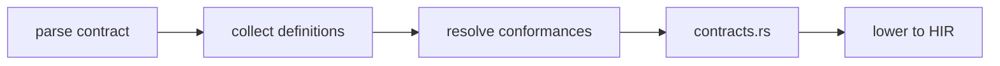
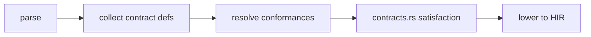
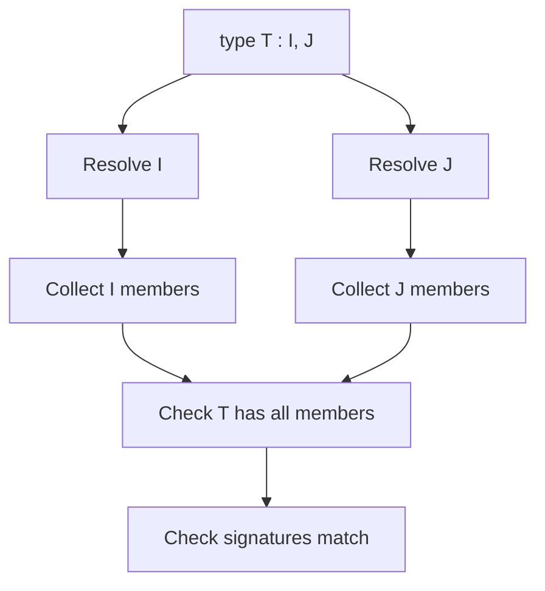

<!-- migrated from the legacy platform spec; canonical OpenSpec source -->
# Contracts Specification

## Purpose

This specification defines structural contract declarations, conformance lists, and embedding. These contracts differ from compiler Mod SDK contracts. They also differ from runtime requires and ensures. The runtime requires and ensures are not in the v0.1 grammar.
## Requirements
### Requirement: Contract declaration and embeddings
`contract Name { items }` MUST declare required members. Items MAY be method
signatures (`T name(params);`), embeddings (`OtherContract;`), or associated
type declarations (`type Item;`). Types MUST declare implementation with a
conformance list (`type T : I, J { ... }`) or an impl-block conformance list
(`impl T : I, J { ... }`). Duplicate contract method names in one contract
MUST error (**E1003**). Conflicting embedded contract methods MUST error
(**E1004**). A contract MAY declare generic type parameters
(`contract Iterator<T> { ... }`), mirroring `EnumDefinition`; the type
parameters MUST be in scope inside the contract's method signatures. A
`ContractEmbedding` of a generic contract MUST supply type arguments
(`Iterator<T>;`) and MUST match the embedded contract's type-parameter arity.

**Stable ID:** `BSP-REQ-5A6EF5C559A0`

#### Scenario: Duplicate method name in one contract
- **GIVEN** a `contract` that declares two methods with the same name
- **WHEN** the contract is validated
- **THEN** the compiler emits **E1003**

#### Scenario: Generic contract type parameters are in scope in signatures
- **GIVEN** `contract Iterator<T> { Option<T> Current(); }`
- **WHEN** the contract's method signatures are typed
- **THEN** `T` resolves as a generic parameter inside `Current()`'s return
  type, matching the `EnumDefinition` generic-scope pattern

#### Scenario: Embedding a generic contract requires matching arity
- **GIVEN** `contract Iterable<T> { Iterator<T> iter; }` embedding
  `Iterator<T>`
- **WHEN** the embedding is validated
- **THEN** the embedded `Iterator<T>` type arguments match `Iterator`'s
  declared type-parameter count, else the compiler emits a generic-arity
  diagnostic

### Requirement: Conformance satisfaction and diagnostics
Implementing types MUST supply every required member with a compatible
signature (**E1601**, **E1602**, **E1606**). Invalid conformance targets MUST
error (**E1607**). All `Standard` types advertising conformance MUST pass
contract satisfaction in the reference compiler. Signature compatibility MUST
compare parameter types and return type via the type-checker's
`FunctionSignature` (`TypeId`-based) equality, superseding arity-only
comparison; a return-type mismatch (including a `This`-typed contract return
vs a concrete impl return) MUST emit **E1602**. An `impl T : Contract { ... }`
block MUST populate the conformance table identically to `type T : Contract`
and MUST be permitted only in the module that defines `T` (closed extension
with private-member access, not subject to **E1511**).

**Stable ID:** `BSP-REQ-CA9C4460BD37`

#### Scenario: Missing required member
- **GIVEN** a type that lists a contract in its conformance list but omits a
  required member
- **WHEN** contract satisfaction checking runs
- **THEN** the compiler emits **E1601**, **E1602**, or **E1606**

#### Scenario: Return-type mismatch is flagged
- **GIVEN** a contract `C { string Name(); }` and an impl
  `impl T : C { i64 Name() { ... } }`
- **WHEN** contract satisfaction checking runs
- **THEN** the compiler emits **E1602** because the `FunctionSignature`
  return types differ

#### Scenario: Impl-block conformance creates the same edge as type conformance
- **GIVEN** `impl StyleChain : AnsiStyleStep { ... }` in the module that
  defines `StyleChain`
- **WHEN** the resolver processes the impl block
- **THEN** a conformance edge `(StyleChain, AnsiStyleStep)` is created
  identically to `type StyleChain : AnsiStyleStep { ... }` and the stage6
  satisfaction check fires

#### Scenario: Impl conformance is closed to the defining module
- **GIVEN** an `impl T : Contract { ... }` block in a module that does not
  define `T`
- **WHEN** the resolver processes the impl block
- **THEN** the compiler rejects it; the closed-form private access of `impl`
  is not relaxed

### Requirement: Contract call dispatch
Contract calls MUST use static dispatch on the receiver's type after
conformance is proven. Contracts MAY be used as namespaces for static-style
calls when the resolver provides contract-as-namespace fallback. A call on a
contract-typed receiver whose static type is known to conform MUST lower to a
static `MethodDispatch` against the implementing type's method item (with
generic substitution), not a runtime entry-symbol indirection. The
entry-symbol indirection remains exclusive to the mod-SDK cross-object
host-invocation path.

**Stable ID:** `BSP-REQ-DC7D6E98A37C`

#### Scenario: Static dispatch after proven conformance
- **GIVEN** a receiver whose static type implements a contract containing
  method `M`
- **WHEN** `receiver.M(...)` is resolved
- **THEN** the callee is selected from the receiver's static type without
  runtime virtual dispatch

#### Scenario: Contract-typed receiver dispatches to the implementing method
- **GIVEN** a local typed as a contract `C` whose concrete type `T` conforms
  to `C`, and `C` declares `M`
- **WHEN** `local.M(...)` is lowered
- **THEN** the lowering resolves to a static `MethodDispatch` against `T`'s
  method item, not an entry-symbol lookup

### Requirement: Generic contract type parameters
A contract MAY declare zero or more type parameters by inserting `GenericParameters` between its name and its body, identical in syntax to `EnumDefinition` and `TypeDefinition`. The type parameters MUST be in scope
inside the contract's `ContractMethodSignature` return types and parameter
types. `ContractMethodSignature` SHALL NOT individually declare generic
parameters; generic dispatch on a contract method is derived from the
enclosing contract's type parameters. A type conforming to a generic contract
MUST match the contract's type-parameter arity at the conformance site, and
each conformance instantiates one specialization per concrete type-argument
tuple.

**Stable ID:** `BSP-REQ-F4FBE05B03A9`

#### Scenario: Generic contract parses and scopes type parameters
- **GIVEN** `contract Iterator<T> { Option<T> Current(); }`
- **WHEN** the reference parser builds its syntax tree and the typechecker
  types the signatures
- **THEN** `T` is recorded as a generic parameter in scope and `Option<T>`
  resolves `T` as a `GenericParam` TypeId

#### Scenario: Conforming type matches generic arity
- **GIVEN** `contract Iterator<T> { ... }` and
  `type ArrayIterator<T> : Iterator<T> { ... }`
- **WHEN** the conformance site is validated
- **THEN** the conformance instantiates `Iterator<T>` with one type argument
  matching `Iterator`'s single type parameter, else a generic-arity
  diagnostic is emitted

### Requirement: Impl-block conformance linkage
An `impl` block MAY name a conformance list after its receiver type: `impl ReceiverType : ContractName [, ContractName]* { ... }`. The conformance targets MUST resolve to `ContractDefinition` items; otherwise the compiler
emits **E1607**. The compiler MUST verify at the impl site that every
required method of each named contract (including methods flattened from
`ContractEmbedding`) is present with a compatible signature. The receiver
type MAY be a generic instantiation
(`impl ArrayIterator<T> : Iterator<T> { ... }`); the compiler MUST substitute
the receiver's type arguments into both the impl method signatures and the
contract's required signatures when checking conformance. An `impl` block
with a conformance clause MUST be a first-class syntax node (not flattened to
individual method items) so the conformance clause is preserved.

**Stable ID:** `BSP-REQ-D56691D2BA01`

#### Scenario: Impl-block conformance parses and creates an edge
- **GIVEN** `impl StyleChain : AnsiStyleStep { StyleChain Bold() { ... } }`
- **WHEN** the resolver processes the impl block
- **THEN** a conformance edge `(StyleChain, AnsiStyleStep)` is created and
  the stage6 check verifies `Bold` is present with a compatible signature

#### Scenario: Generic receiver conformance substitutes type arguments
- **GIVEN** `impl ArrayIterator<T> : Iterator<T> { Option<T> Current() { ... } }`
- **WHEN** the conformance is validated
- **THEN** the compiler substitutes `T` into both the impl signature and the
  contract's required signature before comparing them

### Requirement: Generic parameter contract bounds
A generic function MAY declare a `where` clause after its parameter list and before its body, listing zero or more type-parameter-to-contract bounds of the form `T : ContractPath`. A bound target MUST resolve to a `ContractDefinition`.
A call to a bounded generic function MUST be rejected (fail closed) if the
inferred or explicitly-supplied concrete type for a bounded parameter does not
conform to the named contract. The bound check MUST complete before
monomorphization so the ISLE layer and the `CallLowering` enum remain
unchanged; a bounded generic call reuses `CallLowering::Direct` and lowers to
`DirectCallee::SpecializedItem` exactly as an unbounded generic call does once
the bound check passes. Bounds MUST NOT alter type identity: the generic
parameter name remains the substitution identity. Inside a bounded generic
function body, a method call `x.M(...)` on a receiver of type `T` where
`T : C` MUST resolve `M` against contract `C`'s method signatures and lower
to a per-concrete-`T` specialized direct call.

**Stable ID:** `BSP-REQ-0A9592899219`

#### Scenario: Bounded generic call admits a conforming type
- **GIVEN** `pub string Render<T: ConsoleControl>(T control, ConsoleSize size)
  { return control.Render(size); }` and a call `Render(panel, size)` where
  `Panel` conforms to `ConsoleControl`
- **WHEN** the call is specialized
- **THEN** the bound check passes and the call lowers to a specialized
  direct call against `Panel.Render`

#### Scenario: Bounded generic call rejects a non-conforming type
- **GIVEN** the same `Render<T: ConsoleControl>` and a call `Render(42, size)`
  where `i64` does not conform to `ConsoleControl`
- **WHEN** the call is specialized
- **THEN** the compiler rejects the call with a `GenericBoundNotSatisfied`
  diagnostic before monomorphization

#### Scenario: Method availability on a bounded generic receiver
- **GIVEN** a generic body with `T : ConsoleControl` and an expression
  `control.Render(size)`
- **WHEN** the method call is resolved
- **THEN** `Render` is resolved against `ConsoleControl`'s method signatures
  and the call monomorphizes per concrete `T`

### Requirement: This type placeholder in contract and impl signatures
`This` SHALL be a reserved keyword and a `BeskidType` variant (`Type::This`,
`TypeInfo::This_`). `This` MAY appear as a type only inside: a contract method
signature, an `impl`-block method, an `extend type` method, an inline
`type`-body method, or as the type of the `this` receiver parameter of a free
function used as a method; elsewhere the typechecker MUST emit an error.
Inside a contract body, `This` MUST refer to the eventual implementing type,
NOT the contract's own nominal type; contract-signature seeding MUST record a
`This` marker (`TypeInfo::This_`), not `TypeInfo::Named(contract_item)`. At an
impl site, the compiler MUST substitute `This` with the impl's receiver type.
At a monomorphized bound site (Gap 3, deferred), the compiler MUST substitute
`This` with the concrete type bound to the bounded generic. The receiver
value local SHALL remain `this` (a regular identifier, NOT a keyword); `self`
SHALL NOT be introduced as a keyword or receiver name.

**Stable ID:** `BSP-REQ-1B6A31798933`

#### Scenario: This in a contract signature substitutes at the impl site
- **GIVEN** `contract AnsiStyleStep { This Bold(); }` and
  `impl StyleChain : AnsiStyleStep { StyleChain Bold() { ... } }`
- **WHEN** the conformance is validated
- **THEN** `This` in the contract signature is substituted with `StyleChain`
  and the `FunctionSignature` return types match

#### Scenario: This out of context is rejected
- **GIVEN** a top-level free function `pub This Foo() { ... }` with no
  receiver context
- **WHEN** the typechecker resolves the return type
- **THEN** the compiler emits an error because `This` has no receiver to
  alias

#### Scenario: This at a bounded generic call site
- **GIVEN** a bounded generic `pub T Chain<T: AnsiStyleStep>(T x) { return x.Bold(); }`
  called as `Chain(styleChain)`
- **WHEN** the call is specialized with `T = StyleChain`
- **THEN** `This` inside `AnsiStyleStep.Bold`'s signature is substituted with
  `StyleChain`

### Requirement: Contract associated type declarations
A contract MAY declare associated types as `type Identifier ("=" BeskidType)? ";` inside its body. An associated type declaration MUST be a new `ContractItem`
variant. An associated-type reference `T::Item` (double-colon, paralleling
`EnumPath` and `Option::Some`) MUST resolve via the implementor's binding for
`Item`, populated when a type declares `: Contract`. Inside a contract body,
the bare associated-type name (`Item`) is in scope and MAY be used directly in
method signatures. An associated type MAY carry a default type
(`type Item = T;`); an implementor MAY omit the binding if a default exists,
and MUST supply a binding if no default exists.

**Stable ID:** `BSP-REQ-84129B86DA81`

#### Scenario: Associated type resolves per implementor
- **GIVEN** `contract Iterator<T> { type Item; Option<Item> Current(); }` and
  `type ArrayIterator<T> : Iterator<T> { type Item = T; ... }`
- **WHEN** `Current()` is called on an `ArrayIterator<i64>`
- **THEN** `Item` resolves to `i64` and `Current()` returns `Option<i64>`

#### Scenario: Associated type reference uses double-colon syntax at a bound site
- **GIVEN** a bounded generic `pub T::Item First<T: Iterator>(T it)` and an
  `ArrayIterator<i64>` conforming to `Iterator`
- **WHEN** `First` is specialized with `T = ArrayIterator<i64>`
- **THEN** the reference `T::Item` resolves via `ArrayIterator`'s binding
  (`Item = i64`), paralleling the `EnumPath` / `Option::Some` double-colon
  syntax

#### Scenario: Missing associated type binding without default is rejected
- **GIVEN** a contract `C { type Item; }` and an impl `impl T : C { ... }`
  that does not bind `Item`
- **WHEN** the conformance is validated
- **THEN** the compiler emits a diagnostic because `Item` has no default and
  no binding

### Requirement: Function-signature conformance equality
Contract conformance validation MUST compare parameter types and return type
via the type-checker's `FunctionSignature` (`TypeId`-based) equality after
`This` and associated-type substitution, superseding arity-only string
comparison. A return-type mismatch (including `This`-typed contract return
vs concrete impl return, before substitution) MUST emit **E1602**. Contract
subtyping (`is_contract_compatible`) applies to parameter and return positions
where a contract type is expected.

**Stable ID:** `BSP-REQ-5C8554765310`

#### Scenario: Return-type mismatch is flagged after This substitution
- **GIVEN** `contract C { This Bold(); }` and
  `impl T : C { i64 Bold() { ... } }`
- **WHEN** the conformance is validated
- **THEN** the compiler substitutes `This` with the receiver type, compares
  `FunctionSignature`s, and emits **E1602** because `i64` does not match the
  substituted `This`

#### Scenario: Arity-only mismatch remains flagged
- **GIVEN** `contract C { i64 Add(i64 x); }` and
  `impl T : C { i64 Add(i64 x, i64 y) { ... } }`
- **WHEN** the conformance is validated
- **THEN** the compiler emits **E1602** because the `FunctionSignature`
  parameter counts differ

### Requirement: Bounded generic method availability
Inside a bounded generic function body, a method call on a receiver of type `T` where `T : C` MUST resolve the method against contract `C`'s
`ContractMethodSignature` declarations and lower to a per-concrete-`T`
specialized direct call. A non-existent method MUST be rejected with a
`ContractMethodNotFound`-class diagnostic. The bound's method availability
check MUST complete before monomorphization so ISLE sees only concrete
specialized calls.

**Stable ID:** `BSP-REQ-FC54F89BB020`

#### Scenario: Bounded generic method resolves against the contract
- **GIVEN** `pub T Render<T: ConsoleControl>(T control, ConsoleSize size)
  { return control.Render(size); }` where `ConsoleControl` declares
  `string Render(ConsoleSize)`
- **WHEN** the method call `control.Render(size)` is resolved inside the
  generic body
- **THEN** `Render` is resolved against `ConsoleControl`'s signatures and the
  call monomorphizes per concrete `T`

#### Scenario: Bounded generic method not in contract is rejected
- **GIVEN** the same `Render<T: ConsoleControl>` and a call
  `control.NotAMethod()` inside the generic body
- **WHEN** the method call is resolved
- **THEN** the compiler rejects it with a `ContractMethodNotFound`-class
  diagnostic

### Requirement: Generation-bound conformance fact in semantic contract
The `beskid_queries` semantic-contract source of truth MUST mint a
generation-bound conformance fact directly from syntax (`type X : C` and
`impl X : C` → conformance fact), not expose a legacy resolver table via a
tracked fact. The conformance fact MUST be reusable by `impl`-block
conformance validation, generic-bound admission, and `This` substitution at
monomorphized bound sites. The fact MUST be derived from the canonical syntax
corpus and MUST NOT depend on a legacy analysis pass.

**Stable ID:** `BSP-REQ-1E1690A4A158`

#### Scenario: Conformance fact is minted from type conformance
- **GIVEN** `type StyleChain : AnsiStyleStep { ... }`
- **WHEN** the semantic-contract layer builds its facts
- **THEN** a conformance fact `(StyleChain, AnsiStyleStep)` is minted from
  the syntax without consulting a legacy resolver table

#### Scenario: Conformance fact is minted from impl conformance
- **GIVEN** `impl StyleChain : AnsiStyleStep { ... }`
- **WHEN** the semantic-contract layer builds its facts
- **THEN** a conformance fact `(StyleChain, AnsiStyleStep)` is minted from
  the impl-block syntax identically to the type-conformance case

#### Scenario: Bound admission consumes the conformance fact
- **GIVEN** a bounded generic call `Render<T: ConsoleControl>(...)` and a
  conforming `Panel`
- **WHEN** the bound check runs inside
  `generic_specialization_instance_for_call`
- **THEN** the check consults the generation-bound conformance fact and
  admits the call

## Informative Source Provenance

The records below preserve migration history. They are not normative except where text was extracted into a requirement above.

### Source Record: Contracts

**Authority:** informative provenance  
**Legacy path:** `/platform-spec/language-meta/contracts-and-effects/contracts/`  
**Source:** `site/spec-content/platform-spec/language-meta/contracts-and-effects/contracts/content.md`  
**SHA-256:** `f815bcf08e502ec9140298b516ce723392de7433866ba8e445164a3e72d97966`

<details>
<summary>Migrated source text</summary>

``````markdown
## Normative specification

### Scope

Defines **`contract` declarations** — structural interfaces that types **implement** via conformance lists. This is distinct from **compiler Mod contracts** ([Compiler Mod SDK](/platform-spec/language-meta/metaprogramming/compiler-mod-sdk/)).

### Syntax

```beskid
contract Disposable
{
    unit Dispose();
}
```

- **`contract Name { items }`** declares required members.
- Items **may** be method signatures (`T name(params);`) or **embeddings** (`OtherContract;`) that flatten member requirements.
- Types declare implementation with **`type T : I, J { … }`**.

### Static rules

- Implementing types **must** supply every required member with compatible signature (**E1601**, **E1602**, **E1606**).
- Conflicting embedded contract methods **must** error (**E1004**).
- Duplicate contract method names in one contract **must** error (**E1003**).
- Invalid conformance targets **must** error (**E1607**).

### Dynamic semantics

- Contract calls use static dispatch on the receiver’s type after conformance is proven.
- Contracts **may** be used as namespaces for static-style calls when the resolver provides contract-as-namespace fallback.

### Diagnostics

Contract band **E1601–E1607**. Registry: [Diagnostic code registry](/platform-spec/compiler/semantic-pipeline/diagnostic-code-registry/).

### Conformance

All `Standard` types advertising conformance **must** pass contract satisfaction in the reference compiler.

## Decisions
<!-- spec:generate:adr-index -->
No ADRs published under **`adr/`** yet.
<!-- /spec:generate:adr-index -->
## Articles
<!-- spec:generate:article-index -->
- [Contracts - Contracts and edge cases](./articles/contracts-and-edge-cases/)
- [Contracts - Design model](./articles/design-model/)
- [Contracts - Examples](./articles/examples/)
- [Contracts - FAQ and troubleshooting](./articles/faq-and-troubleshooting/)
- [Contracts - Flow and algorithm](./articles/flow-and-algorithm/)
- [Contracts - Verification and traceability](./articles/verification-and-traceability/)
<!-- /spec:generate:article-index -->
``````

</details>

### Source Record: Contracts - Contracts and edge cases

**Authority:** informative provenance  
**Legacy path:** `/platform-spec/language-meta/contracts-and-effects/contracts/articles/contracts-and-edge-cases/`  
**Source:** `site/spec-content/platform-spec/language-meta/contracts-and-effects/contracts/articles/contracts-and-edge-cases/content.md`  
**SHA-256:** `5b9b2c2c3bcc839ebbb55e1ce3511e8835f43773a054f284c1ce4312b0048361`

<details>
<summary>Migrated source text</summary>

``````markdown
## Hard requirements

- **Structural contracts** — Checked structurally at compile time, not runtime interface tables.
- **Embedding composes requirements** — Contract embedding flattens member requirements without inheritance syntax.
- **No `requires`/`ensures` in v0.1** — Design-by-contract assertions are deferred.
- **Distinct from Mod SDK** — Compiler mod contracts follow the Mod SDK spec, not this surface.

## Diagnostic band E16xx

| Code | Condition |
| --- | --- |
| **E1601** | Contract method missing implementation |
| **E1602** | Contract implementation signature mismatch |
| **E1606** | Contract method not found (resolution) |
| **E1607** | Invalid conformance target |

## Edge cases

- **Empty contract** — A contract with no items is valid but useless unless used as a marker.
- **Self-conformance** — A type does not automatically conform to a contract it defines; explicit `: Contract` is required.
- **Generic contract** — Contracts may declare generic parameters; implementing types must match arity.
- **Contract method default body** — Not supported in v0.1; all contract methods are signatures only.

## Invariants

- Every type advertising conformance must pass contract satisfaction before lowering.
- Contract calls use static dispatch on the receiver's type after conformance is proven.
- Embedded contract conflicts must be detected at definition time, not at use time.
``````

</details>

### Source Record: Contracts - Design model

**Authority:** informative provenance  
**Legacy path:** `/platform-spec/language-meta/contracts-and-effects/contracts/articles/design-model/`  
**Source:** `site/spec-content/platform-spec/language-meta/contracts-and-effects/contracts/articles/design-model/content.md`  
**SHA-256:** `3fd2a218691681c31e35da641543f5c72978542914fe6b1dfce35912ff00c1d1`

<details>
<summary>Migrated source text</summary>

``````markdown
## Vocabulary

| Construct | Role |
| --- | --- |
| **`ContractDefinition`** | Declares required members (method signatures and embeddings) |
| **`ContractNode`** | Either a method signature or an embedded contract reference |
| **`ContractEmbedding`** | Flattened member requirements from another contract |
| **`ContractMethodSignature`** | Method signature without body inside a contract |

## Contract architecture

Contracts are **structural interfaces** checked at compile time. Types implement contracts via conformance lists (`: I, J`).



### Subsystem boundaries

| Subsystem | Responsibility | Key file |
| --- | --- | --- |
| Parser | Parse `contract` and `ContractNode` | `syntax/items/contract_definition.rs` |
| AST | Store contract structure | `syntax/items/contract_node.rs` |
| Resolver | Bind conformance targets | `resolve/` |
| Contract rules | Check satisfaction | `analysis/rules/staged/contracts.rs` |
| HIR lowering | Embed contract metadata | `hir/lowering/items.rs` |

## Embedding model

Contracts may embed other contracts (`OtherContract;` inside a contract body). This flattens member requirements without inheritance syntax. Conflicting embedded methods emit **E1004**.

## Distinction from Mod SDK

This user-language `contract` surface is distinct from compiler Mod SDK contracts. Mod contracts follow the [Compiler Mod SDK](/platform-spec/language-meta/metaprogramming/compiler-mod-sdk/) specification.
``````

</details>

### Source Record: Contracts - Examples

**Authority:** informative provenance  
**Legacy path:** `/platform-spec/language-meta/contracts-and-effects/contracts/articles/examples/`  
**Source:** `site/spec-content/platform-spec/language-meta/contracts-and-effects/contracts/articles/examples/content.md`  
**SHA-256:** `b24ae2d5b885bfd0588300207af8efbb5ab33b2ff5adf1227121da5f6dd0c619`

<details>
<summary>Migrated source text</summary>

``````markdown
## Basic contract

```beskid
contract Named {
    string Name();
}

type Person : Named {
    string name;

    pub string Name() {
        return name;
    }
}
```

## Contract embedding

```beskid
contract HasId {
    i32 Id();
}

contract Entity : HasId {
    string Name();
}

type Product : Entity {
    i32 id;
    string name;

    pub i32 Id() { return id; }
    pub string Name() { return name; }
}
```

## Conformance error

```beskid
contract Drawable {
    unit Draw();
}

// Missing Draw() — E1601
type Circle : Drawable {
    f32 radius;
}
```

## Signature mismatch

```beskid
contract Comparable {
    i32 CompareTo(other);
}

// Wrong return type — E1602
type Item : Comparable {
    pub bool CompareTo(Item other) {
        return false;
    }
}
```
``````

</details>

### Source Record: Contracts - FAQ and troubleshooting

**Authority:** informative provenance  
**Legacy path:** `/platform-spec/language-meta/contracts-and-effects/contracts/articles/faq-and-troubleshooting/`  
**Source:** `site/spec-content/platform-spec/language-meta/contracts-and-effects/contracts/articles/faq-and-troubleshooting/content.md`  
**SHA-256:** `365c3af177858a2eb57ab40e26c759aaf4b3833d6b646a20b5c891db521d21e8`

<details>
<summary>Migrated source text</summary>

``````markdown
## Locked decisions

| Decision | ID | Summary |
| --- | --- | --- |
| Structural contracts | D-LM-CON-001 | Nominal surfaces checked structurally |
| Embedding | D-LM-CON-002 | Composes requirements without inheritance |
| No `requires`/`ensures` | D-LM-CON-003 | Deferred to future version |
| Distinct from Mod SDK | D-LM-CON-004 | Mod contracts follow SDK spec |

## FAQ

### Can a contract have a default method body?

No. Contract items are signatures only in v0.1. Default bodies may be added in a future version.

### What is the difference between `contract` and `interface`?

Beskid uses `contract` as the keyword. The concept is similar to interfaces in other languages, but checked structurally at compile time.

### Can I embed multiple contracts?

Yes. A contract may embed multiple other contracts. Conflicting method names from embedded contracts emit **E1004**.

## Troubleshooting

| Symptom | Likely cause |
| --- | --- |
| **E1601** | Type missing a required contract method |
| **E1602** | Contract method signature does not match implementation |
| **E1004** | Two embedded contracts define the same method |
| **E1607** | Conformance target is not a contract |
| **E1003** | Duplicate method name inside one contract |
``````

</details>

### Source Record: Contracts - Flow and algorithm

**Authority:** informative provenance  
**Legacy path:** `/platform-spec/language-meta/contracts-and-effects/contracts/articles/flow-and-algorithm/`  
**Source:** `site/spec-content/platform-spec/language-meta/contracts-and-effects/contracts/articles/flow-and-algorithm/content.md`  
**SHA-256:** `049521e9e1644eb7c154ba217e1b558eaf646cc346c14c99b800e1af5e60cdf3`

<details>
<summary>Migrated source text</summary>

``````markdown
## Compile pipeline placement



## Contract satisfaction algorithm (normative)

1. **Parse contract definitions** — `ContractDefinition` stores `name`, `items` (method signatures + embeddings), and per-item docs.
2. **Collect contract nodes** — `ContractNode` enum distinguishes `MethodSignature` from `Embedding`.
3. **Resolve conformance lists** — For each `type T : I, J { }`, resolve `I` and `J` to actual contract definitions. `ResolveInvalidConformanceTarget` (**E1607**) for invalid targets.
4. **Check member presence** — For each required contract method, verify the implementing type declares a method with the same name. `ContractMethodMissingImplementation` (**E1601**) otherwise.
5. **Check signature compatibility** — Compare parameter and return types. `ContractImplementationSignatureMismatch` (**E1602**) if they differ.
6. **Check embedding conflicts** — If two embedded contracts define the same method name, `ConflictingEmbeddedContractMethod` (**E1004**) fires.
7. **Check duplicate contract methods** — `DuplicateContractMethod` (**E1003**) for duplicate names within one contract.

## Conformance list processing



## LSP / incremental

Re-run contract checking when contract definitions, type conformances, or method signatures change.
``````

</details>

### Source Record: Contracts - Verification and traceability

**Authority:** informative provenance  
**Legacy path:** `/platform-spec/language-meta/contracts-and-effects/contracts/articles/verification-and-traceability/`  
**Source:** `site/spec-content/platform-spec/language-meta/contracts-and-effects/contracts/articles/verification-and-traceability/content.md`  
**SHA-256:** `abe52307a47af3c9f2c31c75c90d0b8728be8d24919139ecdb7177cdc8670d9b`

<details>
<summary>Migrated source text</summary>

``````markdown
## Verification matrix

| Scenario | Expected evidence |
| --- | --- |
| Contract with method signatures | Parses; AST round-trip correct |
| Type conforms to contract | Compiles; no diagnostic |
| Missing implementation | **E1601** emitted |
| Signature mismatch | **E1602** emitted |
| Embedding conflict | **E1004** emitted |
| Invalid conformance target | **E1607** emitted |

## Implementation checklist

- [x] Grammar: `contract`, method signatures, embeddings
- [x] AST: `ContractDefinition`, `ContractNode`, `ContractMethodSignature`
- [x] Parser: `beskid.pest` productions for contract items
- [x] Resolver: conformance target resolution
- [x] Contract rules: satisfaction checking in `contracts.rs`
- [x] Diagnostics: **E1601**, **E1602**, **E1606**, **E1607**, **E1003**, **E1004**
- [ ] Generic contract conformance
- [ ] Contract method default bodies (deferred)

## Test locations

- `compiler/crates/beskid_analysis/src/syntax/items/contract_definition.rs` — parser tests
- `compiler/crates/beskid_analysis/src/analysis/rules/staged/contracts.rs` — satisfaction tests
- `compiler/crates/beskid_tests` — integration tests for contracts
``````

</details>
