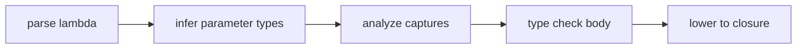
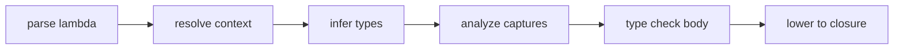
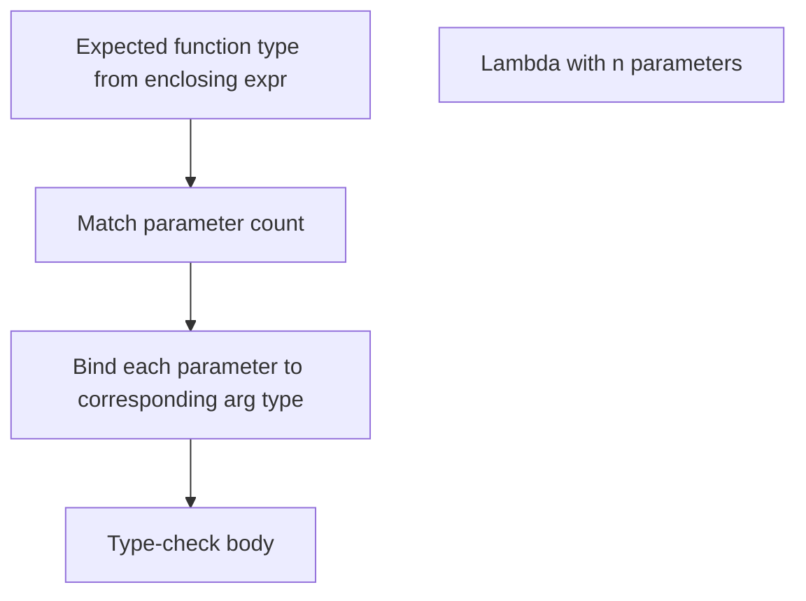

<!-- migrated from the legacy platform spec; canonical OpenSpec source -->
# Lambdas and closures Specification

## Purpose

This specification defines capture lists, environment layout, and the lifetime of delegates. The JIT and AOT backends use the same closure calling conventions.
## Requirements
### Requirement: Lambda syntax and typing
`param => body` or `(p1, p2) => body` MUST form a lambda where `body` is an expression or `{ block }`. Parameters MAY be typed (`T name`) or untyped (`name`) when contextual type is available. Lambda type MUST be inferable from expected type or parameter annotations (**E1202** otherwise). Lambdas MAY appear anywhere an `Expression` is allowed, including as `spawn` operands.

#### Scenario: Untyped lambda without context
- **GIVEN** an untyped lambda with no expected function type in context
- **WHEN** type inference runs
- **THEN** the compiler emits **E1202**

### Requirement: Capture and closure lifetime
Captured locals MUST be definitely assigned before capture or diagnosed per definite-assignment rules. A capture SHALL be a by-value snapshot taken when the closure record is created. A lambda that is not a `spawn` operand SHALL NOT capture a `mut` binding or a native pointer; the compiler SHALL report **E1233** at the lambda and SHALL name the captured binding. A `spawn` operand that captures a stack reference SHALL keep **E1225**. A closure MUST extend the lifetime of captured storage to at least the closure value's lifetime: a captured managed value SHALL be traced through the closure environment. Closures passed to `spawn` MUST be compatible with fiber entry signatures.

A lambda that captures an owning Moved-class name without `move` SHALL borrow it: the capture is a borrow and the lambda SHALL NOT store, return, `move` or pass it to a `move` parameter (**E1241** at the escaping use). A lambda that captures `move x` SHALL consume `x` at the lambda expression; the capture is owned by the closure environment, and a lambda that is not passed to a `[Captures]` parameter or to `spawn` SHALL NOT capture `move x` (**E1239** at the `move`, noting that an ordinary closure is repeatable).

#### Scenario: Capture of mut binding rejected
- **GIVEN** `i64 Main() { mut i64 count = 1; let read = () => count; return read(); }`
- **WHEN** capture analysis runs
- **THEN** the compiler emits **E1233** at the lambda, naming `count`, and rejects the lambda

#### Scenario: Captured string is traced
- **GIVEN** `string Call((string) => string f) { return f("!"); }` and `string Main(string prefix) { return Call((string s) => prefix + s); }`
- **WHEN** the lambda's closure environment is laid out
- **THEN** `prefix` is a traced field of the environment

#### Scenario: Ordinary lambda borrows a Moved capture
- **GIVEN** `i64 Total(u8[] data) { let sum = () => Checksum(data); return sum() + sum(); }` where `Checksum(u8[] data)` takes a borrowed parameter
- **WHEN** capture analysis runs
- **THEN** the lambda compiles and `data` stays usable after the lambda

#### Scenario: Ordinary lambda may not move a capture
- **GIVEN** `unit Keep(u8[] data) { let take = () => Archive.Store(move data); take(); }`
- **WHEN** capture analysis runs
- **THEN** the compiler SHALL report **E1239** at `move data`

### Requirement: Capture bounds on function-typed parameters
A parameter of function type MAY carry `[Captures(Bound: C)]` where `C` is a path naming one of the corelib marker contracts `Transferable`, `Shared`, `Moved` or `Copied`. Any other `Bound` expression, or `[Captures]` on a parameter whose type is not a function type, SHALL be reported as **E1248** at the attribute. The bound SHALL be part of the callable's signature fact, visible in hover and signature help, and SHALL be honored at every call of the callable, including calls through a contract method or a function-typed value whose declaration carries it.

At a call site, the argument for a `[Captures]` parameter SHALL be one of:

1. a lambda literal: every capture SHALL have a transfer class accepted by `C` (Shared, Moved or Copied for `Transferable`; the one class otherwise). A capture whose class is rejected SHALL be reported as **E1236** at the capture, naming the binding, its type, its class and the first offending field when the class is Never. A capture of a `mut` local SHALL be reported as **E1235** at the first assignment inside the lambda, or at the capture when the lambda only reads it, with the help "use a reduction". A capture of an owning Moved-class name without `move` SHALL be reported as **E1237** at the capture with the help "write `move <name>`"; a capture written `move x` SHALL consume `x` at the lambda expression. A capture of a borrowed Moved-class name SHALL be reported as **E1241**;
2. a named, non-generic function item: accepted, because it has no environment;
3. anything else (a local, field, call result or parameter of function type): **E1238** at the argument, with the help "pass the lambda literal".

**E1235**, **E1236**, **E1237** and **E1238** SHALL be legality facts of the calling item in the query layer, reported once per capture or argument.

#### Scenario: Shared and Copied captures accepted
- **GIVEN** `pub unit Run([Captures(Bound: Transferable)] () => i64 body) { }`, `[Immutable] pub type Config { string name; i64 retries; }`, `[Copyable] pub type Pixel { u8 r; u8 g; u8 b; }` and `unit Main(Config config, Pixel pixel) { Run(() => config.retries + pixel.r); }`
- **WHEN** the call is checked
- **THEN** no diagnostic is reported

#### Scenario: Mutable local captured
- **GIVEN** the same `Run` and `i64 Count(List<string> lines) { mut i64 count = 0; Run(() => { count = count + 1; return count; }); return count; }`
- **WHEN** the call is checked
- **THEN** the compiler SHALL report **E1235** at `count = count + 1` with the help "use a reduction"

#### Scenario: Non-transferable capture
- **GIVEN** the same `Run`, `pub type Cache { Map<string, i64> entries; }` and `unit Main(Cache cache) { Run(() => cache.entries.Count()); }`
- **WHEN** the call is checked
- **THEN** the compiler SHALL report **E1236** at `cache`, naming `Cache`, class Never and the reason "no marker attribute"

#### Scenario: Moved capture without move
- **GIVEN** the same `Run` and `unit Main(move u8[] data) { Run(() => Checksum(data)); }`
- **WHEN** the call is checked
- **THEN** the compiler SHALL report **E1237** at `data` with the help "write `move data`"

#### Scenario: Moved capture with move consumes
- **GIVEN** the same `Run` and `unit Main(move u8[] data) { Run(() => Checksum(move data)); i64 n = Array.Len<u8>(data); }`
- **WHEN** the item is checked
- **THEN** the call is accepted and `Array.Len<u8>(data)` is reported as **E1234** naming `data` and pointing at `move data`

#### Scenario: Function item accepted
- **GIVEN** the same `Run` and `i64 Work() { return 1; }` and `unit Main() { Run(Work); }`
- **WHEN** the call is checked
- **THEN** no diagnostic is reported

#### Scenario: Closure value rejected
- **GIVEN** the same `Run` and `unit Main(() => i64 body) { Run(body); }`
- **WHEN** the call is checked
- **THEN** the compiler SHALL report **E1238** at `body` with the help "pass the lambda literal"

#### Scenario: Shared bound rejects a Moved capture
- **GIVEN** `pub unit Share([Captures(Bound: Shared)] () => i64 body) { }` and `unit Main(move u8[] data) { Share(() => Checksum(move data)); }`
- **WHEN** the call is checked
- **THEN** the compiler SHALL report **E1236** at `data` naming class Moved and the bound `Shared`

#### Scenario: Bound is not a marker
- **GIVEN** `pub unit Run([Captures(Bound: Disposable)] () => i64 body) { }`
- **WHEN** the declaration is checked
- **THEN** the compiler SHALL report **E1248** at the attribute

#### Scenario: Captures on a non-function parameter
- **GIVEN** `pub unit Run([Captures(Bound: Transferable)] i64 count) { }`
- **WHEN** the declaration is checked
- **THEN** the compiler SHALL report **E1248** at the attribute

## Informative Source Provenance

The records below preserve migration history. They are not normative except where text was extracted into a requirement above.

### Source Record: Lambdas and closures

**Authority:** informative provenance  
**Legacy path:** `/platform-spec/language-meta/evaluation/lambdas-and-closures/`  
**Source:** `site/spec-content/platform-spec/language-meta/evaluation/lambdas-and-closures/content.md`  
**SHA-256:** `04f9394f460a134847f17bcfd1ffcc6f8e583679e9163e2dc3d378c7c9dd040a`

<details>
<summary>Migrated source text</summary>

``````markdown
## Normative specification

### Scope

Defines **lambda expressions** (`=>`), **closures**, and their typing. Function types are in [Types](/platform-spec/language-meta/type-system/types/); inference in [Type inference](/platform-spec/language-meta/type-system/type-inference/).

### Syntax

- **`param => body`** or **`(p1, p2) => body`** where `body` is an expression or `{ block }`.
- Parameters **may** be typed (`T name`) or untyped (`name`) when contextual type is available.
- Lambdas **may** appear anywhere an `Expression` is allowed, including as `spawn` operands.

### Static rules

- Lambda type **must** be inferable from expected type or parameter annotations (**E1202** otherwise).
- Captured locals **must** be definitely assigned before capture or diagnosed per definite-assignment rules (v0.1: follow reference compiler behavior).
- Lambdas **must not** capture `mut` bindings unless the implementation explicitly allows it; otherwise **must** error.

### Dynamic semantics

- A closure **must** extend the lifetime of captured storage to at least the closure value’s lifetime.
- Invocation uses the standard function call ABI for the target triple.
- Closures passed to `spawn` **must** be compatible with fiber entry signatures (see [Fibers and spawn](/platform-spec/language-meta/evaluation/fibers-and-spawn/)).

### Diagnostics

Type inference and call mismatch bands **E1202**, **E1205**. Registry: [Diagnostic code registry](/platform-spec/compiler/semantic-pipeline/diagnostic-code-registry/).

### Conformance

Closure codegen tests **must** match between debug and release for the reference backend on each supported triple.

## Decisions
<!-- spec:generate:adr-index -->
No ADRs published under **`adr/`** yet.
<!-- /spec:generate:adr-index -->
## Articles
<!-- spec:generate:article-index -->
- [Lambdas and closures - Contracts and edge cases](./articles/contracts-and-edge-cases/)
- [Lambdas and closures - Design model](./articles/design-model/)
- [Lambdas and closures - Examples](./articles/examples/)
- [Lambdas and closures - FAQ and troubleshooting](./articles/faq-and-troubleshooting/)
- [Lambdas and closures - Flow and algorithm](./articles/flow-and-algorithm/)
- [Lambdas and closures - Verification and traceability](./articles/verification-and-traceability/)
<!-- /spec:generate:article-index -->
``````

</details>

### Source Record: Lambdas and closures - Contracts and edge cases

**Authority:** informative provenance  
**Legacy path:** `/platform-spec/language-meta/evaluation/lambdas-and-closures/articles/contracts-and-edge-cases/`  
**Source:** `site/spec-content/platform-spec/language-meta/evaluation/lambdas-and-closures/articles/contracts-and-edge-cases/content.md`  
**SHA-256:** `bc740bbb8f5d742c5c2d7869fb553e8b53ad7c31fc0b5a50ffa92f1ec99d1fac`

<details>
<summary>Migrated source text</summary>

``````markdown
## Hard requirements

- **Expression lambdas** — Statement lambdas use block bodies; no separate `fn` literal syntax.
- **No async lambdas** — `async`/`await` are not closure modifiers; use `spawn` instead.
- **Capture extends lifetime** — Closures must keep captured locals alive for the closure value's lifetime.
- **GC for escaped captures** — Captured reference-bearing values must be heap-traced when they escape.

## Diagnostic band

| Code | Condition |
| --- | --- |
| **E1202** | Missing type annotation (lambda parameter inference fails) |
| **E1223** | Spawn target not fiber compatible |
| **E1225** | Stack reference escapes spawn |

## Edge cases

- **Zero-parameter lambda** — `() => body` is valid; the parameter list is empty.
- **Lambda as statement** — A lambda expression used as a statement is valid but usually pointless unless assigned.
- **Recursive lambda** — A lambda cannot directly reference itself unless bound to a named variable first.
- **Capture of `this`** — Instance lambdas capture `this` implicitly; the closure environment holds a reference to the enclosing object.

## Invariants

- Lambda type must be inferable from expected type or parameter annotations.
- Captured locals must be definitely assigned before capture.
- Closures passed to `spawn` must be compatible with fiber entry signatures.
- JIT and AOT must agree on closure calling conventions.
``````

</details>

### Source Record: Lambdas and closures - Design model

**Authority:** informative provenance  
**Legacy path:** `/platform-spec/language-meta/evaluation/lambdas-and-closures/articles/design-model/`  
**Source:** `site/spec-content/platform-spec/language-meta/evaluation/lambdas-and-closures/articles/design-model/content.md`  
**SHA-256:** `bd88ff46feda8eca0224af65060a48d2df2d7129285bd98035ade92a65f29cc7`

<details>
<summary>Migrated source text</summary>

``````markdown
## Vocabulary

| Construct | Role |
| --- | --- |
| **`LambdaExpression`** | Anonymous function `params => body` |
| **`LambdaParameter`** | Single parameter with optional explicit type |
| **`LambdaParameters`** | Parameter list (single identifier or parenthesized list) |

## Lambda architecture

Lambdas are **expression-level anonymous functions** with optional parameter types. They may appear anywhere an `Expression` is allowed.



### Subsystem boundaries

| Subsystem | Responsibility | Key file |
| --- | --- | --- |
| Parser | Parse `=>` syntax | `syntax/expressions/lambda_expression.rs` |
| AST | Store lambda structure | `syntax/expressions/expression.rs` |
| Type checker | Infer parameter types from context | `types/context/expressions.rs` |
| Capture analysis | Track captured locals | `analysis/rules/staged/` |
| HIR lowering | Build closure environment | `hir/lowering/expressions.rs` |

## Capture model

- Captured locals must be definitely assigned before capture.
- Lambdas must not capture `mut` bindings unless the implementation explicitly allows it.
- A closure extends the lifetime of captured storage to at least the closure value's lifetime.
- Captured reference-bearing values must be heap-traced when they escape the frame.
``````

</details>

### Source Record: Lambdas and closures - Examples

**Authority:** informative provenance  
**Legacy path:** `/platform-spec/language-meta/evaluation/lambdas-and-closures/articles/examples/`  
**Source:** `site/spec-content/platform-spec/language-meta/evaluation/lambdas-and-closures/articles/examples/content.md`  
**SHA-256:** `45039c4f75ecb25c068938a710f7020e70a49e37c214ab50a346d71583e75417`

<details>
<summary>Migrated source text</summary>

``````markdown
## Simple lambda

```beskid
unit Simple() {
    let add = (a, b) => a + b;
    let result = add(2, 3);
}
```

## Typed parameters

```beskid
unit Typed() {
    let mul = (i32 a, i32 b) => a * b;
}
```

## Block body

```beskid
unit BlockBody() {
    let max = (i32 a, i32 b) => {
        if (a > b) {
            return a;
        }
        return b;
    };
}
```

## Capture

```beskid
unit Capture() {
    let offset = 10;
    let addOffset = (i32 x) => x + offset;
    let result = addOffset(5);   // 15
}
```

## Lambda as argument

```beskid
unit Apply(i32[] values, (i32) => i32 transform) {
    for v in values {
        let transformed = transform(v);
        Console.WriteLine(transformed);
    }
}

unit UseApply() {
    let values = i32[] { 1, 2, 3 };
    Apply(values, x => x * 2);
}
```
``````

</details>

### Source Record: Lambdas and closures - FAQ and troubleshooting

**Authority:** informative provenance  
**Legacy path:** `/platform-spec/language-meta/evaluation/lambdas-and-closures/articles/faq-and-troubleshooting/`  
**Source:** `site/spec-content/platform-spec/language-meta/evaluation/lambdas-and-closures/articles/faq-and-troubleshooting/content.md`  
**SHA-256:** `19dd901cce2da518a197217e4d36b80c0a7a1a94108e948cb75500a93d6129a0`

<details>
<summary>Migrated source text</summary>

``````markdown
## Locked decisions

| Decision | ID | Summary |
| --- | --- | --- |
| Expression lambdas | D-LM-LAM-001 | Block bodies; no `fn` literal syntax |
| No async lambdas | D-LM-LAM-002 | Use `spawn` instead |
| Capture extends lifetime | D-LM-LAM-003 | Captured locals kept alive |
| GC for escaped captures | D-LM-LAM-004 | Heap-traced when escaping |

## FAQ

### Can a lambda reference itself recursively?

Not directly. Bind the lambda to a `let` first, then reference the variable name.

### Why can't I capture `mut` bindings?

Mutability capture is restricted to prevent data races. This may be relaxed in future versions with explicit capture modifiers.

### Do lambdas allocate?

Stack closures do not allocate. Heap closures allocate only when the closure escapes the defining frame.

## Troubleshooting

| Symptom | Likely cause |
| --- | --- |
| **E1202** | Lambda parameter type cannot be inferred |
| **E1223** | Lambda passed to `spawn` is not fiber-compatible |
| **E1225** | Stack reference captured in a `spawn` closure |
``````

</details>

### Source Record: Lambdas and closures - Flow and algorithm

**Authority:** informative provenance  
**Legacy path:** `/platform-spec/language-meta/evaluation/lambdas-and-closures/articles/flow-and-algorithm/`  
**Source:** `site/spec-content/platform-spec/language-meta/evaluation/lambdas-and-closures/articles/flow-and-algorithm/content.md`  
**SHA-256:** `45fdd0ff809dfea587ec89c94d3f4bbc3a5aa989d545437b4b789d71efbbf4fe`

<details>
<summary>Migrated source text</summary>

``````markdown
## Compile pipeline placement



## Lambda parsing algorithm (normative)

1. **Parse lambda expression** — `param => body` or `(p1, p2) => body` becomes `LambdaExpression` with `parameters` and `body`.
2. **Parse parameters** — Single identifier becomes an untyped parameter. Parenthesized list may include explicit types (`T name`).
3. **Infer parameter types** — If parameters lack types, infer from the expected function type in the surrounding expression context. `TypeMissingTypeAnnotation` (**E1202**) if inference fails.
4. **Type-check body** — Type-check the lambda body with the inferred/declared parameter types in scope.
5. **Analyze captures** — Identify locals referenced in the body that are defined in outer scopes.
6. **Validate capture rules** — Reject `mut` captures unless explicitly allowed. Check definite assignment.
7. **Lower to closure** — Build a closure environment object holding captured values. Heap-allocate if the closure escapes the frame.

## Contextual inference



## Closure environment layout

- **Stack closure** — Captures live on the stack if the closure does not escape the defining frame.
- **Heap closure** — Captures are moved to the GC heap if the closure escapes (for example, returned from a function or passed to `spawn`).

## LSP / incremental

Re-run lambda analysis when parameter types, body expressions, or capture contexts change.
``````

</details>

### Source Record: Lambdas and closures - Verification and traceability

**Authority:** informative provenance  
**Legacy path:** `/platform-spec/language-meta/evaluation/lambdas-and-closures/articles/verification-and-traceability/`  
**Source:** `site/spec-content/platform-spec/language-meta/evaluation/lambdas-and-closures/articles/verification-and-traceability/content.md`  
**SHA-256:** `37dc8204dc81f80a7726b8d84d91f84668261880d829f58fe73808e4f0b41d06`

<details>
<summary>Migrated source text</summary>

``````markdown
## Verification matrix

| Scenario | Expected evidence |
| --- | --- |
| Lambda parsing | AST round-trip preserves structure |
| Parameter inference | Types inferred from expected function type |
| Body type check | Body checked with parameter types in scope |
| Capture analysis | Captured locals identified |
| Closure lowering | Environment object built for escaped closures |

## Implementation checklist

- [x] Grammar: `=>` syntax, parameter lists
- [x] AST: `LambdaExpression`, `LambdaParameter`
- [x] Parser: `beskid.pest` productions for lambdas
- [x] Type checker: Parameter inference from context
- [x] Capture analysis: Local reference tracking
- [x] Diagnostics: **E1202**, **E1223**, **E1225**
- [ ] Closure environment layout tests
- [ ] Heap allocation for escaped closures
- [ ] JIT/AOT closure parity tests

## Test locations

- `compiler/crates/beskid_analysis/src/syntax/expressions/lambda_expression.rs` — parser tests
- `compiler/crates/beskid_analysis/src/types/context/expressions.rs` — lambda typing tests
- `compiler/crates/beskid_tests` — integration tests for closures
``````

</details>
