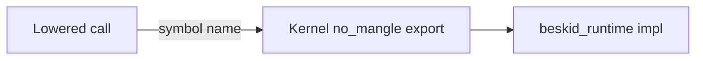
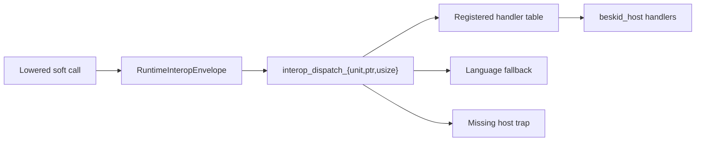
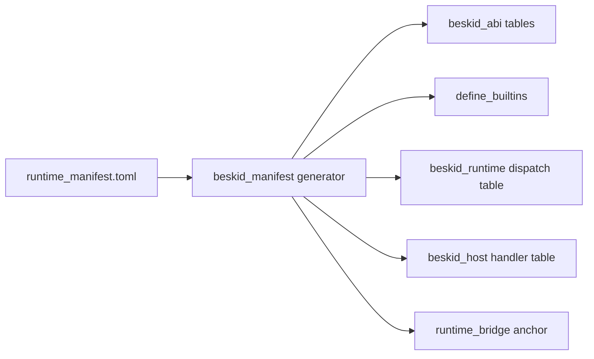

<!-- migrated from the legacy platform spec; canonical OpenSpec source -->
# Rust ABI profile Specification

## Purpose

This specification defines the Rust-hosted runtime surface. The surface covers exported symbols and unwind at the boundary. The stability rules differ from the user C extern libraries.
## Requirements
### Requirement: Feature hub owns normative contract: Decision [D-LMETA-RUSTABI-0001]
The Beskid standard SHALL enforce the following migrated contract section. Accepted ADR decisions are binding; uppercase requirement keywords retain their BCP-14 meaning.

> This feature hub **must** own normative MUST/SHOULD for **Rust-hosted runtime** interop distinct from user **C ABI profile** libraries.

**Stable ID:** `BSP-REQ-01AF40204EB4`  
**Legacy source:** `site/spec-content/platform-spec/language-meta/interop/rust-abi-profile/adr/0001-hub-authority/content.md`  
**Source SHA-256:** `3a63b0ee78d46ee27565c5340d42f46e24554d9a8548dcadbf51dab9f6b4a203`

#### Scenario: Conformance exercises Decision
- **GIVEN** an implementation claims conformance with this capability
- **WHEN** behavior governed by this contract section is exercised
- **THEN** every MUST, SHALL, REQUIRED, prohibition, and accepted decision in the section is satisfied

### Requirement: Runtime exposes C-compatible entrypoints: Decision [D-LMETA-RUSTABI-0002]
The Beskid standard SHALL enforce the following migrated contract section. Accepted ADR decisions are binding; uppercase requirement keywords retain their BCP-14 meaning.

> The Beskid runtime **must** expose **stable C-compatible entrypoints** to loaders. **Rust-specific** implementation choices **must** remain **inside** the runtime crate boundary.

**Stable ID:** `BSP-REQ-81656A98C490`  
**Legacy source:** `site/spec-content/platform-spec/language-meta/interop/rust-abi-profile/adr/0002-runtime-c-exports-rust-internal/content.md`  
**Source SHA-256:** `c6b13af23e512a1f25288cc96669c1bf3d587d788e1957bbd904a9b691a5b7cd`

#### Scenario: Conformance exercises Decision
- **GIVEN** an implementation claims conformance with this capability
- **WHEN** behavior governed by this contract section is exercised
- **THEN** every MUST, SHALL, REQUIRED, prohibition, and accepted decision in the section is satisfied

### Requirement: User Extern not arbitrary Rust crates: Decision [D-LMETA-RUSTABI-0003]
The Beskid standard SHALL enforce the following migrated contract section. Accepted ADR decisions are binding; uppercase requirement keywords retain their BCP-14 meaning.

> This profile is **not** a promise that arbitrary Rust crates can be user **`Extern`** targets without shims. User-authored foreign code on the supported path **must** remain **[C ABI profile](/platform-spec/language-meta/interop/c-abi-profile/)** until a future specification promotes additional Rust-native interop.

**Stable ID:** `BSP-REQ-3B1D8B90178B`  
**Legacy source:** `site/spec-content/platform-spec/language-meta/interop/rust-abi-profile/adr/0003-user-extern-not-rust-crates/content.md`  
**Source SHA-256:** `3185c57a435ba091529913e503d6bf733861e64b80195cccd80a1ca8cd871eb9`

#### Scenario: Conformance exercises Decision
- **GIVEN** an implementation claims conformance with this capability
- **WHEN** behavior governed by this contract section is exercised
- **THEN** every MUST, SHALL, REQUIRED, prohibition, and accepted decision in the section is satisfied

### Requirement: Language-owned runtime manifest: Decision [D-LMETA-RUSTABI-0004]
The Beskid standard SHALL enforce the following migrated contract section. Accepted ADR decisions are binding; uppercase requirement keywords retain their BCP-14 meaning.

> | Rule | Detail |
> | --- | --- |
> | Authority | `compiler/runtime_manifest.bsol` is the **sole normative authority** for runtime builtin classification |
> | Generated outputs | The runtime import tables **must** be **generated** from the manifest at build time. `beskid_abi/build.rs` generates `ABI_V5_SOFT_BUILTINS`, `ABI_V5_CORELIB_SERVICE_BINDINGS`, and `ABI_V5_SOURCE_BUILTINS` in `beskid_abi::generated::abi_v5_contract`. These tables are the sole source of runtime import signatures. `compiler/crates/beskid_abi/tests/runtime_import_catalog_v06.rs` fails if they drift from the manifest |
> | Hand edits | Hand-maintained symbol lists outside the manifest and generator **must not** ship |
> | Entry shape | Each manifest row carries `symbol`, Cranelift kinds, `beskid_path`, `injected`, `dispatch_tag`, `return_group`, and optional `corelib_owner` |

**Stable ID:** `BSP-REQ-1451CEF8D64A`  
**Legacy source:** `site/spec-content/platform-spec/language-meta/interop/rust-abi-profile/adr/0004-language-owned-runtime-manifest/content.md`  
**Source SHA-256:** `5ad3b7dbc07166ca409f2c71f0d11af625c919e317b498a033525233140ed09e`

#### Scenario: Conformance exercises Decision
- **GIVEN** an implementation claims conformance with this capability
- **WHEN** behavior governed by this contract section is exercised
- **THEN** every MUST, SHALL, REQUIRED, prohibition, and accepted decision in the section is satisfied

### Requirement: Kernel exports vs handler registration: Decision [D-LMETA-RUSTABI-0005]
The Beskid standard SHALL enforce the following migrated contract section. Accepted ADR decisions are binding; uppercase requirement keywords retain their BCP-14 meaning.

> | Layer | Role |
> | --- | --- |
> | **Kernel** | Direct `extern "C-unwind"` exports the linker/JIT **must** resolve by name — allocation, GC barriers/roots, panic, preempt, `fiber_yield`, `interop_dispatch_{unit,ptr,usize}`, `beskid_register_callbacks`, `beskid_register_handlers`, composition lifecycle, dynamic mapping (Phase A) |
> | **Dispatch** | Soft ops **must not** appear as direct kernel exports in v3; codegen routes through `interop_dispatch_*` with manifest-assigned tags |
> | **Registration** | Corelib init **must** call `beskid_register_handlers` before user static init; handler table maps tags to Rust implementations |
> | **Private impls** | Former soft `no_mangle` bodies **must** become `pub(crate)` — reachable only via dispatch or registration |
> 
> Initial v3 kernel inventory is normative in the manifest `[[kernel]]` section.

**Stable ID:** `BSP-REQ-983263D40FC4`  
**Legacy source:** `site/spec-content/platform-spec/language-meta/interop/rust-abi-profile/adr/0005-kernel-vs-dispatch-registration/content.md`  
**Source SHA-256:** `01b4dc55c188e0365bb2be95d59ce83dcaca9eb29e6769d5e7051b6407843db7`

#### Scenario: Conformance exercises Decision
- **GIVEN** an implementation claims conformance with this capability
- **WHEN** behavior governed by this contract section is exercised
- **THEN** every MUST, SHALL, REQUIRED, prohibition, and accepted decision in the section is satisfied

### Requirement: ABI v4 runtime/host split: Decision [D-EXEC-RT-0017]
The Beskid standard SHALL enforce the following migrated contract section. Accepted ADR decisions are binding; uppercase requirement keywords retain their BCP-14 meaning.

> | Rule | Detail |
> | --- | --- |
> | ABI version | The cutover is **ABI v4**. `BESKID_RUNTIME_ABI_VERSION` is `4`. |
> | Language runtime | `beskid_runtime` owns the kernel, dispatch router, GC, fibers, channels, strings, bytes, syscall dispatch handlers, and clocks. |
> | Host crate | `beskid_host` owns filesystem, environment, process, and TTY dispatch handlers. |
> | Registration | `beskid_host_register_all()` registers host handlers with `beskid_runtime::beskid_register_handlers(4, table, count)`. |
> | Runtime fallback | Host-owned tags **must not** have static `crate::builtins::*` fallback arms in `beskid_runtime`. Missing host registration traps deterministically. |
> | Profiles | The default `std` profile links runtime plus host. The `minimal` profile links the language runtime only. |
> | Corelib init | `Runtime.Init` is a documented no-op stub; host registration is performed by host/link startup, not by a Beskid handler table. |

**Stable ID:** `BSP-REQ-C0851BB0676B`  
**Legacy source:** `site/spec-content/platform-spec/language-meta/interop/rust-abi-profile/adr/0017-runtime-host-split-v4/content.md`  
**Source SHA-256:** `2a03434d0a867a0c5451be95bd5dd65f980d7b121e81ea6738a2df289b9d5bfb`

#### Scenario: Conformance exercises Decision
- **GIVEN** an implementation claims conformance with this capability
- **WHEN** behavior governed by this contract section is exercised
- **THEN** every MUST, SHALL, REQUIRED, prohibition, and accepted decision in the section is satisfied

### Requirement: Rust Glue C ABI separation
Generated Rust Glue wrappers SHALL use the selected target C ABI with explicit representations and SHALL NOT expose native Rust ABI, Rust bool/char/str/Vec/Result layout or assume the Rust runtime embedding ABI is the user Glue ABI. Beskid exports SHALL execute canonical AOT code within its documented runtime entry/root scope. User FFI layout band and runtime ABI SHALL be separately recorded and validated; changed runtime export signatures SHALL follow the runtime ABI version gate. Panic/unwind SHALL NOT cross C boundaries: catches occur inside compatible wrappers and translate declared errors; abort/trap becomes terminal process failure.

#### Scenario: Representation is explicit
- **GIVEN** manual and generated wrappers for Rust functions and Beskid exports
- **WHEN** their signatures are inspected and linked on each required target
- **THEN** they use C-compatible scalar/view shapes and matching bands (R4-ABI-01)

#### Scenario: Foreign panic isolated
- **GIVEN** a foreign call panics or aborts
- **WHEN** the boundary executes
- **THEN** caught panic returns declared failure and abort is terminal process failure; no unwind crosses C (R4-CALL-04)

#### Scenario: Runtime gate independent
- **GIVEN** an artifact has compatible user layout but incompatible runtime ABI
- **WHEN** the export service loads
- **THEN** it fails closed before invoking exports

### Requirement: Normalized managed local transport
Manual and generated local C wrappers SHALL normalize borrowed UTF-8 and bytes to `(const uint8_t*, target usize length)` and managed returns to a signed `int32_t` status plus a checked writable `GlueOwnedView*` out parameter. `GlueOwnedView` SHALL contain pointer, target usize length, and checked u64 owner token in that order; on every required 64-bit target its size/alignment SHALL be 24/8 with offsets 0/8/16. Status SHALL be 0 success, 1 invalid boundary value, 2 declared foreign error, or 3 caught foreign panic. Scalar success signatures SHALL retain direct exact-width values and unit SHALL use void; scalar failures SHALL use an explicitly checked wrapper, never a success-value sentinel.
The wrapper SHALL validate output nullness/alignment, input null/nonempty consistency, strict UTF-8, and the declared 16 MiB bound before effects. It SHALL copy bounded managed inputs and outputs under canonical GC root scopes, zero the output on failure, and publish no partial buffer. The owning library SHALL export `int32_t beskid_glue_release_<librarySha256>(uint64_t token)`, where `librarySha256` is the lowercase SHA-256 of its exact UTF-8 logical library identity, and release exactly once. Generated declarations and private native admission SHALL use that exact qualified symbol rather than a shared basename. The canonical provider SHALL derive the token's shape, kind, and generation from the live source-owned library record before release. Tokens SHALL be issued and checked through the canonical process owner authority with library, session, shape, and generation provenance; a library-local counter or independent fallback registry SHALL NOT authorize production ownership. Hidden adapter pointers SHALL NOT be exposed as logical user raw-address signatures or serialized into the stdio bridge.

#### Scenario: Managed export succeeds under collection
- **GIVEN** a Rust caller invokes a Beskid string or byte-array export using this transport
- **WHEN** allocation and collection occur while the canonical adapter copies the result
- **THEN** status is zero, contents including embedded NUL and Unicode or high bytes are exact, and the valid owned token releases once (R4-OWN-01, R4-OWN-02)

#### Scenario: Invalid managed input publishes nothing
- **GIVEN** invalid UTF-8, null nonempty input, excessive length, or a null or misaligned output
- **WHEN** the checked wrapper is called
- **THEN** it returns invalid status before effects and any valid output is zeroed without a published token (R4-CALL-03)

#### Scenario: Owner authority rejects alien and stale tokens
- **GIVEN** a token belongs to another library/session/shape/generation or has already been released
- **WHEN** the owning release wrapper checks it
- **THEN** it returns invalid status without freeing any live allocation (R4-OWN-03)

### Requirement: Source-owned rooted owner record lifecycle

The canonical provider SHALL construct owner records from registered Runtime/Glue/OwnerRecord.bd typed constructors and their compiler-emitted aggregate descriptors. Owner chains SHALL use typed managed arrays with zero or one predecessor and typed managed byte payloads. Native foreign-buffer pointers SHALL remain untraced scalar storage. Callback registry V3 SHALL preserve its existing 1056-byte prefix, own Dynamic live-root handle at 1056 and Glue owner live-root handle at 1064, and have size 1072. Replacement SHALL transfer both live roots without releasing them. Shutdown SHALL release foreign buffers and unroot both registry handles before checking external roots or clearing canonical handles.

Owner admission SHALL check nonzero process issuer, process-issued session, library, generation, kind, shape and token correlations. Opening a library SHALL establish a generation-bound ownership domain supporting multiple shapes. A scalar shape correlation SHALL NOT qualify canonical serializer signature authority; generated adapters SHALL bind their independently validated compiled shape set. Issuance SHALL be bounded to 65536 records per session and 16 MiB per copied payload, and return checked failure without publishing output when admission fails.

#### Scenario: Library and generation separation
- **GIVEN** two ownership domains in one canonical provider and an output owned by the first
- **WHEN** release uses the second library or a substituted generation, kind or shape
- **THEN** release fails and the output remains owned by the first domain
- **AND** release with all original correlations succeeds exactly once

#### Scenario: Root preservation and teardown
- **GIVEN** an owner chain with a live copied payload and Dynamic registry root
- **WHEN** callback registration replaces the registry and collection runs
- **THEN** both roots remain live and the copied payload retains its bytes
- **WHEN** the runtime shuts down and is initialized again
- **THEN** foreign buffers are freed and both old roots are unrooted before handle clearing
- **AND** old session tokens fail admission even if fresh GC slot generations coincide

### Requirement: Canonical GC-owned primitive UTF-8 storage
The runtime SHALL represent each newly constructed primitive String through a canonical source-declared Utf8ViewRecord whose descriptor and pointer map are emitted from the registered typed runtime assembly. The record SHALL contain a managed u8-array payload and untraced native data pointer and length. Its ABI-visible String view SHALL retain the existing data-and-length geometry while canonical reference normalization resolves that view to its live owning GC object. Descriptor flag 2 SHALL be admitted only for the compiler-authorized canonical runtime record with verified size 40, alignment 8 and pointer-map offset 16; user declarations with matching names or geometry SHALL NOT receive that authority. String construction, concatenation, integer conversion and slicing SHALL publish only fully initialized, rooted records. Collection SHALL retain backing bytes reachable through String roots and reclaim unreachable records and backing arrays without a separate immortal native-buffer allocation.

#### Scenario: String retained across collection
- **GIVEN** a String constructed from copied UTF-8 bytes containing an embedded NUL and a supplementary Unicode scalar
- **WHEN** a canonical GC handle roots its ABI-visible view and collection runs
- **THEN** the handle resolves to the same view and all bytes and length remain intact
- **AND** empty-string and concatenation results obey the same ownership contract.

#### Scenario: Forged UTF-8 view is rejected
- **GIVEN** an arbitrary native fat pointer or a user-defined record matching the canonical geometry
- **WHEN** the value is submitted to canonical managed-reference normalization
- **THEN** it SHALL NOT be admitted as a canonical String owner without the live allocation and compiler-issued descriptor authority.

### Requirement: Shared compiled-shape registration authority
Glue and Dynamic V1 SHALL share the callback-registry V3 Dynamic root at offset 1056. Native shape registration SHALL use the explicitly versioned 136-byte, eight-byte-aligned registration DTO: version and size at offsets 0 and 4, library and generation at 8 and 16, complete source SHA-256 at 24, complete signature SHA-256 at 56, signature pointer and native length at 88 and 96, payload and cell descriptor pointers at 104 and 112, and compiler-emitted constructor and accessor callbacks at 120 and 128. Registration SHALL retain source and full signature bytes in descriptor-backed managed records, recompute the signature digest through the canonical hash service, reject conflicting bytes or descriptor/callback closure under the same digest, and limit each signature to one MiB, aggregate signature storage to sixteen MiB, and registrations to 65536. A library owner token alone SHALL NOT grant compiled-shape authority: production registration SHALL be issued from the validated loaded artifact and current canonical specialization closure. Registered callbacks and descriptors SHALL remain pinned while any cell or registry references them.

#### Scenario: Conflicting or stale compiled shape rejected
- **GIVEN** a registered full signature and current compiler-issued constructor/accessor closure
- **WHEN** a registration reuses its digest with different bytes, source identity, descriptors, callbacks or generation
- **THEN** registration fails without replacing the existing shape or publishing a token.

#### Scenario: Registry teardown retains safe stale metadata
- **GIVEN** cells retain managed shape records whose registry owner is active
- **WHEN** the runtime closes its registry before dropping canonical roots and clearing handles
- **THEN** stale create, cast and map requests fail, while retained metadata follows the canonical GC lifetime without acquiring a new session identity.

### Requirement: Issuer-bound managed Dynamic erasure
The compiler SHALL represent logical erased Dynamic cells and payload boxes as sealed managed nominals issued from the verified canonical runtime source and exact syntax generation. An ordinary empty aggregate layout SHALL NOT authorize the cell's forty-byte runtime representation. The sealed cell nominal SHALL have no ordinary constructor or readable/copyable source fields. User declarations with matching names, annotations or geometry SHALL NOT acquire the representation capability. Only the checked typed native bridge SHALL return a logical sealed cell after validating live allocation, registered descriptor, shape, tag and active provider/session. Result and aggregate storage containing that nominal SHALL use normal managed root and barrier facts. Payload erasure SHALL likewise be issued from its registered payload descriptor rather than a pointer-to-nominal source cast. Old descriptor-only creation and unchecked mapping services SHALL be removed.

#### Scenario: Logical result retains a Dynamic cell
- **GIVEN** a checked typed bridge returns a registered cell as the canonical sealed managed nominal
- **WHEN** the caller allocates a Result or aggregate and collection runs before unpacking it
- **THEN** the cell, payload box and shape metadata remain reachable through ordinary managed facts.

#### Scenario: Empty lookalike cannot construct an erased cell
- **GIVEN** an ordinary source type named DynamicValueV1 or copied opaque annotation
- **WHEN** ordinary construction or ABI lowering attempts to obtain the canonical erased-cell representation
- **THEN** no canonical representation capability is granted, and construction through the real sealed declaration fails closed.

### Requirement: Source-derived opaque nominal boxing

A logical GlueHandle nominal SHALL retain its canonical managed source representation inside Beskid and SHALL cross normalized foreign transport only as a checked u64 owner token. Its adapter allocation descriptor, object geometry, token field offset and pointer map SHALL come from the current registered nominal aggregate layout and the sole compiler descriptor pass. The compiler SHALL project the exact binding type through the shared portable semantic shape issuer, preserving applied generic arguments and package/declaration identity; equal physical u64 fields SHALL NOT collapse different brands. Ordinary u64 signatures SHALL NOT receive nominal boxing or ownership authority.

#### Scenario: Distinct applied brands preserve distinct identities

- **GIVEN** one source-defined GlueHandle nominal Token<T> with an untraced u64 token field
- **WHEN** current bindings use Token<i64> and Token<u64>
- **THEN** both adapters SHALL use source-derived managed geometry while retaining distinct complete applied shape identities
- **AND** an ordinary u64 binding SHALL receive no GlueHandle shape grant.

#### Scenario: Foreign owner is a compiled dependency domain

- **GIVEN** an opaque token owned by a pinned Rust library and a Beskid consumer owned by another library
- **WHEN** the normalized adapter admits that token
- **THEN** it SHALL resolve the owner through a private producer-issued brand dependency correspondence
- **AND** it SHALL validate the actual process, session, library, generation, kind and complete brand before allocating a managed nominal box
- **AND** neither a library-name string nor a caller-supplied token-library pair SHALL establish that correspondence.

### Requirement: Opaque owner lifecycle in the canonical traced chain
Opaque ownership SHALL use the same canonical process issuer and traced owner-record chain as managed transfers. A kind-seven live record SHALL retain a copied forty-eight-byte payload containing the complete thirty-two-byte brand digest, eight-byte foreign address and eight-byte checked destructor address. A kind-eight dependency record SHALL retain sorted unique eighty-byte rows containing consumer brand digest, owning library identity, owning brand digest and owning generation. These scalar bytes SHALL NOT be traced as managed pointers, and the source record's foreign buffer SHALL be null for these borrowed-copy records. Their retained bytes SHALL debit the shared sixteen-MiB owner budget. Registration SHALL require private producer/loader image and source correspondence; callers SHALL NOT extend admitted brands or substitute an owning domain. Destructor role six SHALL have the checked physical signature i32(pointer), with panic contained by the owning Rust wrapper. Release SHALL tombstone and clear the record before invoking the admitted destructor exactly once; stale, foreign or already released tokens SHALL reject without invoking it. Library close SHALL release all live opaque owners before invalidating the image closure, while the process lease retains their image through heap destruction. Failure outputs SHALL remain zero and a destructor failure SHALL not make a released token live again.

#### Scenario: Foreign opaque token cannot acquire a managed box
- **GIVEN** a live token with the same scalar width but another complete brand or owning library
- **WHEN** a consumer normalizes it through its compiled dependency row
- **THEN** it rejects before allocating a box or calling source code

#### Scenario: Release failure cannot repeat destruction
- **GIVEN** an admitted Rust destructor reports a caught panic after its owner record is tombstoned
- **WHEN** release is repeated or the library closes
- **THEN** destruction is not invoked again and the checked failure remains distinct from a successful live token

## Informative Source Provenance

The records below preserve migration history. They are not normative except where text was extracted into a requirement above.

### Source Record: Rust ABI profile

**Authority:** informative provenance  
**Legacy path:** `/platform-spec/language-meta/interop/rust-abi-profile/`  
**Source:** `site/spec-content/platform-spec/language-meta/interop/rust-abi-profile/content.md`  
**SHA-256:** `3b07641a9648775c4605f2746ec997f9eaa4ca78689d7c58d93758570769220d`

<details>
<summary>Migrated source text</summary>

``````markdown
<SpecSection title="What this feature specifies" id="what-this-feature-specifies">
The **Rust ABI profile** describes how the **Beskid runtime** (implemented in Rust) exposes **stable C-compatible entrypoints** to JIT and AOT loaders while allowing **Rust-specific** implementation choices **inside** the runtime crate boundary.

This profile is **not** a promise that arbitrary Rust crates can be linked as user `Extern` targets without shims. User-authored foreign code on the supported path remains the **[C ABI profile](/platform-spec/language-meta/interop/c-abi-profile/)** until a future specification promotes additional Rust-native interop.
</SpecSection>

<SpecSection title="Implementation anchors" id="implementation-anchors">
- Language-owned manifest: `compiler/runtime_manifest.toml`
- Generated symbol names and specs: `compiler/crates/beskid_abi/src/generated/`
- Manifest generator: `compiler/crates/beskid_manifest/`
- Runtime exports and modules: `compiler/crates/beskid_runtime/src/lib.rs`, `compiler/crates/beskid_runtime/src/builtins/mod.rs`
- Syscall and panic bridges (example of `extern "C-unwind"` usage): `compiler/crates/beskid_runtime/src/builtins/panic_io.rs`
- JIT registration of runtime symbols: `compiler/crates/beskid_engine/src/jit_module.rs`
- Symbol inventory and runtime ABI references: `/platform-spec/execution/runtime/`
</SpecSection>

## Decisions
<!-- spec:generate:adr-index -->
No open decisions. Closed choices are normative ADRs under **`adr/`** (`D-LMETA-RUSTABI-0001` … `D-EXEC-RT-0017`); use the reader **ADRs** tab for expandable detail.
<!-- /spec:generate:adr-index -->
## Articles
<!-- spec:generate:article-index -->
- [Rust ABI profile — Boundary and stability](./articles/boundary-and-stability/)
- [Rust ABI profile — Kernel and dispatch](./articles/kernel-and-dispatch/)
- [Rust ABI profile — Runtime manifest](./articles/runtime-manifest/)
- [Rust ABI profile — Shims and compatibility strategy](./articles/shims-and-compatibility/)
<!-- /spec:generate:article-index -->
``````

</details>

### Source Record: Feature hub owns normative contract

**Authority:** informative provenance  
**Legacy path:** `/platform-spec/language-meta/interop/rust-abi-profile/adr/0001-hub-authority/`  
**Source:** `site/spec-content/platform-spec/language-meta/interop/rust-abi-profile/adr/0001-hub-authority/content.md`  
**SHA-256:** `3a63b0ee78d46ee27565c5340d42f46e24554d9a8548dcadbf51dab9f6b4a203`

<details>
<summary>Migrated source text</summary>

``````markdown
## Context

Rust runtime exports were documented beside user C extern rules.

## Decision

This feature hub **must** own normative MUST/SHOULD for **Rust-hosted runtime** interop distinct from user **C ABI profile** libraries.

## Consequences

Builtin table and ABI version policy stay here; user `Extern` stays on C profile.

## Verification anchors

/platform-spec/language-meta/interop/rust-abi-profile/
``````

</details>

### Source Record: Runtime exposes C-compatible entrypoints

**Authority:** informative provenance  
**Legacy path:** `/platform-spec/language-meta/interop/rust-abi-profile/adr/0002-runtime-c-exports-rust-internal/`  
**Source:** `site/spec-content/platform-spec/language-meta/interop/rust-abi-profile/adr/0002-runtime-c-exports-rust-internal/content.md`  
**SHA-256:** `c6b13af23e512a1f25288cc96669c1bf3d587d788e1957bbd904a9b691a5b7cd`

<details>
<summary>Migrated source text</summary>

``````markdown
## Context

JIT/AOT loaders need stable C symbol names while implementation remains Rust.

## Decision

The Beskid runtime **must** expose **stable C-compatible entrypoints** to loaders. **Rust-specific** implementation choices **must** remain **inside** the runtime crate boundary.

## Consequences

`beskid_abi` symbols and unwind bridges document the outward face only.

## Verification anchors

`compiler/crates/beskid_abi`; `compiler/crates/beskid_runtime`.
``````

</details>

### Source Record: User Extern not arbitrary Rust crates

**Authority:** informative provenance  
**Legacy path:** `/platform-spec/language-meta/interop/rust-abi-profile/adr/0003-user-extern-not-rust-crates/`  
**Source:** `site/spec-content/platform-spec/language-meta/interop/rust-abi-profile/adr/0003-user-extern-not-rust-crates/content.md`  
**SHA-256:** `3185c57a435ba091529913e503d6bf733861e64b80195cccd80a1ca8cd871eb9`

<details>
<summary>Migrated source text</summary>

``````markdown
## Context

Linking arbitrary `rlib` targets as user Extern would imply unstable Rust ABI across toolchains.

## Decision

This profile is **not** a promise that arbitrary Rust crates can be user **`Extern`** targets without shims. User-authored foreign code on the supported path **must** remain **[C ABI profile](/platform-spec/language-meta/interop/c-abi-profile/)** until a future specification promotes additional Rust-native interop.

## Consequences

Embedding docs steer authors to C contracts + shims for Rust libraries.

## Verification anchors

/platform-spec/language-meta/interop/rust-abi-profile/ and [FFI and extern](/platform-spec/language-meta/interop/ffi-and-extern/).
``````

</details>

### Source Record: Language-owned runtime manifest

**Authority:** informative provenance  
**Legacy path:** `/platform-spec/language-meta/interop/rust-abi-profile/adr/0004-language-owned-runtime-manifest/`  
**Source:** `site/spec-content/platform-spec/language-meta/interop/rust-abi-profile/adr/0004-language-owned-runtime-manifest/content.md`  
**SHA-256:** `5ad3b7dbc07166ca409f2c71f0d11af625c919e317b498a033525233140ed09e`

<details>
<summary>Migrated source text</summary>

``````markdown
## Context

Runtime ABI tables were maintained in four parallel Rust registries (`beskid_abi`, analysis builtins, JIT registration, runtime bridge). Manual sync drifted from corelib ownership and made v3 kernel shrink impossible to audit.

## Decision

| Rule | Detail |
| --- | --- |
| Authority | `compiler/runtime_manifest.toml` is the **sole normative authority** for runtime builtin classification |
| Generated outputs | The runtime import tables **must** be **generated** from the manifest at build time. In ABI v5 these are `ABI_V5_SOFT_BUILTINS`, `ABI_V5_CORELIB_SERVICE_BINDINGS`, and `ABI_V5_SOURCE_BUILTINS` from `compiler/runtime_manifest.bsol` |
| Hand edits | Hand-maintained symbol lists outside the manifest and generator **must not** ship |
| Entry shape | Each manifest row carries `symbol`, Cranelift kinds, `beskid_path`, `injected`, `dispatch_tag`, `return_group`, and optional `corelib_owner` |

## Consequences

[D-LMETA-RUSTABI-0002](/platform-spec/language-meta/interop/rust-abi-profile/adr/0002-runtime-c-exports-rust-internal/) remains valid but applies to **kernel** exports only. See [runtime manifest](/platform-spec/language-meta/interop/rust-abi-profile/runtime-manifest/) for schema and generation pipeline.

## Verification anchors

`compiler/runtime_manifest.toml`; `compiler/crates/beskid_manifest/`; generated stubs under `compiler/crates/beskid_abi/src/`.
``````

</details>

### Source Record: Kernel exports vs handler registration

**Authority:** informative provenance  
**Legacy path:** `/platform-spec/language-meta/interop/rust-abi-profile/adr/0005-kernel-vs-dispatch-registration/`  
**Source:** `site/spec-content/platform-spec/language-meta/interop/rust-abi-profile/adr/0005-kernel-vs-dispatch-registration/content.md`  
**SHA-256:** `01b4dc55c188e0365bb2be95d59ce83dcaca9eb29e6769d5e7051b6407843db7`

<details>
<summary>Migrated source text</summary>

``````markdown
## Context

ABI v2 exported ~80 direct `no_mangle` symbols. Hot paths (GC, panic, preempt) need stable direct calls; soft ops (strings, channels, fibers) can route through tag dispatch without bloating the linker surface.

## Decision

| Layer | Role |
| --- | --- |
| **Kernel** | Direct `extern "C-unwind"` exports the linker/JIT **must** resolve by name — allocation, GC barriers/roots, panic, preempt, `fiber_yield`, `interop_dispatch_{unit,ptr,usize}`, `beskid_register_callbacks`, `beskid_register_handlers`, composition lifecycle, dynamic mapping (Phase A) |
| **Dispatch** | Soft ops **must not** appear as direct kernel exports in v3; codegen routes through `interop_dispatch_*` with manifest-assigned tags |
| **Registration** | Corelib init **must** call `beskid_register_handlers` before user static init; handler table maps tags to Rust implementations |
| **Private impls** | Former soft `no_mangle` bodies **must** become `pub(crate)` — reachable only via dispatch or registration |

Initial v3 kernel inventory is normative in the manifest `[[kernel]]` section.

## Consequences

Stable surface narrows to kernel exports plus [dispatch envelope layout](/platform-spec/language-meta/interop/interop-contracts/adr/0004-dispatch-envelope-layout/). See [kernel and dispatch](/platform-spec/language-meta/interop/rust-abi-profile/kernel-and-dispatch/) for call paths.

## Verification anchors

`compiler/runtime_manifest.toml`; `compiler/crates/beskid_runtime/src/interop/`; `compiler/crates/beskid_tests/src/abi/contracts.rs`.
``````

</details>

### Source Record: ABI v4 runtime/host split

**Authority:** informative provenance  
**Legacy path:** `/platform-spec/language-meta/interop/rust-abi-profile/adr/0017-runtime-host-split-v4/`  
**Source:** `site/spec-content/platform-spec/language-meta/interop/rust-abi-profile/adr/0017-runtime-host-split-v4/content.md`  
**SHA-256:** `2a03434d0a867a0c5451be95bd5dd65f980d7b121e81ea6738a2df289b9d5bfb`

<details>
<summary>Migrated source text</summary>

``````markdown
## Context

ABI v3 removed many legacy direct exports from the runtime kernel, but the `beskid_runtime` crate still contained host-adjacent dispatch handlers for filesystem, environment, process, and terminal behavior. That made a runtime-only test profile carry OS authority it did not need, and it blurred the boundary between language runtime services and host composition.

[D-LMETA-RUSTABI-0004](/platform-spec/language-meta/interop/rust-abi-profile/adr/0004-language-owned-runtime-manifest/) remains the manifest authority. This decision narrows what the language runtime may satisfy with static dispatch fallback.

## Decision

| Rule | Detail |
| --- | --- |
| ABI version | The cutover is **ABI v4**. `BESKID_RUNTIME_ABI_VERSION` is `4`. |
| Language runtime | `beskid_runtime` owns the kernel, dispatch router, GC, fibers, channels, strings, bytes, syscall dispatch handlers, and clocks. |
| Host crate | `beskid_host` owns filesystem, environment, process, and TTY dispatch handlers. |
| Registration | `beskid_host_register_all()` registers host handlers with `beskid_runtime::beskid_register_handlers(4, table, count)`. |
| Runtime fallback | Host-owned tags **must not** have static `crate::builtins::*` fallback arms in `beskid_runtime`. Missing host registration traps deterministically. |
| Profiles | The default `std` profile links runtime plus host. The `minimal` profile links the language runtime only. |
| Corelib init | `Runtime.Init` is a documented no-op stub; host registration is performed by host/link startup, not by a Beskid handler table. |

## Host-owned dispatch rows

The host owner covers the manifest rows for `fs_write_text`, `fs_read_text`, `fs_delete`, `fs_exists`, `fs_mkdir`, `env_get`, `env_getcwd`, `env_set`, `process_exit`, `process_getpid`, and `tty_winsize`.

`syscall_read`, `syscall_write`, `syscall_read_bytes`, `syscall_write_bytes`, `clock_monotonic_nanos`, `clock_realtime_nanos`, and `fiber_now_millis` stay language-owned in `beskid_runtime`.

## Consequences

- `beskid run`, `beskid test`, `beskid build`, and `beskid repl` use the `std` runtime profile unless the caller requests `--runtime-profile minimal`.
- Minimal-profile programs may use language-runtime services such as `Testing` and panic/syscall output, but host-owned `System.FS`, environment, process, and terminal dispatch surfaces trap unless a host registers handlers.
- AOT runtime bundles must include a v4 host archive or equivalent host link anchor for the `std` profile.
- Contract tests must assert that host symbols are not kernel exports and that host-owned manifest rows have registration-table coverage.

## Verification anchors

- `compiler/runtime_manifest.toml` — `abi_version = 4`, dispatch `owner`, and runtime profiles.
- `compiler/crates/beskid_manifest/` — runtime dispatch codegen and host-handler table codegen.
- `compiler/crates/beskid_runtime/src/generated/dispatch_table.rs` — host tags trap without registration.
- `compiler/crates/beskid_host/` — host handler implementations and `beskid_host_register_all()`.
- `compiler/crates/beskid_tests/src/abi/contracts.rs` — ABI v4 and host-export contracts.
``````

</details>

### Source Record: Rust ABI profile — Boundary and stability

**Authority:** informative provenance  
**Legacy path:** `/platform-spec/language-meta/interop/rust-abi-profile/articles/boundary-and-stability/`  
**Source:** `site/spec-content/platform-spec/language-meta/interop/rust-abi-profile/articles/boundary-and-stability/content.md`  
**SHA-256:** `50f6a14f99c59e77ac52720265813eb495bbef59a2a8e37bffe1587e59c71f29`

<details>
<summary>Migrated source text</summary>

``````markdown
## Stable surface

The **normative stable surface** for loaders and generated code in ABI v3 is:

1. **Kernel exports** — the small set of direct `extern "C-unwind"` symbols published through generated `beskid_abi` tables and realized in `beskid_runtime` (see [kernel and dispatch](/platform-spec/language-meta/interop/rust-abi-profile/kernel-and-dispatch/)).
2. **Dispatch envelope layout** — the versioned `RuntimeInteropEnvelope` band and tag validity rules ([D-LMETA-IC-0004](/platform-spec/language-meta/interop/interop-contracts/adr/0004-dispatch-envelope-layout/)).

Soft runtime ops are **not** stable as individual linker symbols in v3; they are stable as **manifest-assigned dispatch tags** routed through `interop_dispatch_*` kernel entrypoints. Conformance tests lock the kernel allowlist and envelope band for a given **runtime ABI version** (see `compiler/crates/beskid_tests/src/abi/contracts.rs`).

## Implementation-private Rust

Rust types, modules, and internal helpers inside `beskid_runtime` that are **not** part of the exported symbol contract may change across compiler releases without a major ABI version bump, provided tests and documented runtime behavior remain compatible.

## Unwind and panics

Runtime entrypoints may use **`extern "C-unwind"`** (or equivalent) where platform policy requires interoperable unwinding with generated code. The exact mapping is **profile-defined** and must stay consistent with panic and IO documentation under `/execution/runtime/`.
``````

</details>

### Source Record: Rust ABI profile — Kernel and dispatch

**Authority:** informative provenance  
**Legacy path:** `/platform-spec/language-meta/interop/rust-abi-profile/articles/kernel-and-dispatch/`  
**Source:** `site/spec-content/platform-spec/language-meta/interop/rust-abi-profile/articles/kernel-and-dispatch/content.md`  
**SHA-256:** `7cd7415f756fce53ac3047c842380bc7989973a27935d6eab69bc24b3ec19f0b`

<details>
<summary>Migrated source text</summary>

``````markdown
## Purpose

ABI v4 splits runtime entry into a **small language kernel**, **language-owned dispatch fallbacks**, and **host-owned dispatch handlers** registered by `beskid_host`. This article describes the call paths and the registration model after [D-EXEC-RT-0017](/platform-spec/language-meta/interop/rust-abi-profile/adr/0017-runtime-host-split-v4/).

## Direct kernel path

Hot, layout-sensitive, or bootstrap operations stay **direct**:



Examples: `alloc`, `gc_write_barrier`, `panic`, `panic_str`, `runtime_preempt_check`, `fiber_yield`, composition container lifecycle, dynamic mapping, dispatch entrypoints, registration entrypoints, and the ABI version export.

## Dispatch path

Soft ops emit a **`RuntimeInteropEnvelope`** and call the matching kernel dispatch builtin:



Codegen selects `interop_dispatch_unit`, `interop_dispatch_ptr`, or `interop_dispatch_usize` from the manifest return group. The runtime validates the tag and first checks the registered handler table. If no handler is registered, language-owned tags may fall back to static `beskid_runtime` builtins. Host-owned tags must not fall back to runtime builtins; they trap with a missing-host-handler diagnostic.

## Handler registration

Before user code runs in the `std` runtime profile:

1. The engine, runtime bridge, or AOT link anchor includes `beskid_host`.
2. Startup calls `beskid_host_register_all()`.
3. `beskid_host_register_all()` calls `beskid_register_handlers(4, table, count)` with FS/env/process/TTY handler entries.
4. User code may call host-owned dispatch surfaces through the same `System.*` facades.

The `minimal` profile links `beskid_runtime` only. In that profile, host-owned tags remain valid manifest tags but trap when used because no host handler table is registered.

Registration **must** complete before user static init ([D-EXEC-ABI-0008](/platform-spec/execution/abi-and-host/extern-dispatch-and-policy/adr/0007-handler-registration-init-order/)). Unknown tags must trap; known host tags without registration must trap deterministically.

## v4 kernel inventory

| Category | Symbols |
| --- | --- |
| Version | `beskid_runtime_abi_version` |
| Allocation / GC | `alloc`, `gc_write_barrier`, `gc_root_handle`, `gc_unroot_handle`, `gc_register_root`, `gc_unregister_root` |
| Faults / scheduling | `panic`, `panic_str`, `runtime_preempt_check`, `fiber_yield` |
| Dispatch | `interop_dispatch_unit`, `interop_dispatch_ptr`, `interop_dispatch_usize` |
| Registration | `beskid_register_callbacks`, `beskid_register_handlers` |
| Composition / dynamic | composition container lifecycle symbols; dynamic mapping symbols |

Language-owned dispatch remains in `beskid_runtime` for strings, bytes, arrays, GC status, fibers, channels, clocks, and `syscall_*`. Host-owned dispatch (`fs_*`, `env_*`, `process_*`, `tty_winsize`) is supplied by `beskid_host` in the `std` profile.

## Related topics

- [Runtime manifest](./runtime-manifest/) — schema, owners, and profiles
- [Boundary and stability](./boundary-and-stability/) — what loaders may rely on
- [Dispatch envelope layout](/platform-spec/language-meta/interop/interop-contracts/adr/0004-dispatch-envelope-layout/)
``````

</details>

### Source Record: Rust ABI profile — Runtime manifest

**Authority:** informative provenance  
**Legacy path:** `/platform-spec/language-meta/interop/rust-abi-profile/articles/runtime-manifest/`  
**Source:** `site/spec-content/platform-spec/language-meta/interop/rust-abi-profile/articles/runtime-manifest/content.md`  
**SHA-256:** `cd391ef96cc328df1154bc660970b2fd78dcc378b59d6461d6a8bd65a7c87607`

<details>
<summary>Migrated source text</summary>

``````markdown
## Purpose

The **runtime manifest** (`compiler/runtime_manifest.toml`) is the language-owned catalog that classifies every runtime builtin as a **kernel** direct export or a **dispatch** soft op. ABI v4 also classifies every dispatch row by runtime authority: **language** or **host**.

Rust registries are **generated** from this file — not edited by hand.

## Schema

Manifest rows use TOML tables grouped by role:

```toml
[manifest]
abi_version = 4

[profiles.minimal]
owners = ["language"]

[profiles.std]
owners = ["language", "host"]

[[kernel]]
symbol = "alloc"
params = ["usize", "ptr"]
returns = "ptr"
injected = true
beskid_path = ["__alloc"]

[[dispatch.usize]]
tag = 0
name = "StrLen"
beskid_path = ["__str_len"]
dispatch_key = "str_len"
owner = "language"

[[dispatch.usize]]
tag = 1
name = "FsWriteText"
beskid_path = ["__fs_write_text"]
dispatch_key = "fs_write_text"
owner = "host"
```

Each entry carries:

| Field | Meaning |
| --- | --- |
| `symbol` | Linker-visible name for kernel rows |
| `params` / `returns` | Cranelift ABI kinds |
| `beskid_path` | Compiler-visible `__*` path |
| `tag` | Tag integer for dispatch rows |
| `return_group` | The dispatch table group: `unit`, `ptr`, `usize`, or `i64` |
| `dispatch_key` | Stable routing key for generated lookup tables and handler wrappers (not a kernel export) |
| `owner` | Dispatch authority: `language` or `host` |
| `injected` | Whether the compiler injects the Beskid `__*` path |

## Runtime profiles

| Profile | Owners | Behavior |
| --- | --- | --- |
| `minimal` | `language` | Links `beskid_runtime` only. Language-owned dispatch has runtime fallback; host-owned tags trap if called. |
| `std` | `language`, `host` | Links `beskid_runtime` plus `beskid_host`. Host-owned tags are registered before user entry. |

The CLI defaults to `std`. `--runtime-profile minimal` exists for testing and host-less programs that do not use FS/env/process/TTY surfaces.

## Ownership

| Owner | Responsibility |
| --- | --- |
| **Language / platform spec** | Manifest schema, kernel inventory, tag assignment policy, profile semantics |
| **Generator** | Mechanical emission — no business logic outside manifest classification |
| **Runtime crate** | Kernel exports, dispatch router, and static fallback for language-owned dispatch |
| **Host crate** | FS/env/process/TTY dispatch handlers and `beskid_host_register_all()` |
| **Corelib** | Public `System.*` facades and `Runtime.Abi` constants that mirror manifest tags |

Host-owned dispatch rows in ABI v4 are `fs_write_text`, `fs_read_text`, `fs_delete`, `fs_exists`, `fs_mkdir`, `env_get`, `env_getcwd`, `env_set`, `process_exit`, `process_getpid`, and `tty_winsize`.

`syscall_*`, clocks, fibers, channels, strings, bytes, arrays, GC status, events, mutexes, hubs, and wait groups remain language-owned.

## Generation pipeline



`beskid_abi` `build.rs` runs the generator and writes:

- `beskid_abi::generated::abi_v5_contract` — `ABI_V5_SOFT_BUILTINS`, `ABI_V5_CORELIB_SERVICE_BINDINGS`, `ABI_V5_SOURCE_BUILTINS` (generated from `compiler/runtime_manifest.bsol`)
- `src/generated/symbols.rs` is not generated. It is a frozen ABI-v4 name list (`RUNTIME_EXPORT_SYMBOLS`, `SYM_*`) that only reserves names from user FFI
- dispatch lookup and tag tables consumed by compiler and tests
- runtime dispatch tables with language fallback only
- host-handler tables consumed by `beskid_host`
- analysis, JIT, and bridge stubs in their respective crates

`cargo:rerun-if-changed=runtime_manifest.toml` keeps outputs in sync.

Normative decisions: [D-LMETA-RUSTABI-0004](/platform-spec/language-meta/interop/rust-abi-profile/adr/0004-language-owned-runtime-manifest/) and [D-EXEC-RT-0017](/platform-spec/language-meta/interop/rust-abi-profile/adr/0017-runtime-host-split-v4/).

## Related topics

- [Kernel and dispatch](./kernel-and-dispatch/) — call paths after generation
- [Manifest-generated registries](/platform-spec/execution/abi-and-host/builtins-and-symbols/adr/0005-manifest-generated-registries/) — execution-side registry rules
``````

</details>

### Source Record: Rust ABI profile — Shims and compatibility strategy

**Authority:** informative provenance  
**Legacy path:** `/platform-spec/language-meta/interop/rust-abi-profile/articles/shims-and-compatibility/`  
**Source:** `site/spec-content/platform-spec/language-meta/interop/rust-abi-profile/articles/shims-and-compatibility/content.md`  
**SHA-256:** `010c5b697b6b181ac8933d4a092eec540aaaa553ce9c9f5ed5b3455491795d43`

<details>
<summary>Migrated source text</summary>

``````markdown
## Shim pattern

Any future **Rust-native** user interop would introduce **thin shim symbols** with stable C names that delegate to Rust `extern "Rust"` or crate-specific metadata. **Interop.Contracts** normalization would run **before** shim emission so that profiles remain composable.

## Compatibility bands

The platform can evolve:

1. **Band A** — C-profile user `Extern` and the v3 **kernel export set** plus dispatch envelope layout (today’s supported story).
2. **Band B** — manifest-driven handler registration and `[Runtime]`-attributed corelib shims; soft ops route through `interop_dispatch_*` rather than direct linker symbols ([runtime manifest](/platform-spec/language-meta/interop/rust-abi-profile/runtime-manifest/)).

Upgrades **must** preserve Band A artifacts unless accompanied by a major ABI version policy change documented under **[conformance and versioning](/platform-spec/language-meta/interop/interop-contracts/conformance-and-versioning/)**.
``````

</details>
