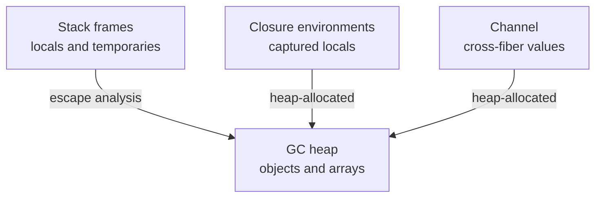
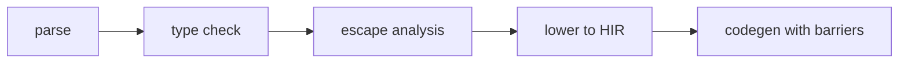

<!-- migrated from the legacy platform spec; canonical OpenSpec source -->
# Memory and references Specification

## Purpose

This specification defines locals, mut bindings, heap objects, and fiber sharing rules. A concurrent GC manages the heap objects. The runtime write barriers and collector phases defer to the execution specs. The `/execution/` path is a non-normative legacy bridge.
## Requirements
### Requirement: Locals mut and assignment
Assignment to immutable bindings MUST error (**E1214**). `mut` MUST appear as a prefix modifier before the type or after `let` to allow reassignment (`mut T name = expr`, `let mut name = expr`, or `mut T name` parameters). Legacy suffix form `T mut name` MUST be rejected by the parser. Parameters are passed by value in v0.1; `ref` and `out` parameter modifiers are not part of v0.1.

`move` SHALL be a parameter modifier in the same position as `mut` (`move T name`), and a method receiver MAY be declared `move this` or `mut this` as its first parameter. `move` and `mut` SHALL NOT both appear on one parameter; the parser SHALL reject `move mut T name` and `mut move T name`. A parameter declared `move` SHALL have a Moved-class type; `move` on a parameter of any other class SHALL be reported as **E1239** at the modifier, naming the class. `move this` SHALL be accepted only in a method of an `[Isolated]` type or of a type whose class is Moved; otherwise **E1239**. No `[Owned]` attribute exists.

#### Scenario: Assignment to immutable local
- **GIVEN** a non-`mut` local binding
- **WHEN** code assigns to that binding
- **THEN** the compiler emits **E1214**

#### Scenario: Owning parameter and receiver
- **GIVEN** `[Isolated] pub type Archive { List<u8[]> blocks; pub Archive Add(move this, move u8[] block) { this.blocks = this.blocks.Push(move block); return this; } }`
- **WHEN** the type is parsed and checked
- **THEN** both `move` modifiers are accepted and no diagnostic is reported

#### Scenario: move on a Shared parameter
- **GIVEN** `i64 Size(move string name) { return name.Length(); }`
- **WHEN** the declaration is checked
- **THEN** the compiler SHALL report **E1239** at `move` naming class Shared

### Requirement: Arrays heap and null prohibition
`T[]` values MUST use the manifest-derived `BeskidArray` header and a precise
immutable element descriptor carrying stride, alignment, and pointer-map data.
Non-empty arrays MUST have real managed storage. Safe array length, get, and
set operations SHALL lower directly through generation-bound typed ISLE facts:
they MUST check the logical bound and address arithmetic before memory access,
and MUST NOT call `array_get` or `array_set`. Dynamic growth MUST use the sole
manifest-owned typed grow operation and preserve descriptor, logical length,
initialized values, roots, and barriers.

Reference-bearing values that escape their defining frame MUST live on the
precisely traced GC heap. A managed aggregate or array under construction MUST
remain rooted through every allocation-capable initializer and pointer store.
Pointer stores to managed objects or arrays MUST execute the canonical write
barrier before a safepoint when required by the active GC phase. User code MUST
NOT expose manual `free`, untracked pointers, or `null`; optional absence MUST
use `Option<T>`.

#### Scenario: Null literal is rejected
- **GIVEN** a program that uses a `null` literal as a value
- **WHEN** the program is type-checked
- **THEN** the compiler rejects `null` and requires `Option<T>` or an explicit
  absent variant

#### Scenario: Direct indexing checks bounds and arithmetic
- **GIVEN** a managed `T[]` and an index expression
- **WHEN** typed ISLE lowering emits an element load or store
- **THEN** logical bounds and address arithmetic are checked before direct
  memory access and no element-access runtime import is emitted

#### Scenario: Aggregate pointer publication is traced
- **GIVEN** a newly allocated managed aggregate whose pointer initializer can
  allocate
- **WHEN** construction stores that initializer into the aggregate
- **THEN** owner and value remain rooted through evaluation and the edge is
  barred before any allocation or safepoint can observe it

#### Scenario: Typed growth preserves live references
- **GIVEN** a pointer-bearing array with live initialized elements
- **WHEN** manifest-owned growth runs under collection pressure
- **THEN** the source and result remain rooted during copy and every initialized
  referent remains reachable through the preserved pointer map

### Requirement: Cross-fiber sharing
Values MUST NOT be shared across fibers by alias unless immutability is proven or synchronization uses `Channel<T>`. Capturing mutable shared state in `spawn` closures SHOULD be rejected when detectable. Closure environments MUST outlive uses tracked by the compiler’s capture analysis.

#### Scenario: Unsynchronized cross-fiber alias
- **GIVEN** a mutable value aliased into two fibers without proven immutability or a `Channel<T>`
- **WHEN** sharing analysis runs
- **THEN** the compiler rejects the sharing or diagnoses detectable mutable capture

### Requirement: Dead growth of a mutable array parameter
A growth operation is a canonical `Core.Collections.Array` call that can reallocate the array named by its first argument and that returns the grown handle. `Array.Append` is a growth operation. Each sibling with the same shape is a growth operation. Parameters pass by value, so a growth operation on a `mut T[]` parameter changes only the callee's copy of the handle. The growth SHALL NOT change the length, the capacity or the elements of the caller's array, whatever the capacity of that array. While the parameter holds the handle that the caller passed, the first growth SHALL copy the array into a new array. An element write through the parameter before that growth SHALL write the caller's array.

The compiler SHALL reject a function or method body with the diagnostic `DeadCollectionGrowth` when all of the following conditions are true:

- The owner argument of a growth operation resolves to a `mut T[]` parameter of that body.
- The body discards the returned handle: the growth call is an expression statement, or it is the whole source of an expression statement `p = <growth call>;` whose target is the same parameter.
- The body does not publish the parameter handle. A read of the parameter publishes the handle when the read is in a position other than the owner argument of a growth operation, the target of an index expression, the target of an assignment, or an argument of a canonical `Core.Collections.Array` function that does not return or store its array argument (`Len`, `IsEmpty`, `Capacity`, `Get`, `Current`, `Iterate`, `Copy` and `CopyRange`). Another call argument, a `return` operand, an assignment or binding source, a struct field initializer, and a capture in a nested lambda are publishing reads.

The compiler MUST NOT report `DeadCollectionGrowth` when the body does not discard the returned handle, when the body contains one or more publishing reads of the parameter, or when the owner argument resolves to a local binding or an aggregate field instead of a parameter. The diagnostic is an error. Semantic analysis MUST fail closed on `DeadCollectionGrowth` before lowering, and the diagnostic MUST name the source site of the growth call. When the compiler reports `DeadCollectionGrowth` for the growth call of `p = <growth call>;`, it MUST NOT also report **E1259** for that assignment.

**Stable ID:** `BSP-REQ-35580A7D7B75`

#### Scenario: Discarded growth of a parameter is rejected
- **GIVEN** `unit Push(mut u8[] buffer, u8 value) { Array.Append<u8>(buffer, value); }` where `Array.Append` resolves to the canonical `Core.Collections.Array` declaration
- **WHEN** semantic analysis completes
- **THEN** the compiler reports `DeadCollectionGrowth` at the `Array.Append` call and does not lower the program

#### Scenario: A local read of the length is not a publication
- **GIVEN** `i64 AppendAndCount(mut i64[] xs) { Array.Append<i64>(xs, 9); return Array.Len<i64>(xs); }`
- **WHEN** semantic analysis completes
- **THEN** the compiler reports `DeadCollectionGrowth` at the `Array.Append` call

#### Scenario: A returned growth is accepted
- **GIVEN** `i64[] AppendAndReturn(mut i64[] xs) { Array.Append<i64>(xs, 9); return xs; }` and a caller `a = AppendAndReturn(a);`
- **WHEN** the program runs
- **THEN** no diagnostic is reported and the caller's `a` has one more element

#### Scenario: Growth never reaches the caller's array
- **GIVEN** a caller array `a` of length 1 and a callee `i64[] AppendMany(mut i64[] xs)` that appends 100 elements and returns `xs`, called as `i64[] b = AppendMany(a);`
- **WHEN** the program runs
- **THEN** `b` has 101 elements and `a` has 1 element, whatever the capacity of `a`

### Requirement: The move expression
`move` SHALL be a reserved keyword and `MoveExpression = MoveKeyword ~ PostfixExpression` SHALL be a `UnaryExpression` alternative beside `SpawnUnary` and `PrefixUnary`. The operand SHALL be a path naming an owning Moved-class name, or a field place admitted by the requirement "Destructive read of a field". `move x` SHALL be an owned expression of `x`'s type and SHALL consume `x` at the point of evaluation. `move` applied to a name whose class is Shared, Copied or Never, to a borrowed name, to a `mut` local of non-Moved class, or to a call result or literal SHALL be reported as **E1239** at the expression, naming the class or the reason "borrowed".

#### Scenario: Move a local into a parameter
- **GIVEN** `unit Store(move u8[] block) { }` and `unit Main() { u8[] data = Array.Empty<u8>(); Store(move data); }`
- **WHEN** the item is checked
- **THEN** the call is accepted and `data` is a Moved place after it

#### Scenario: Move of a Shared local
- **GIVEN** `unit Main() { string name = "a"; string other = move name; }`
- **WHEN** the item is checked
- **THEN** the compiler SHALL report **E1239** at `move name` naming class Shared

#### Scenario: Move of a borrowed parameter
- **GIVEN** `unit Keep(u8[] data, Archive a) { a.Add(move data); }`
- **WHEN** the item is checked
- **THEN** the compiler SHALL report **E1239** at `move data` with the reason "borrowed" and the help "declare the parameter `move u8[] data`"

### Requirement: Array length changes never reach another handle
A `T[]` value is a handle to one array. Two or more handles can name the same array: a local copy (`ys = xs`), a field and a local, a closure capture, an element of a collection, an argument, and a returned array. An element write through one handle SHALL be visible through every handle to the same array. A growth operation (`Array.Append`, `Array.TryAppend`) through one handle SHALL NOT change the length, the capacity or the elements that another handle reads. This rule applies to the elements that the grower writes after the growth, also when those elements are in the spare capacity of the array. A shrink operation (`Array.RemoveLast`, the only operation that decreases the length of an array) through one handle SHALL NOT change the length or the elements that another handle reads. `Array.Clear` clears one element and keeps the length: it is an element write.

When another handle can read the array, the growth or the shrink SHALL copy the array into a new array, and only the handle that changes the length SHALL hold the new array. A growth or a shrink SHALL be in place only when no other handle can read the array. An array that only one handle can read SHALL grow in place while capacity remains, so that a sequence of appends costs amortized constant time for each element, and SHALL shrink in place.

The handle that changes the length is the owner of the array: a `let` local, a `mut` or `move` parameter, or a field of an object that a local, a parameter or the receiver holds. The changed array SHALL be written back to the owner. When the first argument of `Array.RemoveLast` is not an owner (a plain parameter, an element, a call result), the call SHALL return a shortened copy and the argument SHALL keep its length.

The compiler SHALL treat a handle as able to read the array when the program made that handle from the grower's handle:
- by a read of the array place in a copy position of copy on assignment (a `let` value, an assignment value, an argument that the callee keeps, a field, element or payload of a construction, the operand of `move` at an isolate crossing, or a returned place that the callable does not own);
- by a call result that can be an array argument of the call, unless the result is stored back into the place that every array argument reads (`xs = Array.Append<T>(xs, v)`);
- by an argument read from a field or an element, when the callee can reach the object that holds that field or element and can grow or shrink it during the call. The callee can reach the holder when it is a method, a function value or a dispatched call, or when another argument is an object, struct, enum, closure or contract value, or an array whose elements can lead to one (for example `Holder[]`). An argument that is a primitive, a string, or an array whose elements are primitives, strings or such arrays cannot reach the holder.

`List<T>` is not an array: a list keeps its own sharing state (copy on assignment), and this requirement does not change it.

#### Scenario: A local copy keeps its length
- **GIVEN** `mut i64[] xs` with length 1 and capacity 4, and `mut i64[] ys = xs;`
- **WHEN** the program runs `Array.Append<i64>(xs, 9);`
- **THEN** `Array.Len<i64>(ys)` is 1 and `Array.Len<i64>(xs)` is 2

#### Scenario: Two handles grow into the same spare slot
- **GIVEN** `mut i64[] xs` with length 1 and capacity 4, and `mut i64[] ys = xs;`
- **WHEN** the program runs `Array.Append<i64>(xs, 5);`, then `Array.Append<i64>(ys, 6);`, then `xs[0] = 3;`
- **THEN** `xs[1]` is 5, `ys[1]` is 6 and `ys[0]` is unchanged

#### Scenario: A field and a local
- **GIVEN** a local `xs` with spare capacity and `Holder h = Holder { items: xs };`
- **WHEN** the program runs `Array.Append<i64>(h.items, 9);`
- **THEN** `Array.Len<i64>(xs)` is unchanged and `Array.Len<i64>(h.items)` is one more

#### Scenario: A capture, a list element and a returned field
- **GIVEN** an array with spare capacity that a lambda captured, that a `List<i64[]>` holds, or that a function returned from a field
- **WHEN** the program grows the original handle
- **THEN** the lambda, the list element and the returned array each read the original length

#### Scenario: An unaliased array grows in place
- **GIVEN** `mut i64[] xs` with length 1 and capacity 4 that no other handle can read
- **WHEN** the program runs `Array.Append<i64>(xs, 1);` and `xs = Array.Append<i64>(xs, 2);`
- **THEN** `Array.Capacity<i64>(xs)` is still 4

#### Scenario: A shrink through a local copy
- **GIVEN** `mut i64[] xs` with length 3 and `mut i64[] ys = xs;`
- **WHEN** the program runs `Array.RemoveLast<i64>(xs);`
- **THEN** `Array.Len<i64>(xs)` is 2, `Array.Len<i64>(ys)` is 3 and `ys[2]` is unchanged

#### Scenario: A shrink through a field, a capture, a list element or a returned field
- **GIVEN** an array that a second handle reads: a field of a construction, a lambda capture, a `List<i64[]>` element, an element of an `i64[][]` bound to a local, or the result of a function that returns a field
- **WHEN** the program runs `Array.RemoveLast` through either handle
- **THEN** the other handle reads the original length and the original last element

#### Scenario: A shrink of a parameter
- **GIVEN** a caller array `xs` with length 2
- **WHEN** a callee runs `Array.RemoveLast` on a `mut i64[]` parameter, on a plain `i64[]` parameter (and returns the result), or on a local copy of a parameter
- **THEN** the callee's result has length 1 and `Array.Len<i64>(xs)` is still 2

#### Scenario: A shrink of an element is not an owner shrink
- **GIVEN** `i64[][] nested` whose element 0 has length 2
- **WHEN** the program runs `i64[] shorter = Array.RemoveLast<i64>(nested[0]);`
- **THEN** `Array.Len<i64>(shorter)` is 1 and `Array.Len<i64>(nested[0])` is 2

#### Scenario: Clear keeps the length
- **GIVEN** `mut i64[] xs` with length 2 and `i64[] ys = xs;`
- **WHEN** the program runs `Array.Clear<i64>(xs, 1);`
- **THEN** both handles read length 2 and `ys[1]` is 0

#### Scenario: An unaliased array shrinks in place
- **GIVEN** `mut i64[] xs` with length 4 and capacity 4 that no other handle can read, or a field that no other handle can read
- **WHEN** the program runs `Array.RemoveLast<i64>(xs);` and `xs = Array.RemoveLast<i64>(xs);`, or removes every element of the field
- **THEN** `Array.Capacity` is still 4, and a later `Array.Append<i64>(xs, 9)` stores into the freed slot in place

#### Scenario: A field lent beside an array of holders
- **GIVEN** `Holder h` with `items` of length 2, `Holder[] holders = [h];`, and a free function `i64 F(i64[] lent, Holder[] holders)` that binds `mut Holder g = holders[0];` and runs `Array.RemoveLast<i64>(g.items);` or `Array.Append<i64>(g.items, 9);`
- **WHEN** the program calls `F(h.items, holders)` and `F` returns `Array.Len<i64>(lent)`
- **THEN** the result is the original length of `h.items`

### Requirement: Contract values at an isolate crossing
The transfer class of a contract type SHALL come from the transfer marker contracts that it embeds, transitively. A contract that embeds no marker SHALL have class Never. A contract that embeds only `Copied`, optionally with `Transferable`, SHALL have class Copied. A contract that embeds any other marker SHALL have class Moved. Every implementing type SHALL satisfy every embedded marker; a conversion of a value whose type does not satisfy them SHALL be **E1206**. Markers SHALL have no implementation tables. A contract value SHALL be a managed record that holds the implementing value and the implementation table. `Port<C>` SHALL be well typed exactly when `C` embeds a marker; otherwise it SHALL be **E1610**. The crossing rules of the requirement "Move applies at isolate crossings" SHALL apply to a contract value that crosses and to the value it holds. On a crossing the record SHALL be copied into the destination heap with the graph it holds. An immutable Shared implementing object SHALL be shared by reference, and the implementation table SHALL be static data that is valid in every isolate. Contract values SHALL require a 64-bit target; on a target with a narrower pointer, narrowing or widening a scalar receiver SHALL fail closed.

#### Scenario: Send a marked contract value
- **GIVEN** `contract Scored : Transferable { i64 Score(); }` with `[Isolated]` implementations and `out.Send(move scored)` where `scored` is a unique local
- **WHEN** the code is checked
- **THEN** no diagnostic is reported and a read of `scored` after the send is **E1234**

#### Scenario: Port of an unmarked contract
- **GIVEN** `contract Greeter { string Greet(); }` and `Port<Greeter> p`
- **WHEN** the code is checked
- **THEN** the compiler SHALL report **E1610**

### Requirement: Mutable parameters pass by value
A `mut` parameter SHALL be a local binding of the callee that the body MAY assign again. An assignment whose target is the parameter name SHALL change only the callee's binding and SHALL NOT change the caller's argument. An assignment through the parameter to a field or an element (`p.f = v`, `p[i] = v`) SHALL write the object or array that the caller also references. A `mut` parameter SHALL NOT be an alias of the caller's storage.

The compiler SHALL report **E1259** for an expression statement that assigns a `mut` parameter of the enclosing function or method (`p = v;` or a compound assignment such as `p += v;`) when no read of the parameter can follow the assignment on any path before the parameter is assigned again or the body ends. A read SHALL be every occurrence of the parameter name other than the target of such an assignment, including a field or element access, a call argument, a `return` operand, an occurrence in a lambda and an occurrence in a string interpolation. A `break` SHALL continue the path after its loop, a `continue` and the end of a loop body SHALL continue it at the loop condition, and a `return` SHALL end it. The diagnostic is an error, and semantic analysis MUST fail closed on it before lowering. The compiler MUST NOT report **E1259** for an assignment to a local binding, a field or an element, or for an assignment that a later read can observe, also in a later iteration of a loop. The compiler MUST NOT report **E1259** for an assignment `p = <growth call>;` when it reports `DeadCollectionGrowth` for that growth call.

#### Scenario: Whole assignment that the caller cannot see
- **GIVEN** `type Size { i32 columns; i32 rows; }` and `unit AssignWhole(mut Size s) { s = Size { columns: 80, rows: 24, }; }`
- **WHEN** the code is checked or built
- **THEN** the compiler SHALL report **E1259** at the assignment, and the build SHALL NOT lower the body

#### Scenario: Field assignment reaches the caller
- **GIVEN** `unit AssignFields(mut Size s) { s.columns = 80; s.rows = 24; }` and a caller `mut Size s = Size { columns: 0, rows: 0, }; AssignFields(s);`
- **WHEN** the program runs
- **THEN** no diagnostic is reported and the caller reads `s.columns` as `80`

#### Scenario: Assignment read later in the body
- **GIVEN** `i64 Clamp(mut i64 value) { if (value < 0) { value = 0; } return value; }`
- **WHEN** the code is checked
- **THEN** no diagnostic is reported

#### Scenario: Assignment read in the next iteration
- **GIVEN** `i64 Digits(mut u64 value) { mut i64 count = 0; while (value > 0_u64) { value = value / 10_u64; count = count + 1; } return count; }`
- **WHEN** the code is checked
- **THEN** no diagnostic is reported

#### Scenario: Assignment to a primitive parameter at the end
- **GIVEN** `unit Bump(mut i64 value) { value = value + 1; }`
- **WHEN** the code is checked
- **THEN** the compiler SHALL report **E1259** at the assignment

### Requirement: Move applies at isolate crossings
A crossing operand SHALL be one of: the value argument of the corelib `Port<T>.Send` or of the runtime builtin `__port_send`; a binding declared outside a closure that is the argument of a `[Captures]`-bounded parameter, or initializes a `[Captures]`-bounded field, or is the body of `__isolate_spawn`, and that the closure reads with `move`. The `[Captures]`-bounded parameters of `Scope.Spawn`, of `Parallel.Scope` tasks and of the `.Parallel()` steps SHALL make those captures crossings through this definition. A fiber `spawn` SHALL NOT be a crossing. `move x` SHALL consume `x` only as a crossing operand. `move` written anywhere else SHALL be **E1239** with the help "remove `move`; it applies only when a value crosses to another isolate". `move` applied to a Shared, Copied or Never value, and the `move` modifier on a parameter of such a type, SHALL be **E1239** with the help "remove `move`: Shared and Copied values pass without it". A crossing operand of Moved class that is written without `move` SHALL be **E1242** with the help "write `move <name>`". Outside a crossing the compiler SHALL NOT classify names as owning or borrowed and SHALL NOT report use after move. Assignment, `let y = x`, field and element stores, returns and ordinary calls SHALL NOT consume a value. A read of a binding after the crossing that consumed it, on a path the crossing reaches, SHALL be **E1234** with the label "moved here" at the crossing. A place read of Moved class that is handed to a crossing without `move` (`xs[i]`, `x.f`) SHALL be **E1241** with the help to copy the value first or to take it out. Fiber handle linearity (a double `Join` is **E1234**) SHALL stay unchanged.

#### Scenario: Ordinary alias is accepted
- **GIVEN** `unit Main() { u8[] a = Array.Empty<u8>(); u8[] b = a; Array.Append<u8>(a, 1); Array.Append<u8>(b, 2); }`
- **WHEN** the item is checked
- **THEN** no diagnostic is reported

#### Scenario: Move outside a crossing
- **GIVEN** `unit Main() { u8[] a = Array.Empty<u8>(); Archive.Store(move a); }` where `Store` is an ordinary function
- **WHEN** the item is checked
- **THEN** the compiler SHALL report **E1239** at `move a` with the help "remove `move`; it applies only when a value crosses to another isolate"

#### Scenario: Use after a port send
- **GIVEN** `unit Main(Port<u8[]> out) { u8[] block = Array.Zeroed<u8>(16_i64); out.Send(move block); i64 n = Array.Len<u8>(block); }`
- **WHEN** the item is checked
- **THEN** the compiler SHALL report **E1234** at `block` in `Array.Len<u8>(block)` with the label "moved here" on `move block`

#### Scenario: Spawn capture is consumed
- **GIVEN** `s.Spawn(() => Checksum(move buffer));` followed by a read of `buffer` in the parent
- **WHEN** the item is checked
- **THEN** the compiler SHALL report **E1234** at the read

#### Scenario: Crossing without move
- **GIVEN** `out.Send(block)` where `block` is a `u8[]` local and `out` is a `Port<u8[]>`
- **WHEN** the item is checked
- **THEN** the compiler SHALL report **E1242** with the help "write `move block`"

### Requirement: Consumption at a crossing
Consumption SHALL be tracked per binding only for crossing operands. A consumption in one arm of an `if` statement SHALL NOT make a use in the other arm **E1234**. A use after the `if` statement SHALL be **E1234** when an arm consumed the binding and that arm can complete normally. A consumption followed on its own path by `return`, `break` or `continue` SHALL NOT reach a use after that exit. A crossing in a loop body that consumes a binding declared outside the loop, without reassigning it before the next iteration, SHALL be **E1240** at the `move`. Reassigning a consumed binding SHALL make it usable again.

#### Scenario: Send in one arm, use in the other
- **GIVEN** `unit Main(Port<u8[]> out, move u8[] data, bool keep) { if keep { out.Send(move data); } else { Log.Info(Array.Len<u8>(data)); } }`
- **WHEN** the item is checked
- **THEN** no diagnostic is reported

#### Scenario: Use after a conditional send
- **GIVEN** `unit Main(Port<u8[]> out, move u8[] data, bool keep) { if keep { out.Send(move data); } i64 n = Array.Len<u8>(data); }`
- **WHEN** the item is checked
- **THEN** the compiler SHALL report **E1234** at `data` in the `Len` call

#### Scenario: Send in a loop
- **GIVEN** `unit Main(Port<u8[]> out, move u8[] data, i64 rounds) { mut i64 i = 0; while i < rounds { out.Send(move data); i = i + 1; } }`
- **WHEN** the item is checked
- **THEN** the compiler SHALL report **E1240** at `move data`

#### Scenario: Send in a loop with revival
- **GIVEN** `unit Main(Port<u8[]> out, i64 rounds) { mut u8[] data = Array.Empty<u8>(); mut i64 i = 0; while i < rounds { out.Send(move data); data = Array.Empty<u8>(); i = i + 1; } }`
- **WHEN** the item is checked
- **THEN** no diagnostic is reported

### Requirement: Taking a field out at a crossing
`move x.f` SHALL be accepted only as a crossing operand. The field's type SHALL have a canonical empty value: `Option<T>` (left as `Option::None`) or `T[]` (left as the empty array). A `List<T>` has no canonical empty value, so `move x.items` of a `List<T>` field SHALL be **E1243** with the help "use `exchange(<place>, <value>)`". The expression SHALL yield the field value and SHALL store the canonical empty value into the field in the same evaluation step. `move x.f` on a field of any other type SHALL be **E1243** with the help "use `exchange(x.f, v)`". The builtin `exchange(place, value)` SHALL store `value` into `place` and return the previous value; it SHALL NOT require `move`.

#### Scenario: Send a field
- **GIVEN** `unit Flush(Port<u8[]> out, Stage s) { out.Send(move s.buffer); }` where `buffer` is a `u8[]` field
- **WHEN** the item is checked and run
- **THEN** the port receives the buffer and `s.buffer` is the empty array

#### Scenario: Exchange without move
- **GIVEN** `u8[] Swap(Stage s, u8[] next) { return exchange(s.buffer, next); }`
- **WHEN** the item is checked and run with a buffer `[1]` and `next` `[2]`
- **THEN** no diagnostic is reported, the result is `[1]` and `s.buffer` is `[2]`

### Requirement: ORCA preconditions at crossings
Two static guarantees SHALL hold for hand-over by pointer. First, deep persistent immutability: a value of Shared class is never written after construction. Second, external uniqueness at the crossing: a crossing operand `move x` SHALL be **E1241**, with the help to copy the value first, unless `x` is a `move` parameter or a local initialized from an owned expression (a call result, a literal, a struct, array or enum literal, or an element or member of one), and no expression in the callable makes `x` the value of a `let`, of an assignment or of a literal element, or reads `x` inside a closure that is not `[Captures]`-bounded, and the latest assignment to `x` on the crossing's path (if any) assigned an owned expression. An argument of a `move` or `mut` parameter, an argument of a `spawn` target and the value of `exchange` SHALL give the binding another name, because the callee may keep the value; such a binding SHALL NOT cross unless it is copied first (**E1241**, help "copy first"). An argument of a plain parameter SHALL NOT give the binding another name, because a plain parameter cannot be kept (see "Plain parameters cannot be kept"). A binding passed as an argument whose parameter type is a type parameter, of the function or of its declaring type, SHALL count as aliased: a later crossing of the binding SHALL be **E1241** with the help "copy it first" (owner ruling). A crossing operand that is a plain parameter, or a local that holds one, SHALL be reported as the requirement "Plain parameters cannot be kept" states, with both repairs. Internal aliases and cycles inside the handed-over graph are permitted. Aliases inside one isolate that never cross are permitted.

#### Scenario: Aliased value at a crossing
- **GIVEN** `unit Main(Port<u8[]> out) { u8[] a = Array.Empty<u8>(); u8[] b = a; out.Send(move a); }`
- **WHEN** the item is checked
- **THEN** the compiler SHALL report **E1241** at `move a` with the help to copy the value first

#### Scenario: Unique local
- **GIVEN** `unit Main(Port<u8[]> out) { u8[] a = Array.Zeroed<u8>(8_i64); out.Send(move a); }`
- **WHEN** the item is checked
- **THEN** no diagnostic is reported and the value is handed over by pointer

### Requirement: Plain parameters cannot be kept
A parameter with no modifier (neither `mut`, `move` nor `bulk`) of Moved class that is not `[CopyOnAssign]` SHALL NOT be kept by the callee. Keeping SHALL mean: storing the parameter into a field or element; using it as a field of a struct literal, an element of an array literal or a payload of an enum constructor (except into a corelib `[ScopeBorrowed]` view); returning it; passing it as an argument the callee keeps (a `move` parameter, a `spawn` target call, the value of `exchange`); or sending it as a crossing operand (`port.Send(move data)`). A local initialized or assigned from such a parameter SHALL be judged in the same way. The receiver `this` of a method without `move this` (a plain or `mut this` receiver) SHALL follow the same keep rule; the fix SHALL insert `move` only for an explicit plain `this`. A plain parameter that a lambda captures SHALL NOT be kept by an escaping lambda: a lambda escapes when it is returned, stored, put into an element, a payload or a field without a `[Captures]` bound, spawned, or reached through a local that holds it. Such a capture SHALL be **E1241**. A violation SHALL be **E1241** at the use with a machine-applicable fix that inserts `move` before the parameter. The message SHALL be "the parameter `<name>` is borrowed, so it cannot be stored, returned, sent to another isolate or kept: the caller still owns its value", or, for a local that holds the parameter, "`<local>` holds the borrowed parameter `<name>`, so it cannot be stored, returned, sent to another isolate or kept: the caller still owns its value". The help SHALL be "copy it, or declare the parameter `move`". A plain parameter that is a crossing operand SHALL get this diagnostic, not the help "copy `<name>` first". A `mut` parameter SHALL be exempt, so the idiom `AppendCrlf(mut u8[] data) { ...; return data; }` stays valid; the caller treats a `mut` argument as kept. A `List<T>` is `[CopyOnAssign]` and is therefore copied wherever it is kept. Generated native SDK constructors SHALL be exempt, because native Mods hand their arguments over.

#### Scenario: Stored plain parameter
- **GIVEN** `unit Keep(u8[] data, Archive a) { a.blocks = data; }`
- **WHEN** the function is checked
- **THEN** the compiler SHALL report **E1241** at `data` with a fix that declares the parameter `move u8[] data`

#### Scenario: Sent plain parameter
- **GIVEN** `unit Hand(Port<u8[]> output, u8[] block) { output.Send(move block); }`
- **WHEN** the function is checked
- **THEN** the compiler SHALL report **E1241** at `move block` with the help "copy it, or declare the parameter `move`" and a fix that declares the parameter `move u8[] block`

#### Scenario: Sent move parameter
- **GIVEN** `unit Hand(Port<u8[]> output, move u8[] block) { output.Send(move block); }`
- **WHEN** the function is checked
- **THEN** no diagnostic is reported

#### Scenario: Receiver stored
- **GIVEN** a method `Keep(Archive a) { a.owner = this; }` of a type `Stage` whose receiver is not `move this`
- **WHEN** the method is checked
- **THEN** the compiler SHALL report **E1241** at `this`

#### Scenario: Escaping lambda captures a plain parameter
- **GIVEN** a function `Reader(u8[] data)` that returns the lambda `() => data`
- **WHEN** the function is checked
- **THEN** the compiler SHALL report **E1241** at the capture of `data`

#### Scenario: Type parameter argument aliases
- **GIVEN** `items.Push(b); out.Send(move b);` where `Push` takes a parameter of type `T`
- **WHEN** the function is checked
- **THEN** the compiler SHALL report **E1241** at `move b` with the help "copy it first"

#### Scenario: Mut parameter is exempt
- **GIVEN** `u8[] AppendCrlf(mut u8[] data) { Array.Append<u8>(data, 13_u8); return data; }`
- **WHEN** the function is checked
- **THEN** no diagnostic is reported

#### Scenario: Argument of a move parameter
- **GIVEN** `Archive.Store(move data);` followed by `out.Send(move data)` of the same binding
- **WHEN** the function is checked
- **THEN** the compiler SHALL report **E1241** with the help to copy the value first

### Requirement: Nested copy-on-assign values at a crossing
A crossing operand whose type holds a `[CopyOnAssign]` value below the top level (in a field, an array element, an enum payload, or as the element type of a top-level `List`, such as `List<List<T>>`) SHALL be **E1241** with the help "copy it first", because the holder of the inner value may be reachable from other names of the sender. A top-level `List<T>` whose elements hold no `[CopyOnAssign]` value SHALL cross detached from its sharers. A generic operand of type `T` SHALL be judged where `T` is concrete.

#### Scenario: List of lists
- **GIVEN** `out.Send(move rows)` where `rows` is a `List<List<i64>>`
- **WHEN** the function is checked
- **THEN** the compiler SHALL report **E1241** with the help "copy it first"

#### Scenario: Flat list
- **GIVEN** `out.Send(move values)` where `values` is a `List<i64>` that is a unique local
- **WHEN** the function is checked
- **THEN** no diagnostic is reported and the list crosses detached

### Requirement: Scope-borrowed values do not escape
A value of a corelib `[ScopeBorrowed]` type SHALL stay in the scope that uses it. The compiler SHALL report **E1241** when such a value is: returned, by `return` or as the expression body of a lambda; the value of an assignment to a field or an element; a field initializer of a struct literal whose type is not itself `[ScopeBorrowed]`, an element of an array literal, or a payload of an enum constructor; an argument of a `spawn` target call; or captured by an escaping lambda. A lambda SHALL escape when it is returned, is the value of an assignment to a field or an element, is an element of an array literal or an enum constructor payload, initializes a struct literal field that has no `[Captures]` bound, or is the operand of `spawn`. A lambda that is called in place, bound to a local, passed as a call argument, or that initializes a `[Captures]`-bounded struct literal field SHALL NOT be an escaping lambda. A local initialized from a `[ScopeBorrowed]` value SHALL be such a value. The message SHALL name the type, and the help SHALL say to use the value inside the scope that created it. Construction of a `[ScopeBorrowed]` value from a borrowed value SHALL stay permitted. `[ScopeBorrowed]` outside a `Core.*` module SHALL remain **E1510** and SHALL grant nothing.

#### Scenario: Store into a field
- **GIVEN** a function that assigns a `SeqSource<T>` value to a field of a record
- **WHEN** the function is checked
- **THEN** the compiler SHALL report **E1241** at the assignment

#### Scenario: Return of a view
- **GIVEN** a function that returns the `SeqSource<T>` it received
- **WHEN** the function is checked
- **THEN** the compiler SHALL report **E1241** at the `return` expression

#### Scenario: Capture by a spawned closure
- **GIVEN** a `spawn` operand closure that captures a `SeqSource<T>`
- **WHEN** the function is checked
- **THEN** the compiler SHALL report **E1241** at the capture

#### Scenario: Use inside the scope
- **GIVEN** `.Parallel().Map((x) => x * x).Reduce(0_i64, SumI64 {})` in one expression
- **WHEN** the function is checked
- **THEN** no diagnostic is reported

### Requirement: Immutable assignment is reported once per binding
Assignment to an immutable binding SHALL be reported with **E1214** once per binding, at the name of the declaration. Each assignment to the binding SHALL be a related location with the label "assigned again". The help SHALL write the declaration with `mut`. The diagnostic SHALL carry a machine-applicable fix that inserts `mut ` before the type of a typed local or a parameter, or after `let`. The iterator of a `for` loop SHALL get the help without a fix.

#### Scenario: Two assignments
- **GIVEN** `i64 x = 1; x = 2; x = 3;`
- **WHEN** the code is checked
- **THEN** one **E1214** is reported at the declaration of `x`, with two related locations "assigned again" and a fix that gives `mut i64 x = 1;`

## Informative Source Provenance

The records below preserve migration history. They are not normative except where text was extracted into a requirement above.

### Source Record: Memory and references

**Authority:** informative provenance  
**Legacy path:** `/platform-spec/language-meta/memory-model/memory-and-references/`  
**Source:** `site/spec-content/platform-spec/language-meta/memory-model/memory-and-references/content.md`  
**SHA-256:** `d64ab2a24007fbb462198eee3e7fcd1a92867c0668708f833ca3af0f16fbe2bb`

<details>
<summary>Migrated source text</summary>

``````markdown
## Normative specification

### Scope

Defines **local storage**, **`mut` bindings**, **GC-managed heap objects**, **arrays**, and **cross-fiber sharing** at the language level. Collector algorithms and write barriers **must** match execution platform-spec; the `/execution/` doc tree is informative only.

### Locals and assignment

- Locals live in function activation records unless captured by closures (see [Lambdas and closures](/platform-spec/language-meta/evaluation/lambdas-and-closures/)).
- Assignment to immutable bindings **must** error (**E1214**).
- `mut` **must** appear as a **prefix modifier** before the type or after `let` to allow reassignment:
  - Typed locals: `mut T name = expr` (for example `mut i64 acc = 0`).
  - Inferred locals: `let mut name = expr`.
  - Parameters: `mut T name` (for example `fn f(mut u8[] buf)`).
- Legacy suffix form `T mut name` **must** be rejected by the parser.

### Parameter passing

- Parameters are passed **by value** in v0.1. Callees that must update caller-visible state **must** return values or use heap/`T[]` handles per the array ABI.
- `ref` and `out` parameter modifiers are **not** part of v0.1.

### Arrays

- `T[]` values use the fat-pointer layout (`BeskidArray`) described in execution ABI material.
- Element access **must** respect bounds checks in safe builds (lowering inserts checks unless proven).

### Heap and garbage collection

- Reference-bearing values that escape their defining frame **must** live on the **GC heap** traced by the runtime collector (concurrent tri-color mark-sweep in the reference implementation).
- User code **must not** expose manual `free` or untracked pointers in v0.1.
- Pointer stores to heap objects **must** execute **write barriers** when required by the active GC phase (see execution memory contracts).
- `null` **must not** appear as a value; optional absence uses `Option<T>` per [Types](/platform-spec/language-meta/type-system/types/).

### Fibers and sharing

- Values **must not** be shared across fibers by alias unless immutability is proven or synchronization uses `Channel<T>` per [Fibers and spawn](/platform-spec/language-meta/evaluation/fibers-and-spawn/).
- Capturing mutable shared state in `spawn` closures **should** be rejected when detectable.

### Dynamic semantics

- Stack frames are tied to call/return; `return` ends the frame and invalidates temporaries.
- Closure environments **must** outlive uses tracked by the compiler’s capture analysis.

### Diagnostics

Immutability **E1214**; member access **E1211–E1213**. Registry: [Diagnostic code registry](/platform-spec/compiler/semantic-pipeline/diagnostic-code-registry/).

### Conformance

Memory rules enforced in `beskid_analysis` **must** be preserved in codegen for **L3** claims.

## Decisions
<!-- spec:generate:adr-index -->
No ADRs published under **`adr/`** yet.
<!-- /spec:generate:adr-index -->
## Articles
<!-- spec:generate:article-index -->
- [Memory and references - Contracts and edge cases](./articles/contracts-and-edge-cases/)
- [Memory and references - Design model](./articles/design-model/)
- [Memory and references - Examples](./articles/examples/)
- [Memory and references - FAQ and troubleshooting](./articles/faq-and-troubleshooting/)
- [Memory and references - Flow and algorithm](./articles/flow-and-algorithm/)
- [Memory and references - Verification and traceability](./articles/verification-and-traceability/)
<!-- /spec:generate:article-index -->
``````

</details>

### Source Record: Memory and references - Contracts and edge cases

**Authority:** informative provenance  
**Legacy path:** `/platform-spec/language-meta/memory-model/memory-and-references/articles/contracts-and-edge-cases/`  
**Source:** `site/spec-content/platform-spec/language-meta/memory-model/memory-and-references/articles/contracts-and-edge-cases/content.md`  
**SHA-256:** `4165774b91535f27f55c70ab5a8836ca05b12ae1340ad266eb0e139a1caffce9`

<details>
<summary>Migrated source text</summary>

``````markdown
## Hard requirements

- **Channel-only fiber sharing** — Language law forbids ad hoc shared mutable globals across fibers.
- **Fat-pointer arrays** — All `T[]` share one ABI representation per target.
- **GC by default** — Heap objects are collector-managed; escape analysis may stack-allocate but must not skip tracing when pointers escape.
- **No `null` addresses** — References are non-null at the type level; `Option<T>` models absence.

## Diagnostic band

| Code | Condition |
| --- | --- |
| **E1214** | Assignment to immutable binding |
| **E1225** | Stack reference escapes spawn |

## Edge cases

- **Empty array** — `i32[] {}` is valid; length is zero.
- **Array of structs** — Struct elements are stored inline in the array buffer.
- **Ref to local** — `ref` parameters may alias local variables; the compiler tracks aliasing for definite assignment.
- **Closure capture of ref** — Capturing a `ref` parameter in a closure requires heap allocation of the alias.

## Invariants

- Stack frames are tied to call/return; `return` ends the frame and invalidates temporaries.
- Closure environments must outlive uses tracked by the compiler's capture analysis.
- Memory rules enforced in `beskid_analysis` must be preserved in codegen for L3 claims.
``````

</details>

### Source Record: Memory and references - Design model

**Authority:** informative provenance  
**Legacy path:** `/platform-spec/language-meta/memory-model/memory-and-references/articles/design-model/`  
**Source:** `site/spec-content/platform-spec/language-meta/memory-model/memory-and-references/articles/design-model/content.md`  
**SHA-256:** `a7a2d994fe1f786670a8a1ae29242b7f1387f3ba0870076e110dc9fd252b2340`

<details>
<summary>Migrated source text</summary>

``````markdown
## Vocabulary

| Construct | Role |
| --- | --- |
| **`mut T name`** | Mutable binding (prefix modifier before type) |
| **`let mut name`** | Mutable inferred local |
| **`BeskidArray`** | Fat-pointer layout for array values |
| **GC heap** | Collector-managed storage for escaped reference-bearing values |

## Memory architecture

Beskid uses a **concurrent tri-color mark-sweep GC** in the reference implementation. User code cannot manually free heap objects.



### Subsystem boundaries

| Subsystem | Responsibility | Key file |
| --- | --- | --- |
| Parser | Parse prefix `mut` on bindings | `beskid.pest` |
| Type checker | Validate `mut` reassignment rules | `types/context/` |
| Semantic rules | Immutable assignment check | `analysis/rules/staged/` |
| Runtime | GC and heap management | `beskid_runtime/src/gc.rs` |
| Codegen | Emit write barriers | `beskid_codegen` |

## Local storage

Locals live in function activation records unless captured by closures. Assignment to immutable bindings emits **E1214**.

## `mut` bindings

- Typed locals and parameters use `mut` before the type: `mut i64 acc = 0`, `fn f(mut u8[] buf)`.
- Inferred locals use `let mut name = expr`.
- Parameters pass by value; mutation of caller state uses return values or heap/`T[]` handles.

## Arrays

`T[]` values use the fat-pointer layout (`BeskidArray`). Element access respects bounds checks in safe builds.

## Cross-fiber sharing

Values must not be shared across fibers by alias unless immutability is proven or synchronization uses `Channel<T>`.
``````

</details>

### Source Record: Memory and references - Examples

**Authority:** informative provenance  
**Legacy path:** `/platform-spec/language-meta/memory-model/memory-and-references/articles/examples/`  
**Source:** `site/spec-content/platform-spec/language-meta/memory-model/memory-and-references/articles/examples/content.md`  
**SHA-256:** `a2bb333baef63990765b71dccd5cc6d0fbf442d03fb86dc50112126535b38ce5`

<details>
<summary>Migrated source text</summary>

``````markdown
## Mutable local

```beskid
unit Counter() {
    mut i64 count = 0;
    count = count + 1;
}
```

## Inferred mutable local

```beskid
unit InferredMut() {
    let mut total = 0;
    total = total + 10;
}
```

## Mutable parameter

```beskid
unit Bump(mut i64 value) {
    value = value + 1;
}
```

## Array allocation

```beskid
unit Arrays() {
    u8[] buf = __array_new(1, 4);
    buf[0] = 1;
}
```

## Cross-fiber channel

```beskid
unit FiberShare() {
    let ch = Channel.New<i64>();
    spawn {
        ch.Send(42);
    };
    let value = ch.Receive();
}
```
``````

</details>

### Source Record: Memory and references - FAQ and troubleshooting

**Authority:** informative provenance  
**Legacy path:** `/platform-spec/language-meta/memory-model/memory-and-references/articles/faq-and-troubleshooting/`  
**Source:** `site/spec-content/platform-spec/language-meta/memory-model/memory-and-references/articles/faq-and-troubleshooting/content.md`  
**SHA-256:** `ddd166de521fa5bb7232c4c82fae9f2ef56ebc5af2732a187debb6470251975f`

<details>
<summary>Migrated source text</summary>

``````markdown
## Locked decisions

| Decision | ID | Summary |
| --- | --- | --- |
| Channel-only fiber sharing | D-LM-MEM-001 | No ad hoc shared mutable globals |
| Fat-pointer arrays | D-LM-MEM-002 | Single ABI representation per target |
| GC by default | D-LM-MEM-003 | Heap objects collector-managed |
| No `null` addresses | D-LM-MEM-004 | `Option<T>` models absence |

## FAQ

### Can I use pointers?

No. User code must not expose manual `free` or untracked pointers in v0.1.

### How do I declare a mutable local?

Use prefix `mut` before the type (`mut i64 acc = 0`) or `let mut name = expr` when the type is inferred.

### How do I share data between fibers?

Use `Channel<T>` for safe cross-fiber communication. Direct alias sharing is forbidden.

## Troubleshooting

| Symptom | Likely cause |
| --- | --- |
| **E1214** | Assigning to an immutable binding |
| **E1225** | Stack reference captured in a `spawn` closure |
| Bounds check failure | Array index out of range |
| GC pause | Normal behavior for concurrent mark-sweep |
``````

</details>

### Source Record: Memory and references - Flow and algorithm

**Authority:** informative provenance  
**Legacy path:** `/platform-spec/language-meta/memory-model/memory-and-references/articles/flow-and-algorithm/`  
**Source:** `site/spec-content/platform-spec/language-meta/memory-model/memory-and-references/articles/flow-and-algorithm/content.md`  
**SHA-256:** `b7669d09c84a4b6e2531d3e0ab6e2765bc572c225fd5120ae19338331a533ecf`

<details>
<summary>Migrated source text</summary>

``````markdown
## Compile pipeline placement



## Memory validation algorithm (normative)

1. **Parse declarations** — prefix `mut` on `TypedLetStatement`, `InferredLetStatement`, and `Parameter` nodes.
2. **Check immutability** — `ImmutableAssignment` (**E1214**) fires when assigning to a non-`mut` binding.
4. **Escape analysis** — Identify reference-bearing values that escape their defining frame.
5. **Heap allocation decision** — Escaped values must live on the GC heap.
6. **Insert write barriers** — Pointer stores to heap objects execute write barriers when required by the active GC phase.
7. **Bounds checks** — Array element access inserts bounds checks in safe builds unless proven safe.

## GC phases

The reference implementation uses concurrent tri-color mark-sweep:
1. **Mark** — Trace reachable objects from roots.
2. **Sweep** — Reclaim unreachable objects.
3. **Write barriers** — During mark, pointer stores trigger barrier logic to preserve the tri-color invariant.

## Cross-fiber sharing rules

1. **No alias sharing** — Values must not be shared across fibers by alias.
2. **Immutability exception** — Immutable values may be shared without synchronization.
3. **Channel required** — Mutable shared state must use `Channel<T>`.
4. **Spawn closure check** — `StackReferenceEscapesSpawn` (**E1225**) prevents unsafe captures.

## LSP / incremental

Re-run memory analysis when local declarations, assignments, or closure captures change.
``````

</details>

### Source Record: Memory and references - Verification and traceability

**Authority:** informative provenance  
**Legacy path:** `/platform-spec/language-meta/memory-model/memory-and-references/articles/verification-and-traceability/`  
**Source:** `site/spec-content/platform-spec/language-meta/memory-model/memory-and-references/articles/verification-and-traceability/content.md`  
**SHA-256:** `9a7ecffef3c1809b9751e0d173bbcfac9bb6216b3e91f1fad44b437b291b1dbd`

<details>
<summary>Migrated source text</summary>

``````markdown
## Verification matrix

| Scenario | Expected evidence |
| --- | --- |
| `mut i64` local | Parses; reassignment allowed |
| `let mut` inferred local | Parses; reassignment allowed |
| `mut T` parameter | Parses; callee may reassign parameter binding |
| Immutable assignment | **E1214** emitted |
| Array bounds check | Inserted in safe builds |
| Escape to heap | GC-traced when pointers escape |
| Spawn capture | **E1225** for unsafe stack reference capture |

## Implementation checklist

- [x] Grammar: prefix `mut` on bindings
- [x] Parser: `beskid.pest` productions for `mut`
- [x] Type checker: `mut` reassignment validation
- [x] Immutable check: **E1214**
- [x] Runtime: GC in `beskid_runtime/src/gc.rs`
- [x] Diagnostics: **E1214**, **E1225**
- [ ] Escape analysis full implementation
- [ ] Write barrier insertion in codegen
- [ ] Bounds check elimination optimization

## Test locations

- `compiler/crates/beskid_analysis/src/analysis/rules/staged/` — immutability and escape tests
- `compiler/crates/beskid_runtime/src/gc.rs` — GC unit tests
- `compiler/crates/beskid_tests` — integration tests for memory
``````

</details>
