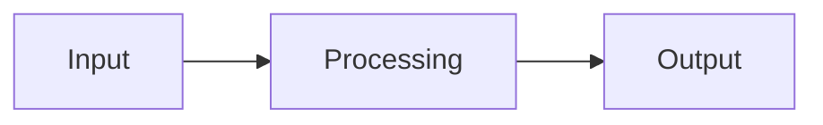

<!-- migrated from the legacy platform spec; canonical OpenSpec source -->
# Metaprogramming Specification

## Purpose

This specification defines source generators and attributes. The attributes drive compiler plug-ins. The specification defines the scheduling relative to other analyses. The broader generator roadmap lives in guides. The v0.1 rules are normative here.
## Requirements
### Requirement: Two metaprogramming planes
Beskid MUST provide two metaprogramming planes: language macros (`macro` items, `name!` invocation) and compiler mods (`type: Mod` projects, SDK contracts). Serialization MUST be realized as a reference mod plus attributes. This hub MUST NOT duplicate the full normative text of those child capabilities.

#### Scenario: Distinct macro and mod mechanisms
- **GIVEN** a library that both declares a `macro` item and depends on a `type: Mod` package
- **WHEN** compilation schedules metaprogramming phases
- **THEN** language macros expand via `macro.expand` and mods run via the Mod SDK pipeline as separate planes

### Requirement: Phase scheduling order
The reference compiler MUST schedule: parse and build HIR; `macro.expand` (**E1901–E1908**); re-run resolution and types on the expanded surface; then `mod.load` / `mod.collect` / generators; then continue semantic analysis, composition (if host), and codegen. Mods MUST NOT run before macro expansion completes on the same compilation unit unless a future decision explicitly orders otherwise. Tooling MUST invoke the same phase order for CLI and IDE builds on a given project kind.

#### Scenario: Macros before mods
- **GIVEN** a compilation unit containing both language macro invocations and Mod dependencies
- **WHEN** the reference compiler builds the unit
- **THEN** `macro.expand` completes before `mod.load` begins

### Requirement: Project kind and attribute rules
App/Lib/Test projects MAY declare `macro` items and consume mods. Mod projects MUST NOT declare app `host` graphs. Attribute declarations `attribute Name(targets) { … }` are module items; misuse of targets MUST error (**E1508–E1510**). Metaprogramming effects are compile-time only; expanded/generated AST becomes input to later phases.

An attribute declaration SHALL list its targets from the closed target catalogue of the requirement "Attribute target catalogue". A target name outside the catalogue SHALL be reported as **E1509** at the target identifier, naming the allowed targets. A target listed twice SHALL be reported as **E1508**. An attribute declaration without a target list SHALL accept no site: every use of it SHALL be reported as **E1510**.

#### Scenario: Invalid attribute targets
- **GIVEN** an `attribute` declaration applied to a target kind not listed in its targets
- **WHEN** attribute checking runs
- **THEN** the compiler emits **E1508**, **E1509**, or **E1510**

#### Scenario: Unknown target name in a declaration
- **GIVEN** `pub attribute Tag(Widget) { }`
- **WHEN** the declaration is checked
- **THEN** the compiler SHALL report **E1509** at `Widget` and SHALL list the catalogue names in the help

#### Scenario: Declaration without targets accepts nothing
- **GIVEN** `pub attribute Sealed { }` and `[Sealed] pub type Door { i64 width; }`
- **WHEN** the use is checked
- **THEN** the compiler SHALL report **E1510** at `[Sealed]`

### Requirement: Attribute target catalogue
The attribute target names SHALL be exactly: `ModuleDeclaration`, `TypeDefinition`, `EnumDefinition`, `EnumVariant`, `ContractDefinition`, `ContractMethodSignature`, `ContractAssociatedType`, `ContractEmbedding`, `ImplBlock`, `FunctionDefinition`, `MethodDefinition`, `ReceiverParameter`, `Parameter`, `LambdaExpression`, `LambdaParameter`, `TypeParameter`, `Field`, `LetStatement`, `ConstantDefinition`, `TestDefinition`, `AttributeDeclaration`. Each name SHALL denote the grammar production of the same name in `beskid.pest`, with `MethodDefinition` denoting `ImplMethodDefinition` (in `impl`, `extend type` and inline type bodies) and `ModuleDeclaration` denoting both `ModuleDeclaration` and `InlineModule`. The compiler SHALL expose the catalogue as one ordered list in `beskid_analysis` and the LSP completion inside an `AttributeTargetList` SHALL offer exactly that list.

#### Scenario: Catalogue is the help text of E1509
- **GIVEN** `pub attribute Tag(method) { }`
- **WHEN** the declaration is checked
- **THEN** the compiler SHALL report **E1509** whose help lists `MethodDefinition` among the allowed names

#### Scenario: Serialization Mod targets use catalogue names
- **GIVEN** the serialization Mod declares `Serialize` and `SerializeField`
- **WHEN** the Mod's attribute declarations are loaded
- **THEN** their targets SHALL be `TypeDefinition`, `EnumDefinition` and `Field`, and no **E1509** SHALL be reported

### Requirement: Attributes on every declaration site
The grammar SHALL accept an `AttributeList` immediately before each of these productions: `AttributeDeclaration`, `ImplBlock`, `ConstantDefinition`, `Parameter`, `ReceiverParameter`, `LambdaExpression`, `LambdaParameter`, each identifier of `GenericParameters` (a type parameter), `EnumVariant`, `ContractAssociatedType`, `ContractEmbedding`, `TypedLetStatement` and `InferredLetStatement`, in addition to the sites that accept one today (`ModuleDeclaration`, `InlineModule`, `FunctionDefinition`, `ImplMethodDefinition`, `Field`, `TypeDefinition`, `EnumDefinition`, `ContractDefinition`, `ContractMethodSignature`, `TestDefinition`). A `ReceiverParameter` SHALL be the production `AttributeList? ~ (MutKeyword | MoveKeyword)? ~ "this"` accepted as the optional first entry of a method `ParameterList`; a method without one SHALL keep its implicit receiver. On a lambda the list SHALL precede `LambdaParameters` (`[A] (x) => x + 1`); on a type parameter it SHALL precede the identifier (`<[A] T>`); on a `let` it SHALL precede `mut`, the type or `let`. The syntax model SHALL record the attributes of every site in a field named `attributes`, the formatter SHALL round-trip them at every site in the position stated here, and semantic tokens SHALL tag each attribute name with the attribute token type at every site.

#### Scenario: Attribute on a parameter
- **GIVEN** `pub attribute Trace(Parameter) { }` and `i64 Add([Trace] i64 left, i64 right) { return left + right; }`
- **WHEN** the unit is parsed and formatted
- **THEN** `Add` parses, the first `Parameter` node carries `Trace` in `attributes`, and the formatter emits `[Trace] i64 left` unchanged

#### Scenario: Attribute on a lambda and its parameter
- **GIVEN** `pub attribute Pure(LambdaExpression) { }`, `pub attribute Hot(LambdaParameter) { }` and `let square = [Pure] ([Hot] i64 x) => x * x;`
- **WHEN** the statement is parsed
- **THEN** the `LambdaExpression` node carries `Pure` and its `LambdaParameter` node carries `Hot`

#### Scenario: Attribute on a let binding, a type parameter and an enum variant
- **GIVEN** `pub attribute Pinned(LetStatement) { }`, `pub attribute Any(TypeParameter) { }`, `pub attribute Legacy(EnumVariant) { }`, the statement `[Pinned] mut i64 total = 0;`, the function `unit Keep<[Any] T>(T value) { }` and `pub enum Mode { Fast, [Legacy] Slow }`
- **WHEN** the unit is parsed
- **THEN** every attribute attaches to its node and the formatter round-trips each one

#### Scenario: Attribute on an explicit receiver
- **GIVEN** `pub attribute Receiver(ReceiverParameter) { }` and `pub type Counter { i64 count; pub i64 Read([Receiver] this) { return this.count; } }`
- **WHEN** the type is parsed
- **THEN** the method's `ReceiverParameter` node carries `Receiver` and `this` resolves to the receiver as it does for a method without an explicit receiver

### Requirement: Attribute use target enforcement
Every attribute use SHALL be checked against the target list of the attribute's declaration, and a use on a site whose target name is not listed SHALL be reported as **E1510** at the attribute, naming the attribute, the site's target name and the allowed targets. A use whose name resolves to no attribute declaration and to no compiler-recognized attribute SHALL be reported as **E1510** with the note that no declaration exists. The check SHALL run in the query layer as a legality fact of the unit (the same gate as **E1233**), once per use, and the diagnostic SHALL be reported in `beskid check`, `beskid build` and the LSP.

#### Scenario: Field attribute on a type
- **GIVEN** `pub attribute FluentInner(Field) { }` and `[FluentInner] pub type Wrapper { i64 inner; }`
- **WHEN** the legality gate judges the unit
- **THEN** the compiler SHALL report **E1510** at `[FluentInner]`, naming the site `TypeDefinition` and the allowed target `Field`

#### Scenario: Correct site is silent
- **GIVEN** the same declaration and `pub type Wrapper { [FluentInner] i64 inner; }`
- **WHEN** the legality gate judges the unit
- **THEN** no diagnostic SHALL be reported for the attribute

#### Scenario: Undeclared attribute
- **GIVEN** `[Frozen] pub type Ice { i64 temperature; }` with no declaration of `Frozen` in scope
- **WHEN** the legality gate judges the unit
- **THEN** the compiler SHALL report **E1510** at `[Frozen]` noting that no declaration exists

### Requirement: Compiler-recognized attributes declare their targets in corelib
Each attribute the compiler recognizes by name SHALL have a corelib declaration with a target list, and the compiler SHALL enforce that list like any user declaration: `Export(FunctionDefinition, MethodDefinition)`, `Extern(ContractDefinition)`, `Runtime(FunctionDefinition)`, `CompilerDerived(ContractDefinition)`, `Immutable(TypeDefinition)`, `Isolated(TypeDefinition)`, `Copyable(TypeDefinition)`, `NeverTransferable(TypeDefinition)`, `ImmutableStorage(Field)`, `Captures(Parameter)`. Recognition SHALL be by the attribute's simple name resolved to its corelib declaration; a user declaration of the same simple name in another module SHALL NOT be recognized and SHALL be an ordinary attribute.

#### Scenario: Extern on a function keeps E1510
- **GIVEN** `[Extern(Abi:"C", Library:"libc")] pub i64 Getpid() { return 0; }`
- **WHEN** the legality gate judges the unit
- **THEN** the compiler SHALL report **E1510** at the attribute, naming the allowed target `ContractDefinition`

#### Scenario: Immutable on a field is rejected
- **GIVEN** `pub type Point { [Immutable] i64 x; i64 y; }`
- **WHEN** the legality gate judges the unit
- **THEN** the compiler SHALL report **E1510** naming the allowed target `TypeDefinition`

#### Scenario: Shadowing declaration is not recognized
- **GIVEN** a user module declaring `pub attribute Immutable(Field) { }` and `pub type Point { [Immutable] i64 x; }` under that module's `use`
- **WHEN** the unit is checked
- **THEN** no **E1510** SHALL be reported and the type SHALL NOT be classified Shared by the user attribute

## Informative Source Provenance

The records below preserve migration history. They are not normative except where text was extracted into a requirement above.

### Source Record: Metaprogramming

**Authority:** informative provenance  
**Legacy path:** `/platform-spec/language-meta/metaprogramming/metaprogramming/`  
**Source:** `site/spec-content/platform-spec/language-meta/metaprogramming/metaprogramming/content.md`  
**SHA-256:** `0755ff5736c805f61047357bade58911aee03756534b7304ab2bd3264eb4a0da`

<details>
<summary>Migrated source text</summary>

``````markdown
## Normative specification

### Scope

Defines the **two metaprogramming planes** in Beskid and how they interact with compilation. Detailed rules live in child articles; this hub **must not** duplicate their full text.

| Plane | Mechanism | Normative home |
| --- | --- | --- |
| **Language macros** | `macro` items, `name!` invocation | [Language macros](/platform-spec/language-meta/metaprogramming/macros/) |
| **Compiler mods** | `type: Mod` projects, SDK contracts | [Compiler Mod SDK](/platform-spec/language-meta/metaprogramming/compiler-mod-sdk/) |
| **Serialization** | Reference mod + attributes | [Serialization packages](/platform-spec/language-meta/metaprogramming/serialization/) |

### Scheduling (reference compiler)

1. Parse and build HIR.
2. **`macro.expand`** — expand language macros (**E1901–E1908** band).
3. Re-run resolution and types on expanded surface.
4. **`mod.load` / `mod.collect` / generators** — mod pipeline per [Compiler Mods](/platform-spec/compiler/compiler-mods/).
5. Continue semantic analysis, composition (if host project), and codegen.

Mods **must not** run before macro expansion completes on the same compilation unit unless a future decision explicitly orders otherwise.

### Static rules

- **App/Lib/Test** projects **may** declare `macro` items and consume mods.
- **Mod** projects **must not** declare app `host` graphs ([Native dependency injection](/platform-spec/language-meta/composition/dependency-injection/)).
- Attribute declarations **`attribute Name(targets) { … }`** are module items; misuse of targets **must** error (**E1508–E1510**).

### Dynamic semantics

Metaprogramming effects are **compile-time only**; expanded/generated AST becomes input to later phases. No interpreted Beskid execution at compile time except through compiled mod AOT artifacts.

### Diagnostics

Macro band **E1901+**; mod band **E1829**, **E1851–E1870**; attribute **E1508+**. Registry: [Diagnostic code registry](/platform-spec/compiler/semantic-pipeline/diagnostic-code-registry/).

### Conformance

Tooling **must** invoke the same phase order for CLI and IDE builds on a given project kind.

## Decisions
<!-- spec:generate:adr-index -->
No ADRs published under **`adr/`** yet.
<!-- /spec:generate:adr-index -->
## Articles
<!-- spec:generate:article-index -->
_No articles in this bundle yet._
<!-- /spec:generate:article-index -->
``````

</details>

### Source Record: Metaprogramming - Contracts and edge cases

**Authority:** informative provenance  
**Legacy path:** `/platform-spec/language-meta/metaprogramming/metaprogramming/articles/contracts-and-edge-cases/`  
**Source:** `site/spec-content/platform-spec/language-meta/metaprogramming/metaprogramming/articles/contracts-and-edge-cases/content.md`  
**SHA-256:** `a5524f35aec0ad18462390f5f6fda422a1194db3d57ff3ccabd1acfa676e6d72`

<details>
<summary>Migrated source text</summary>

``````markdown
## Hard requirements

The normative specification in this capability's Requirements section defines the hard requirements for this feature. This article documents edge cases and contract-level guarantees.

## Edge cases

Edge cases are documented as they are discovered during implementation. Key edge cases include:

- Interactions with other features that may produce unexpected results
- Boundary conditions at the limits of defined behavior
- Error paths and diagnostic conditions

## Invariants

The following invariants must hold across all implementations:

1. The normative specification takes precedence over implementation behavior
2. Diagnostic codes are registered in the diagnostic code registry and must not be reused
3. Conformance tests must pass at the declared conformance level

## Contract guarantees

Implementations must satisfy the contracts defined in this capability's Requirements section. Violations must be surfaced through the diagnostic system.
``````

</details>

### Source Record: Metaprogramming - Design model

**Authority:** informative provenance  
**Legacy path:** `/platform-spec/language-meta/metaprogramming/metaprogramming/articles/design-model/`  
**Source:** `site/spec-content/platform-spec/language-meta/metaprogramming/metaprogramming/articles/design-model/content.md`  
**SHA-256:** `8b8ec4b6a65a7eda1a8f7cd83cad24bbf96e69e125a7ea9aef60af7f19bc5844`

<details>
<summary>Migrated source text</summary>

``````markdown
## Design overview

This article describes the conceptual model and design decisions behind the feature. The normative specification lives in this capability's Requirements section (and related OpenSpec sibling capabilities); this article expands on the rationale, subsystem boundaries, and architectural choices.

## Key design decisions

- Decision details are recorded as ADRs under the hub's `adr/` directory when formal record-keeping is needed.
- Design rationale here is informative; normative contract language lives in this capability's Requirements section.

## Subsystem boundaries

Refer to this capability's Requirements section for the authoritative specification. This article provides supplementary design context.

## Related articles

- [Contracts and edge cases](../contracts-and-edge-cases/)
- [Verification and traceability](../verification-and-traceability/)
``````

</details>

### Source Record: Metaprogramming - Examples

**Authority:** informative provenance  
**Legacy path:** `/platform-spec/language-meta/metaprogramming/metaprogramming/articles/examples/`  
**Source:** `site/spec-content/platform-spec/language-meta/metaprogramming/metaprogramming/articles/examples/content.md`  
**SHA-256:** `669d2440f2f0093d624b6f176dbd8b28098da976baa66b962d3406cdb5ff85a8`

<details>
<summary>Migrated source text</summary>

``````markdown
## Basic usage

```beskid
// TODO: Add basic usage example for this feature
```

## Common patterns

```beskid
// TODO: Add common usage patterns
```

## Edge case examples

```beskid
// TODO: Add edge case examples
```

> **Note:** Full code examples for this feature are being developed. See this capability's Requirements section for the normative specification.
``````

</details>

### Source Record: Metaprogramming - FAQ and troubleshooting

**Authority:** informative provenance  
**Legacy path:** `/platform-spec/language-meta/metaprogramming/metaprogramming/articles/faq-and-troubleshooting/`  
**Source:** `site/spec-content/platform-spec/language-meta/metaprogramming/metaprogramming/articles/faq-and-troubleshooting/content.md`  
**SHA-256:** `c150c0cb07e09a9213a885b299f43b116cfcd3cd23949b6bf4309947e3ac7297`

<details>
<summary>Migrated source text</summary>

``````markdown
## Frequently asked questions

### Is this feature stable?

This capability's status metadata indicates the maturity level. Articles marked `Proposed` are under active development.

### How does this interact with other features?

See the "Related articles" section in each article and the `related.json` files for cross-feature links.

### Where can I find implementation details?

Implementation anchors are listed under Implementation anchors in this capability's Requirements or Informative Source Provenance.

## Troubleshooting

### Diagnostic codes

Refer to this capability's Requirements section for feature-specific diagnostic codes. All codes are registered in the [Diagnostic code registry](/platform-spec/compiler/semantic-pipeline/diagnostic-code-registry/).

### Common errors

- **Spec violation:** If behavior contradicts this capability's Requirements section, the capability specification takes precedence.
- **Missing conformance:** If a test case is missing, add it to the `articles/verification-and-traceability/` article.
``````

</details>

### Source Record: Metaprogramming - Flow and algorithm

**Authority:** informative provenance  
**Legacy path:** `/platform-spec/language-meta/metaprogramming/metaprogramming/articles/flow-and-algorithm/`  
**Source:** `site/spec-content/platform-spec/language-meta/metaprogramming/metaprogramming/articles/flow-and-algorithm/content.md`  
**SHA-256:** `4aea6cd84472c547ed9d8384d17abcad24998652b006fcf59cdbded27b6850f5`

<details>
<summary>Migrated source text</summary>

``````markdown
## Processing steps

The normative algorithm for this feature is defined in the compiler implementation. This article provides an informative overview of the processing flow.

## Data flow



## Algorithm outline

1. Parse the relevant syntax from the source
2. Resolve names and types according to the rules in this capability's Requirements section
3. Lower to intermediate representation
4. Code generation

> **Note:** Detailed flow documentation is being developed. Refer to the compiler implementation for the authoritative algorithm.
``````

</details>

### Source Record: Metaprogramming - Verification and traceability

**Authority:** informative provenance  
**Legacy path:** `/platform-spec/language-meta/metaprogramming/metaprogramming/articles/verification-and-traceability/`  
**Source:** `site/spec-content/platform-spec/language-meta/metaprogramming/metaprogramming/articles/verification-and-traceability/content.md`  
**SHA-256:** `3746ef46e20a53acc80344fc5631f9ca16d265fbdc1026126cca93200f9068d6`

<details>
<summary>Migrated source text</summary>

``````markdown
## Conformance evidence

Conformance to this specification is verified through:

1. **Compiler test suite** — Unit and integration tests in the compiler workspace
2. **Corelib conformance** — Published corelib packages must conform to the specification
3. **End-to-end tests** — E2E tests validate the full pipeline

## Test coverage

Test coverage for this feature is tracked in the compiler's test suite. Key test areas include:

- Syntax validation
- Semantic analysis (type checking, name resolution)
- Code generation and lowering
- Runtime behavior

## Verification anchors

Implementation anchors are listed under Implementation anchors in this capability's Requirements or Informative Source Provenance.

## Traceability

Each normative statement in this capability's Requirements section should be traceable to:
- A test case in the compiler test suite
- An ADR documenting the decision
- A diagnostic code in the diagnostic registry
``````

</details>
