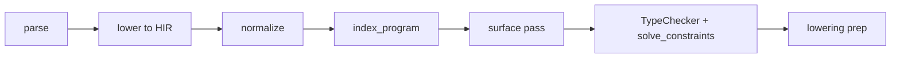
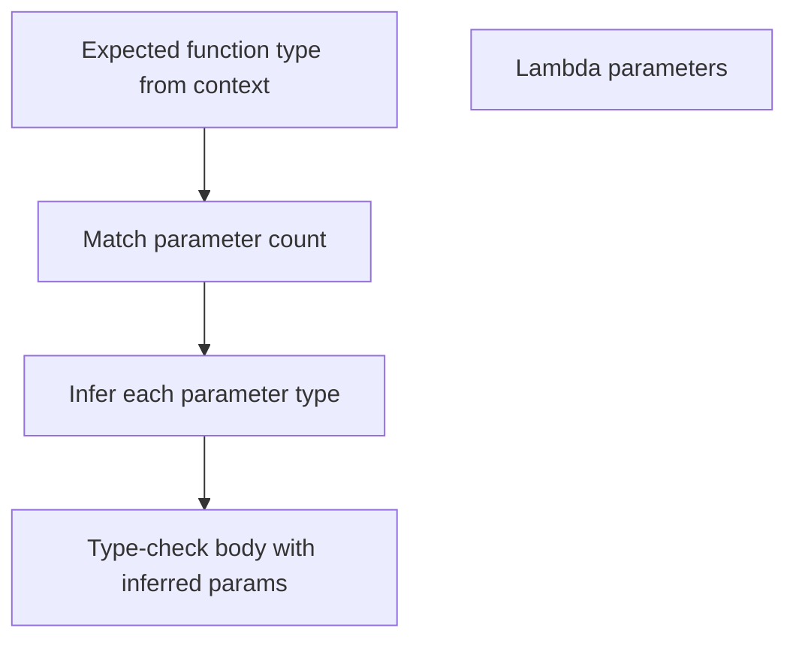

<!-- migrated from the legacy platform spec; canonical OpenSpec source -->
# Type inference Specification

## Purpose

This specification defines local type inference. The inference reduces the annotation burden. The inference keeps programs predictable. The specification defines the inference algorithm. Diagnostics reference these rules.
## Requirements
### Requirement: Let and generic inference sites
`let name = expr` MUST infer the variable type from `expr` when unambiguous. `let T name = expr` MUST check `expr` against `T` with no inference of `T` from the initializer alone. Generic arguments at call sites MAY be inferred from parameter types when a unique solution exists (**E1203** when missing). Lambda parameter types MAY be inferred from expected function type; untyped lambda parameters require contextual type (**E1202** when missing).

#### Scenario: Inferred let from unambiguous initializer
- **GIVEN** `let x = 1` where `1` has a unique integer literal type in context
- **WHEN** inference runs
- **THEN** `x` receives that inferred type without an explicit annotation

### Requirement: Ambiguity and no widening
Inference MUST NOT widen beyond the declared or inferred constraint (no implicit numeric promotion across unrelated primitives in v0.1). Ambiguous inference MUST error with **E1202** rather than pick an arbitrary type. Enum constructors and struct literals MUST have sufficient context to resolve the target type or require explicit qualification. Function return types on top-level functions SHOULD be explicit; when omitted, inference MAY use body yield rules.

#### Scenario: Ambiguous inference errors
- **GIVEN** an expression site where multiple types satisfy the constraints equally
- **WHEN** inference runs
- **THEN** the compiler emits **E1202** and does not pick an arbitrary type

### Requirement: Inference diagnostics and conformance
Mismatch after inference MUST diagnose **E1206**. Inference affects compile-time only. Reference compiler tests for `let` inference and generic call inference MUST pass for L2 claims.

#### Scenario: Inferred type mismatches annotation context
- **GIVEN** an inferred expression that does not match a required contextual type
- **WHEN** checking completes after inference
- **THEN** the compiler emits **E1206**

### Requirement: Contextual numeric literal typing
An integer literal without a suffix SHALL have the type that its context requires when the context requires a primitive integer type. The contexts SHALL be: a declared local or field type; an assignment target; a function, method or enum variant parameter, after generic inference; a type literal field; a `return` value; an array element of a known element type; a match arm or value block whose result type is known; the other operand of a binary operator whose type is known; and a branch of a conditional expression as stated in the control-flow capability. A float literal without a suffix SHALL have type `f32` when its context requires `f32`, and otherwise `f64`. An integer literal without a suffix where `f32` or `f64` is required SHALL be converted to that type. Without a context, an integer literal without a suffix SHALL have type `i32` when its value fits, and otherwise `i64`; a hexadecimal literal above `i64::MAX` SHALL have type `word`. A suffix (`_u8`, `_i64`, `_f32`) SHALL fix the type of the literal and SHALL take precedence over the context. When the type of a suffix differs from the numeric type that the context requires, the compiler SHALL report **E1206**, except when the literal is an operand of a binary operator, where the numeric promotion rules of the operator apply. A float literal where an integer type is required SHALL be **E1206**. A literal whose value does not fit the type that its context or suffix gives it SHALL be **T0905** at the literal, and SHALL NOT be wrapped or truncated. A negative value SHALL NOT fit an unsigned type. A float literal fits when it is finite in its type.

#### Scenario: Field context
- **GIVEN** `type Port { u8 high; u8 low; }` and `Port { high: 1, low: 2 }`
- **WHEN** the code is checked
- **THEN** both literals have type `u8` and no diagnostic is reported

#### Scenario: No context
- **GIVEN** `let n = 3000000000;`
- **WHEN** the code is checked
- **THEN** `n` has type `i64`, and `let m = 7;` gives `m` the type `i32`

#### Scenario: Literal does not fit
- **GIVEN** `u8 x = 300;`
- **WHEN** the code is checked
- **THEN** the compiler SHALL report **T0905** at `300` with the message "`300` does not fit in `u8`"

#### Scenario: Conflicting suffix
- **GIVEN** `u8 x = 1_i64;`
- **WHEN** the code is checked
- **THEN** the compiler SHALL report **E1206**

#### Scenario: Suffix as a binary operand
- **GIVEN** `i64 y = a + 1_i64;` where `a` is `i64`
- **WHEN** the code is checked
- **THEN** no diagnostic is reported

### Requirement: Generic inference from bulk arguments
For a generic callee whose last parameter is `bulk T[]`, the element type `T` SHALL be inferred from the trailing arguments as if they were one `T[]` argument, or SHALL be taken from explicit type arguments. A call with no trailing arguments SHALL leave `T` uninferred, so it SHALL supply explicit type arguments or be rejected for missing type arguments.

**Stable ID:** `BSP-REQ-BULK-GENERIC-INFERENCE`

#### Scenario: Element type inferred from trailing arguments
- **GIVEN** `T First<T>(bulk T[] values) { return values[0]; }`
- **WHEN** `First(4_i64, 5_i64)` and `First<i64>(4, 5, 6)` are compiled
- **THEN** both calls specialize `First` with `T` as `i64` and pack their
  trailing arguments as `i64` elements

#### Scenario: No trailing arguments needs type arguments
- **GIVEN** the same `First`
- **WHEN** `First()` is type-checked
- **THEN** the compiler rejects the call for missing type arguments

### Requirement: Locals annotated with a type parameter
Inside a generic function, a local declared with a type parameter as its type (`T held = value;`) SHALL take the concrete type that the current specialization substitutes for that parameter, for scalar and reference types alike.

**Stable ID:** `BSP-REQ-GENERIC-ANNOTATED-LOCAL`

#### Scenario: Scalar and string specializations
- **GIVEN** `T Same<T>(T value) { T held = value; return held; }`
- **WHEN** `Same("s")` and `Same(7_i64)` are compiled and run
- **THEN** each specialization compiles, and the calls return `"s"` and `7`

### Requirement: Contextual enum constructors in method arguments
An enum constructor written without type arguments SHALL take its type from the declared parameter type when it is an argument to a method called on a local whose type is written explicitly, as it already does for arguments to module functions.

**Stable ID:** `BSP-REQ-ENUM-CONSTRUCTOR-METHOD-ARGUMENT-CONTEXT`

#### Scenario: Generic constructor takes the parameter's application
- **GIVEN** `enum Maybe<T> { None(), Some(T value) }`, a type `Holder` with
  method `i64 Pick(Maybe<i64> other)`, and `Holder holder = Holder { n: 1 };`
- **WHEN** `holder.Pick(Maybe::None())` is type-checked
- **THEN** the constructor resolves to `Maybe<i64>::None`

### Requirement: Method type argument inference
A call of a generic function or method whose own type parameters are not given explicitly SHALL infer them, and the inference SHALL proceed in this order:

1. The owner type parameters of a method SHALL be bound by the instantiated receiver.
2. Explicit type arguments, when written, SHALL bind every own type parameter, and steps 3 and 4 SHALL then only check.
3. Each argument that is not a lambda literal SHALL be synthesized and its proven type SHALL be unified structurally with its declared parameter type (through nominal type arguments, array elements and function parameter and result types), left to right. Two different bindings of one type parameter SHALL be reported as **E1229**.
4. Each lambda literal argument SHALL then be typed left to right against its declared function-typed parameter with the bindings of steps 1-3 and of earlier lambdas applied. An untyped lambda parameter SHALL take its type from that parameter type, which SHALL be fully bound at this point (**E1202** otherwise); a typed lambda parameter SHALL be unified like a step 3 argument. When the declared result type still names an unbound type parameter, the lambda's result SHALL be synthesized: an expression body from its own proven type (an unsuffixed integer literal takes the language default `i32`), a block body from its `return` expressions, which SHALL all have the same proven type (a block with no `return` value is `unit`); the synthesized result SHALL then be unified with the declared result type.
5. A type parameter that is still unbound SHALL be reported as **E1203** at the call, naming the parameter, with the help to write the type arguments.

Inference SHALL NOT use the expected type of the call itself and SHALL NOT bind a type parameter from a lambda's parameters' use inside its body. The expected type of an argument SHALL keep the 2026-10-09 rule (bound only by explicit arguments or the receiver), with one refinement: a function-typed parameter whose unbound type parameters appear only in its result SHALL still supply its parameter types to an untyped lambda, and the lambda's result SHALL have no expected type. After inference every argument SHALL be checked against the substituted parameter type (**E1206** on mismatch) and every `where` bound SHALL be proven (**E1610**).

#### Scenario: Result type inferred from an expression body
- **GIVEN** a method `pub Task<T> Spawn<T>(() => T body)` on `Scope` and `Task<i64> t = s.Spawn(() => 20_i64);`
- **WHEN** the call is checked
- **THEN** `T` is bound to `i64` and no diagnostic is reported

#### Scenario: Lambda parameter from the receiver, result from the body
- **GIVEN** `pub type Seq<T> { T[] items; pub Seq<U> Map<U>((T) => U f) { ... } }` and `Seq<string> Show(Seq<i64> numbers) { return numbers.Map((x) => "${x}"); }`
- **WHEN** the call is checked
- **THEN** `x` has type `i64`, `U` is bound to `string`, and no diagnostic is reported

#### Scenario: Type parameter from a non-lambda argument
- **GIVEN** a method `pub T Fold<C>(T seed, C combiner) where C: Folder<T>` on `Seq<T>`, a type `AddAll : Folder<i64>`, and `numbers.Fold(0_i64, AddAll {})`
- **WHEN** the call is checked
- **THEN** `C` is bound to `AddAll` and the bound is proven

#### Scenario: Block body result from its returns
- **GIVEN** `Task<i64> t = s.Spawn(() => { Log.Info("start"); return 7_i64; });`
- **WHEN** the call is checked
- **THEN** `T` is bound to `i64`

#### Scenario: Unresolvable result requires type arguments
- **GIVEN** `pub Task<T> SpawnTry<T>(() => Result<T, string> body)` and `s.SpawnTry(() => Result::Error("no input"))`
- **WHEN** the call is checked
- **THEN** the compiler reports **E1203** naming `T`, and `s.SpawnTry<i64>(() => Result::Error("no input"))` is accepted

#### Scenario: Conflicting bindings
- **GIVEN** `pub T Pick<T>(T a, T b)` and `Pick(1_i64, "x")`
- **WHEN** the call is checked
- **THEN** the compiler reports **E1229** naming `T`, `i64` and `string`

## Informative Source Provenance

The records below preserve migration history. They are not normative except where text was extracted into a requirement above.

### Source Record: Type inference

**Authority:** informative provenance  
**Legacy path:** `/platform-spec/language-meta/type-system/type-inference/`  
**Source:** `site/spec-content/platform-spec/language-meta/type-system/type-inference/content.md`  
**SHA-256:** `9af8a0ee3cd9a3361a7f834f889dc0a1355ff4ec5de9a03c04d584e12111173e`

<details>
<summary>Migrated source text</summary>

``````markdown
## Normative specification

### Scope

Defines when types **must** be written explicitly and when the compiler **may** infer types from context. Ground rules for type expressions are in [Types](/platform-spec/language-meta/type-system/types/).

### Inference sites

- **`let name = expr`** (inferred let) **must** infer the variable type from `expr` when unambiguous.
- **`let T name = expr`** (typed let) **must** check `expr` against `T`; no inference of `T` from the initializer alone.
- **Function return types** on top-level functions **should** be explicit; when omitted, inference **may** use body yield rules; explicit annotation is **recommended** for public APIs.
- **Generic arguments** at call sites **may** be inferred from parameter types when a unique solution exists (**E1203** when missing).
- **Lambda** parameter types **may** be inferred from expected function type; untyped lambda parameters require contextual type (**E1202** when missing).

### Static rules

- Inference **must not** widen beyond the declared or inferred constraint (no implicit numeric promotion across unrelated primitives in v0.1).
- Ambiguous inference **must** error with **E1202** (missing annotation) rather than pick an arbitrary type.
- **Enum constructors** and **struct literals** **must** have sufficient context to resolve the target type or require explicit qualification.

### Dynamic semantics

Inference affects compile-time only; no runtime reflection of inferred types beyond debug metadata.

### Diagnostics

**E1202** missing annotation; **E1206** mismatch after inference. Registry: [Diagnostic code registry](/platform-spec/compiler/semantic-pipeline/diagnostic-code-registry/).

### Conformance

Reference compiler tests for `let` inference and generic call inference **must** pass for **L2** claims.

## Decisions
<!-- spec:generate:adr-index -->
No ADRs published under **`adr/`** yet.
<!-- /spec:generate:adr-index -->
## Articles
<!-- spec:generate:article-index -->
- [Type inference - Contracts and edge cases](./articles/contracts-and-edge-cases/)
- [Type inference - Design model](./articles/design-model/)
- [Type inference - Examples](./articles/examples/)
- [Type inference - FAQ and troubleshooting](./articles/faq-and-troubleshooting/)
- [Type inference - Flow and algorithm](./articles/flow-and-algorithm/)
- [Type inference - Verification and traceability](./articles/verification-and-traceability/)
<!-- /spec:generate:article-index -->
``````

</details>

### Source Record: Type inference - Contracts and edge cases

**Authority:** informative provenance  
**Legacy path:** `/platform-spec/language-meta/type-system/type-inference/articles/contracts-and-edge-cases/`  
**Source:** `site/spec-content/platform-spec/language-meta/type-system/type-inference/articles/contracts-and-edge-cases/content.md`  
**SHA-256:** `8c34504b3fe439a90161ad9d11683ef39ceccfaa098bb54b095248778a8fe3e2`

<details>
<summary>Migrated source text</summary>

``````markdown
## Hard requirements

- **Fail on ambiguity** — Prefer errors over guessing when multiple types satisfy constraints.
- **Public API annotations** — Exported functions should declare return types even when inference succeeds.
- **No nullable inference** — Inference must not introduce nullable or `optional` types; use `Option<T>` explicitly.
- **Contextual lambdas** — Untyped lambda parameters require an expected function type from the enclosing expression.

## Diagnostic band E12xx

| Code | Condition |
| --- | --- |
| **E1202** | Missing type annotation (ambiguous inference) |
| **E1203** | Missing generic type arguments |
| **E1206** | Type mismatch after inference |
| **W1203** | Implicit numeric cast detected |

## Edge cases

- **Enum constructor inference** — Enum constructors and struct literals must have sufficient context to resolve the target type or require explicit qualification.
- **Nested lambdas** — Inner lambdas may infer parameter types from the outer lambda's expected type.
- **Generic recursion** — Recursive generic calls may require explicit type arguments to break ambiguity.
- **Empty collections** — `[]` without context cannot infer element type; explicit annotation required.

## Invariants

- Every `let` binding must have a resolved type after `TypeChecker::finish` completes.
- Inference does not mutate HIR; solved types are recorded in `TypeResult.node_types` and `TypeResult.local_types`.
- Re-inference on incremental edits must produce the same result as full compilation for unchanged sites.
``````

</details>

### Source Record: Type inference - Design model

**Authority:** informative provenance  
**Legacy path:** `/platform-spec/language-meta/type-system/type-inference/articles/design-model/`  
**Source:** `site/spec-content/platform-spec/language-meta/type-system/type-inference/articles/design-model/content.md`  
**SHA-256:** `c3dd212f40c100ce6c67832b0f57b46a4d256d7ec3e0167b89a6e5d9fc177ed9`

<details>
<summary>Migrated source text</summary>

``````markdown
## Vocabulary

| Construct | Role |
| --- | --- |
| **`TypedLet`** | `let name = expr` where the variable type is inferred from the initializer |
| **`ExplicitLet`** | `let T name = expr` where the type is written by the author |
| **`TypeVar`** | Inference metavariable introduced during body typing |
| **`ConstraintSet`** | Collected equality and kind constraints for one inference site |
| **`InferenceResult`** | Solved `TypeVar → TypeId` bindings from the constraint solver |
| **`TypeChecker`** | Body typing pass that records `node_types` and emits constraints |

## Inference architecture

Type inference in Beskid is **local and constraint-driven**, not global Hindley-Milner. The [`TypeChecker`](compiler/crates/beskid_analysis/src/types/checker.rs) collects constraints at specific sites; [`solve_constraints`](compiler/crates/beskid_analysis/src/types/inference/solve.rs) resolves metavariables against a read-only [`TypeEnv`](compiler/crates/beskid_analysis/src/types/inference/mod.rs) backed by the hash-consed `TypeTable`.


Inference runs inside the **check** sub-pass of **`lower.type_check`**, after per-unit surfaces are built and merged. It is separate from **lowering prep**, which records codegen metadata on an already-typed tree.

### Constraint vocabulary

| Constraint | Typical source |
| --- | --- |
| `Equal(var, ty)` | `let x = expr`, parameter against contextual expected type |
| `EqualVar(left, right)` | Two metavariables that must unify |
| `ApplyGeneric(item, args)` | Call sites and qualified type paths with omitted generic arguments |
| `IsNumeric(var)` | Binary operators and compound assignment |
| `VariantOf(var, enum, variant)` | `?` desugar sites and enum constructor expressions |

The reference implementation lives in [`types/inference/`](compiler/crates/beskid_analysis/src/types/inference/). Numeric promotion follows the shared [`unify_types`](compiler/crates/beskid_analysis/src/types/inference/unify.rs) rule — there is no wider implicit coercion beyond that rule in v0.1.

### Inference sites

1. **`let name = expr`** — Introduce a `TypeVar` for the binding; constrain it to the initializer type when unambiguous.
2. **Function return types** — When omitted, inference may use body yield rules; explicit annotation is recommended for public APIs.
3. **Generic arguments at call sites** — Propagate constraints from actual argument types to generic parameters; apply when a unique substitution exists.
4. **Lambda parameters** — Inferred from expected function type; untyped parameters require contextual type.

### Subsystem boundaries

| Subsystem | Responsibility | Key file |
| --- | --- | --- |
| Parser | Distinguish `let` from typed `let` | `beskid.pest` |
| AST | Store binding shapes | `syntax/expressions/` |
| Type checker | Walk bodies; collect constraints; write `node_types` | `types/checker.rs` |
| Inference | Solve constraint sets | `types/inference/{constraint,solve,unify}.rs` |
| Semantic rules | Emit ambiguity errors | `analysis/rules/staged/type_checking.rs` |

## Fail-on-ambiguity model

When multiple types satisfy a constraint set, or a metavariable marked `must_resolve` remains unbound after solving, [`solve_constraints`](compiler/crates/beskid_analysis/src/types/inference/solve.rs) emits `TypeError::MissingTypeAnnotation` — surfaced as **E1202** at the inference site rather than guessing. This is locked by decision **D-LM-INF-001**.

The solver **must not** pick an arbitrary default type for unannotated bindings. Ambiguity includes: two satisfiable numeric types with no contextual tie-break, generic call sites with no unique substitution, and lambdas without an expected function type.

## No implicit widening

Inference does not widen beyond declared or inferred constraints. There is no implicit numeric promotion across unrelated primitives in v0.1. `TypeImplicitNumericCast` (**W1203**) warns when a narrowing cast is detected. The only shared numeric unification is the explicit rule in `types/inference/unify.rs`.
``````

</details>

### Source Record: Type inference - Examples

**Authority:** informative provenance  
**Legacy path:** `/platform-spec/language-meta/type-system/type-inference/articles/examples/`  
**Source:** `site/spec-content/platform-spec/language-meta/type-system/type-inference/articles/examples/content.md`  
**SHA-256:** `7ab8ed9c3ace874c60d78f2759d3e78f99a754b48f9b161f18b9b687d94fdbd4`

<details>
<summary>Migrated source text</summary>

``````markdown
## Inferred let

```beskid
unit Inferred() {
    let x = 42;        // inferred: i32
    let y = "hello";   // inferred: string
    let z = true;      // inferred: bool
}
```

## Typed let

```beskid
unit Explicit() {
    let i64 big = 42;
    let string name = "hello";
}
```

## Lambda inference

```beskid
unit Lambdas() {
    // Context from function parameter type
    let add = (a, b) => a + b;   // inferred: (i32, i32) => i32 from context

    // Explicit lambda parameter types when no context
    let mul = (i32 a, i32 b) => a * b;
}
```

## Generic inference

```beskid
type Box<T> {
    T value;
}

unit Generics() {
    let b = Box { value = 42 };   // inferred: Box<i32>
}
```

## Ambiguous inference (error)

```beskid
unit Ambiguous() {
    // let empty = [];   // E1202 — cannot infer element type
    let i32[] empty = [];   // OK — explicit annotation
}
```
``````

</details>

### Source Record: Type inference - FAQ and troubleshooting

**Authority:** informative provenance  
**Legacy path:** `/platform-spec/language-meta/type-system/type-inference/articles/faq-and-troubleshooting/`  
**Source:** `site/spec-content/platform-spec/language-meta/type-system/type-inference/articles/faq-and-troubleshooting/content.md`  
**SHA-256:** `2d90e8dabaf08512e4965feb60177029a865c17fb36d43d39ff0c20b1c5aabaa`

<details>
<summary>Migrated source text</summary>

``````markdown
## Locked decisions

| Decision | ID | Summary |
| --- | --- | --- |
| Fail on ambiguity | D-LM-INF-001 | Prefer errors over guessing |
| Public API annotations | D-LM-INF-002 | Exported functions should declare return types |
| No nullable inference | D-LM-INF-003 | Inference must not introduce nullable types |
| Contextual lambdas | D-LM-INF-004 | Untyped parameters need expected function type |

## FAQ

### Why does `let x = []` fail?

The compiler cannot infer the element type of an empty array without context. Add an explicit type: `let i32[] x = [];`.

### Do I need to annotate every variable?

No. Simple literals and expressions with unambiguous types infer automatically. Annotate when the type is not obvious from the initializer.

### Can inference fail across function boundaries?

Return type inference works within a single function body. Cross-function inference is not supported; function signatures must be self-contained.

## Troubleshooting

| Symptom | Likely cause |
| --- | --- |
| **E1202** | Ambiguous type — add explicit annotation |
| **E1203** | Missing generic arguments at call site |
| **W1203** | Implicit numeric narrowing — add explicit cast |
| Lambda parameter error | No expected function type in context |
``````

</details>

### Source Record: Type inference - Flow and algorithm

**Authority:** informative provenance  
**Legacy path:** `/platform-spec/language-meta/type-system/type-inference/articles/flow-and-algorithm/`  
**Source:** `site/spec-content/platform-spec/language-meta/type-system/type-inference/articles/flow-and-algorithm/content.md`  
**SHA-256:** `2f46d494cfaa1f3b6da93f026efb039e221ec1f5ce47d0f7e2b38cf8ae80c02c`

<details>
<summary>Migrated source text</summary>

``````markdown
## Compile pipeline placement

Type inference runs inside the **check** sub-pass of **`lower.type_check`**, after `index_program` and the surface pass, and before lowering prep:



Entry point: [`TypeChecker::check_entry`](compiler/crates/beskid_analysis/src/types/checker/entry.rs), orchestrated from [`type_check_lowered_hir`](compiler/crates/beskid_analysis/src/services/lower.rs) under phase id **`lower.type_check`**.

## Constraint-driven inference (normative)

Inference is **local and constraint-driven**, not global Hindley-Milner. During the check pass:

1. **Collect inference sites** — Walk HIR bodies and identify `let` bindings, lambda parameters, and generic call sites without explicit types.
2. **Emit constraints** — For each site, push `Equal`, `EqualVar`, `ApplyGeneric`, `IsNumeric`, or `VariantOf` constraints into a `ConstraintSet` on the active `TypeChecker`.
3. **Record provisional types** — Write `node_types[HirNodeId]` and `local_types[LocalId]` as expressions are walked.
4. **Solve at finish** — `TypeChecker::finish` calls [`solve_constraints`](compiler/crates/beskid_analysis/src/types/inference/solve.rs) against a read-only `TypeEnv` backed by the hash-consed `TypeTable`.
5. **Emit ambiguity errors** — If multiple types satisfy constraints, emit **E1202** at the binding site.

## Lambda parameter inference



- The expected function type comes from `contextual_expected_type` on the enclosing `TypeChecker` (for example, a function argument position).
- If the lambda has `n` parameters and the expected type has `n` argument types, each parameter is bound to the corresponding argument type.
- If no expected type exists, untyped lambda parameters require explicit annotations or emit **E1202**.

## Generic call-site inference

When generic arguments are omitted at a call site:
1. Collect the types of the actual arguments.
2. Match them against the generic parameter constraints in the callee signature via `ApplyGeneric` constraints.
3. If a unique substitution exists, apply it during `solve_constraints`.
4. If ambiguous or missing, emit **E1203** or **E1204**.

## Return type inference

For functions without an explicit return type annotation:
1. Type-check the body with `current_return_type` unset.
2. If the body ends with an expression, use that expression's type as the inferred return type.
3. If the body ends with statements only, default to `unit`.
4. Public API functions should declare return types explicitly even when inference succeeds.
``````

</details>

### Source Record: Type inference - Verification and traceability

**Authority:** informative provenance  
**Legacy path:** `/platform-spec/language-meta/type-system/type-inference/articles/verification-and-traceability/`  
**Source:** `site/spec-content/platform-spec/language-meta/type-system/type-inference/articles/verification-and-traceability/content.md`  
**SHA-256:** `bc293ca9f275ff4f7d0eca25bb04ecdd8b78faabcef8365ef61bc24718496541`

<details>
<summary>Migrated source text</summary>

``````markdown
## Verification matrix

| Scenario | Expected evidence |
| --- | --- |
| `let x = 42` | Inferred as `i32`; no diagnostic |
| `let x = []` | **E1202** emitted |
| Lambda with context | Parameters inferred from expected function type |
| Lambda without context | **E1202** if parameters lack types |
| Generic call omission | Arguments inferred from parameter types |
| Public function without return type | Warning or recommendation to annotate |

## Implementation checklist

- [x] Grammar: `let` with and without type annotation
- [x] AST: `TypedLet` vs `ExplicitLet` distinction
- [x] Type context: `try_infer.rs` local inference
- [x] Lambda parameter inference from expected type
- [x] Generic call-site argument inference
- [x] Diagnostics: **E1202**, **E1203**, **W1203**
- [ ] Return type inference for all function forms
- [ ] Enum constructor context inference
- [ ] Integration tests for nested lambda inference

## Test locations

- `compiler/crates/beskid_analysis/src/types/context/try_infer.rs` — inference unit tests
- `compiler/crates/beskid_analysis/src/types/context/expressions.rs` — expression typing tests
- `compiler/crates/beskid_tests` — integration tests for inference scenarios
``````

</details>
