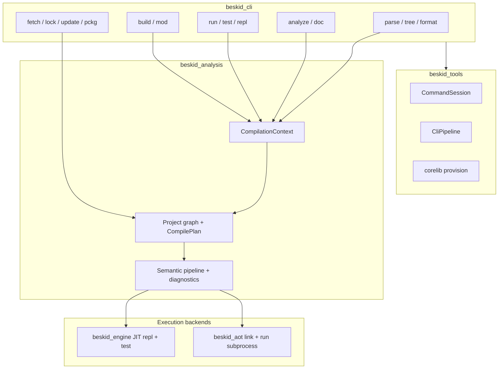
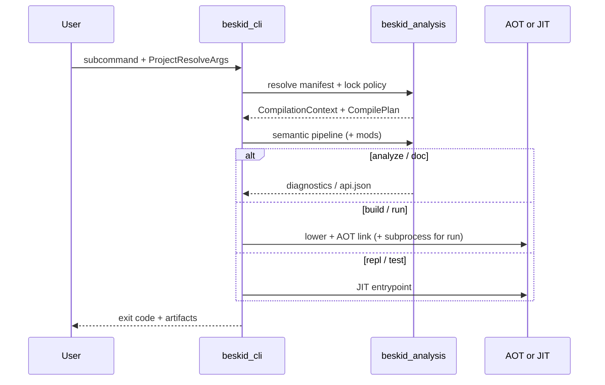

<!-- migrated from the legacy platform spec; canonical OpenSpec source -->
# Build, analyze, and run contract Specification

## Purpose

Expected CLI behavior and outputs across build, analysis, and runtime execution commands.
## Requirements
### Requirement: Line-oriented command progress
Pipeline commands SHALL report bounded progress and readable phase trees without alternate-screen or raw input. TTY in-place bars SHALL leave readable final summaries and return without keypress. Non-TTY and --plain streams SHALL be deterministic newline-delimited output without cursor controls. Only explicit dev project graph --tui SHALL permit full-screen interaction.

#### Scenario: Interactive build returns after completion
- **GIVEN** interactive project build
- **WHEN** build finishes
- **THEN** control returns with readable summary without keypress

#### Scenario: Plain build is machine-readable
- **GIVEN** redirected project build
- **WHEN** build finishes
- **THEN** progress has no cursor controls and is emitted to stderr

### Requirement: Hub authority: Decision [D-TOOL-CLI-0001]
The Beskid standard SHALL enforce the following migrated contract section. Accepted ADR decisions are binding; uppercase requirement keywords retain their BCP-14 meaning.

> Hub owns MUST/SHOULD.

**Stable ID:** `BSP-REQ-3399DD008DB2`  
**Legacy source:** `site/spec-content/platform-spec/tooling/cli/build-analyze-run-contract/adr/0001-hub-authority/content.md`  
**Source SHA-256:** `783be1ea80669a334220e370b1c701f5488efac7513b4975855efa6adf74c5c3`

#### Scenario: Conformance exercises Decision
- **GIVEN** an implementation claims conformance with this capability
- **WHEN** behavior governed by this contract section is exercised
- **THEN** every MUST, SHALL, REQUIRED, prohibition, and accepted decision in the section is satisfied

### Requirement: Shared pipeline: Decision [D-TOOL-CLI-0002]
The Beskid standard SHALL enforce the following migrated contract section. Accepted ADR decisions are binding; uppercase requirement keywords retain their BCP-14 meaning.

> Use beskid_analysis aligned with LSP.

**Stable ID:** `BSP-REQ-7C7E4861576C`  
**Legacy source:** `site/spec-content/platform-spec/tooling/cli/build-analyze-run-contract/adr/0002-shared-analysis-pipeline/content.md`  
**Source SHA-256:** `3ca076aaaf41f06f109f036642dc8df280cac244dcb499387e434c2974fed3d3`

#### Scenario: Conformance exercises Decision
- **GIVEN** an implementation claims conformance with this capability
- **WHEN** behavior governed by this contract section is exercised
- **THEN** every MUST, SHALL, REQUIRED, prohibition, and accepted decision in the section is satisfied

### Requirement: Check and manifest validation
Check SHALL perform semantic checking through shared generation-bound analysis without producing a linked executable. Check/build/run/test SHALL validate selected manifests and fail required unresolved dependencies before executable lowering; they SHALL NOT silently upgrade valid pins.

#### Scenario: Semantic check
- **GIVEN** a project with a semantic error
- **WHEN** check runs
- **THEN** a shared diagnostic is emitted with status 1 and no linked executable

#### Scenario: Unresolved project
- **GIVEN** a required dependency cannot resolve
- **WHEN** build/run/test/check runs
- **THEN** the operation fails before executable lowering rather than succeeding with a warning

### Requirement: Program arguments streams and outcome
Run SHALL accept trailing -- arguments preserving OsString argument boundaries, including empty values, spaces, Unicode and leading dashes; a --json after -- SHALL belong to the program. It SHALL inherit stdin and preserve independent child stdout/stderr bytes without mixing progress into stdout. It SHALL forward cancellation, reap the child and propagate numeric child status; Unix signal termination SHALL map to 128+signal and Windows cancellation to 130. Successful ordinary execution SHALL NOT impose an undocumented unconditional 60-second timeout. Captured internal execution SHALL drain both pipes concurrently. Linker, subprocess and interrupted test failures SHALL NOT report success.

#### Scenario: CLI06-03 Boundaries and status
- **GIVEN** a program reading stdin and argv and exiting 7
- **WHEN** run -- passes empty, spaced and leading-dash arguments
- **THEN** arguments/stdin arrive unchanged, streams remain separate and CLI exits 7

#### Scenario: CLI06-03 Large output
- **GIVEN** a child writes more than pipe capacity to both streams
- **WHEN** run executes it
- **THEN** both outputs complete without deadlock or dropped bytes

#### Scenario: CLI06-03 Cancellation
- **GIVEN** a running child
- **WHEN** the user interrupts run
- **THEN** the child is interrupted and reaped and CLI returns the specified nonzero cancellation status

### Requirement: Native test execution shares one compiled selected closure
Test SHALL execute through AOT native objects and the exact verified ABI-v5 runtime kit. For each target it SHALL lower the union of selected, non-skipped test entrypoints once and compile shared reachable functions once into one common object. Unselected unreachable tests SHALL NOT acquire execution authority. Each test SHALL run in a fresh process with canonical runtime initialization and termination. Assertion or panic failure SHALL be captured without preventing subsequent selected tests. Target and matrix timeout or cancellation SHALL terminate and reap the active child and report remaining unexecuted tests distinctly. Test execution SHALL NOT initialize a JIT engine or rebuild a compilation database per test.

#### Scenario: CLI06-NATIVE-TEST-UNION Shared reachable helper
- **GIVEN** two selected tests sharing a helper and an unreachable unselected function
- **WHEN** the target is prepared and executed
- **THEN** one common object contains both selected entries and one helper compilation, omits the unreachable function, and each selected entry runs exactly once

#### Scenario: CLI06-NATIVE-TEST-FAILURE Failure isolation
- **GIVEN** a failing assertion followed by a passing selected test
- **WHEN** native tests execute
- **THEN** the first process failure is reported and the second test runs in a fresh runtime process

#### Scenario: CLI06-NATIVE-TEST-BUDGET Active child budget
- **GIVEN** a selected test exceeding the execution budget
- **WHEN** the budget expires or execution is cancelled
- **THEN** the child is terminated and reaped and remaining tests are reported as unexecuted because of budget or cancellation

### Requirement: Native preparation deadlines cover contained tool processes
Selected native test compilation, object emission, bootstrap compilation, linking and execution SHALL share one absolute target/matrix deadline and cancellation state. Each spawned native tool or test SHALL belong to a descendant containment boundary established before it executes; deadline, cancellation, error and leader exit SHALL terminate that boundary and reap the direct child before returning. Unix process groups and Windows suspended-spawn job assignment SHALL implement this boundary without a direct-child-only fallback. Preparation SHALL report existing pipeline progress. Synchronous compiler work that cannot be preempted SHALL retain checks before and after the serviced call and SHALL NOT be described as a hard interruptible phase.

#### Scenario: CLI06-NATIVE-TREE Native descendant deadline
- **GIVEN** a native tool or test that spawns a sleeping descendant
- **WHEN** its shared absolute deadline expires
- **THEN** its containment boundary terminates the descendant and reaps the direct child before the phase returns

#### Scenario: CLI06-NATIVE-CANCEL Shared cancellation
- **GIVEN** an active native preparation phase and the shared cancellation state
- **WHEN** cancellation is requested
- **THEN** the phase terminates its process tree and returns a cancellation diagnostic without resetting the deadline for a later phase

#### Scenario: CLI06-NATIVE-PROGRESS Union compilation
- **GIVEN** selected tests with a shared callee
- **WHEN** their reachable union is compiled
- **THEN** one existing pipeline progress observer reports the union preparation and shared object emission

### Requirement: Matrix supervision cancels active native descendants before worker termination
The matrix supervisor SHALL split the selected targets round-robin over a bounded number of worker processes, each preparing the workspace once and running only its shard, and SHALL report targets in manifest order regardless of completion order. Within a target, selected tests MAY link and run concurrently, each in its own process, and SHALL be reported in source order. The supervisor SHALL own a private cancellation channel for each worker. Deadline, supervision error, a fatal error in any worker or supervisor-channel closure SHALL request every worker's shared cancellation state so an active native containment boundary can terminate and reap its child before worker exit. Supervisor cleanup SHALL provide a bounded grace interval and SHALL reap every worker on every return path. A hard stop after that grace SHALL remain available for synchronous compiler work that cannot service cancellation; it SHALL NOT substitute for cleanup of an active native test process.

#### Scenario: CLI06-MATRIX-NATIVE-CANCEL Parent deadline precedes target deadline
- **GIVEN** a matrix worker executing an observed endless native test and a matrix deadline earlier than its target deadline
- **WHEN** the supervisor reaches the matrix deadline
- **THEN** it signals shared cancellation, waits only the bounded cleanup grace, reaps the worker and leaves no running native test process

#### Scenario: CLI06-MATRIX-PARENT-EXIT Parent channel closes
- **GIVEN** a matrix worker and its private supervisor channel
- **WHEN** the supervisor exits or an error closes the channel
- **THEN** the worker receives cancellation without a signal handler or a second deadline reset

### Requirement: Rust Glue build selection
`beskid build --backend glue-rust` SHALL build the selected Lib target as a shared Glue consumer image through the compiler-owned `beskid_aot` prepared Glue route. It SHALL also build one Rust owner image for each manifest glue block that a selected Extern import or `GlueHandle` type references. Runtime linkage SHALL be the shared Glue provider (`GlueSharedProviderV1`).

The consumer native library identity SHALL be the selected target name. Each owner identity SHALL be its glue label, and the two SHALL differ. The consumer image SHALL be written to `--output` or to the default target output name. Each owner image SHALL be written beside it with the platform shared-library name of its label. `--release` and `--target-triple` SHALL apply to both images.

Outputs SHALL be produced in a fresh staging directory and published only after every image has been admitted. A failure SHALL leave the previous outputs unchanged. A rebuild SHALL replace both images atomically, not fail because an output already exists.

The CLI SHALL reject each of these cases before any external tool runs:
- `glue-rust` for a project without a referenced glue block;
- a glue block that no selected binding references;
- a manifest with glue blocks built with the default `clif` backend;
- an App or Test target, or a `--kind` other than shared;
- `glue-dotnet`, which SHALL report the backend as unavailable in 0.6.

The obsolete 0.4/0.5 "declared but not implemented" diagnostic SHALL be removed.

#### Scenario: Owned fixture builds through the CLI alone
- **GIVEN** the manual owned Glue fixture with a `glue "glue_manual"` block and explicit Rust tools
- **WHEN** `beskid build --backend glue-rust` runs for its Lib target
- **THEN** it emits an admitted consumer image and an admitted `glue_manual` owner image whose loaded calls match the manual results, without test code constructing owner type or callable mappings

#### Scenario: Backend and project shape mismatches fail closed
- **GIVEN** `--backend glue-rust` on a project without glue blocks, a glue project built with `clif`, an App target, or `--backend glue-dotnet`
- **WHEN** `beskid build` runs
- **THEN** it exits non-zero with an actionable diagnostic before starting Cargo, rustc or the linker, and writes no output

#### Scenario: Failed rebuild preserves prior outputs
- **GIVEN** previously published consumer and owner images and an owner source that no longer compiles
- **WHEN** `beskid build --backend glue-rust` runs again
- **THEN** the build fails, the previous images remain byte-identical, and no staging directory remains as an output

### Requirement: Published Rust Glue image admission
Each Glue producer SHALL compile an immutable admission record into its image before the link: the consumer through a generated object, and each Rust owner through its generated bridge crate. The record SHALL be an exported read-only data symbol (`beskid_glue_artifact_v1_admission_record` or `beskid_glue_rust_owner_v1_admission_record`). It SHALL hold the producer, source, tool and provider evidence that loader initialization needs. A producer SHALL NOT modify a linked image, because that invalidates platform code signatures. Each producer SHALL read the record back from its linked image and fail if it differs from the issued record.

The consumer record SHALL pin the exact SHA-256 of every Rust owner image that the build produced for a referenced library. `beskid build --backend glue-rust` SHALL print the SHA-256 of each published image.

`beskid_aot::api::glue::admit_published_glue_images` SHALL admit published images only with a consumer digest that the host supplies. The host SHALL receive that digest through a channel it trusts. No file beside the outputs SHALL grant admission. Before any image code runs, the loader SHALL read every record from the file bytes and fail closed in each of these cases:
- the consumer bytes differ from the supplied digest;
- a record is absent, ambiguous, not canonically encoded, or from another compiler version;
- the target, runtime ABI or provider differs from the validated installed kit provider;
- the consumer record does not pin exactly one owner for each referenced library;
- a supplied owner image is not pinned, is supplied twice, or one pinned owner is missing;
- an owner record names another library, source generation or provider;
- an owner record names a compiler driver whose digest differs from the driver under the installed prefix;
- a required export is absent.

Admission SHALL then use the same process initialization as the in-process producer route.

#### Scenario: Published images match the manual results
- **GIVEN** the consumer and owner images that `beskid build --backend glue-rust` published for the manual owned fixture, and the consumer digest that the build printed
- **WHEN** the host admits them through the installed kit with that digest
- **THEN** the loaded calls match the manual results of the in-process producer route

#### Scenario: Substituted published images fail closed
- **GIVEN** a consumer image with one code byte changed, an owner image with one code byte changed, an owner image from another build of the same library, or a correctly pinned consumer from another build with the first build's owner
- **WHEN** the host requests admission
- **THEN** admission fails before any image is loaded, and the unchanged images still admit

#### Scenario: Owner set must equal the pinned set
- **GIVEN** a published consumer that pins one owner image
- **WHEN** the host supplies no owner image, or the same owner image twice
- **THEN** admission fails closed

### Requirement: Explicit Rust Glue tool selection
A `glue-rust` build SHALL take tools only from command-line flags. The flags are `--rust-toolchain <prefix>`, which resolves `<prefix>/bin/cargo` and `<prefix>/bin/rustc` with the platform executable suffix, or `--cargo <path>` and `--rustc <path>` together; these two forms SHALL be mutually exclusive. `--linker <path>` SHALL also be required.

The CLI SHALL NOT select tools from `CARGO`, `RUSTC`, `PATH`, Cargo configuration or rustup defaults. Each selected tool SHALL pass the bounded probe and executable identity recheck defined for Glue tool validation. The flags SHALL be rejected for `clif` builds. Machine-local tool paths SHALL NOT enter the portable artifact identity.

#### Scenario: Missing or conflicting tool flags
- **GIVEN** a glue-rust build with no Rust tool flags, `--rust-toolchain` together with `--cargo`, only one of `--cargo` and `--rustc`, or no `--linker`
- **WHEN** `beskid build` runs
- **THEN** it fails before the probe and names the required flag form

#### Scenario: Ambient tool variables do not select tools
- **GIVEN** inherited `CARGO`, `RUSTC` and `PATH` values that point at different executables
- **WHEN** a glue-rust build runs with explicit flags
- **THEN** only the flagged executables are probed, receipted and invoked

### Requirement: Default target of build and run
When `beskid build` or `beskid run` resolves a host project manifest and the command has no `--target` and no source-file input, the command SHALL select the target by kind. The order of the target blocks in the manifest SHALL NOT change the selection. Neither command SHALL select a target of `kind = Test`.

- `beskid run` SHALL select the App target.
- `beskid build` SHALL select the App target. When the manifest declares no App target, `beskid build` SHALL select the Lib target.

When the manifest declares two or more targets of the kind that the command selects, the command SHALL fail before it resolves dependencies. The error SHALL name each of those targets with its kind and SHALL tell the user to pass `--target <name>`. When the manifest declares no target of a kind that the command can select, the command SHALL fail with an error that names the targets of the manifest and tells the user to pass `--target <name>`. The command MUST NOT fall back to another target. `--target <name>` SHALL select the named target as before, also a Test target.

#### Scenario: A library with a Test target builds the library
- **GIVEN** a manifest that declares `target "lib" { kind = Lib }` and then `target "tests" { kind = Test }`
- **WHEN** `beskid build` runs in the project directory
- **THEN** the command builds the `lib` target as a shared library and does not report a missing `Main`

#### Scenario: An application with Lib and Test targets
- **GIVEN** a manifest that declares a Test target, an App target `app` and a Lib target, in that order
- **WHEN** `beskid run` and `beskid build` run without `--target`
- **THEN** both commands use the `app` target

#### Scenario: Two App targets
- **GIVEN** a manifest that declares `target "one" { kind = App }` and `target "two" { kind = App }`
- **WHEN** `beskid build` or `beskid run` runs without `--target`
- **THEN** the command fails with an error that names `one` and `two` and says to pass `--target <name>`

#### Scenario: Only a Test target
- **GIVEN** a manifest that declares only `target "tests" { kind = Test }`
- **WHEN** `beskid build` runs without `--target`
- **THEN** the command fails with an error that names `tests` and says to pass `--target <name>`

## Informative Source Provenance

The records below preserve migration history and are not normative except where text was extracted into a requirement above.

### Source Record: Build, analyze, and run contract

**Authority:** informative provenance  
**Legacy path:** `/platform-spec/tooling/cli/build-analyze-run-contract/`  
**Source:** `site/spec-content/platform-spec/tooling/cli/build-analyze-run-contract/content.md`  
**SHA-256:** `53cfbf9eab29989c356698d0805e520904961f771a4d2eddb32dd4dbea1461d1`

<details>
<summary>Migrated source text</summary>

``````markdown
<SpecSection title="What this feature specifies" id="what-this-feature-specifies">
`Build, analyze, and run contract` defines one operational contract that a newcomer can follow end-to-end: first the model, then execution flow, then strict guarantees, concrete examples, and verification guidance.
</SpecSection>

<SpecSection title="Implementation anchors" id="implementation-anchors">
- CLI command implementations in `compiler/crates/beskid_cli/src/commands/`
- Analysis pipeline in `compiler/crates/beskid_analysis/src/services/`
- Runtime launch via AOT subprocess in `compiler/crates/beskid_aot/src/run.rs`; JIT REPL in `compiler/crates/beskid_repl/`
- CLI-facing tests in `compiler/crates/beskid_tests/src/analysis/pipeline/core.rs`
</SpecSection>

<SpecSection title="Decisions" id="decisions">
No open decisions. **`D-TOOL-CLI-0001`** (hub authority), **`0002`** (shared analysis pipeline with LSP)—see **`adr/`** and the **ADRs** tab.
</SpecSection>

## Decisions
<!-- spec:generate:adr-index -->
No open decisions. Closed choices are normative ADRs under **`adr/`** (`D-TOOL-CLI-0001` … `D-TOOL-CLI-0002`); use the reader **ADRs** tab for expandable detail.
<!-- /spec:generate:adr-index -->
## Articles
<!-- spec:generate:article-index -->
- [Contracts and edge cases](./articles/contracts-and-edge-cases/)
- [Design model](./articles/design-model/)
- [Examples](./articles/examples/)
- [FAQ and troubleshooting](./articles/faq-and-troubleshooting/)
- [Flow and algorithm](./articles/flow-and-algorithm/)
- [Verification and traceability](./articles/verification-and-traceability/)
<!-- /spec:generate:article-index -->
``````

</details>

### Source Record: Hub authority

**Authority:** informative provenance  
**Legacy path:** `/platform-spec/tooling/cli/build-analyze-run-contract/adr/0001-hub-authority/`  
**Source:** `site/spec-content/platform-spec/tooling/cli/build-analyze-run-contract/adr/0001-hub-authority/content.md`  
**SHA-256:** `783be1ea80669a334220e370b1c701f5488efac7513b4975855efa6adf74c5c3`

<details>
<summary>Migrated source text</summary>

``````markdown
## Context

Drift risk.

## Decision

Hub owns MUST/SHOULD.

## Consequences

Articles defer.

## Verification anchors

trudoc.
``````

</details>

### Source Record: Shared pipeline

**Authority:** informative provenance  
**Legacy path:** `/platform-spec/tooling/cli/build-analyze-run-contract/adr/0002-shared-analysis-pipeline/`  
**Source:** `site/spec-content/platform-spec/tooling/cli/build-analyze-run-contract/adr/0002-shared-analysis-pipeline/content.md`  
**SHA-256:** `3ca076aaaf41f06f109f036642dc8df280cac244dcb499387e434c2974fed3d3`

<details>
<summary>Migrated source text</summary>

``````markdown
## Context

CLI/LSP divergence.

## Decision

Use beskid_analysis aligned with LSP.

## Consequences

- CLI compile commands (`run`, `build`, `test`, `clif`) and LSP share the same `beskid_analysis` prepare spine.
- Each compile command performs **one** executable prepare (`executable_gate_prepared` / `PrepareMode::Executable`) before lowering or codegen; a second prepare on the same command is forbidden.
- Lowering and codegen consume the prepared front-end bundle (`into_executable` → `lower_from_front_end`); they must not re-enter `prepare_compilation`.
- Parity: diagnostics, semantic snapshots, and typed HIR products match between CLI and LSP for the same resolved input.

## Verification anchors

- `compiler/crates/beskid_tests/src/spine/single_prepare.rs` — asserts one parent `semantic` and one parent `lower` per run-path prepare.
- Pipeline integration tests under `compiler/crates/beskid_tests/src/analysis/pipeline/`.
``````

</details>

### Source Record: Contracts and edge cases

**Authority:** informative provenance  
**Legacy path:** `/platform-spec/tooling/cli/build-analyze-run-contract/articles/contracts-and-edge-cases/`  
**Source:** `site/spec-content/platform-spec/tooling/cli/build-analyze-run-contract/articles/contracts-and-edge-cases/content.md`  
**SHA-256:** `9c526464afd342fef4f9b9db6982526c99f7a8a3c983dcd5bda317fd905a1844`

<details>
<summary>Migrated source text</summary>

``````markdown
## Normative contracts

- **Single analysis entry** — Project-scoped commands **must not** fork ad-hoc parsers that skip `CompilationContext` when a `Project.proj` is in scope.
- **Corelib always on** — Host projects **must** resolve the implicit `Core` dependency (corelib); manifests **must not** opt out (`noCorelib`, `useCorelib: false` are parse errors in `beskid_analysis` `projects/parser.rs`).
- **Exit codes** — Semantic errors on `analyze` **must** yield non-zero process exit; `build`/`run` **must** propagate linker/AOT subprocess failures without masking as warnings; `run` **must** exit with the linked executable's status code on success paths.
- **Pipeline truthfulness** — Reported phase IDs **must** correspond to real `beskid_pipeline` stages; silent no-ops are forbidden for declared progress events.
- **Mod parity** — Capability denial and generator round exhaustion **must** match LSP diagnostics (same codes, same severity).

## Edge cases

| Situation | Expected behavior |
| --- | --- |
| Input is a `.bd` file outside any project root | File-scoped commands work; project commands error with manifest discovery diagnostics |
| Missing `Project.lock` under strict policy | `build`/`run` fail with lock policy message before lowering |
| `Mod` artifact cache miss | `build` triggers AOT compile or reports cache policy failure; no partial host compile |
| Multiple workspace members | `--project` selects the member; the language server uses the focused project. No environment variable selects a default member |
| `--entrypoint` on non-`app` target | Rejected with stable CLI error (no silent default to `main`) |
| Corelib root only via env | `BESKID_CORELIB_ROOT` and install layout fallbacks in `resolver.rs` apply before graph build |

## Foreign libraries and link metadata

FFI link lines come from **`project.link`** on host manifests (see **[Project link libraries](/platform-spec/tooling/manifests-and-lockfiles/project-manifest-contract/project-link-libraries/)**). `build` **must** pass resolved native libraries to the AOT linker when present; missing symbols fail at link time, not at runtime silently.
``````

</details>

### Source Record: Design model

**Authority:** informative provenance  
**Legacy path:** `/platform-spec/tooling/cli/build-analyze-run-contract/articles/design-model/`  
**Source:** `site/spec-content/platform-spec/tooling/cli/build-analyze-run-contract/articles/design-model/content.md`  
**SHA-256:** `288a738906fb93f95c3ffa9ad0b1fa9c6705e143c1ff4e5897df905d97ef9e13`

<details>
<summary>Migrated source text</summary>

``````markdown
## Purpose

The `beskid` executable is a thin Clap binary over **`beskid_tools`** (pipeline progress, diagnostic rendering, `CommandSession` resolve/gate helpers, corelib provisioning) and **`beskid_analysis`** (project graph, semantic pipeline, document snapshots), with backend-specific drivers (**AOT** for `run`/`build`, **JIT** for `repl` and interim `test`, **CLIF** introspection). Every project-scoped command shares the same resolution inputs (`ProjectResolveArgs`, `LockfilePolicyArgs`) and **must** provision bundled corelib before dispatch (`ensure_corelib_ready` in `compiler/crates/beskid_cli/src/cli.rs` via `beskid_tools::corelib`).

## Layered model



| Layer | Responsibility |
| --- | --- |
| **Argv + global flags** | `@file` expansion, `--log-cranelift`, subcommand dispatch |
| **Project resolution** | Discover `Project.proj` / `Workspace.proj`, honor lockfile policy, build `CompilationContext` |
| **Pipeline observation** | Map `beskid_pipeline` phase IDs to a Ratatui TUI (Elm Architecture: model / message / update / view) or `--plain` stderr lines |
| **Command backend** | `analyze` emits diagnostics only; `build`/`run` lower + AOT; `repl`/`test` JIT entrypoints |

## Shared resolution contract

`build`, `run`, `test`, `analyze`, `doc`, `clif`, and `format` (when given a project input) **must** enter analysis through the same helpers that construct a **`CompilationContext`** for the resolved manifest path. Mod registration on the host compilation **must** occur after the dependency graph is materialized and before semantic gates, per **[Stage ordering and lowering](/platform-spec/compiler/build-pipeline/stage-ordering/)**.

File-only commands (`parse`, `tree` with a single `.bd` path) may bypass the project graph but still use the parser and formatter crates directly.

## Compiler mods on the CLI

**`Mod`** projects are graph-discovered packages compiled AOT and loaded during host builds. CLI **`beskid mod`** manages artifact cache lifecycle; **`beskid build` / `run` / `test` / `analyze`** route mod work through **`beskid_analysis`** orchestration—the same entrypoints the LSP uses—so diagnostic codes, capability denial, and generator round caps match IDE behavior.

| Concern | Normative rule |
| --- | --- |
| Progress | New pipeline phase IDs **must** surface through the CLI `PipelineObserver` implementation |
| Diagnostics | Meta and semantic diagnostics share `SemanticDiagnostic` / miette shaping |
| Parity | Changing mod scheduling **must** update CLI, LSP, and **[Diagnostics parity](/platform-spec/compiler/build-pipeline/diagnostics-parity/)** together |

## Terminal UI summary

When stderr is a TTY and `--plain` is not set, pipeline-backed commands render phase progress on the alternate screen using a **single flexible shell**: a context bar, a stage-focused primary pane, a secondary pane (pipeline tree, test list, or summary chart), a log strip, and dual progress gauges in the footer. Pane weights shift with the active pipeline stage (workspace resolve, front-end parse, semantic analysis, lowering/codegen, or test execution). **Navigation:** after compile completes the pipeline screen stays visible until **Space** opens the test table (`beskid test`) or summary (other commands); **Space** again opens the summary chart; **Space** or **q** exits. The same facts are always echoed as a one-line stderr summary after the TUI exits so noninteractive consumers can parse them. `--plain` skips the alternate-screen UI entirely.

## Implementation anchors

- Subcommand wiring: `compiler/crates/beskid_cli/src/cli.rs`, `compiler/crates/beskid_cli/src/commands/`
- Resolution + pipeline UI: `compiler/crates/beskid_cli/src/frontend.rs`, `compiler/crates/beskid_cli/src/project_args.rs`
- Analysis services: `compiler/crates/beskid_analysis/src/services/`, `compilation_context.rs`
- JIT launch (interim test + REPL): `compiler/crates/beskid_engine/`
- REPL snippets: `compiler/crates/beskid_repl/`
- AOT link and run subprocess: `compiler/crates/beskid_aot/`
``````

</details>

### Source Record: Examples

**Authority:** informative provenance  
**Legacy path:** `/platform-spec/tooling/cli/build-analyze-run-contract/articles/examples/`  
**Source:** `site/spec-content/platform-spec/tooling/cli/build-analyze-run-contract/articles/examples/content.md`  
**SHA-256:** `8c0de91b6a26e42ad262f5932fd28c01fb5c5e59a62ae3faef97c1099aff6eef`

<details>
<summary>Migrated source text</summary>

``````markdown
## Analyze a project target

```bash
beskid analyze --project path/to/Project.proj
```

Emits semantic (+ mod) diagnostics for the resolved host target using the same pipeline as the IDE.

## Release build of an app

```bash
beskid build --project apps/demo/Project.proj --release --kind exe
```

Produces an AOT executable with release profile defaults; link mode and runtime strategy follow `beskid_aot` defaults unless overridden.

## Run with explicit entrypoint

```bash
beskid run --project apps/demo/Project.proj --entrypoint DemoHost.Run
```

JIT-compiles the resolved `app` target and invokes the named entry function.

## Workspace lock before a reproducible build

```bash
beskid lock --project apps/demo/Project.proj
beskid build --project apps/demo/Project.proj
```

`lock` materializes `Project.lock`; `build` consumes the pinned graph.

## Plain progress for logs

```bash
beskid build --project apps/demo/Project.proj --plain
```

Maps pipeline phases to line-oriented stderr suitable for noninteractive log parsers.
``````

</details>

### Source Record: FAQ and troubleshooting

**Authority:** informative provenance  
**Legacy path:** `/platform-spec/tooling/cli/build-analyze-run-contract/articles/faq-and-troubleshooting/`  
**Source:** `site/spec-content/platform-spec/tooling/cli/build-analyze-run-contract/articles/faq-and-troubleshooting/content.md`  
**SHA-256:** `912d3c8ddbbb180593aa8c8eedac76e0a23d61bbb5aeadff4db5434d6d73d8e8`

<details>
<summary>Migrated source text</summary>

``````markdown
## Why does `analyze` pass in the IDE but fail from the CLI?

The CLI runs the full project graph and lock policy. Run `beskid lock` (or check in `Project.lock`) and set `BESKID_CORELIB_ROOT` when not using the bundled corelib layout. Compare against the focused `Project.proj` the extension sends to the LSP.

## `build` cannot find corelib / `Core`

Verify `BESKID_CORELIB_ROOT` points at a tree containing `beskid_corelib/Project.proj`, or run `beskid corelib` materialization. Superrepo checkouts should resolve via `compiler/corelib/beskid_corelib` discovery in `resolver.rs`.

## Diagnostics differ between `analyze` and `build`

`build` runs lowering and may surface codegen-only failures. Start with `analyze`; if clean, inspect AOT/link logs. Mod generator failures appear in both when semantic gates run.

## `run` works locally but not in containers

Confirm the JIT runtime matches the target triple and that syscall-backed corelib surfaces are available in the image. Release AOT (`build`) is the supported path for minimal runtime images.

## Where are mod artifacts cached?

`beskid mod` subcommands and the analysis cache under the package/object store documented in **[Compiler Mods](/platform-spec/compiler/compiler-mods/)**. Stale caches: use documented clean/rebuild policy from the mod manifest `artifactPolicy`.
``````

</details>

### Source Record: Flow and algorithm

**Authority:** informative provenance  
**Legacy path:** `/platform-spec/tooling/cli/build-analyze-run-contract/articles/flow-and-algorithm/`  
**Source:** `site/spec-content/platform-spec/tooling/cli/build-analyze-run-contract/articles/flow-and-algorithm/content.md`  
**SHA-256:** `27a33633e6e7ea646f150ca360ec2e04a2131224e9920f718f369cb9b9a06469`

<details>
<summary>Migrated source text</summary>

``````markdown
## Startup

1. Expand response files (`argfile`) and parse global flags.
2. Initialize logging (`BESKID_LOG_CRANELIFT` / `--log-cranelift`).
3. **`ensure_corelib_ready`** — materialize or locate bundled corelib before any project command runs.
4. Dispatch the selected subcommand.

## Project-scoped command flow



### `analyze`

1. Resolve input to a host target and `CompilationContext`.
2. Run the semantic pipeline with builtin (+ mod) rules.
3. Print diagnostics to stderr (miette rendering); non-zero exit when errors exist.

### `build`

1. Resolve `CompilePlan` and target kind (`App`, `Lib`, `Test`).
2. Lower through `beskid_codegen` with pipeline observation.
3. Invoke `beskid_aot::build` with profile, link mode, and runtime strategy flags.
4. Write object/shared/static/executable per `--kind` and target defaults.

### `run`

1. Resolve entry module and optional `--entrypoint`.
2. Lower through `beskid_codegen` with pipeline observation (`RUN_AOT_PHASE_ORDER`).
3. Link an executable via `beskid_aot::build` and execute it in a subprocess; forward stdout/stderr and propagate the child exit code.

### `test` (interim JIT)

1. Resolve entry module and discover `test` items.
2. JIT-compile via `beskid_engine` in-process and aggregate results. Phase 2 will migrate this path to AOT.

### `repl`

1. Read single expression or statement snippets from stdin (no project graph in v1).
2. JIT-compile each snippet via a persistent `beskid_engine::Engine` session in `beskid_repl`.
3. Print formatted results; `:quit` and `:reset` control session lifecycle. See **[REPL command](/platform-spec/tooling/cli/repl-command/)**.

### Workspace maintenance (`fetch`, `lock`, `update`)

These commands mutate or verify the materialized dependency tree and `Project.lock` **before** host compilation. They share graph resolution with build/run but do not themselves lower user code.

## Lockfile interaction

When `LockfilePolicyArgs` require a lock, the CLI **must** fail fast if `Project.lock` is missing or stale relative to manifests, rather than silently fetching in release-critical paths unless the command documents otherwise (`update` vs `build` defaults).

## Verification hooks

Integration coverage lives in `compiler/crates/beskid_tests/src/analysis/pipeline/core.rs` and command-specific tests beside each `commands/*.rs` module.
``````

</details>

### Source Record: Verification and traceability

**Authority:** informative provenance  
**Legacy path:** `/platform-spec/tooling/cli/build-analyze-run-contract/articles/verification-and-traceability/`  
**Source:** `site/spec-content/platform-spec/tooling/cli/build-analyze-run-contract/articles/verification-and-traceability/content.md`  
**SHA-256:** `209c9d4d49c78e132a819391a7d4b68f942071bc654376082541e500ec553fd5`

<details>
<summary>Migrated source text</summary>

``````markdown
## Automated coverage

| Area | Location |
| --- | --- |
| Pipeline + workspace resolution | `compiler/crates/beskid_tests/src/analysis/pipeline/core.rs` |
| Project graph / corelib layout | `compiler/crates/beskid_tests/src/projects/corelib/` |
| CLI integration | Tests adjacent to `compiler/crates/beskid_cli/src/commands/*.rs` where present |

## Traceability matrix

| Contract clause | Verification |
| --- | --- |
| Shared `CompilationContext` | Pipeline tests assert identical diagnostics for CLI vs in-process analysis hooks |
| Lock policy enforcement | Workspace tests with missing/stale `Project.lock` |
| Implicit corelib | `layout.rs` and parser rejection tests for `noCorelib` |
| Mod round caps | Compiler-mod integration tests under `compiler/crates/beskid_tests` mod suites |

## Release checks

Changing command surfaces **must** extend an existing integration test or add a focused CLI test rather than relying on manual smoke runs only.

## Spec maintenance

When adding subcommands or flags, update this feature bundle, the CLI area index, and any pipeline phase registry entries in the same change set.
``````

</details>
