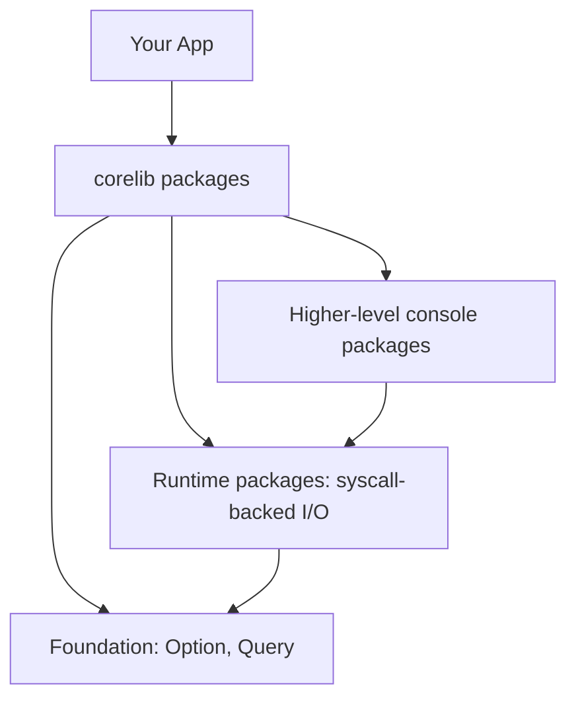

Application code is yours. **Corelib** is the shared floor: collections, contracts, options, the stuff you should not rewrite per repo.

## Identity

Package identity is **`corelib`**. Sources live in the compiler **`corelib`** submodule: a workspace with a `.bws` manifest, the aggregate project `beskid_corelib/corelib.bproj`, library packages under `packages/`, and compiler Mods under `mods/`. `BESKID_CORELIB_ROOT` points the CLI at an explicit Corelib workspace.

Your project gets Corelib as an implicit dependency with the label **`Core`**. The label is not a module path. Corelib modules keep their package roots, so you write `use Core.Output;` or `use Concurrency.Channel;`, never a `Std.` prefix. Your own modules have no prefix at all.

Beskid standard library implementation stays **Beskid source**, not a side Rust crate pretending to be std.

## Tooling materialization

Commands that compile (`check`, `build`, `run`, `test`, `doc`) first make sure the bundled Corelib is installed and current. [`beskid dev corelib`](/book/reference/cli/commands/corelib/) copies the embedded workspace to disk when you want to read or patch it. `BESKID_CORELIB_SOURCE` matters only when you build the compiler itself: it selects the workspace that gets embedded.

## Layout mental model

Corelib splits into **interlinked workspace packages**, not one monolithic `IO.bd` dumping ground:

- Primitive types and contracts in the foundation package under `Core` (including `Option<T>`)
- Runtime syscall-backed I/O under runtime packages; higher console work in dedicated packages (see the [core library](/docs/standard/capabilities/taxonomy--core-library/) domain)

**Text equivalent:** Your application depends on corelib packages: foundation (such as `Option<T>`), higher-level console packages, and runtime packages with syscall-backed I/O. The console packages build on the runtime packages, and the runtime packages build on foundation.

## Docs and `api.json`

Compiler `doc` emission can place `api.json` and markdown under `.beskid/docs/`. Registry and pckg treat structured API JSON as the primary contract. You consume std docs like any package docs, not a separate mythological website.

## Standard reference (informative)

- [Core library domain](/docs/standard/capabilities/taxonomy--core-library/)
- [Types: Option](/docs/standard/capabilities/language-meta--type-system--types/)

## Next chapter

[05. Names nobody agreed on](/book/05-names-nobody-agreed-on/)
