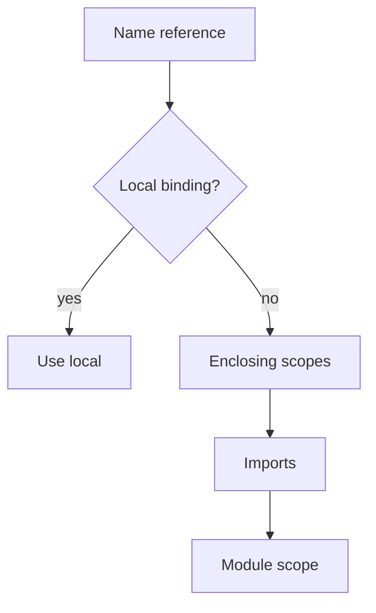

Name resolution is the compiler answering **which declaration did you mean?** When the answer is "more than one," you get an ambiguity error. That is a feature.

## Expression lookup order

1. Local scope (parameters, `let` bindings)
2. Enclosing scopes
3. Imports (including aliases)
4. Module scope



## Ambiguity

If two imports provide the same **unaliased** name, the compiler errors. Fix with `as` aliases; do not rely on import order to "win."

## Imports do not override locals

Assuming `use Foo;` lets you shadow a local `Foo` is a fast path to embarrassment. Locals win.

## Cross-module paths

Fully qualified paths follow module nesting declared by files and `mod` statements. A fully qualified path to a public module of any package in your resolved dependency closure works without a `use`:

```beskid
i32 Main() {
    Core.Output.WriteLine("no import needed");
    return 0;
}
```

Two rules keep this from turning into guesswork:

- **Lexical names win.** A `use` binding, an inline module, a type, an enum, or a contract in scope shadows the absolute module lookup. If you named something `Core`, `Core.Output` means your thing.
- **One module path, one provider.** When two packages in the closure provide the same logical module path, the compiler reports **E1104** and lists every provider in root order (host first). It does not pick one by search order. Rename the module in the package you own. A host file `Console.bd` next to a dependency that also provides `Console` is the classic way to meet this error.

A private item reached through a qualified path is still private: **E1107**.

When lost, `beskid check` with a one-file repro beats staring at folders.

## Standard reference (informative)

- [Name Resolution](/docs/standard/capabilities/language-meta--program-structure--name-resolution/)

## Next

[pub use re-exports](/book/05-names-nobody-agreed-on/pub-use-reexports/)
