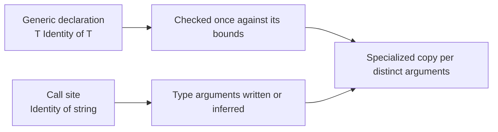

import { Aside } from '@astrojs/starlight/components';

<Aside type="caution">
This chapter is **informative**. Enforceable rules live in the [Beskid Standard](/docs/standard/), especially [Types](/docs/standard/capabilities/language-meta--type-system--types/) and [Type inference](/docs/standard/capabilities/language-meta--type-system--type-inference/).
</Aside>

At some point you write `FirstString`, then `FirstI64`, then `FirstUser`, and then you notice that the function body never changed. That is the moment generics were invented for. A **type parameter** is a placeholder for a type that the caller chooses. The function is written once, and the compiler checks it once, and the caller gets a version that fits.

[Chapter 07](/book/07-compiler-is-not-your-therapist/types-and-generics/) mentioned generics in passing. This chapter is the practical version: how to write them, how to constrain them, how the compiler fills in the blanks, and how to read it when it refuses.

## What you will find here

| Section | Topic |
| --- | --- |
| [Type parameters](/book/07a-generics-write-it-once/type-parameters/) | `T` on functions, types, enums and methods. |
| [Where bounds](/book/07a-generics-write-it-once/where-bounds/) | `where T: Contract`, and why an unbounded `T` can do very little. |
| [Inference at call sites](/book/07a-generics-write-it-once/inference-at-call-sites/) | When you can leave the `<...>` out, and when you cannot. |
| [Generic collections](/book/07a-generics-write-it-once/generic-collections/) | `List<T>`, `Map<TKey, TValue>`, `Set<T>`, `Option<T>`, `Result<T, E>`. |
| [Common errors](/book/07a-generics-write-it-once/common-errors/) | E1203, E1204, E1229, E1250, E1610 and what to change. |

**Text equivalent:** The compiler checks a generic declaration once, against its `where` bounds. Each call supplies type arguments, written by you or inferred from the arguments. The compiler then produces a specialized copy of the declaration for every distinct set of type arguments.

## By the end of this chapter

- Declare generic functions, types and enums, and write the explicit form of a call.
- Constrain a type parameter with `where` and call the methods of its bound.
- Know what inference can solve and what it leaves to you.
- Use the generic collections without reading their source.
- Map E1203, E1204, E1229, E1250 and E1610 to a one-line fix.

## Previous

[07. The compiler is not your therapist](/book/07-compiler-is-not-your-therapist/)

## Start here

[Type parameters](/book/07a-generics-write-it-once/type-parameters/)

## Next chapter

[08. Green tests, red production](/book/08-green-tests-red-production/)
