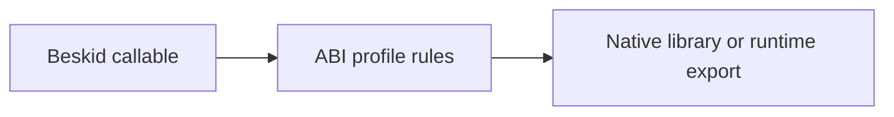

Preview means **read the spec before you ship**. User Beskid is not a daily `unsafe` language; interop is **`[Extern]` contracts**, manifests, and profiles.

## User-facing: FFI and extern

Normative hub: [FFI and extern](/docs/standard/capabilities/language-meta--interop--ffi-and-extern/).

- Declare foreign surfaces with **`[Extern(...)] contract`** patterns aligned to [Interop contracts](/docs/standard/capabilities/language-meta--interop--interop-contracts/).
- Link native libraries through tooling ([Foreign library import](/docs/standard/capabilities/taxonomy--tooling--foreign-library-import/)) and C ABI profiles ([C ABI profile](/docs/standard/capabilities/language-meta--interop--c-abi-profile/)).
- Errors cross boundaries as **envelopes**, not thrown exceptions ([Error and unwind semantics](/docs/standard/capabilities/language-meta--interop--interop-contracts/)).

## Host-facing: the runtime

The runtime is Beskid source under `compiler/runtime/beskid/src/Runtime`. It exports its C entry points with `[Export(Abi:"C", Symbol:"...")]` and is compiled into the ABI-v5 runtime kit; see [Builtins and symbols](/docs/standard/capabilities/execution--abi-and-host--builtins-and-symbols/). That is **platform maintenance**, not a tutorial pattern for app authors.

## Optional libraries

An `[Extern]` contract can be marked `Optional:true`. The program then loads even when the library or one of its symbols is missing, and a `bool Available();` method on the contract tells you whether every symbol resolved. Calling a missing symbol stops the program with the `extern_unavailable` trap instead of jumping to a null address. Windows AOT targets reject optional contracts. Details: [C ABI profile](/docs/standard/capabilities/language-meta--interop--c-abi-profile/).

## Calling Rust

Do not reach for the runtime's Rust ABI profile. Use [Rust Glue](/book/21-ffi-and-forbidden-friendships/rust-glue/), which generates checked C ABI adapters for plain Rust code, or write the C shim yourself.

## Practical rule

If you typed `unsafe` because you were angry at the type checker, stop. If you need native code, write a thin `extern` boundary and test it like an adversary.

## Next chapter

[11. Fibers: cheaper than threads, still scary](/book/11-fibers-cheaper-than-threads/)
