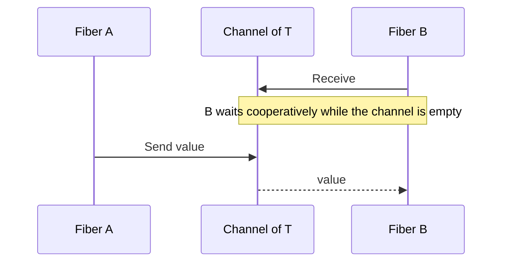

If two fibers need to talk, they use a **channel**. They do not share a mutable stack and hope for the best: that pattern already has a body count in other languages.

## Model

- **`Channel<T>`** carries typed messages between fibers. `Channel.Create<T>()` makes an unbounded channel; `CreateWithOptions` takes `ChannelOptions` (`Bounded(n)`, `SingleReader()`, `SingleWriter()`).
- **`Send`** / **`Receive`** block cooperatively (scheduler-aware) and return `Result` with a `ChannelError`. **`TrySend`** / **`TryReceive`** never block. **`Close`** ends the channel.
- An unbounded channel has no fixed entry limit, and the runtime has no fixed channel count: its tables grow until the system allocator refuses memory.
- The full API is specified in the [Concurrency package](/docs/standard/capabilities/core-library--concurrency--concurrency-package/).

**Text equivalent:** Fiber B calls Receive and waits cooperatively. When Fiber A sends a value, the channel hands it to Fiber B.

## ADR-backed choices

Cross-fiber events use channels, not ad-hoc flags. See [ADR: cross-fiber events use channels](/docs/standard/capabilities/language-meta--evaluation--fibers-and-spawn/).

## Mutex, WaitGroup, and Hub

**Mutex** (`Lock` returns a `MutexGuard`, `Unlock` takes it back) and **WaitGroup** (`Add`, `Done`, `Wait`) coordinate invariants; they are **not** a substitute for channel payload transfer. **`Hub<T>`** multiplexes several channels behind one `WaitReceive`. If you are passing data, use a channel; if you are guarding a critical section, use the primitives the spec names.

## Memory interaction

Shared **heap** objects still follow [Memory and references](/docs/standard/capabilities/language-meta--memory-model--memory-and-references/); channels are how you avoid data races without pretending Beskid is C++.

## Next

[Corelib concurrency](/book/11-fibers-cheaper-than-threads/corelib-concurrency/)
