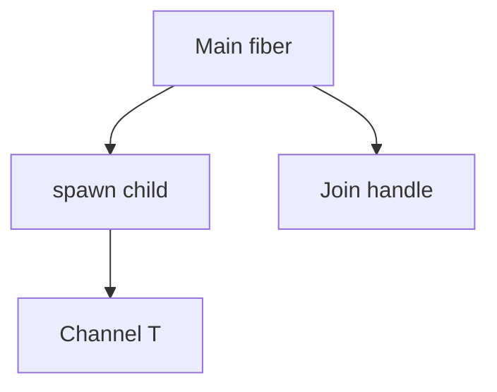

Evaluation in Beskid is **callable-centric**: functions, methods, closures, with control flow and types checked before lowering. Concurrency is **explicit spawn**, not hidden schedulers behind `await`.

## Callables and closures

- Functions and methods are the default unit of work. Functions are also values: a named function or a lambda can be passed, stored, returned, and called. See [Functions and methods](/book/07-compiler-is-not-your-therapist/functions-and-methods/).
- Closures capture by value when they are created. A lambda that is not a `spawn` operand may not capture a `mut` local (**E1233**). Captured managed values are traced by the GC through the closure environment.
- See [Lambdas and closures](/docs/standard/capabilities/language-meta--evaluation--lambdas-and-closures/) for capture rules.

## No `async` / `await`

The language **rejects** reserved `async` / `await` tokens. Structured concurrency uses:

- **`spawn`** → `Fiber<T>`
- **`Join`** for `Result<T, FiberError>`
- **Channels** for cross-fiber payloads
- **WaitGroup**, **Hub** for coordination ([Concurrency package](/docs/standard/capabilities/core-library--concurrency--concurrency-package/))

## Compiler anchors

| Crate | Role |
| --- | --- |
| `beskid_queries` | Spawn typing, capture diagnostics |
| `beskid_codegen` / `beskid_isle` | Spawn lowering, closure records |
| Runtime source (`compiler/runtime/beskid`) | Scheduler, stacks |

## Area hub

[Evaluation](/docs/standard/capabilities/taxonomy--language-meta--evaluation/)

## Next

[Fibers and spawn](/book/11-fibers-cheaper-than-threads/fibers-and-spawn/)
