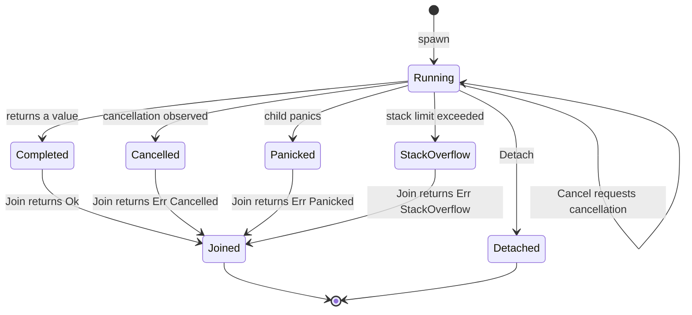

```beskid
Fiber<i32> worker = spawn DoWork(42);
```

`spawn` schedules a **cooperative fiber** with a typed handle, not "fire a thread." The operand can be a call or a lambda:

```beskid
Fiber<unit> server = spawn (() => Serve(listener));
```

Fibers are how Beskid does concurrency. There is no raw OS-thread API: `Thread.Spawn` and `Thread.Join` are gone from Corelib, and `Core.Threading` keeps only `Thread.Yield`, an OS-level yield.

## Types

Every `spawn` expression **must** type-check to **`Fiber<T>`** where `T` is the entry callable's return type (`Concurrency.Fiber` in `corelib_concurrency`). You do not get `T` directly from `spawn`; use **`Join`**.

Normative feature: [Fibers and spawn](/docs/standard/capabilities/language-meta--evaluation--fibers-and-spawn/).

## Handle and cancellation

The handle has three operations:

| Operation | Effect |
| --- | --- |
| `Join()` | Consumes the handle and returns `Result<T, FiberError>` |
| `Detach()` | Consumes the handle and waives the shutdown join |
| `Cancel()` | Requests cancellation; idempotent, leaves the handle usable |

The handle is move-only. `FiberError` tells you how the child ended: `Cancelled(reason, cancelerId)`, `StackOverflow(limitBytes, requestedBytes)`, or `Panicked(code, message)`. How cancellation reaches parked channel and synchronization operations is specified in [Channels and synchronization](/docs/standard/capabilities/execution--runtime--channels-and-synchronization/).



**Text equivalent:** `spawn` starts a running fiber. `Cancel` may be called repeatedly while it runs. The fiber ends as completed, cancelled, panicked or stack overflow, and `Join` consumes the handle with the matching `Result`. `Detach` consumes the handle without joining and waives the shutdown join.

## Semantic rules (cheat sheet)

| Rule | Consequence |
| --- | --- |
| Stack references must not escape `spawn` | **E1225** (`StackReferenceEscapesSpawn`) |
| **Detach** waives shutdown join | Otherwise runtime joins non-detached children when `main` returns |
| Cross-fiber payload | **Channels only**, not mutex-as-mailbox |

## Lowering and limits

The compiler lowers `spawn` to a runtime fiber spawn with the captured environment rooted for the GC. The scheduler itself is Beskid source in `compiler/runtime/beskid/src/Runtime/Fiber`. Its tables grow on demand: there is no fixed fiber count. Each fiber reserves up to 8 MiB of stack by default; `BESKID_FIBER_STACK_MAX` changes that. See [Runtime fibers](/book/17-execution-abi-host-runtime/runtime-fibers/) for the limits, and [Fiber scheduler and stacks](/docs/standard/capabilities/execution--runtime--fiber-scheduler-and-stacks/) for the normative text.

## Next

[Channels preview](/book/11-fibers-cheaper-than-threads/channels-preview/)
