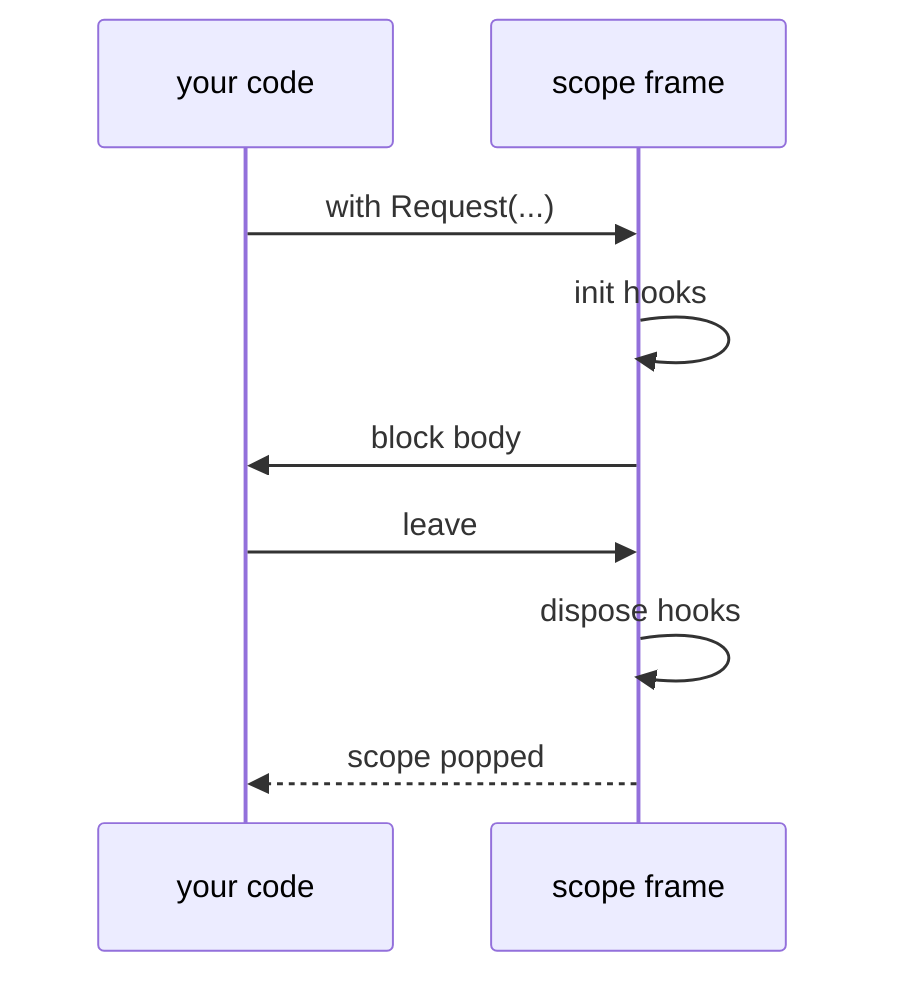

A **hook** is a block of code that the composition runs at a fixed moment. There are three, and each has a place.

| Hook | Declared in | Runs | Reads |
| --- | --- | --- | --- |
| `startup(...)` | The host body | Once per `launch`, after the global container is built | Global registrations |
| `init(...)` | A scope body | Once per activation, before the `with` block | The scope's registrations and the ones above it |
| `dispose(...)` | A scope body | Once per activation, after the `with` block | The same |

A hook is written like a function without a name or a return type: the keyword, a parameter list, and a block.

## Parameters are requests

The parameters of a hook are injected. Each one names a service, and the compiler resolves it exactly as it resolves an `inject` field, with the same rules for arrays and for `global::` and `parent::`:

```text
startup(Configuration configuration, Storage[] storages)
{
    ...
}

scope Request(string id)
{
    init(global::Configuration configuration, Session session)
    {
        session.Open(configuration, id);
    }
}
```

The parameters of the *scope* (`id`) are in scope inside its hooks as ordinary variables, as the host's launch inputs are in `startup`. A hook parameter that cannot be resolved is E1704, at the parameter.

## `startup`

`startup` is where the application begins. It runs once, after the compiler's plan has built the global container and every `single` has its instance. A host without one is valid, as in the `AppHost` that only registers a service. When a host extends a base, the base's `startup` and the extending host's are both part of the chain.

```beskid
use Core.Output;

type Logger
{
    pub unit Info(string message)
    {
        Output.WriteLine(message);
        return;
    }
}

type Greeting
{
    inject Logger logger;

    pub unit Say(string name)
    {
        this.logger.Info("hello, ${name}");
        return;
    }
}

host GreeterHost(string name)
{
    registry
    {
        single Logger;
        single Greeting;
    }

    startup(Greeting greeting)
    {
        greeting.Say(name);
    }
}

i32 Main()
{
    launch GreeterHost("beskid");
    return 0;
}
```

## `init` and `dispose`

`init` prepares the scope's services for the activation: open the session, begin the transaction, load what the request needs. `dispose` is its mirror: commit, close, release. They always pair up. The compiler gives them the same set of scoped instances, so what `init` opened is what `dispose` closes.

The full sequence of a `with` is:



**Text equivalent:** `with` pushes the scope frame and runs `init`. The block body then runs. When the block ends, `dispose` runs, and the scope frame is popped. `dispose` also runs when the block is left by unwinding.

With nested scopes, `dispose` runs from the innermost scope outwards, the reverse of the order in which the scopes were entered. Services within one scope are released in reverse order of creation.

## `dispose` is not `Disposable`

Corelib has a `Disposable` contract (`Core.Disposable`) for resources released by a scoped `use` binding inside one function. `dispose` hooks are different: they belong to a composition scope and release the services that scope owns. The two can be combined: a scoped service may itself hold a `Disposable` resource and release it in its own cleanup.

## What a hook cannot do

- Hooks have no return type. They end when the block ends.
- A hook cannot be called. Only the composition runs it.
- A `startup` hook is not a replacement for `Main`. `launch` runs it and then the program continues with the next statement.

## Next

[Composition errors](/book/11a-hosts-and-native-ioc/composition-errors/)
