import { Aside } from '@astrojs/starlight/components';

<Aside type="caution">
This chapter is **informative**. Enforceable rules live in the [Beskid Standard](/docs/standard/), especially [Native dependency injection](/docs/standard/capabilities/language-meta--composition--dependency-injection/).
</Aside>

Most languages let you wire a program together in whatever order the constructors happen to run, and then ship a framework to repair the consequences. Beskid puts the wiring in the language. A program declares a **host**, which is its composition root. The host lists what exists (a **registry**), what lives for only part of the run (a **scope**), and what happens when things start and stop (**hooks**). One `launch` statement starts the whole arrangement.

The compiler resolves the entire graph **before the program runs**. There is no container library, no reflection and no lookup by name at run time. If a service needs something that nobody provides, you learn it from a diagnostic, not from a crash at 3 a.m.

## The smallest composed program

```beskid
use Core.Output;

type Logger
{
    pub unit Info(string message)
    {
        Output.WriteLine(message);
        return;
    }
}

host AppHost()
{
    registry
    {
        single Logger;
    }

    startup(Logger logger)
    {
        logger.Info("composed and started");
    }
}

i32 Main()
{
    launch AppHost();
    return 0;
}
```

Read it from the bottom. `Main` launches `AppHost`. The host registers one `Logger` as a `single`, which means one instance for the whole run. The `startup` hook asks for a `Logger` and receives that instance. Nobody wrote a constructor call for `Logger`, and nobody can forget to.

## What you will find here

| Section | Topic |
| --- | --- |
| [Host and launch](/book/11a-hosts-and-native-ioc/host-and-launch/) | `host`, parameters, inheritance, and the one-launch rule. |
| [Registry and lifetimes](/book/11a-hosts-and-native-ioc/registry-and-lifetimes/) | `single`, `transient`, `for Contract`, overrides. |
| [Inject fields](/book/11a-hosts-and-native-ioc/inject-fields/) | `inject`, plural `T[]`, and where the search for a service starts. |
| [Scopes and with](/book/11a-hosts-and-native-ioc/scopes-and-with/) | Named scopes, `with`, nesting, and the scope stack. |
| [Hooks](/book/11a-hosts-and-native-ioc/hooks/) | `startup`, `init`, `dispose`, and their order. |
| [Composition errors](/book/11a-hosts-and-native-ioc/composition-errors/) | E1701 to E1721, read as advice. |

## How a program is composed and run

```mermaid
flowchart LR
  accTitle: From host declaration to a running program
  accDescr: The compiler parses the host, resolves the composition graph in the composition.resolve phase after the semantic snapshot, and freezes a binding plan. At run time launch builds the global container from that plan, runs startup, and then the program continues. Each with statement enters a scope, runs init, runs its body, runs dispose and leaves the scope.
  src[Host, registry, scope source] --> sem[Semantic snapshot]
  sem --> comp["composition.resolve"]
  comp --> plan[Frozen binding plan]
  plan --> lower[Codegen]
  lower --> launch["launch: build global container"]
  launch --> startup[startup hook]
  startup --> run[Program continues]
  run --> with["with: init, body, dispose"]
```



**Text equivalent:** The compiler resolves hosts, registries and scopes in the `composition.resolve` phase, after the semantic snapshot, and freezes the result as a binding plan. Code generation turns the plan into calls. At run time `launch` builds the global container and runs `startup`. Each `with` statement enters a scope, runs `init`, runs its body, runs `dispose` and leaves the scope.

Because the plan is frozen at compile time, the JIT and the AOT build execute the same plan. The compiler side of this is in [From source to something that runs](/book/14-from-source-to-runs/pipeline-overview/). The runtime side, including the container and the scope stack, is in [Execution: ABI, host, and runtime](/book/17-execution-abi-host-runtime/abi-and-host/). This chapter stays on the surface you write.

## Words that sound alike

Two other things in the Book use the word "host", and neither is this one.

| Word | Where | Meaning |
| --- | --- | --- |
| `host` declaration | This chapter | A composition root in your program |
| Mod host | [Mods](/book/15-mods-plugins-with-consequences/what-is-a-mod/) | The compiler component that loads Mods |
| ABI host | [Execution](/book/17-execution-abi-host-runtime/abi-and-host/) | The process that runs compiled code |

A `Mod` project must not declare a `host` at all (E1710). Mods register through their own contract.

## By the end of this chapter

- Write a host with a registry and launch it from `Main`.
- Choose `single` or `transient` and understand what a scope changes.
- Inject a dependency into a field, and a list of them with `T[]`.
- Activate a scope with `with` and predict the order of `init` and `dispose`.
- Read the E17xx diagnostics as instructions.

## Previous chapter

[11. Fibers: cheaper than threads, still scary](/book/11-fibers-cheaper-than-threads/)

## Start here

[Host and launch](/book/11a-hosts-and-native-ioc/host-and-launch/)

## Next chapter

[12. The normative bible (and why we bothered)](/book/12-the-normative-bible/)
