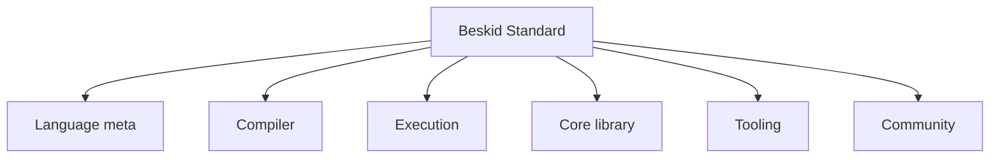

Open the [Beskid Standard](/docs/standard/). That is the normative front door: no version prefix in the URL, Git as the axis ([Release policy](/docs/standard/capabilities/community--spec-maintenance--release-and-versioning-policy/)).

The normative text itself lives in OpenSpec, under `openspec/specs/<capability>/spec.md` in the repository, indexed by `openspec/catalog.json`. The website does not copy that text. Each capability has a catalog page at `/docs/standard/capabilities/<capability>/` and each requirement has a stable identifier page under `/docs/standard/requirements/`. Those pages tell you what the record is and link to the canonical source.

## Top-level shape

**Text equivalent:** The Standard home leads to six domains: language meta, compiler, execution, core library, tooling and community.

Capability names follow the same split: `language-meta--evaluation--fibers-and-spawn` is the fibers feature in the evaluation area of the language-meta domain. Use the domain to pick the owner of a question, not to infer a rule from a title.

## Old links

The former Platform Spec site is retired. A known `/platform-spec/...` address redirects to the capability page that now owns it, and an unknown one opens the Standard's not-found search. Do not write new `/platform-spec/` links.

## Book vs Standard

| Need | Go to |
| --- | --- |
| Tutorial voice, workflows | `/book/` |
| Enforceable contracts | `/docs/standard/` |
| CLI flag lists | `/book/reference/cli/` |

A requirement that is still proposed lives in an OpenSpec change under `openspec/changes/`, not in `openspec/specs`. Treat it as a design signal rather than a stable guarantee. The [specification authority guidance](/docs/standard/capabilities/community--spec-maintenance--spec-authority-and-decisions/) explains how authority and maturity are presented.

## Next

[Language meta map](/book/13-reading-the-law/language-meta-map/)
