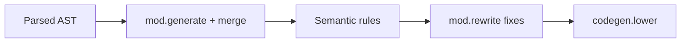

Parsing proves you speak Beskid syntax. **Semantic analysis** proves you meant something allowed.

## Rules pipeline

Hub: [Rules pipeline contract](/docs/standard/capabilities/compiler--semantic-pipeline--rules-pipeline-contract/).

- Typing and legality are decided by one authority: the query gate in `beskid_queries`. `beskid check`, `beskid build`, and the language server all use it. In 0.6 the old second type checker in `beskid_analysis` is gone, so a program that passes `check` is never rejected by a different type system during `build`; if lowering fails after that, it is a compiler gap, not your mistake.
- Structural rules still run as staged rules in `beskid_analysis::analysis::rules::staged`.
- Diagnostic codes in [Diagnostic code registry](/docs/standard/capabilities/compiler--semantic-pipeline--diagnostic-code-registry/)
- Language-meta bands (e.g. **E16xx** contracts) referenced, not duplicated

## Mod phases (semantic-adjacent)

After optional **generate/merge/reparse**, mods run **analyze** and **rewrite** on the merged program:

- [Mod host bridge](/docs/standard/capabilities/compiler--compiler-mods--mod-host-bridge/)
- [Analysis, query, and diagnostics facades](/docs/standard/capabilities/compiler--compiler-mods--analysis-query-diagnostics-facade/)

**Text equivalent:** Parse the source, merge generated Mod output, apply semantic rules, apply approved rewrites, and then start code generation.

## `beskid check`

Runs analysis and manifest validation without linking: your CI friend for "no, you cannot call that." It judges every source unit of your own project, not just the ones `Main` reaches, and a standalone `.bd` file outside any project gets the same query gate.

Book reference: [Semantic analysis](/book/reference/analysis/semantic-analysis/), [Semantic rules](/book/reference/analysis/semantic-rules/).

## Next

[Codegen and IR](/book/14-from-source-to-runs/codegen-and-ir/)
