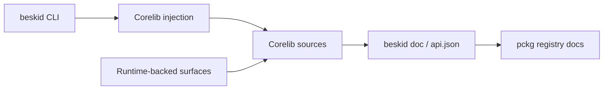

import { Aside } from '@astrojs/starlight/components';

<Aside type="caution">
This chapter is **informative**. Enforceable rules live in the [Beskid Standard](/docs/standard/).
</Aside>

The **corelib** package is not "stdlib.zip you found on a forum." The compiler **injects** it, the runtime backs part of it, and **pckg** serves the rest as normal, immutable package artifacts. Each `.bpk` carries its exact semver and registry dependency pins, while source `.bproj` files can keep workspace-local paths for development.

If you expected a monolithic `System.IO` graveyard, adjust expectations now.

## What you will find here

| Section | Topic |
| --- | --- |
| [corelib command](/book/16-corelib-batteries-with-opinions/corelib-command/) | Materialize the embedded Corelib workspace with `beskid dev corelib`. |
| [Injection and resolution](/book/16-corelib-batteries-with-opinions/injection-and-resolution/) | How every project gets the same canonical package. |
| [Terminal and console](/book/16-corelib-batteries-with-opinions/terminal-and-console/) | ANSI, streams, and why console is not syscall soup. |
| [Doc and api.json](/book/16-corelib-batteries-with-opinions/doc-and-api-json/) | `beskid doc`, structured API, and pckg docs UI. |
| [Runtime-backed surfaces](/book/16-corelib-batteries-with-opinions/runtime-backed-surfaces/) | What must call through the runtime vs pure Beskid. |

The Corelib workspace in `compiler/corelib` holds the aggregate `corelib` package, the library packages under `packages/`, and two compiler Mods under `mods/`. The aggregate depends on the library packages, so a project that gets the implicit `Core` dependency can import any of them.

| Package | What it holds |
| --- | --- |
| `corelib_foundation` | Collections, results, strings, threading yield, and testing helpers |
| `corelib_runtime` | Runtime ABI surfaces: process init and host linkage helpers |
| `corelib_concurrency` | `Fiber<T>`, `Channel<T>`, `Hub<T>`, `Mutex`, `WaitGroup` |
| `corelib_console` | Terminal and ANSI helpers built on runtime I/O |
| `corelib_interop` | C ABI view types: `CStringView`, `CBuffer`, `CArrayView` |
| `corelib_network` | DNS, TCP, and UDP resources |
| `corelib_connect` | TCP connection establishment with Happy Eyeballs |
| `corelib_uri` | URI parsing, formatting, normalization, and resolution |
| `corelib_codec`, `corelib_crypto`, `corelib_x509` | Byte primitives, cryptography, and certificate validation |
| `corelib_tls` | TLS 1.3 client and server |
| `corelib_http`, `corelib_http2`, `corelib_http3`, `corelib_quic` | HTTP/1.1, HTTP/2, QUIC, and HTTP/3 |
| `corelib_websocket` | WebSocket client and server |
| `corelib_web` | HTTP client and server facade over the protocol packages |
| `corelib_serialization` | Format-independent values, policies, and typed serialization metadata |
| `corelib_bsol` | Native BSOL syntax, schema validation, and typed read and write |
| `corelib_glue` | Provisional stdio bridge types; the 0.6 Rust Glue path does not use them |
| `corelib_compiler_sdk` | The Mod SDK: `Beskid.Compiler.*` and `Beskid.Syntax` |
| `serialization_mod` | The Serialization Mod that generates adapters for `[Serialize]` types |
| `corelib_pest_gen` | A Mod that generates Pest grammar parsers |

## Serialization in one paragraph

Serialization is split into three layers. The **Serialization Mod** finds types marked `[Serialize]` (fields can carry `[SerializeField]`) and generates typed adapters for them at compile time. The **Serialization library** (`Core.Serialization`) holds the format-independent data model, metadata, and limits. A **format package** such as `Core.Bsol` reads and writes one format through those adapters. The Mod runs only for programs that reach `Core.Serialization`; see [what activates a Mod](/book/15-mods-plugins-with-consequences/what-is-a-mod/). The normative contract is [Serialization](/docs/standard/capabilities/language-meta--metaprogramming--serialization/).

## Next

[17. Execution: ABI, host, and runtime](/book/17-execution-abi-host-runtime/)
