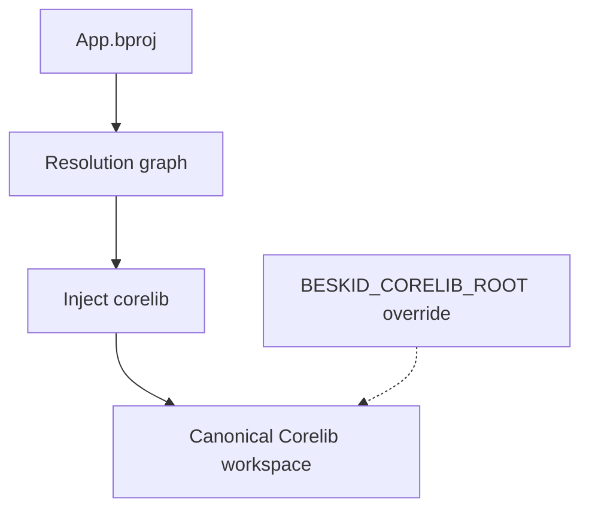

You do not "add corelib like any other dependency" in the happy path. The analysis resolver **injects** the canonical package so beginners do not ship programs that forgot the standard library and veterans do not fork reality with a random `corelib` path on a USB stick.

## Mental model

1. Resolver builds the project graph from the `.bproj` manifest (and workspace members if applicable).
2. Corelib is located via discovery rules: the Corelib bundled with the installed toolchain, or the workspace that `BESKID_CORELIB_ROOT` names.
3. The implicit dependency has the label **`Core`**. That label is reserved for the Corelib aggregate. An explicit `dependency "Core"` must use `source = path`; without a `path` it selects the installed Corelib.
4. The same package identity **`corelib`** is what CI publishes to **pckg** and what the CLI embeds for offline work.

The dependency label is not a module path. Corelib modules keep their own package roots (`Core.*`, `Testing.*`, `Concurrency.*`, `Beskid.Compiler.*`), and your own modules have no prefix. There is no `Std` namespace: `use Std.Core.Output;` does not resolve, `use Core.Output;` does.

## When overrides matter

Two variables, two jobs. `BESKID_CORELIB_ROOT` points the CLI at an explicit Corelib workspace when it runs. `BESKID_CORELIB_SOURCE` is read when the compiler itself is built: it selects the workspace that gets embedded into the CLI. Local compiler work sets the second to the submodule checkout so you are not editing the embedded snapshot like a cave person. Production consumers should rely on the installed toolchain or registry versions, not your laptop path.

## Spec

- [Corelib injection and resolution](/docs/standard/capabilities/core-library--compiler-integration--corelib-injection-and-resolution/)
- [Resolution and projects](/docs/standard/capabilities/taxonomy--compiler--resolution-and-projects/)
